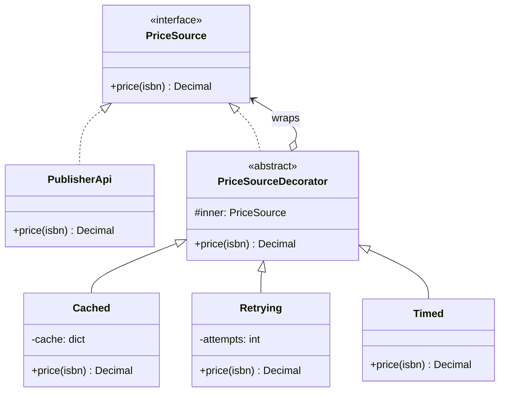
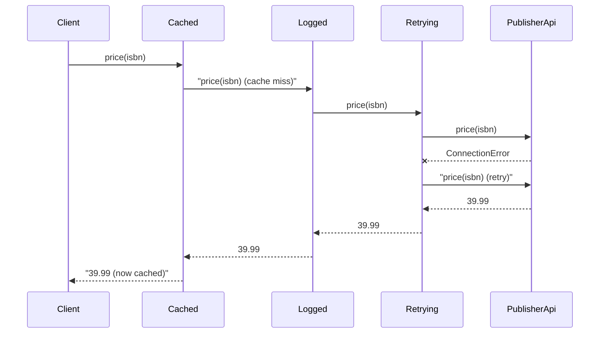

# Decorator Pattern

## Introduction

Order a coffee and the barista starts with an espresso. Add milk and it is a latte. Add a vanilla shot, then an extra shot. Each addition wraps the drink, adds its own cost, and the result is *still a coffee* you can hand to the customer. Nobody needs a menu entry called `VanillaDoubleShotLatteWithOatMilk`.

The **Decorator pattern** attaches extra responsibilities to an object **dynamically**, by wrapping it in another object that has **the same interface**. The wrapper does a bit of work before or after forwarding the call to the object inside. Because the wrapper looks exactly like the original, wrappers can be stacked in any order and any number.

Decorator is how you add cross-cutting behavior such as caching, retries, logging, metrics, compression, encryption and access checks, without touching the core class and without a subclass for every combination.

In this page you will:

- see why "add it to the class" and "add a subclass" both break down
- build stackable object decorators in Python
- learn why the **order** of decorators matters
- connect the GoF pattern to Python's `@decorator` syntax, including `functools.lru_cache` and `functools.wraps`
- see Java's I/O streams, the most famous decorator stack in any standard library
- learn when *not* to decorate, and how Decorator differs from Proxy, Adapter and Composite

## The Problem: Cross-Cutting Code Piles Up

The bookstore shows live prices for books it gets from a publisher's pricing API. The API is slow and sometimes fails. Over a few months, the price client grew like this:

```python
# "Before": one class doing four jobs
import time
from decimal import Decimal


class PublisherPriceClient:
    def __init__(self, use_cache: bool = True, retries: int = 3, log: bool = True) -> None:
        self.use_cache, self.retries, self.log = use_cache, retries, log
        self._cache: dict[str, Decimal] = {}

    def price(self, isbn: str) -> Decimal:
        if self.use_cache and isbn in self._cache:
            return self._cache[isbn]
        for attempt in range(1, self.retries + 1):
            started = time.perf_counter()
            try:
                result = self._call_api(isbn)
                break
            except ConnectionError:
                if attempt == self.retries:
                    raise
        if self.log:
            print(f"price({isbn}) took {time.perf_counter() - started:.3f}s")
        if self.use_cache:
            self._cache[isbn] = result
        return result

    def _call_api(self, isbn: str) -> Decimal:
        return Decimal("39.99")      # pretend HTTP call
```

Problems:

- The class has four reasons to change: the API, caching policy, retry policy and logging. That breaks the [Single Responsibility Principle](../1-arch-design-principles/1-arch-single-responsibility.mdx).
- Flags multiply. Want metrics? Add a flag. Want caching only in production? Add config.
- You cannot reuse the retry logic for the *inventory* client without copying it.
- Subclassing does not help: `CachedPriceClient`, `RetryingPriceClient`, `CachedRetryingPriceClient`... is the same combinatorial explosion that [Bridge](./1-arch-bridge.mdx) fights, in a different form.

## The Pattern

Separate each responsibility into its own wrapper. Every wrapper implements the same interface as the thing it wraps.



The key line is the last arrow: a decorator **is a** `PriceSource` and **has a** `PriceSource`. That is what lets you stack them.

### Step 1: The interface and the real component

```python
import time
from decimal import Decimal
from typing import Protocol


class PriceSource(Protocol):
    def price(self, isbn: str) -> Decimal: ...


class PublisherApi:
    """The concrete component: talks to the (fake) remote API."""

    def __init__(self, fail_first: int = 0) -> None:
        self.calls = 0
        self._fail_first = fail_first

    def price(self, isbn: str) -> Decimal:
        self.calls += 1
        if self.calls <= self._fail_first:
            raise ConnectionError("publisher API timeout")
        return Decimal("39.99")
```

### Step 2: One decorator per concern

```python
class Cached:
    def __init__(self, inner: PriceSource) -> None:
        self._inner = inner
        self._cache: dict[str, Decimal] = {}

    def price(self, isbn: str) -> Decimal:
        if isbn not in self._cache:
            self._cache[isbn] = self._inner.price(isbn)
        return self._cache[isbn]


class Retrying:
    def __init__(self, inner: PriceSource, attempts: int = 3) -> None:
        self._inner, self._attempts = inner, attempts

    def price(self, isbn: str) -> Decimal:
        for attempt in range(1, self._attempts + 1):
            try:
                return self._inner.price(isbn)
            except ConnectionError as exc:
                print(f"  retry {attempt}/{self._attempts}: {exc}")
                if attempt == self._attempts:
                    raise
        raise AssertionError("unreachable")


class Logged:
    def __init__(self, inner: PriceSource, label: str) -> None:
        self._inner, self._label = inner, label

    def price(self, isbn: str) -> Decimal:
        started = time.perf_counter()
        result = self._inner.price(isbn)
        print(f"  [{self._label}] price({isbn}) = {result} in {time.perf_counter() - started:.1f}s")
        return result
```

Each class is short, has one job, and can be tested alone. None of them knows about publishers; `Retrying` would work just as well around an inventory client with the same shape.

### Step 3: Stack them

```python
api = PublisherApi(fail_first=1)
prices: PriceSource = Cached(Logged(Retrying(api), label="publisher"))

print("first call:")
print(prices.price("978-1492056355"))
print("second call:")
print(prices.price("978-1492056355"))
print("API calls made:", api.calls)
```

Output:

```text
first call:
  retry 1/3: publisher API timeout
  [publisher] price(978-1492056355) = 39.99 in 0.0s
39.99
second call:
39.99
API calls made: 2
```

The second call never reached the API: `Cached` answered it. The client code just holds a `PriceSource` and has no idea how many layers there are.



## Order Matters

Decorators are not commutative. The same three layers in a different order behave differently:

| Stack (outside to inside) | Effect |
| --- | --- |
| `Cached(Logged(Retrying(api)))` | Cache hits are not logged; each log line is one real lookup, and its time includes any retries |
| `Logged(Cached(Retrying(api)))` | Every call is logged, including cache hits; good for measuring user-facing latency |
| `Cached(Retrying(Logged(api)))` | Every individual attempt is logged, including the failed ones; useful when debugging the partner API |
| `Retrying(Cached(api))` | Safe only if the cache never stores failures; otherwise a retry can never succeed |

A good habit: write the stack in one place (a factory or the composition root), from outermost to innermost, with a comment saying why the order is what it is.

## Python's `@decorator` Syntax and the GoF Pattern

Python has a language feature called *decorators*: `@something` above a function or class. The two ideas are related but not identical:

- A **GoF decorator** wraps an *object* and keeps its *interface*.
- A **Python decorator** is any callable that takes a function (or class) and returns a replacement. It often wraps the function in a new function with the same signature, which is the GoF idea applied to functions. It can also do unrelated things, such as registering a route.

The standard library ships useful function decorators. `functools.lru_cache` is the classic one: it wraps a function in a memoizing wrapper with the same call signature.

```python
from functools import lru_cache


@lru_cache(maxsize=1024)
def shipping_quote(country: str, grams: int) -> float:
    print(f"  computing quote for {country}, {grams} g")
    return round(4.0 + grams / 1000 * (2.5 if country == "US" else 6.0), 2)


print(shipping_quote("US", 1200))
print(shipping_quote("US", 1200))
print(shipping_quote.cache_info())
```

Output:

```text
  computing quote for US, 1200 g
7.0
7.0
CacheInfo(hits=1, misses=1, maxsize=1024, currsize=1)
```

When you write your own function decorator, use `functools.wraps` so the wrapper keeps the original's name, docstring and signature metadata. Without it, debuggers, logs and documentation tools see the wrapper's name instead.

```python
import functools
from collections.abc import Callable
from typing import ParamSpec, TypeVar

P = ParamSpec("P")
R = TypeVar("R")


def retry(attempts: int = 3) -> Callable[[Callable[P, R]], Callable[P, R]]:
    def decorate(fn: Callable[P, R]) -> Callable[P, R]:
        @functools.wraps(fn)
        def wrapper(*args: P.args, **kwargs: P.kwargs) -> R:
            for attempt in range(1, attempts + 1):
                try:
                    return fn(*args, **kwargs)
                except ConnectionError:
                    if attempt == attempts:
                        raise
            raise AssertionError("unreachable")
        return wrapper
    return decorate


failures = iter([True, False])


@retry(attempts=3)
def stock_level(isbn: str) -> int:
    """Ask the warehouse how many copies are left."""
    if next(failures, False):
        raise ConnectionError("warehouse busy")
    return 12


print(stock_level("978-0321125217"), stock_level.__name__, "-", stock_level.__doc__)
```

Output:

```text
12 stock_level - Ask the warehouse how many copies are left.
```

:::caution `lru_cache` on methods
Putting `@lru_cache` on an instance method caches on `self` too, which keeps every instance alive for as long as the cache holds it, and shares one cache across all instances. For per-instance caching use `functools.cached_property` (for computed attributes) or an object decorator such as `Cached` above. Also note that `lru_cache` never expires entries by time, so it is a poor fit for prices that change; see [Caching Strategies](../11-arch-data-architecture/2-arch-caching-strategies.mdx).
:::

### Java's I/O streams: decorators all the way down

Java's `java.io` package is the textbook example. `InputStream`, `OutputStream`, `Reader` and `Writer` subclasses take another stream of the same type in their constructor and add one capability each: buffering, compression, data types, line reading. Here a `GZIPOutputStream` decorates a byte stream, and on the way back a `BufferedReader` decorates an `InputStreamReader` (an adapter from bytes to characters) that decorates a `GZIPInputStream`:

```java
import java.io.*;
import java.nio.charset.StandardCharsets;
import java.util.zip.GZIPInputStream;
import java.util.zip.GZIPOutputStream;

public class Main {
    public static void main(String[] args) throws IOException {
        ByteArrayOutputStream raw = new ByteArrayOutputStream();
        try (Writer out = new OutputStreamWriter(new GZIPOutputStream(raw), StandardCharsets.UTF_8)) {
            out.write("978-1492056355,Fluent Python\n978-0321125217,Domain-Driven Design\n");
        }
        System.out.println("compressed bytes: " + (raw.size() > 0));

        try (BufferedReader in = new BufferedReader(
                new InputStreamReader(
                    new GZIPInputStream(new ByteArrayInputStream(raw.toByteArray())),
                    StandardCharsets.UTF_8))) {
            in.lines().forEach(line -> System.out.println("read: " + line));
        }
    }
}
```

Output:

```text
compressed bytes: true
read: 978-1492056355,Fluent Python
read: 978-0321125217,Domain-Driven Design
```

Java is a good second language here because each layer's type is visible in the code, which makes the wrapping explicit.

## Where You Have Already Met Decorator

| Where | What the decorator adds |
| --- | --- |
| `java.io` streams, readers and writers | Buffering, compression, data conversion |
| Java `Collections.unmodifiableList`, `synchronizedList`, `checkedList` | Read-only access, locking, runtime type checks, all behind the `List` interface |
| Servlet `HttpServletRequestWrapper` | Changing headers or parameters for downstream code |
| Python `functools.lru_cache`, `functools.cache` | Memoization around a function |
| Python `io.BufferedReader`, `io.TextIOWrapper` | Buffering and text decoding around a raw binary stream |
| Python `logging.LoggerAdapter` | Adds contextual fields while keeping the logger interface |
| ASGI and WSGI middleware | Each middleware wraps the next app with the same call interface |

## Real-World Scenario

**Situation.** Your bookstore calls four partner APIs: two publishers, a shipping carrier and a fraud checker. Each needs a different mix of behaviors. The fraud checker must never be cached and must time out quickly; publisher prices can be cached for five minutes; everything needs logging; one publisher enforces a rate limit. Today each client class has its own hand-rolled copy of retries and logging, and they have drifted apart.

**Solution.** Give every partner client the same small interface (`get(path) -> dict`), write each cross-cutting concern once as a decorator, and build each partner's stack from configuration:

```python
from collections.abc import Callable
from typing import Protocol


class PartnerClient(Protocol):
    def get(self, path: str) -> dict: ...


class FakeHttp:
    def __init__(self, name: str) -> None:
        self.name = name

    def get(self, path: str) -> dict:
        return {"partner": self.name, "path": path}


class LogCalls:
    def __init__(self, inner: PartnerClient, name: str) -> None:
        self._inner, self._name = inner, name

    def get(self, path: str) -> dict:
        print(f"  -> {self._name} GET {path}")
        return self._inner.get(path)


class TtlCache:
    def __init__(self, inner: PartnerClient, ttl_s: float, clock: Callable[[], float]) -> None:
        self._inner, self._ttl, self._clock = inner, ttl_s, clock
        self._store: dict[str, tuple[float, dict]] = {}

    def get(self, path: str) -> dict:
        now = self._clock()
        hit = self._store.get(path)
        if hit and now - hit[0] < self._ttl:
            return hit[1]
        value = self._inner.get(path)
        self._store[path] = (now, value)
        return value


DECORATORS = {
    "log": lambda inner, cfg, name: LogCalls(inner, name),
    "cache": lambda inner, cfg, name: TtlCache(inner, cfg["ttl_s"], cfg["clock"]),
}


def build(name: str, layers: list[str], cfg: dict) -> PartnerClient:
    client: PartnerClient = FakeHttp(name)
    for layer in layers:                      # innermost first
        client = DECORATORS[layer](client, cfg, name)
    return client


fake_time = [0.0]
cfg = {"ttl_s": 300, "clock": lambda: fake_time[0]}
publisher = build("publisher-a", ["log", "cache"], cfg)   # cache outside log: hits are silent
fraud = build("fraud-check", ["log"], cfg)                 # never cached

publisher.get("/prices/978-1492056355")
publisher.get("/prices/978-1492056355")
fake_time[0] = 301
publisher.get("/prices/978-1492056355")
fraud.get("/score/order-77")
fraud.get("/score/order-77")
```

Output:

```text
  -> publisher-a GET /prices/978-1492056355
  -> publisher-a GET /prices/978-1492056355
  -> fraud-check GET /score/order-77
  -> fraud-check GET /score/order-77
```

The second publisher call was a cache hit (no log line); the third came after the five-minute TTL expired. The fraud checker hit the network every time, as required. Adding a rate limiter or circuit breaker later means one new decorator and one new entry in `DECORATORS`. (Production systems often use a library for these, such as `tenacity` for retries, or move them into infrastructure; see [Circuit Breaker, Retry and Timeout](../9-arch-distributed-systems/8-arch-circuit-breaker.mdx) and [Service Mesh and Sidecars](../10-arch-integration-and-apis/8-arch-service-mesh.mdx).)

**Why this approach.** The behaviors are orthogonal and needed in different combinations per partner. Decorators let you write each one once and compose them per client, with no flags inside the core HTTP code.

**When to use it.**

- You need to add behavior to individual objects, in varying combinations, without changing their class.
- The behavior is cross-cutting: caching, retries, logging, metrics, authorization, compression, encryption.
- Subclassing would multiply classes or is impossible (the class is `final` or third-party).

**When not to use it.**

- Only one fixed combination is ever used. Putting the extra line in the class, or one small wrapper function, is simpler.
- The interface is large. A decorator must forward *every* method, which means boilerplate and bugs when the interface grows (Python's `__getattr__` forwarding helps, but hides what is decorated).
- The behavior needs the wrapped object's internals. A decorator only sees the public interface.
- Code relies on object identity or concrete type (`isinstance(x, PublisherApi)`): a decorated object fails those checks.
- Deep stacks make stack traces and debugging harder. If you need ten layers, consider a pipeline or middleware chain instead.

**Alternatives and trade-offs.**

| Approach | Pros | Cons | Best for |
| --- | --- | --- | --- |
| Object decorators | Composable at runtime, one class per concern | Forwarding boilerplate, order mistakes | Cross-cutting behavior on narrow interfaces |
| Function decorators (`@retry`) | Concise, idiomatic Python | Fixed at definition time; per-function, not per-instance | Library-level concerns on functions |
| Subclassing | Simple for one variation | Combinatorial explosion, fixed at compile time | One stable extension |
| Middleware / [Chain of Responsibility](../4-arch-behavioral-patterns/5-arch-chain-of-responsibility.mdx) | Ordered list of handlers, can short-circuit | Framework-specific | HTTP request pipelines |
| Aspect-oriented programming (Spring AOP) | No wrapper code in your classes | "Magic", proxies with surprising rules | Large Java codebases already using Spring |
| Sidecar or service mesh | Out of process, language-agnostic | Operational complexity | Retries, mTLS and metrics across many services |

## Common Mistakes

- **Changing the interface.** A decorator that adds or removes methods is no longer transparent; you have built an [Adapter](./0-arch-adapter.mdx) or a [Facade](./4-arch-facade.mdx) by accident.
- **Forgetting to forward something.** Close methods, context-manager methods (`__enter__`, `__exit__`) and properties are easy to miss.
- **Wrong order.** Draw the stack. Logging outside the cache measures something different from logging inside it.
- **Hidden state in decorators.** A caching decorator shared by two users can leak data between them. Include the user or tenant in the cache key when results differ per user.
- **Forgetting `functools.wraps`.** Your logs and tracebacks will all say `wrapper`.
- **Decorating everything "just in case".** Each layer adds indirection. Add one when there is a concrete need.

## Decorator vs Similar Patterns

| Pattern | Interface | Intent | Who creates the wrapper |
| --- | --- | --- | --- |
| **Decorator** | Same | Add behavior; stackable | The client or composition root, often in layers |
| [Proxy](./6-arch-proxy.mdx) | Same | Control access (lazy, remote, protected) | Usually the framework or a factory, hidden from the client |
| [Adapter](./0-arch-adapter.mdx) | Different | Make incompatible interfaces fit | Integration code |
| [Composite](./2-arch-composite.mdx) | Same | Treat groups like single items | Code that builds the tree |
| [Chain of Responsibility](../4-arch-behavioral-patterns/5-arch-chain-of-responsibility.mdx) | Handler interface | Pass a request along until handled | Pipeline configuration |
| [Strategy](../4-arch-behavioral-patterns/0-arch-strategy.mdx) | Swaps the *inside* | Change the core algorithm | The context's owner |

Decorator and Proxy look almost identical in code. The difference is intent: a decorator *adds* features and is usually composed by the client; a proxy *controls access* to the same features and usually decides the real object's lifecycle itself. The GoF book describes the difference from Strategy as changing an object's "skin" (Decorator) versus changing its "guts" (Strategy).

## Summary

- Decorator wraps an object in another object with the same interface to add behavior before or after the forwarded call.
- Each decorator handles one concern; stacking them composes behavior without subclass explosions.
- Order matters. Build the stack in one place and document it.
- Python's `@` decorators apply the same idea to functions; use `functools.wraps`, and know `lru_cache`'s limits.
- Java's I/O streams, `Collections.unmodifiableList` and WSGI/ASGI middleware are decorators you already use.
- Skip it for fixed single combinations, wide interfaces, or when you need internal access or identity checks.

## Exercises

1. Write a `Metrics` decorator for `PriceSource` that counts calls and failures, and place it so that cache hits are counted but retries are not.
2. Change `Cached` so it does **not** cache exceptions, and write a test showing a failed lookup is retried on the next call.
3. Make `LogCalls` forward every other attribute with `__getattr__`. What do you lose in type checking and readability?
4. In a Java project, find a stack of `java.io` wrappers. Write down each layer and the single responsibility it adds.

**Related pages:** [Proxy Pattern](./6-arch-proxy.mdx), [Adapter Pattern](./0-arch-adapter.mdx), [Composition over Inheritance](../1-arch-design-principles/7-arch-composition-over-inheritance.mdx), [Chain of Responsibility Pattern](../4-arch-behavioral-patterns/5-arch-chain-of-responsibility.mdx), and [Choosing a Structural Pattern](./7-arch-choosing-structural.mdx).
