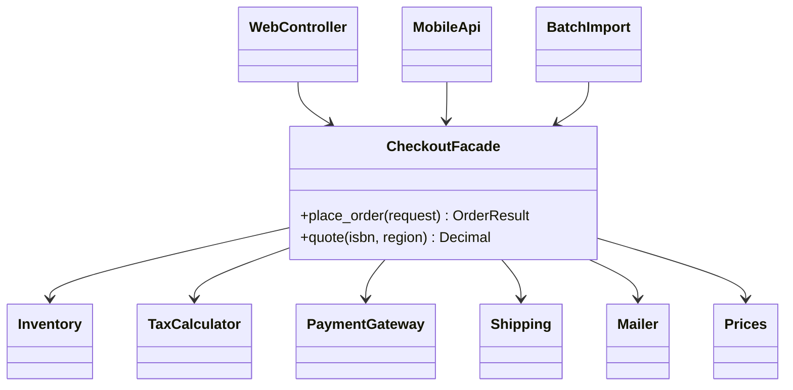
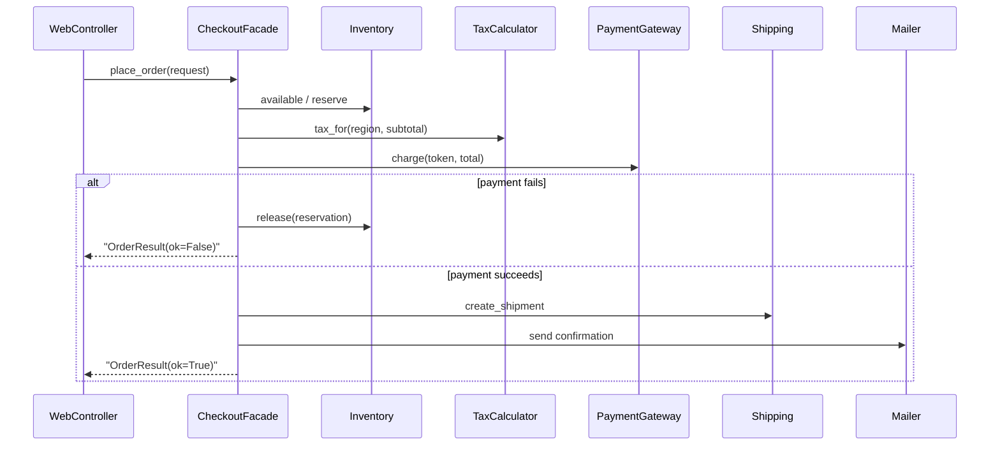
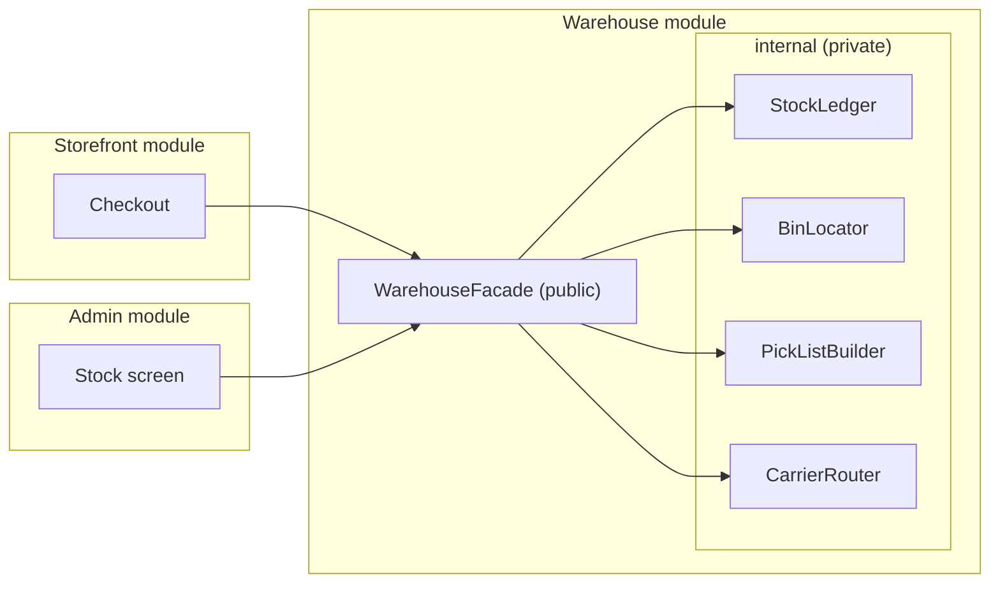

# Facade Pattern

## Introduction

When you check in at a hotel, you talk to one person at the front desk. Behind that desk, the hotel runs a reservation system, a payment terminal, a key-card encoder, housekeeping schedules and a loyalty program. You do not visit each department. The front desk knows which ones to involve and in what order, and gives you a key.

The **Facade pattern** provides **one simplified interface to a complex subsystem**. The subsystem's classes still exist and can still be used directly by those who need fine control, but most callers only need a few common tasks, and the facade makes those easy.

Facade is one of the most practical patterns in everyday code. You write a facade every time you create a function like `send_welcome_email(user)` that hides template rendering, SMTP configuration and retries, or a module whose `__init__.py` exports three functions while twenty classes stay internal.

In this page you will:

- see client code drowning in subsystem details
- build a checkout facade in Python
- learn what a facade should and should not do
- use facades as the public API of a module in a modular monolith
- find facades in Python's standard library and popular libraries
- learn how a facade turns into a "god object", and how Facade differs from Adapter, Mediator and API Gateway

## The Problem: Every Caller Orchestrates Everything

Placing an order in the bookstore involves six subsystems. Here are tiny stand-ins for them:

```python
from dataclasses import dataclass
from decimal import Decimal


class Inventory:
    def __init__(self) -> None:
        self.stock = {"978-1492056355": 3, "978-0321125217": 0}
        self.reserved: dict[str, int] = {}

    def available(self, isbn: str) -> int:
        return self.stock.get(isbn, 0) - self.reserved.get(isbn, 0)

    def reserve(self, isbn: str, qty: int) -> str:
        self.reserved[isbn] = self.reserved.get(isbn, 0) + qty
        return f"res-{isbn[-4:]}"

    def release(self, reservation_id: str) -> None:
        print(f"  inventory: released {reservation_id}")


class TaxCalculator:
    RATES = {"US-NY": Decimal("0.08875"), "DE": Decimal("0.07")}

    def tax_for(self, region: str, amount: Decimal) -> Decimal:
        return (amount * self.RATES.get(region, Decimal("0"))).quantize(Decimal("0.01"))


class PaymentGateway:
    def charge(self, token: str, amount: Decimal) -> str:
        if token == "tok_declined":
            raise RuntimeError("card declined")
        return "pay-001"


class Shipping:
    def create_shipment(self, address: str, isbns: list[str]) -> str:
        return "ship-777"


class Mailer:
    def send(self, to: str, template: str, **data: object) -> None:
        print(f"  mail to {to}: {template} {data}")


@dataclass
class Prices:
    table: dict[str, Decimal]

    def price_of(self, isbn: str) -> Decimal:
        return self.table[isbn]
```

Without a facade, every caller (the web controller, the mobile API, the admin "reorder" button, a batch import job) has to do this dance:

```python
# "Before": the web controller orchestrates six subsystems itself
inventory, tax, payments, shipping, mailer = Inventory(), TaxCalculator(), PaymentGateway(), Shipping(), Mailer()
prices = Prices({"978-1492056355": Decimal("39.99"), "978-0321125217": Decimal("54.99")})


def web_place_order(email: str, region: str, address: str, isbn: str, card: str) -> str:
    if inventory.available(isbn) < 1:
        return "out of stock"
    reservation = inventory.reserve(isbn, 1)
    subtotal = prices.price_of(isbn)
    total = subtotal + tax.tax_for(region, subtotal)
    try:
        payment = payments.charge(card, total)
    except RuntimeError as exc:
        inventory.release(reservation)              # easy to forget in one of the callers
        return f"payment failed: {exc}"
    shipment = shipping.create_shipment(address, [isbn])
    mailer.send(email, "order_confirmed", total=str(total), shipment=shipment)
    return f"ok {payment}"


print(web_place_order("ana@example.com", "US-NY", "1 Main St", "978-1492056355", "tok_visa"))
```

Output:

```text
  mail to ana@example.com: order_confirmed {'total': '43.54', 'shipment': 'ship-777'}
ok pay-001
```

Now imagine four callers with four copies of that sequence. Someone adds a fraud check to the web version and forgets the mobile one. Someone forgets `release` on payment failure in the batch job, and stock leaks. Every caller is [coupled](../0-arch-fundamentals/5-arch-coupling-and-cohesion.mdx) to six classes and their correct ordering.

## The Pattern

Put the common workflow behind one object. Callers talk to the facade; the facade talks to the subsystem.



```python
from dataclasses import dataclass


@dataclass(frozen=True)
class OrderRequest:
    email: str
    region: str
    address: str
    isbn: str
    card_token: str


@dataclass(frozen=True)
class OrderResult:
    ok: bool
    message: str
    total: Decimal = Decimal("0")


class CheckoutFacade:
    """The one supported way to place an order. Subsystems are injected, not created here."""

    def __init__(self, inventory: Inventory, prices: Prices, tax: TaxCalculator,
                 payments: PaymentGateway, shipping: Shipping, mailer: Mailer) -> None:
        self._inventory, self._prices, self._tax = inventory, prices, tax
        self._payments, self._shipping, self._mailer = payments, shipping, mailer

    def quote(self, isbn: str, region: str) -> Decimal:
        subtotal = self._prices.price_of(isbn)
        return subtotal + self._tax.tax_for(region, subtotal)

    def place_order(self, req: OrderRequest) -> OrderResult:
        if self._inventory.available(req.isbn) < 1:
            return OrderResult(False, "out of stock")
        reservation = self._inventory.reserve(req.isbn, 1)
        total = self.quote(req.isbn, req.region)
        try:
            payment = self._payments.charge(req.card_token, total)
        except RuntimeError as exc:
            self._inventory.release(reservation)
            return OrderResult(False, f"payment failed: {exc}", total)
        shipment = self._shipping.create_shipment(req.address, [req.isbn])
        self._mailer.send(req.email, "order_confirmed", total=str(total), shipment=shipment)
        return OrderResult(True, payment, total)
```

Callers shrink to one line each, and the workflow, including the compensation on failure, exists exactly once:

```python
checkout = CheckoutFacade(Inventory(), prices, TaxCalculator(), PaymentGateway(), Shipping(), Mailer())

print(checkout.quote("978-1492056355", "DE"))
print(checkout.place_order(OrderRequest("ana@example.com", "US-NY", "1 Main St", "978-1492056355", "tok_visa")))
print(checkout.place_order(OrderRequest("bo@example.com", "DE", "Hauptstr. 5", "978-1492056355", "tok_declined")))
print(checkout.place_order(OrderRequest("cy@example.com", "DE", "Hauptstr. 9", "978-0321125217", "tok_visa")))
```

Output:

```text
42.79
  mail to ana@example.com: order_confirmed {'total': '43.54', 'shipment': 'ship-777'}
OrderResult(ok=True, message='pay-001', total=Decimal('43.54'))
  inventory: released res-6355
OrderResult(ok=False, message='payment failed: card declined', total=Decimal('42.79'))
OrderResult(ok=False, message='out of stock', total=Decimal('0'))
```

Here is the flow the facade hides:



## What Makes a Good Facade

1. **It covers the common tasks, not every task.** A facade with 60 methods that mirror the subsystem is not simplifying anything.
2. **It does not block the subsystem.** Advanced callers (an admin tool that needs a manual partial refund) can still use the subsystem classes directly. The GoF book is explicit that a facade does not hide the subsystem from clients who need it, unless you choose to enforce that.
3. **It orchestrates; it does not own business rules.** Tax rules live in `TaxCalculator`, stock rules in `Inventory`. The facade only knows the *order of steps* and how to undo them. If pricing logic starts growing inside the facade, push it back down.
4. **It speaks the caller's language.** `place_order(OrderRequest)` instead of six method calls with subsystem-specific types.
5. **It receives its dependencies.** Inject the subsystems so the facade is easy to test with fakes; see [Dependency Injection](../1-arch-design-principles/10-arch-dependency-injection.mdx).

:::note Facade and the Law of Demeter
Facades are a natural way to follow the [Law of Demeter](../1-arch-design-principles/8-arch-law-of-demeter.mdx): callers talk to one nearby object instead of reaching through it into the subsystem.
:::

## Where You Have Already Met Facades

| Where | What it hides |
| --- | --- |
| Python `subprocess.run()` | The lower-level `Popen` object, pipes and waiting; the docs recommend `run()` for all cases it can handle and `Popen` for advanced ones |
| Python `shutil.copytree()`, `shutil.make_archive()` | Many `os` and file operations behind one call |
| Python `requests` | Built on `urllib3`; `requests.get(url)` hides connection pools, encoding and redirects |
| SLF4J (Simple Logging Facade for Java) | A single logging API in front of Logback, Log4j 2 or `java.util.logging` |
| JSF `FacesContext` and `ExternalContext` | Servlet request, response, session and lifecycle classes |
| DDD application services | One method per use case that coordinates domain objects and infrastructure; see [Domain Services and Application Services](../8-arch-domain-driven-design/6-arch-domain-services.mdx) |

The `subprocess` example shows the "does not block the subsystem" property well: `run()` is the facade, and `Popen` stays available.

```python
import subprocess
import sys

result = subprocess.run([sys.executable, "-c", "print('hello from a child process')"],
                        capture_output=True, text=True, check=True)
print(result.returncode, result.stdout.strip())
```

Output:

```text
0 hello from a child process
```

## Facades at Module and System Scale

Facade is not only a class-level pattern. The same idea appears at every scale:

- **Module facade.** In a [modular monolith](../6-arch-architectural-styles/3-arch-modular-monolith.mdx), each module exposes a small public API (often its package `__init__.py` or one `api.py`) and keeps the rest internal. That public API *is* a facade.
- **Service facade.** An [API Gateway or Backend for Frontend](../10-arch-integration-and-apis/4-arch-api-gateway.mdx) gives clients one entry point in front of many services, and the BFF variant tailors it per client type.
- **Legacy facade.** Wrapping a legacy system behind a clean interface is the first step of a [Strangler Fig migration](../9-arch-distributed-systems/11-arch-strangler-fig.mdx): callers move to the facade, and later the implementation behind it can be replaced piece by piece.

## Real-World Scenario

**Situation.** Your bookstore is a modular monolith. The warehouse module has twenty classes: `StockLedger`, `BinLocator`, `PickListBuilder`, `CarrierRouter`, `ReturnInspector` and more. The storefront, the admin app and the reporting job all import those classes directly, so the warehouse team cannot rename or restructure anything without breaking three other teams. A planned move to a separate warehouse service looks impossible.

**Solution.**

1. Agree with the consuming teams on the handful of things they actually need. It turns out to be four operations: `availability(isbns)`, `reserve(order_id, lines)`, `cancel_reservation(order_id)` and `shipment_status(order_id)`.
2. Create `warehouse/api.py` with a `WarehouseFacade` (or plain functions) exposing exactly those, returning simple dataclasses owned by the facade.
3. Move the twenty classes under `warehouse/internal/` and add an import-linting rule in CI that forbids other modules from importing `warehouse.internal`. Tools such as `import-linter` for Python or ArchUnit for Java can enforce this; see [Fitness Functions](../13-arch-documenting-and-evolving/3-arch-fitness-functions.mdx).
4. Migrate callers one by one.



A year later, when the warehouse does move to its own service, only the facade's implementation changes: its methods start making HTTP or messaging calls. The storefront and admin modules do not notice.

**Why this approach.** The problem was not that the warehouse code was complicated, but that *everyone depended on all of it*. A facade shrinks the surface other teams depend on to four operations, which restores the warehouse team's freedom to change the internals. That is [information hiding](../0-arch-fundamentals/6-arch-abstraction-and-modularity.mdx) at module scale.

**When to use it.**

- Many callers repeat the same multi-step workflow over a subsystem.
- You want a stable boundary for a module or library while its internals evolve.
- You are wrapping a complex or legacy API and most callers need only a few operations.
- You want a seam for testing or a future migration.

**When not to use it.**

- The subsystem is already simple. A facade over one class with three methods is just indirection.
- Callers genuinely need fine-grained control most of the time. Then the facade becomes a pass-through that mirrors the subsystem.
- You are using the facade to hide a design problem, such as a subsystem that should be split, rather than fixing it.

**Alternatives and trade-offs.**

| Approach | Pros | Cons | Best for |
| --- | --- | --- | --- |
| Call subsystem classes directly | Full control, no extra layer | Duplicated workflows; wide coupling | Few callers, simple subsystems |
| Facade | One entry point, workflow in one place, stable boundary | Can grow into a god object; can hide useful features | Common workflows over complex subsystems |
| [Adapter](./0-arch-adapter.mdx) | Fits a foreign interface to yours | Wraps one class, does not simplify a workflow | Integrating one incompatible API |
| [Mediator](../4-arch-behavioral-patterns/7-arch-mediator.mdx) | Components talk through a hub, not to each other | More complex; subsystem knows the mediator | Many peers with tangled interactions |
| API Gateway or BFF | Facade at network level, per-client shaping | Extra deployable, latency, ownership questions | Many clients in front of many services |

## Common Mistakes

- **The god facade.** Every new feature gets a method on `CheckoutFacade`, and it grows to 3,000 lines with business rules inside. Split facades by use case or by client (`CheckoutFacade`, `ReturnsFacade`), and keep rules in the subsystem.
- **Pass-through methods.** A facade method that only calls one subsystem method with the same arguments adds nothing. Either let callers use the subsystem directly or give the method a reason to exist.
- **Leaking subsystem types.** Returning internal objects (`StockLedgerEntry`) from the facade re-couples callers to the internals. Return facade-owned data types.
- **Creating subsystems inside the facade.** `self._payments = StripeGateway()` makes the facade untestable and hides configuration. Inject dependencies.
- **Forgetting failure handling.** The facade owns the workflow, so it also owns the compensation steps (releasing a reservation, refunding a charge). For multi-service workflows, see the [Saga Pattern](../9-arch-distributed-systems/5-arch-saga.mdx).

## Facade vs Similar Patterns

| Pattern | Wraps | Interface | Intent |
| --- | --- | --- | --- |
| **Facade** | Many objects | New, simpler | Make a subsystem easy to use |
| [Adapter](./0-arch-adapter.mdx) | Usually one object | Existing target interface | Make an incompatible object fit |
| [Decorator](./3-arch-decorator.mdx) | One object | Same as wrapped | Add behavior |
| [Proxy](./6-arch-proxy.mdx) | One object | Same as wrapped | Control access |
| [Mediator](../4-arch-behavioral-patterns/7-arch-mediator.mdx) | Many peer objects | Peers call the mediator | Coordinate peers that would otherwise talk to each other |

The most common confusion is Facade vs Mediator. With a facade, the subsystem classes do not know the facade exists; communication is one-way. With a mediator, the colleagues know the mediator and send it messages; it coordinates *between* them.

## Summary

- A facade gives a complex subsystem one simple entry point for its most common tasks.
- It orchestrates subsystem calls, including undo steps on failure, but keeps business rules in the subsystem.
- It does not have to block access to the subsystem; advanced callers can still go direct.
- You already use facades: `subprocess.run`, `shutil`, `requests`, SLF4J, and DDD application services.
- At larger scales, a module's public API, an API gateway and a legacy wrapper for a strangler-fig migration are all facades.
- Watch for god facades, pass-through methods and leaked internal types.

## Exercises

1. Add a `cancel_order(order_id)` method to `CheckoutFacade` that refunds the payment and releases stock. What new subsystem method do you need?
2. Write unit tests for `place_order` using fake subsystems, including the "payment failed" path, and assert that `release` was called.
3. Pick a library you use often (for example `boto3`, `pandas` or an HTTP client) and write a three-function facade for how your project uses it. What did you hide, and what did you deliberately leave accessible?
4. Explain why `WarehouseFacade` should return its own dataclasses rather than the internal `StockLedger` entries.

**Related pages:** [Adapter Pattern](./0-arch-adapter.mdx), [Mediator Pattern](../4-arch-behavioral-patterns/7-arch-mediator.mdx), [Modular Monolith](../6-arch-architectural-styles/3-arch-modular-monolith.mdx), [API Gateway and Backend for Frontend](../10-arch-integration-and-apis/4-arch-api-gateway.mdx), and [Choosing a Structural Pattern](./7-arch-choosing-structural.mdx).
