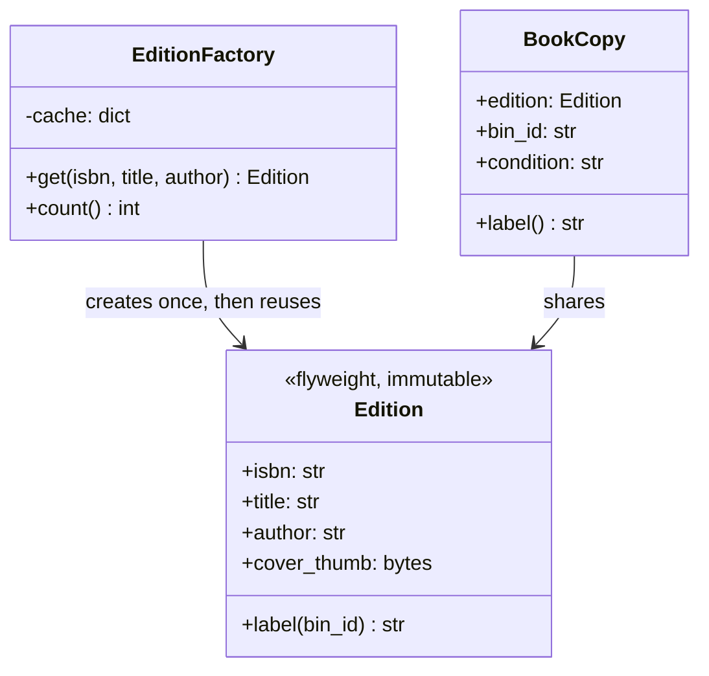
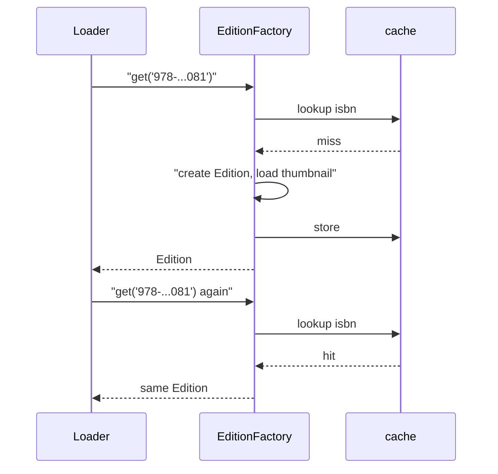

# Flyweight Pattern

## Introduction

A library owns 300 copies of a popular novel. It does not print 300 separate catalog cards with the full title, author, summary and cover photo. It keeps **one** catalog record for the edition and, for each physical copy, only a barcode, a shelf location and a condition note. Everything that is the same for all copies is stored once and shared.

The **Flyweight pattern** does this with objects. When a program creates a huge number of similar objects, it splits each object's data into two parts:

- **Intrinsic state**: data that is the same across many objects and does not change (title, author, cover image). It is stored once, in a shared **flyweight** object.
- **Extrinsic state**: data that is unique to each use (shelf location, condition). It stays with each individual object, or is passed in when needed.

A **flyweight factory** makes sure each distinct intrinsic state is created only once and reused afterwards.

Flyweight is the most "situational" of the structural patterns. You do not need it in most business code. When you do need it (millions of objects, games, text rendering, large in-memory datasets), it can cut memory use dramatically.

In this page you will:

- measure the memory cost of duplicated state in Python
- apply Flyweight with a factory, and measure again
- see flyweights in Java's `Integer.valueOf`, string interning and Python's small-integer cache
- learn the rules that keep flyweights safe (immutability, thread-safe factories)
- compare Flyweight with simpler options such as `__slots__`, interning, and columnar data

## The Problem: The Same Data, Twenty Thousand Times

The bookstore's warehouse app loads every physical book copy into memory to plan picking routes. Each copy object carries the edition's title, author and a small cover thumbnail, plus its own bin location and condition. There are 20,000 copies, but only 200 distinct editions.

```python
import random
import tracemalloc
from dataclasses import dataclass


@dataclass
class BookCopy:                      # "Before": every copy carries everything
    isbn: str
    title: str
    author: str
    cover_thumb: bytes
    bin_id: str
    condition: str


random.seed(7)
EDITIONS = [(f"978-{i:010d}", f"Book title number {i}", f"Author {i % 50}") for i in range(200)]


def load_thumbnail(isbn: str) -> bytes:
    return isbn.encode() * 400       # stand-in for a ~5.6 KB image read from disk


tracemalloc.start()
copies = []
for n in range(20_000):
    isbn, title, author = random.choice(EDITIONS)
    copies.append(BookCopy(isbn, title, author, load_thumbnail(isbn), f"B{n % 900:03d}", "new"))
before_bytes, _ = tracemalloc.get_traced_memory()
tracemalloc.stop()
print(f"before: {len(copies):,} copies use {before_bytes / 1_000_000:.1f} MB")
```

Example output (exact numbers vary by Python version and platform):

```text
before: 20,000 copies use 116.1 MB
```

Over 100 MB for what is really 200 thumbnails and 20,000 short location strings. The thumbnail for each edition has been loaded and stored about 100 times. Scale to two million copies and the app no longer fits in its container.

## The Pattern

Move the shared, immutable part into a flyweight, and let a factory hand out one instance per distinct key.



| Role | In our example | Holds |
| --- | --- | --- |
| Flyweight | `Edition` | Intrinsic state: `isbn`, `title`, `author`, `cover_thumb` |
| Flyweight factory | `EditionFactory` | A cache of flyweights keyed by ISBN |
| Context | `BookCopy` | Extrinsic state (`bin_id`, `condition`) plus a reference to its flyweight |
| Client | Picking planner | Uses copies; never builds `Edition` directly |

### Applying it

```python
from dataclasses import dataclass


@dataclass(frozen=True, slots=True)
class Edition:
    """Flyweight: shared and immutable."""
    isbn: str
    title: str
    author: str
    cover_thumb: bytes

    def label(self, bin_id: str) -> str:          # extrinsic state passed in
        return f"{bin_id}: {self.title} ({self.author})"


class EditionFactory:
    def __init__(self) -> None:
        self._cache: dict[str, Edition] = {}

    def get(self, isbn: str, title: str, author: str) -> Edition:
        edition = self._cache.get(isbn)
        if edition is None:
            edition = Edition(isbn, title, author, load_thumbnail(isbn))   # expensive part runs once
            self._cache[isbn] = edition
        return edition

    def count(self) -> int:
        return len(self._cache)


@dataclass(slots=True)
class FlyweightCopy:
    edition: Edition
    bin_id: str
    condition: str

    def label(self) -> str:
        return self.edition.label(self.bin_id)


random.seed(7)
tracemalloc.start()
factory = EditionFactory()
light_copies = []
for n in range(20_000):
    isbn, title, author = random.choice(EDITIONS)
    light_copies.append(FlyweightCopy(factory.get(isbn, title, author), f"B{n % 900:03d}", "new"))
after_bytes, _ = tracemalloc.get_traced_memory()
tracemalloc.stop()

print(f"after:  {len(light_copies):,} copies use {after_bytes / 1_000_000:.1f} MB "
      f"({factory.count()} shared editions)")
print(f"saved:  {100 * (1 - after_bytes / before_bytes):.0f}%")
print(light_copies[0].label())
print("same object shared:", light_copies[0].edition is factory.get(light_copies[0].edition.isbn, "", ""))
```

Example output:

```text
after:  20,000 copies use 3.3 MB (200 shared editions)
saved:  97%
B000: Book title number 82 (Author 32)
same object shared: True
```

The saving comes almost entirely from storing each thumbnail once instead of a hundred times. `slots=True` on the dataclasses helps too, because each instance no longer carries a per-object `__dict__`, but that effect is small next to deduplication.

:::info Measure, do not guess
Use `tracemalloc` (standard library) or a profiler before and after. Flyweight adds complexity, and it is only worth it when the numbers show a real problem.
:::

Here is how a request for an edition flows through the factory:



## The Rules That Keep Flyweights Safe

1. **Flyweights must be immutable.** They are shared by thousands of contexts. If one copy could change `edition.title`, every other copy would change too. Use `frozen=True` dataclasses, tuples, or Java records.
2. **Clients must not create flyweights directly.** Always go through the factory, or you will quietly get duplicates and lose the savings.
3. **Make the factory thread-safe if it is shared across threads.** Two threads can miss the cache at the same moment and create two flyweights. That only wastes memory, but if your code compares flyweights with `is`, it becomes a bug. Protect the miss path with a lock or use a structure that guarantees single creation.
4. **Decide the factory's lifetime.** A cache that only grows is a memory leak with extra steps. If keys come from user input, bound the cache, or use a `weakref.WeakValueDictionary` so unused flyweights can be garbage-collected.
5. **Keep extrinsic state out.** If something differs per copy, it does not belong in the flyweight, even if it is "usually" the same.

## Where You Have Already Met Flyweight

### Java's boxed integer cache

`Integer.valueOf(int)` returns cached `Integer` objects for small values. The Java Language Specification requires boxing to return the same object for `int` values from -128 to 127, and the JVM may cache a wider range. Autoboxing uses `valueOf`, which leads to a classic surprise:

```java
public class Main {
    public static void main(String[] args) {
        Integer a = 127, b = 127;
        Integer c = 1000, d = 1000;
        System.out.println("127 == 127:   " + (a == b));        // same cached flyweight
        System.out.println("1000 == 1000: " + (c == d));        // two different objects (default JVM settings)
        System.out.println("1000 equals:  " + c.equals(d));     // compare values, not identity
        String s1 = "isbn-978", s2 = new String("isbn-978").intern();
        System.out.println("interned strings same object: " + (s1 == s2));
    }
}
```

Output:

```text
127 == 127:   true
1000 == 1000: false
1000 equals:  true
interned strings same object: true
```

This is why Java style guides say to compare boxed values with `equals`, never `==`. The flyweight cache is an optimization, not a contract you should depend on outside the guaranteed range. Java's string literal pool and `String.intern()` are flyweights too, which the last line shows.

Java is a good second language here precisely because `==` exposes object identity so plainly.

### Python's small integers and `sys.intern`

CPython keeps a pre-built array of small integer objects. The documented range is -5 to 256 in Python 3.12 to 3.14, and the Python 3.15 documentation lists -5 to 1024. Either way it is a **CPython implementation detail**, not a language guarantee. Python also lets you intern strings explicitly with `sys.intern`, which is useful when the same strings (status codes, country names, dictionary keys) repeat millions of times.

```python
import sys

a = int("256")
b = int("256")
c = int("5000")
d = int("5000")
print("256 is 256:", a is b)       # cached small int
print("5000 is 5000:", c is d)     # separate objects

status_1 = sys.intern("".join(["ship", "ped"]))
status_2 = sys.intern("".join(["ship", "ped"]))
print("interned:", status_1 is status_2)
```

Output:

```text
256 is 256: True
5000 is 5000: False
interned: True
```

:::warning
Never use `is` to compare numbers or strings in real code. Use `==`. The `is` checks above only demonstrate that the runtime is sharing objects.
:::

### Other places

- **Text rendering.** Font engines and editors share one glyph object per character and style; each position on screen stores only coordinates. This is the example the GoF book itself uses.
- **Games and graphics.** A forest of 100,000 trees shares a handful of mesh and texture objects; each tree stores position, scale and rotation. GPU "instanced rendering" is the hardware version of the same idea.
- **Database normalization.** Storing an edition once and referencing it by ID from each copy row is the relational form of Flyweight.

## Real-World Scenario

**Situation.** A nightly Python job loads every order line from the last year (several million rows) to compute recommendation features. Each row becomes an object with a dozen string fields, and most of those strings repeat: country code, currency, order status, category name, sales channel. The job has started getting killed by the container's 2 GB memory limit.

**Solution.**

1. **Measure first.** Run the job on a 1% sample with `tracemalloc` and see which allocations dominate. Suppose repeated strings and per-object `__dict__` overhead come out on top.
2. **Intern low-cardinality fields.** Pass `country`, `currency`, `status`, `category` and `channel` through a small flyweight factory (or `sys.intern`), so millions of rows share a few hundred string objects.
3. **Use slotted, frozen dataclasses** for the row objects.
4. **Re-measure** on the sample and project to full size.

```python
import sys
import tracemalloc
from dataclasses import dataclass


@dataclass(frozen=True, slots=True)
class OrderLine:
    order_id: int
    isbn: str
    country: str
    currency: str
    status: str
    category: str


def make_rows(n: int, share: bool) -> list[OrderLine]:
    fix = sys.intern if share else (lambda s: s)
    rows = []
    for i in range(n):
        # Strings built at runtime (as they would be when parsed from a file) are separate objects
        rows.append(OrderLine(i, f"978-{i % 5000:010d}",
                              fix("".join(["U", "S"])), fix("".join(["US", "D"])),
                              fix("".join(["deliv", "ered"])), fix("".join(["Program", "ming"]))))
    return rows


for share in (False, True):
    tracemalloc.start()
    rows = make_rows(50_000, share)
    used, _ = tracemalloc.get_traced_memory()
    tracemalloc.stop()
    print(f"share={share!s:<5} {used / 1_000_000:5.1f} MB for {len(rows):,} rows")
    del rows
```

Example output:

```text
share=False  18.2 MB for 50,000 rows
share=True    8.8 MB for 50,000 rows
```

About half the memory went away for four short repeated fields. On a real dataset the ratio depends on how many repeated fields you have and how long they are, which is why step 1 matters. If the job still does not fit, the next step is usually a columnar tool (pandas or Polars with categorical columns, or Apache Arrow), which applies the same "store each distinct value once" idea for you.

**Why this approach.** The data had a huge number of objects with a small number of distinct values in several fields: the textbook Flyweight situation. Interning is the lightest possible flyweight factory, and it changed only the loading code.

**When to use it.**

- You have a very large number of objects (think hundreds of thousands or more), and memory is a measured problem.
- Much of each object's state is shared and can be made immutable.
- The extrinsic state is small, or can be computed or passed in when needed.

**When not to use it.**

- Memory is not a measured problem. Flyweight trades simplicity for memory; do not pay that price speculatively.
- The "shared" state is mutable or changes per object over time.
- The number of objects is small. A few thousand duplicated strings cost less than the code you would add.
- A better data representation exists: arrays, a dataframe with categorical columns, or a database query that avoids loading everything.

**Alternatives and trade-offs.**

| Approach | Pros | Cons | Best for |
| --- | --- | --- | --- |
| Do nothing | Simplest code | High memory with many duplicates | Small or medium datasets |
| `__slots__` / `slots=True` | One-line change, removes per-instance `__dict__` | Does not deduplicate shared values | Many small objects |
| String interning (`sys.intern`) | Very small change | Only for strings; interned strings can live long | Repeated low-cardinality strings |
| Flyweight with a factory | Deduplicates arbitrary heavy state | Extra classes; immutability and lifetime rules | Heavy shared state (images, configs, meshes) |
| Columnar / categorical data (pandas, Polars, Arrow) | Huge savings and fast analytics | Different programming model | Analytics over millions of rows |
| Stream instead of loading all | Constant memory | Some algorithms need all data at once | Batch jobs that can process row by row |

## Common Mistakes

- **Mutable flyweights.** Changing a shared object changes it for everyone. Make flyweights immutable.
- **Bypassing the factory.** Creating `Edition(...)` directly in one code path silently brings duplicates back.
- **Unbounded factories.** A cache keyed by arbitrary user input grows forever. Bound it or use weak references.
- **Comparing with `is` / `==` on identity.** Code that relies on two flyweights being the same object breaks when someone bypasses the factory or a race creates a duplicate. Compare by value.
- **Optimizing without measuring.** Flyweight makes code harder to follow. Profile first, and check that the savings matter.
- **Confusing it with [Singleton](../2-arch-creational-patterns/1-arch-singleton.mdx) or [Object Pool](../2-arch-creational-patterns/6-arch-object-pool.mdx).** Singleton means one instance of a class; Flyweight means one instance *per distinct intrinsic state*. An object pool lends out mutable objects for exclusive, temporary use; flyweights are shared by many users at the same time and never "returned".

## Flyweight vs Similar Ideas

| Idea | Relationship |
| --- | --- |
| [Singleton](../2-arch-creational-patterns/1-arch-singleton.mdx) | One instance per class vs one instance per key |
| [Object Pool](../2-arch-creational-patterns/6-arch-object-pool.mdx) | Pool reuses mutable objects one user at a time; flyweights are immutable and shared concurrently |
| [Prototype](../2-arch-creational-patterns/5-arch-prototype.mdx) | Copies objects to create new ones; Flyweight avoids copies |
| Caching / memoization | A flyweight factory is a cache of immutable objects keyed by their intrinsic state |
| [Composite](./2-arch-composite.mdx) | Leaves of a large composite (such as characters in a document) are often flyweights |

## Summary

- Flyweight splits object state into shared, immutable **intrinsic** state and per-object **extrinsic** state.
- A factory guarantees one flyweight per distinct intrinsic state and hands out shared references.
- In the bookstore example, sharing 200 editions among 20,000 copies cut measured memory by more than 90%, but always measure your own case.
- You already rely on flyweights: Java's `Integer.valueOf` cache and string pool, CPython's small-integer cache and `sys.intern`, glyphs in text rendering, and instanced meshes in games.
- Flyweights must be immutable, and the factory must be the only way to get one.
- Consider `slots=True`, interning, streaming or columnar data before reaching for a full Flyweight.

## Exercises

1. Change `EditionFactory` to use `weakref.WeakValueDictionary`. Show that an edition disappears from the cache after the last copy referencing it is deleted. (Hint: frozen slotted dataclasses need a `__weakref__` slot, which `@dataclass(weakref_slot=True)` provides.)
2. Make `EditionFactory.get` thread-safe with `threading.Lock`, and write a test that creates editions from 8 threads at once and checks that each ISBN maps to exactly one object.
3. Load the order-line example into a pandas DataFrame with `category` dtype for the repeated columns and compare memory with `df.memory_usage(deep=True)`.
4. Explain why storing `bin_id` inside `Edition` would be a bug.

**Related pages:** [Composite Pattern](./2-arch-composite.mdx), [Object Pool Pattern](../2-arch-creational-patterns/6-arch-object-pool.mdx), [Designing for Performance](../12-arch-quality-and-operations/1-arch-performance.mdx), and [Choosing a Structural Pattern](./7-arch-choosing-structural.mdx).
