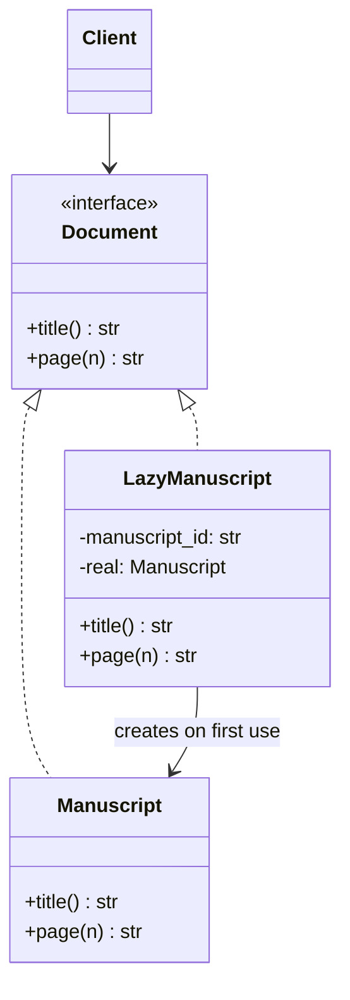
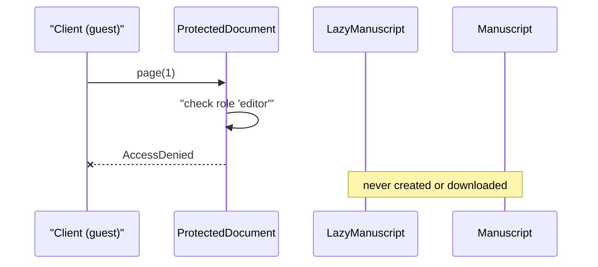
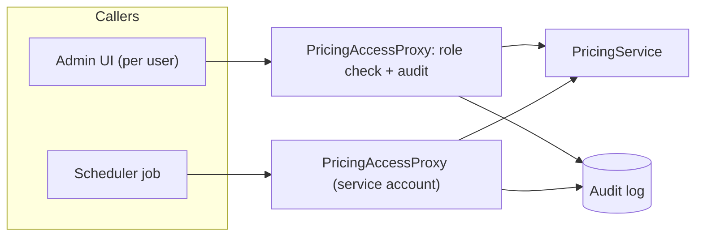

# Proxy Pattern

## Introduction

A company's front-office assistant answers the CEO's phone. Callers dial the same number they would use for the CEO, and from their side nothing looks different. But the assistant decides who gets through, takes messages when the CEO is busy, and answers common questions without disturbing anyone.

The **Proxy pattern** provides a **stand-in object with the same interface as the real object**, so that it can **control access** to it. The client thinks it is talking to the real thing. The proxy decides *whether*, *when* and *how* the real object is used.

Proxies are everywhere in modern software, often generated for you by frameworks: ORMs load related rows lazily through proxies, Spring wraps your beans in proxies to add transactions, RPC libraries give you local "stub" objects for remote services, and Python's `weakref.proxy` refers to an object without keeping it alive.

In this page you will:

- learn the common kinds of proxy: virtual, protection, remote, caching and smart reference
- build a lazy-loading proxy and a protection proxy in Python
- create a Java dynamic proxy with `java.lang.reflect.Proxy`
- understand framework proxies and their famous pitfalls, such as Spring's self-invocation problem
- learn when a proxy hides too much, and how Proxy differs from Decorator, Adapter and Facade

## The Problem: Expensive or Sensitive Objects Used Directly

The bookstore lets editors preview manuscripts. A `Manuscript` object loads a large PDF from object storage when it is created. The catalog page lists 50 manuscripts but users open only one or two.

```python
# "Before": every manuscript is fully loaded up front
import time


class Manuscript:
    def __init__(self, manuscript_id: str) -> None:
        self.manuscript_id = manuscript_id
        print(f"  downloading {manuscript_id}.pdf (slow)")
        time.sleep(0.01)                          # stand-in for a 30 MB download
        self._pages = [f"{manuscript_id} page {n}" for n in range(1, 301)]

    def title(self) -> str:
        return f"Manuscript {self.manuscript_id}"

    def page(self, n: int) -> str:
        return self._pages[n - 1]


catalog = [Manuscript(f"m{i}") for i in range(1, 4)]
print(catalog[0].title())
```

Output:

```text
  downloading m1.pdf (slow)
  downloading m2.pdf (slow)
  downloading m3.pdf (slow)
Manuscript m1
```

We paid for three downloads to show one title. We could add `if not loaded: load()` checks everywhere manuscripts are used, but that spreads loading logic across the codebase. We also have a second problem: only editors with the right role may read unpublished manuscripts, and right now nothing stops any code path from calling `page()`.

## The Pattern

A proxy implements the same interface as the real subject and holds (or knows how to get) a reference to it. Each method does its access-control work and then delegates.



| Role | In our example | Responsibility |
| --- | --- | --- |
| Subject | `Document` | The interface shared by proxy and real object |
| Real subject | `Manuscript` | Does the real work |
| Proxy | `LazyManuscript` | Same interface; controls when and whether the real subject is used |
| Client | Catalog page, preview page | Works with `Document` and cannot tell the difference |

### Kinds of proxy

The structure is always the same; the *access control* differs:

| Kind | Controls | Example |
| --- | --- | --- |
| **Virtual proxy** | *When* the real object is created (lazy loading) | ORM lazy relationships, image placeholders |
| **Protection proxy** | *Whether* the caller may use it (authorization) | Role checks in front of admin operations |
| **Remote proxy** | *Where* it runs (another process or machine) | gRPC and other RPC client stubs |
| **Caching proxy** | *How often* the real object is called | Caching results of an expensive service |
| **Smart reference** | Bookkeeping around access | Reference counting, weak references, locking, audit logs |

### A virtual (lazy) proxy

```python
from typing import Protocol


class Document(Protocol):
    def title(self) -> str: ...
    def page(self, n: int) -> str: ...


class LazyManuscript:
    """Virtual proxy: cheap to create, loads the real Manuscript on first real need."""

    def __init__(self, manuscript_id: str) -> None:
        self._manuscript_id = manuscript_id
        self._real: Manuscript | None = None

    def _subject(self) -> Manuscript:
        if self._real is None:
            self._real = Manuscript(self._manuscript_id)
        return self._real

    def title(self) -> str:
        return f"Manuscript {self._manuscript_id}"     # answerable without loading

    def page(self, n: int) -> str:
        return self._subject().page(n)


catalog: list[Document] = [LazyManuscript(f"m{i}") for i in range(1, 4)]
print([doc.title() for doc in catalog])
print(catalog[1].page(42))
print(catalog[1].page(43))
```

Output:

```text
['Manuscript m1', 'Manuscript m2', 'Manuscript m3']
  downloading m2.pdf (slow)
m2 page 42
m2 page 43
```

Only the manuscript that was actually opened was downloaded, and only once. The catalog page did not change at all; it still works with `Document`.

### A protection proxy

```python
from dataclasses import dataclass


@dataclass(frozen=True)
class User:
    name: str
    roles: frozenset[str]


class AccessDenied(Exception):
    pass


class ProtectedDocument:
    """Protection proxy: checks permissions, then delegates."""

    def __init__(self, inner: Document, user: User, required_role: str = "editor") -> None:
        self._inner, self._user, self._role = inner, user, required_role

    def title(self) -> str:
        return self._inner.title()                    # titles are public

    def page(self, n: int) -> str:
        if self._role not in self._user.roles:
            raise AccessDenied(f"{self._user.name} needs role '{self._role}' to read pages")
        return self._inner.page(n)


editor = User("ana", frozenset({"editor"}))
guest = User("bo", frozenset({"customer"}))

for user in (editor, guest):
    doc: Document = ProtectedDocument(LazyManuscript("m7"), user)
    try:
        print(user.name, "->", doc.title(), "|", doc.page(1))
    except AccessDenied as exc:
        print(user.name, "->", doc.title(), "| denied:", exc)
```

Output:

```text
  downloading m7.pdf (slow)
ana -> Manuscript m7 | m7 page 1
bo -> Manuscript m7 | denied: bo needs role 'editor' to read pages
```

Notice that the guest's request was denied **before** anything was downloaded, because the protection proxy sits outside the virtual proxy. As with decorators, the order of wrapping matters.



## Dynamic Proxies in Java

Writing a proxy class by hand means forwarding every method. Java can generate proxies at runtime for any interface with `java.lang.reflect.Proxy` and an `InvocationHandler`. Frameworks use this mechanism (and bytecode-generation libraries for classes) to add transactions, security and lazy loading without you writing proxy classes. It is a good reason to show Java for this pattern: it makes the "same interface, intercepted calls" idea concrete.

```java
import java.lang.reflect.InvocationHandler;
import java.lang.reflect.Proxy;
import java.util.Map;

interface Catalog {
    String titleOf(String isbn);
    void updatePrice(String isbn, double price);
}

class InMemoryCatalog implements Catalog {
    private final Map<String, String> titles = Map.of("978-0321125217", "Domain-Driven Design");
    public String titleOf(String isbn) { return titles.getOrDefault(isbn, "?"); }
    public void updatePrice(String isbn, double price) { System.out.println("  price of " + isbn + " set to " + price); }
}

public class Main {
    static Catalog auditing(Catalog target, String user) {
        InvocationHandler handler = (proxy, method, args) -> {
            System.out.println("audit: " + user + " called " + method.getName());
            return method.invoke(target, args);
        };
        return (Catalog) Proxy.newProxyInstance(
            Catalog.class.getClassLoader(), new Class<?>[] { Catalog.class }, handler);
    }

    public static void main(String[] args) {
        Catalog catalog = auditing(new InMemoryCatalog(), "ana");
        System.out.println(catalog.titleOf("978-0321125217"));
        catalog.updatePrice("978-0321125217", 49.99);
        System.out.println("is a proxy: " + Proxy.isProxyClass(catalog.getClass()));
    }
}
```

Output:

```text
audit: ana called titleOf
Domain-Driven Design
audit: ana called updatePrice
  price of 978-0321125217 set to 49.99
is a proxy: true
```

One handler intercepts every method of the interface, now and in the future. In Python you can get a similar effect with `__getattr__`, at the cost of losing static type checking.

## Where You Have Already Met Proxies

| Where | Kind | What it does |
| --- | --- | --- |
| Spring AOP (`@Transactional`, `@Cacheable`, method security) | Smart / protection | Spring wraps beans in JDK dynamic proxies or CGLIB subclasses that start transactions, check caches or enforce security |
| Hibernate / JPA lazy associations, `EntityManager.getReference` | Virtual | Returns a proxy that loads the row on first access |
| SQLAlchemy lazy-loaded relationships | Virtual | Related objects are loaded when the attribute is first accessed |
| Django `request.user` | Virtual | `AuthenticationMiddleware` sets it to a `SimpleLazyObject`, so the user is only fetched from the session when used |
| Python `weakref.proxy` | Smart reference | Refers to an object without keeping it alive; raises `ReferenceError` once it is gone |
| gRPC and other RPC client stubs | Remote | A local object whose method calls become network requests; see [gRPC](../10-arch-integration-and-apis/3-arch-grpc.mdx) |
| JavaScript `Proxy` | Any | Built-in language support for intercepting property access and calls |
| Reverse proxies such as [Nginx](/docs/middleware/nginx) | Remote / protection / caching | The same idea at network level |

### The Spring self-invocation pitfall

Framework proxies only intercept calls that come **through the proxy**. If a method inside a Spring bean calls another `@Transactional` method on `this`, the call never passes through the proxy, so no transaction is started. The [Spring reference documentation](https://docs.spring.io/spring-framework/reference/data-access/transaction/declarative/annotations.html) warns about exactly this. Typical fixes are moving the method into another bean, or using AspectJ weaving instead of proxies. This is a general lesson about proxies: **anything that reaches the real object directly skips the proxy's rules.**

You can see the same effect in Python:

```python
class Service:
    def outer(self) -> str:
        return "outer -> " + self.inner()           # calls self, not the proxy

    def inner(self) -> str:
        return "inner"


class LoggingProxy:
    def __init__(self, target: Service) -> None:
        self._target = target

    def __getattr__(self, name: str):
        attr = getattr(self._target, name)
        def wrapper(*args, **kwargs):
            print(f"  proxy intercepted {name}()")
            return attr(*args, **kwargs)
        return wrapper


svc = LoggingProxy(Service())
print(svc.outer())
```

Output:

```text
  proxy intercepted outer()
outer -> inner
```

`inner()` was called, but the proxy never saw it.

## Real-World Scenario

**Situation.** The bookstore's admin app has a `PricingService` with methods like `get_price`, `set_price` and `bulk_discount`. A recent incident: a support agent's account was used to run `bulk_discount` on the whole catalog. The security review requires that write operations be limited to the "pricing" role and recorded in an audit log, and that reads stay fast. The pricing team does not want authorization code mixed into pricing logic, and several other services (a scheduler, the import job) use `PricingService` too.

**Solution.** Put a protection proxy in front of `PricingService` and give it to every caller that acts on behalf of a human user. Keep a set of method names that require the role, so new write methods are denied unless explicitly classified.

```python
from collections.abc import Callable
from decimal import Decimal


class PricingService:
    def __init__(self) -> None:
        self._prices = {"978-1492056355": Decimal("39.99")}

    def get_price(self, isbn: str) -> Decimal:
        return self._prices[isbn]

    def set_price(self, isbn: str, price: Decimal) -> None:
        self._prices[isbn] = price

    def bulk_discount(self, percent: int) -> int:
        for isbn in self._prices:
            self._prices[isbn] = (self._prices[isbn] * (100 - percent) / 100).quantize(Decimal("0.01"))
        return len(self._prices)


class PricingAccessProxy:
    READS = {"get_price"}
    WRITES = {"set_price", "bulk_discount"}

    def __init__(self, target: PricingService, user: User, audit: Callable[[str], None]) -> None:
        self._target, self._user, self._audit = target, user, audit

    def __getattr__(self, name: str):
        attr = getattr(self._target, name)
        if name in self.READS:
            return attr
        if name not in self.WRITES:                     # unknown methods are denied by default
            raise AccessDenied(f"{name} is not classified; add it to READS or WRITES")
        if "pricing" not in self._user.roles:
            self._audit(f"DENIED {self._user.name} {name}")
            raise AccessDenied(f"{self._user.name} may not call {name}")

        def audited(*args, **kwargs):
            self._audit(f"ALLOWED {self._user.name} {name} {args}")
            return attr(*args, **kwargs)
        return audited


audit_log: list[str] = []
service = PricingService()
agent = PricingAccessProxy(service, User("sam", frozenset({"support"})), audit_log.append)
manager = PricingAccessProxy(service, User("ana", frozenset({"pricing"})), audit_log.append)

print(agent.get_price("978-1492056355"))
try:
    agent.bulk_discount(90)
except AccessDenied as exc:
    print("blocked:", exc)
manager.set_price("978-1492056355", Decimal("34.99"))
print(manager.get_price("978-1492056355"))
print(*audit_log, sep="\n")
```

Output:

```text
39.99
blocked: sam may not call bulk_discount
34.99
DENIED sam bulk_discount
ALLOWED ana set_price ('978-1492056355', Decimal('34.99'))
```



**Why this approach.** Authorization and auditing are about *access* to pricing, not about pricing. A protection proxy adds them in one place, keeps `PricingService` focused, and is hard to forget because callers receive the proxy instead of the service. The "deny unknown methods" rule makes it fail safe when someone adds a new write method.

**When to use it.**

- You need lazy creation of expensive objects (virtual proxy).
- You need access control, auditing or rate limiting around an object without changing it (protection proxy).
- The real object lives elsewhere and you want local-looking calls (remote proxy), while staying honest that they are network calls.
- You want to cache or count calls transparently.

**When not to use it.**

- The access rules are part of the domain logic itself (for example "a customer can only see their own orders"). That usually belongs in the domain or application layer, where it is explicit and testable.
- Hiding a network call behind a local-looking interface would mislead callers about latency and failure. Remote proxies should still expose timeouts and errors clearly; see [Distributed Systems Fundamentals](../9-arch-distributed-systems/0-arch-distributed-fundamentals.mdx).
- The object is cheap and trusted. A lazy proxy for something that takes a microsecond to build only adds indirection.
- Callers depend on the concrete type or identity. A proxy is a different object.

**Alternatives and trade-offs.**

| Approach | Pros | Cons | Best for |
| --- | --- | --- | --- |
| Hand-written proxy class | Explicit, type-checked | Forwarding boilerplate for wide interfaces | Small interfaces, clear rules |
| Dynamic proxy (`__getattr__`, `java.lang.reflect.Proxy`) | Covers every method automatically | Weaker typing; harder to read; reflection overhead | Cross-cutting rules over many methods |
| Framework proxies (Spring AOP, ORM lazy loading) | No code to write | Hidden behavior, self-invocation and serialization surprises | Teams already invested in the framework |
| Checks inside the real class | Simple and visible | Mixes concerns, easy to forget in new methods | Rules that are truly domain logic |
| Network-level proxy or gateway | Language-agnostic, central policy | Coarse-grained; another component to run | Cross-service auth, TLS, caching; see [API Gateway](../10-arch-integration-and-apis/4-arch-api-gateway.mdx) |

## Common Mistakes

- **Leaking the real object.** If any code path can reach `PricingService` directly, the proxy's rules are optional. Make the proxy the only thing you hand out, for example through [Dependency Injection](../1-arch-design-principles/10-arch-dependency-injection.mdx).
- **Self-invocation.** Calls from the real object to itself bypass the proxy, as the Spring and Python examples show.
- **Lazy loading in loops (N+1 queries).** A virtual proxy per row that loads on access can turn one list page into hundreds of database queries. Use eager loading for known access patterns.
- **Proxies that change behavior.** A proxy should control access, not alter results. If it starts adding features, it is a [Decorator](./3-arch-decorator.mdx); name it so.
- **Hiding remote failures.** A remote proxy that retries forever or swallows errors makes outages look like hangs.
- **Thread-unsafe lazy initialization.** Two threads can both see `_real is None` and create two real objects. Use a lock if the proxy is shared.

## Proxy vs Similar Patterns

| Pattern | Interface | Intent | Typical creator |
| --- | --- | --- | --- |
| **Proxy** | Same as subject | Control access: lazy, protected, remote, cached | Framework or factory; often invisible to the client |
| [Decorator](./3-arch-decorator.mdx) | Same as component | Add responsibilities; designed to stack | Client or composition root |
| [Adapter](./0-arch-adapter.mdx) | Different | Make an incompatible interface fit | Integration code |
| [Facade](./4-arch-facade.mdx) | New, simpler | Simplify a whole subsystem | Subsystem owner |

Proxy and Decorator often have identical code. A practical way to tell them apart: a **proxy usually manages the real object's lifecycle or access** (it may create it, refuse to call it, or call it remotely), while a **decorator always receives an existing object and adds to what it does**.

## Summary

- A proxy has the same interface as the real object and controls access to it.
- Common kinds: virtual (lazy), protection (authorization), remote (RPC stubs), caching, and smart reference.
- Wrapping order matters: put protection outside lazy loading so denied requests cost nothing.
- Java's `java.lang.reflect.Proxy` and Python's `__getattr__` let you build dynamic proxies that intercept every method.
- You already use proxies: Spring AOP, Hibernate and SQLAlchemy lazy loading, Django's `request.user`, `weakref.proxy`, gRPC stubs and reverse proxies.
- Beware of self-invocation, leaked real objects, N+1 lazy loading, and remote proxies that hide network failures.

## Exercises

1. Make `LazyManuscript` thread-safe with `threading.Lock` and prove with a test that 10 threads calling `page()` at once trigger exactly one download.
2. Write a `CachingCatalog` proxy for the Java `Catalog` interface that caches `titleOf` results and invalidates the cache when `updatePrice` is called for the same ISBN.
3. Add a `rate_limit` rule to `PricingAccessProxy` that allows at most 5 write calls per minute per user. Use an injectable clock so you can test it.
4. In a framework you use (Spring, Django, SQLAlchemy, Hibernate), find one proxy it creates for you. Write down what kind it is and one way the proxy can surprise a developer.

**Related pages:** [Decorator Pattern](./3-arch-decorator.mdx), [Adapter Pattern](./0-arch-adapter.mdx), [Security by Design](../12-arch-quality-and-operations/4-arch-security-by-design.mdx), [Caching Strategies](../11-arch-data-architecture/2-arch-caching-strategies.mdx), and [Choosing a Structural Pattern](./7-arch-choosing-structural.mdx).
