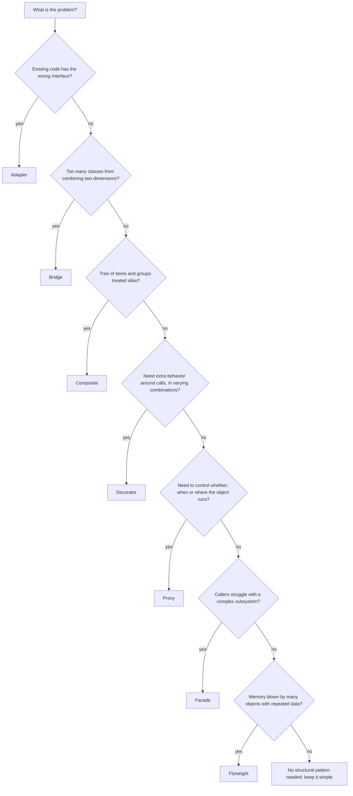
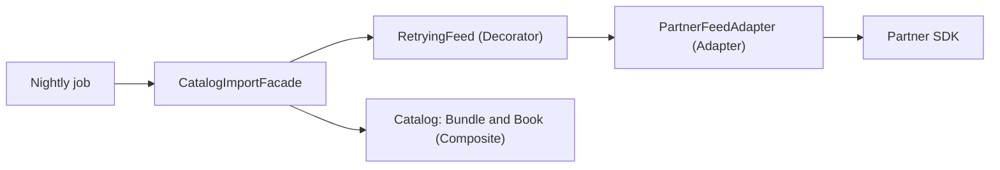

# Choosing a Structural Pattern

## Introduction

The seven structural patterns in this section all answer the same broad question: **how should objects be put together to form larger structures?** Several of them even look identical in code. An adapter, a decorator and a proxy are all "a class that holds another object and forwards calls to it". What separates them is **intent**: the problem each one solves, and the promise it makes to the client.

This page helps you pick the right one, or none at all. It gives you:

- a one-line reminder of each pattern
- a decision flowchart that starts from the problem, not the pattern
- a side-by-side comparison of the "wrapper family"
- a worked example that combines several patterns, as real systems do
- a list of code smells and the pattern each one points to
- guidance on when language features or plain functions are better than any pattern

If you have not read the individual pages yet, start with [Adapter](./0-arch-adapter.mdx) and come back here at the end.

## The Seven Patterns at a Glance

| Pattern | One-line intent | Bookstore example from this section |
| --- | --- | --- |
| [Adapter](./0-arch-adapter.mdx) | Make an incompatible interface fit the one you expect | Two payment providers behind one `PaymentGateway` |
| [Bridge](./1-arch-bridge.mdx) | Split two independent dimensions into two hierarchies | Notification kinds x delivery channels |
| [Composite](./2-arch-composite.mdx) | Treat single items and nested groups the same way | Book bundles inside bundles; nested permission groups |
| [Decorator](./3-arch-decorator.mdx) | Add behavior by wrapping with the same interface | Caching, retry and logging around a price client |
| [Facade](./4-arch-facade.mdx) | Give a complex subsystem one simple entry point | `CheckoutFacade.place_order` over six subsystems |
| [Flyweight](./5-arch-flyweight.mdx) | Share immutable state among many objects to save memory | 200 editions shared by 20,000 book copies |
| [Proxy](./6-arch-proxy.mdx) | Control access to an object with the same interface | Lazy manuscript loading; role checks on pricing writes |

## Start From the Problem

Patterns are answers. Begin with the question you actually have:



The last box matters most. In most code, most of the time, the right number of patterns is zero. See [DRY, KISS and YAGNI](../1-arch-design-principles/6-arch-dry-kiss-yagni.mdx).

## The Wrapper Family: Telling Look-Alikes Apart

Adapter, Decorator, Proxy and Facade all wrap something. Bridge also delegates to another object, but it is designed up front rather than wrapped around existing code. Four questions separate them:

| Question | Adapter | Decorator | Proxy | Facade | Bridge |
| --- | --- | --- | --- | --- | --- |
| How many objects does it wrap? | Usually one | One | One | Many | One implementor |
| Interface compared with the wrapped object | Different | Same | Same | New, simpler | Abstraction differs from implementor |
| What does it change? | The shape of calls | What happens around calls | Whether, when or where calls happen | How many calls the client must make | Nothing; it separates two hierarchies |
| When is it introduced? | After the fact, to integrate | Any time, often stacked | Often generated by frameworks | When a subsystem grows complex | Up front, at design time |
| Typical client awareness | Knows only the target | Usually composes the stack | Often unaware a proxy exists | Calls the facade only | Picks an abstraction and an implementor |

Here is the same tiny interface wrapped three ways, so you can see the difference in a few lines of Python:

```python
from typing import Protocol


class Greeter(Protocol):
    def greet(self, name: str) -> str: ...


class LegacyGreeter:                       # an existing class with the "wrong" interface
    def say_hello_to(self, first: str, last: str) -> str:
        return f"Hello, {first} {last}"


class GreeterAdapter:                      # Adapter: different interface in, Greeter out
    def __init__(self, legacy: LegacyGreeter) -> None:
        self._legacy = legacy

    def greet(self, name: str) -> str:
        first, _, last = name.partition(" ")
        return self._legacy.say_hello_to(first, last)


class ExclaimDecorator:                    # Decorator: same interface, adds behavior
    def __init__(self, inner: Greeter) -> None:
        self._inner = inner

    def greet(self, name: str) -> str:
        return self._inner.greet(name) + "!"


class BusinessHoursProxy:                  # Proxy: same interface, controls access
    def __init__(self, inner: Greeter, is_open: bool) -> None:
        self._inner, self._is_open = inner, is_open

    def greet(self, name: str) -> str:
        if not self._is_open:
            return "(closed, try again tomorrow)"
        return self._inner.greet(name)


base: Greeter = GreeterAdapter(LegacyGreeter())
print(base.greet("Ada Lovelace"))
print(ExclaimDecorator(base).greet("Ada Lovelace"))
print(BusinessHoursProxy(ExclaimDecorator(base), is_open=False).greet("Ada Lovelace"))
```

Output:

```text
Hello, Ada Lovelace
Hello, Ada Lovelace!
(closed, try again tomorrow)
```

The three wrapper classes are nearly the same size and shape. Only their **intent** differs, and that intent is what you communicate when you name a class `...Adapter`, `...Decorator` or `...Proxy`. Good names let the next reader understand the design without reading the body.

## Other Confusable Pairs

| Pair | How to tell them apart |
| --- | --- |
| Adapter vs Bridge | Adapter is retrofitted to make existing code fit; Bridge is planned so two dimensions can grow independently |
| Decorator vs Composite | Both are recursive compositions; a decorator has one child and adds behavior, a composite has many children and aggregates them |
| Facade vs [Mediator](../4-arch-behavioral-patterns/7-arch-mediator.mdx) | Facade is one-way (subsystem does not know it); colleagues of a mediator talk *to* it |
| Flyweight vs [Singleton](../2-arch-creational-patterns/1-arch-singleton.mdx) | Singleton is one instance per class; Flyweight is one instance per distinct shared state |
| Proxy vs [Facade](./4-arch-facade.mdx) | A proxy mirrors one object's interface; a facade invents a simpler interface over many objects |
| Bridge vs [Strategy](../4-arch-behavioral-patterns/0-arch-strategy.mdx) | Strategy swaps one algorithm; Bridge separates two whole hierarchies |

## Patterns Combine

Real designs rarely use one pattern alone. Consider the bookstore's new **partner catalog import**: every night it pulls book data from a partner's feed and updates the catalog.

- The partner's feed client has its own field names and units, so an **Adapter** turns it into our `BookFeed` interface.
- The feed is flaky, so a retrying **Decorator** wraps the adapter.
- The rest of the app should not orchestrate fetching, validating and saving, so a **Facade** offers one call: `import_partner_catalog()`.
- Product bundles in the feed are nested, so the catalog uses a **Composite**.



```python
from dataclasses import dataclass, field
from decimal import Decimal


# --- third-party SDK (cannot change) ---
class PartnerSdk:
    def __init__(self) -> None:
        self.calls = 0

    def fetch_items(self) -> list[dict]:
        self.calls += 1
        if self.calls == 1:
            raise TimeoutError("partner feed timed out")
        return [
            {"ean": "9781492056355", "name": "Fluent Python", "price_cents": 3999, "parts": []},
            {"ean": "BUNDLE-1", "name": "Starter Pack", "price_cents": 0,
             "parts": [{"ean": "9781718502703", "name": "Python Crash Course", "price_cents": 2999, "parts": []},
                       {"ean": "9781492056355", "name": "Fluent Python", "price_cents": 3999, "parts": []}]},
        ]


# --- Composite: the catalog model ---
@dataclass(frozen=True)
class Book:
    isbn: str
    title: str
    price_value: Decimal

    def price(self) -> Decimal:
        return self.price_value


@dataclass
class Bundle:
    title: str
    children: list = field(default_factory=list)

    def price(self) -> Decimal:
        return (sum((c.price() for c in self.children), Decimal("0")) * Decimal("0.9")).quantize(Decimal("0.01"))


# --- Adapter: partner format -> our model ---
class PartnerFeedAdapter:
    def __init__(self, sdk: PartnerSdk) -> None:
        self._sdk = sdk

    def items(self) -> list:
        return [self._convert(raw) for raw in self._sdk.fetch_items()]

    def _convert(self, raw: dict):
        if raw["parts"]:
            return Bundle(raw["name"], [self._convert(p) for p in raw["parts"]])
        return Book(raw["ean"], raw["name"], Decimal(raw["price_cents"]) / 100)


# --- Decorator: retry around any feed ---
class RetryingFeed:
    def __init__(self, inner, attempts: int = 3) -> None:
        self._inner, self._attempts = inner, attempts

    def items(self) -> list:
        for attempt in range(1, self._attempts + 1):
            try:
                return self._inner.items()
            except TimeoutError as exc:
                print(f"  attempt {attempt} failed: {exc}")
        raise RuntimeError("feed unavailable")


# --- Facade: one call for the rest of the app ---
class CatalogImportFacade:
    def __init__(self, feed, catalog: dict) -> None:
        self._feed, self._catalog = feed, catalog

    def import_partner_catalog(self) -> str:
        items = self._feed.items()
        for item in items:
            self._catalog[item.title] = item
        return f"imported {len(items)} items"


catalog: dict = {}
importer = CatalogImportFacade(RetryingFeed(PartnerFeedAdapter(PartnerSdk())), catalog)
print(importer.import_partner_catalog())
for title, item in catalog.items():
    print(f"  {title}: {item.price()}")
```

Output:

```text
  attempt 1 failed: partner feed timed out
imported 2 items
  Fluent Python: 39.99
  Starter Pack: 62.98
```

Each pattern does one small job, and each could be removed or replaced independently. That is the payoff of choosing patterns by problem: the design reads as a list of decisions, each with a reason.

## Code Smells That Point to a Pattern

| You notice... | Consider | But first ask |
| --- | --- | --- |
| Vendor types and exceptions appearing all over your code | Adapter | Is the vendor used in more than one place? |
| Class names that combine two lists (`S3ImageUploader`, `GcsVideoUploader`) | Bridge | Do both dimensions really vary? |
| `isinstance(x, Group)` checks with manual recursion | Composite | Is the structure really an unbounded tree? |
| Flags like `use_cache=True, retries=3, log=True` on a constructor | Decorator | Are the combinations really varied? |
| The same five-step sequence copied into several callers | Facade | Is there one obvious owner for the workflow? |
| Memory profiles dominated by duplicate data | Flyweight | Can the shared data be immutable? |
| `if not loaded: load()` or `if user.is_admin` before many calls | Proxy | Should the rule live in the domain instead? |

## What Each Pattern Costs

Every pattern buys a benefit with some complexity. Weigh both sides before adding one:

| Pattern | Main benefit | Main cost | Typical failure mode |
| --- | --- | --- | --- |
| Adapter | Isolates foreign APIs | One class per adaptee; translation code to test | Leaky adapters that return vendor types |
| Bridge | M + N classes instead of M x N | Upfront design of the implementor interface | Implementor interface grows business methods |
| Composite | Uniform operations over trees | Recursion, cycle and depth handling | Shared interface bloats with leaf-only methods |
| Decorator | Composable cross-cutting behavior | Forwarding boilerplate; order sensitivity | Wrong stack order, forgotten methods |
| Facade | Simple, stable entry point | Another layer to maintain | God facade full of business rules |
| Flyweight | Large memory savings | Immutability rules, factory lifecycle | Mutable shared state, unbounded caches |
| Proxy | Access control without touching the subject | Hidden behavior; another object in the call path | Self-invocation and leaked real objects bypass it |

If you cannot name the benefit for your specific code, you are paying the cost for nothing.

## When a Language Feature Is Enough

Many classic patterns were described for C++ and Smalltalk in 1994. Modern languages often give you a lighter tool for the same job:

| Pattern | Lighter option in Python | Lighter option elsewhere |
| --- | --- | --- |
| Adapter | A function, `functools.partial`, or a `lambda` | Java lambdas for single-method interfaces |
| Decorator | `@decorator` functions with `functools.wraps` | TypeScript decorators, Kotlin delegation (`by`) |
| Proxy | `__getattr__`, `weakref.proxy`, `functools.cached_property` for lazy attributes | Java `java.lang.reflect.Proxy`, JavaScript `Proxy` |
| Flyweight | `sys.intern`, `slots=True`, categorical dtypes in pandas | Java `Integer.valueOf`, string interning |
| Facade | A module with a small public API (`__all__`) | Java modules (`exports`), package-private classes |

Use the lightest option that keeps the intent clear. [Design Patterns in Modern Languages](../5-arch-modern-patterns/0-arch-patterns-in-modern-languages.mdx) explores this further.

## Real-World Scenario

**Situation.** Your team inherits a bookstore codebase where a previous developer "applied patterns everywhere". There is an `AbstractNotificationBridgeFactory`, a `UserServiceProxyDecoratorAdapter`, three facades over the same two classes, and a Flyweight factory for an object created four times per request. New developers take weeks to make simple changes. At the same time, the code that integrates the two payment providers has no abstraction at all, and vendor exceptions leak into the order controller.

**Solution.** Run a pattern review, one structure at a time, using the questions from this page:

1. **List every pattern-named class** and write down the problem it solves today, in one sentence. If you cannot, it is a removal candidate.
2. **Remove wrappers with no current reason.** The facade over two small classes and the Flyweight for four objects go away; callers use the classes directly. Measure memory before and after to confirm the Flyweight was not needed.
3. **Merge wrappers that do the same job.** `UserServiceProxyDecoratorAdapter` turns out to only add logging, so it becomes a plain `LoggingUserService` decorator, named for its intent.
4. **Add the pattern that is actually missing.** Introduce a `PaymentGateway` target with one adapter per provider, plus a contract test suite.
5. **Record the decisions** in short [Architecture Decision Records](../13-arch-documenting-and-evolving/0-arch-decision-records.mdx), so the next team knows why each remaining pattern exists.

**Why this approach.** Patterns have a cost: indirection, more files, more concepts. They should be paid for by a concrete benefit. The review keeps the patterns that solve real problems (vendor isolation) and removes those that only add ceremony. See [Common Anti-Patterns](../5-arch-modern-patterns/7-arch-anti-patterns.mdx) and [Refactoring to Patterns](../5-arch-modern-patterns/8-arch-refactoring-to-patterns.mdx) for the wider practice of moving toward, and away from, patterns.

**When to apply a structural pattern.** When you can point to a current pain (duplication, coupling to a vendor, combinatorial classes, memory pressure, missing access control) and the pattern removes it.

**When not to.** When the justification is "we might need it", "it is more professional", or "the book says so". Add the pattern when the second real use case arrives; refactoring into a pattern later is usually cheap if the code is well tested.

**Alternatives and trade-offs.**

| Approach | Pros | Cons | Best for |
| --- | --- | --- | --- |
| Apply patterns up front | Consistent structure from day one | Speculative complexity; patterns chosen before the problem is understood | Well-understood domains, frameworks, libraries |
| Refactor to patterns when pain appears | Every pattern has a proven reason | Requires good tests and discipline to refactor | Most application code |
| Plain functions and modules | Minimal ceremony | Can sprawl without boundaries as code grows | Scripts, small services |
| Framework conventions (DI containers, AOP) | Patterns provided for you | Hidden behavior, framework lock-in | Teams standardized on a framework |

## Common Mistakes

- **Choosing by structure instead of intent.** "It wraps an object, so it is a decorator" leads to misnamed classes. Ask what the wrapper promises.
- **Stacking patterns in one class name.** `ProxyDecoratorAdapter` means nobody decided what the class is for.
- **Using a pattern to look sophisticated.** Simple code that a newcomer understands is a feature.
- **Never removing a pattern.** Requirements change. A Bridge with one implementor left for two years can be collapsed.
- **Ignoring the cost of indirection.** Every wrapper is another frame in a stack trace and another file to open while debugging.

## Summary

- Structural patterns describe how to compose objects; several look identical in code and differ only in intent.
- Adapter changes an interface, Decorator adds behavior, Proxy controls access, Facade simplifies a subsystem, Bridge separates two dimensions, Composite unifies trees, and Flyweight shares state.
- Start from the problem and use the flowchart; "no pattern" is often the right answer.
- Real systems combine patterns, each solving one small, nameable problem.
- Prefer lighter language features (functions, `@decorators`, `__getattr__`, modules) when they express the same intent.
- Review existing patterns periodically and remove the ones that no longer pay for themselves.

## Exercises

1. For each situation, name the pattern you would choose (or "none") and justify it in one sentence:
   - a. A reporting module must support both PostgreSQL and BigQuery through the same internal query API.
   - b. Every admin API call must be logged with the user's ID, and only some calls need caching.
   - c. A shopping cart contains items and "gift boxes" that can contain items and other gift boxes.
   - d. A script calls one third-party library function in one place.
   - e. A map view renders 300,000 store pins that share 12 icon styles.
2. Extend the partner import example with a `ValidatingFeed` decorator that drops items with a price of zero (except bundles). Where in the stack should it go, and why?
3. Take a class in a codebase you know whose name contains "Manager", "Helper" or "Wrapper". Which structural pattern, if any, is it really implementing? Suggest a better name.
4. Write a short ADR for adding the `PaymentGateway` adapter layer, including the alternatives you rejected.

**Continue learning:** the next section, [Behavioral Design Patterns](../4-arch-behavioral-patterns/0-arch-strategy.mdx), covers how objects communicate and share responsibility, starting with the Strategy pattern. To revisit how patterns are classified, see the [Design Patterns Introduction](../2-arch-creational-patterns/0-arch-design-patterns-introduction.mdx) and [Choosing a Creational Pattern](../2-arch-creational-patterns/7-arch-choosing-creational.mdx).
