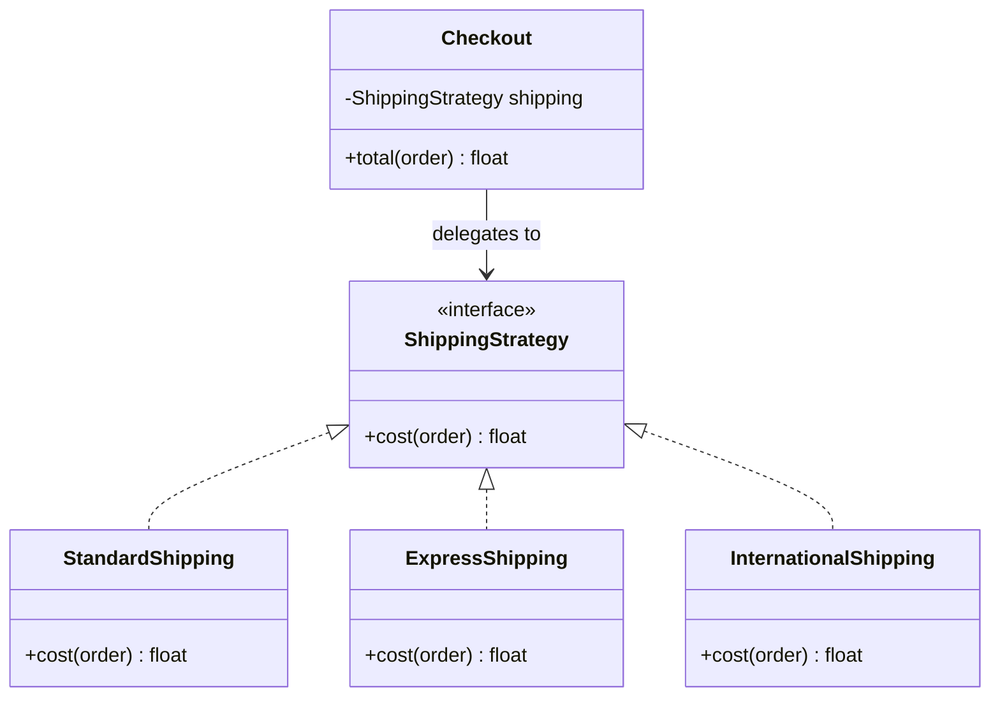

# Strategy Pattern

## Introduction

Behavioral patterns are about **how objects share work and talk to each other**. Creational patterns decide how objects are made, structural patterns decide how they fit together, and behavioral patterns decide who does what, and when.

**Strategy** is the simplest and most widely used of them. It says:

> Define a family of interchangeable algorithms, put each one behind the same interface, and let the caller pick one at runtime.

Think of a navigation app. You pick "fastest", "shortest", "avoid tolls" or "walking". The app (the **context**) does the same job each time: take a start and an end, return a route. Only the **algorithm** changes. The app does not contain one giant function with a branch for every travel mode. It holds a reference to "the current routing strategy" and calls it.

In this page you will:

- see the `if/elif` code that Strategy fixes
- refactor it into class-based and function-based strategies in Python
- see the same idea in Java, where an interface makes the shape explicit
- spot Strategy in libraries you already use
- learn when a strategy is over-engineering and what to use instead

## The Problem: An Algorithm Hidden in a Conditional

Imagine an online bookstore. Checkout must calculate shipping, and the rules depend on the shipping option the customer picks.

```python
from dataclasses import dataclass


@dataclass
class Order:
    subtotal: float
    weight_kg: float
    country: str


def shipping_cost(order: Order, method: str) -> float:
    if method == "standard":
        return 0.0 if order.subtotal >= 35 else 4.99
    elif method == "express":
        return 9.99 + 1.50 * order.weight_kg
    elif method == "international":
        base = 14.99 if order.country in {"CA", "MX"} else 24.99
        return base + 3.00 * order.weight_kg
    elif method == "pickup":
        return 0.0
    else:
        raise ValueError(f"Unknown shipping method: {method}")


order = Order(subtotal=42.0, weight_kg=1.2, country="US")
for m in ["standard", "express", "pickup"]:
    print(m, round(shipping_cost(order, m), 2))
```

Output:

```text
standard 0.0
express 11.79
pickup 0.0
```

This works, and for four short branches it is honestly fine. The pain shows up as the business grows:

- **Every new carrier edits the same function.** Adding "same-day courier" means touching code that already works, which breaks the [Open/Closed Principle](../1-arch-design-principles/2-arch-open-closed.mdx).
- **Branches cannot be tested on their own.** You test `shipping_cost` with magic strings and hope you hit every path.
- **Branches grow their own dependencies.** "Express" soon needs a carrier API client and "international" needs a customs table. The function now imports everything.
- **The string `method` leaks everywhere.** The cart, the admin panel and the reports all repeat `"express"` and its rules.

## The Pattern: Separate "What" From "How"

Strategy has three roles:

| Role | Job | In the bookstore |
| --- | --- | --- |
| **Strategy** | The common interface for the algorithm | `ShippingStrategy` with `cost(order)` |
| **Concrete strategy** | One implementation of the algorithm | `StandardShipping`, `ExpressShipping` |
| **Context** | Uses a strategy without knowing which one | `Checkout` |



### Step 1: Class-based strategies with a Protocol

In Python, `typing.Protocol` describes the interface structurally. Any class with a matching `cost` method qualifies, and no inheritance is required.

```python
from dataclasses import dataclass
from typing import Protocol


@dataclass(frozen=True)
class Order:
    subtotal: float
    weight_kg: float
    country: str


class ShippingStrategy(Protocol):
    def cost(self, order: Order) -> float: ...


class StandardShipping:
    def __init__(self, free_over: float = 35.0) -> None:
        self.free_over = free_over

    def cost(self, order: Order) -> float:
        return 0.0 if order.subtotal >= self.free_over else 4.99


class ExpressShipping:
    def cost(self, order: Order) -> float:
        return 9.99 + 1.50 * order.weight_kg


class InternationalShipping:
    NEAR = {"CA", "MX"}

    def cost(self, order: Order) -> float:
        base = 14.99 if order.country in self.NEAR else 24.99
        return base + 3.00 * order.weight_kg


class Checkout:
    def __init__(self, shipping: ShippingStrategy) -> None:
        self.shipping = shipping

    def total(self, order: Order) -> float:
        return round(order.subtotal + self.shipping.cost(order), 2)


order = Order(subtotal=42.0, weight_kg=1.2, country="CA")
for strategy in [StandardShipping(), ExpressShipping(), InternationalShipping()]:
    print(type(strategy).__name__, Checkout(strategy).total(order))
```

Output:

```text
StandardShipping 42.0
ExpressShipping 53.79
InternationalShipping 60.59
```

Notice what changed:

- `Checkout` knows nothing about express or international rules. It only knows "something with a `cost` method".
- Each strategy can carry its own **configuration** (`free_over`) and its own dependencies.
- Adding same-day delivery means writing a new class. `Checkout` stays untouched.
- Each strategy can be unit-tested in isolation with a plain `Order`.

### Step 2: Choosing a strategy at runtime

Somebody still has to map the customer's choice to a strategy. Keep that mapping in **one place**, usually a dictionary, at the edge of the system (the controller, the API handler or the composition root).

```python
# continues from above
STRATEGIES: dict[str, ShippingStrategy] = {
    "standard": StandardShipping(),
    "express": ExpressShipping(),
    "international": InternationalShipping(),
}


def checkout_for(method: str) -> Checkout:
    try:
        return Checkout(STRATEGIES[method])
    except KeyError:
        raise ValueError(f"Unknown shipping method: {method}") from None


print(checkout_for("express").total(Order(20.0, 2.0, "US")))
try:
    checkout_for("teleport")
except ValueError as e:
    print("Error:", e)
```

Output:

```text
32.99
Error: Unknown shipping method: teleport
```

The conditional did not disappear entirely. It became a **lookup table**, which is data rather than logic. Adding a strategy is now a one-line registration.

### Step 3: Functions as strategies

In languages with first-class functions, a strategy that has a single method and no state is just a **function**. Python programmers use this form far more often than the class form.

```python
from collections.abc import Callable
from dataclasses import dataclass


@dataclass(frozen=True)
class Order:
    subtotal: float
    weight_kg: float
    country: str


ShippingFn = Callable[[Order], float]


def standard(order: Order) -> float:
    return 0.0 if order.subtotal >= 35 else 4.99


def express(order: Order) -> float:
    return 9.99 + 1.50 * order.weight_kg


def flat_rate(amount: float) -> ShippingFn:
    """A strategy factory: returns a configured strategy function."""
    def strategy(order: Order) -> float:
        return amount
    return strategy


def total(order: Order, shipping: ShippingFn) -> float:
    return round(order.subtotal + shipping(order), 2)


order = Order(30.0, 0.5, "US")
print(total(order, standard))
print(total(order, express))
print(total(order, flat_rate(2.50)))
print(total(order, lambda o: 0.0))  # a one-off promotional strategy
```

Output:

```text
34.99
40.74
32.5
30.0
```

Which form should you pick?

| Form | Use it when |
| --- | --- |
| Plain function or lambda | The algorithm is stateless and has one entry point |
| Closure or `functools.partial` | You need a little configuration, like a rate or threshold |
| Class (Protocol or ABC) | The strategy has several methods, real dependencies (an API client), or needs a name in logs and admin screens |

## The Same Idea in Java

Java makes the interface explicit, which is why Strategy is often taught there first. Since Java 8, a single-method interface is a **functional interface**, so lambdas work as strategies too.

```java
import java.util.Map;

public class ShippingDemo {
    record Order(double subtotal, double weightKg, String country) {}

    @FunctionalInterface
    interface ShippingStrategy {
        double cost(Order order);
    }

    static final class Checkout {
        private final ShippingStrategy shipping;
        Checkout(ShippingStrategy shipping) { this.shipping = shipping; }
        double total(Order order) { return order.subtotal() + shipping.cost(order); }
    }

    public static void main(String[] args) {
        Map<String, ShippingStrategy> strategies = Map.of(
            "standard", o -> o.subtotal() >= 35 ? 0.0 : 4.99,
            "express",  o -> 9.99 + 1.50 * o.weightKg()
        );
        Order order = new Order(20.0, 2.0, "US");
        for (String name : new String[] {"standard", "express"}) {
            double total = new Checkout(strategies.get(name)).total(order);
            System.out.printf("%s %.2f%n", name, total);
        }
    }
}
```

Output:

```text
standard 24.99
express 32.99
```

## Where You Have Already Met Strategy

You have been passing strategies around for a long time, probably without the name:

- **Python `sorted(items, key=...)` and `list.sort(key=...)`.** The sort algorithm is fixed. The `key` function is a strategy that decides what to compare.
- **Java `Comparator`.** `list.sort(Comparator.comparing(Book::price))` passes a comparison strategy to a fixed sorting algorithm.
- **Django password hashers.** The `PASSWORD_HASHERS` setting lists hasher classes (PBKDF2, Argon2, bcrypt and so on). Django calls whichever one is configured through the same interface.
- **Passport.js.** Node's authentication middleware calls each login method a "strategy" (`passport.use(new LocalStrategy(...))`), one per provider.
- **Retry and backoff policies.** HTTP clients and libraries such as Python's `tenacity` accept pluggable wait and stop strategies.

```python
books = [("Dune", 9.99), ("SICP", 54.0), ("Refactoring", 39.5)]

print(sorted(books, key=lambda b: b[1]))           # strategy: by price
print(sorted(books, key=lambda b: b[0].lower()))   # strategy: by title
print(sorted(books, key=lambda b: len(b[0])))      # strategy: by title length
```

Output:

```text
[('Dune', 9.99), ('Refactoring', 39.5), ('SICP', 54.0)]
[('Dune', 9.99), ('Refactoring', 39.5), ('SICP', 54.0)]
[('Dune', 9.99), ('SICP', 54.0), ('Refactoring', 39.5)]
```

## Real-World Scenario

Your team runs the bookstore's **pricing service**. Marketing runs several promotions at once: a percentage discount for members, "buy 3 pay for 2" on paperbacks, and a fixed coupon. Promotions change weekly, and marketing wants to A/B test a new promotion on 10% of traffic without a deploy of the checkout code.

### The solution

Each promotion becomes a strategy. The promotion engine applies the one selected by configuration.

```python
from dataclasses import dataclass
from typing import Protocol
import random


@dataclass(frozen=True)
class Line:
    title: str
    price: float
    paperback: bool = False


class Promotion(Protocol):
    name: str
    def discount(self, lines: list[Line]) -> float: ...


@dataclass
class NoPromotion:
    name: str = "none"
    def discount(self, lines: list[Line]) -> float:
        return 0.0


@dataclass
class PercentOff:
    percent: float
    name: str = "percent_off"
    def discount(self, lines: list[Line]) -> float:
        return sum(l.price for l in lines) * self.percent / 100


@dataclass
class ThreeForTwoPaperbacks:
    name: str = "3_for_2"
    def discount(self, lines: list[Line]) -> float:
        prices = sorted(l.price for l in lines if l.paperback)
        free_items = len(prices) // 3
        return sum(prices[:free_items])  # cheapest ones are free


def choose_promotion(user_id: int, rollout: float, rng: random.Random) -> Promotion:
    """Config-driven choice: new promo for a slice of users, old one for the rest."""
    if rng.random() < rollout:
        return ThreeForTwoPaperbacks()
    return PercentOff(percent=10)


cart = [Line("Dune", 9.99, True), Line("Emma", 7.50, True),
        Line("Ulysses", 12.00, True), Line("SICP", 54.00)]
rng = random.Random(42)
for user in range(4):
    promo = choose_promotion(user, rollout=0.5, rng=rng)
    print(f"user {user}: {promo.name:12} discount = {promo.discount(cart):.2f}")
```

Output:

```text
user 0: percent_off  discount = 8.35
user 1: 3_for_2      discount = 7.50
user 2: 3_for_2      discount = 7.50
user 3: 3_for_2      discount = 7.50
```

In production, `choose_promotion` would read a feature flag service instead of a seeded random generator, and the chosen `promo.name` would go into analytics events so marketing can compare conversion rates.

### Why this approach

- **Promotions change often; checkout does not.** Strategy isolates the volatile part.
- **Each promotion is tested alone** with a handful of `Line` objects.
- **Runtime selection is the whole point.** A/B tests, per-tenant rules and feature flags are textbook reasons to choose an algorithm while the program runs.
- **The name is useful data.** Logging which strategy ran makes debugging and analytics easy.

### When to use it, and when not to

Use Strategy when:

- you have **two or more real variants** of an algorithm today, not "maybe one day"
- the variant is **chosen at runtime** (configuration, user choice, tenant, experiment)
- the variants have **different dependencies** that you do not want in one function

Do not use it when:

- there is only **one algorithm** and no concrete second one. That is speculative generality; see [DRY, KISS and YAGNI](../1-arch-design-principles/6-arch-dry-kiss-yagni.mdx).
- the branches are **two or three lines each** and rarely change. A small `if` or `match` is easier to read than four classes.
- the "variants" differ only by a **number** (a rate, a threshold). Pass the number as a parameter instead.

### Alternatives and trade-offs

| Approach | Pros | Cons | Best for |
| --- | --- | --- | --- |
| `if/elif` or `match` | Everything visible in one place, zero indirection | Grows badly, hard to extend without editing | 2-3 stable, tiny variants |
| Function strategies | Minimal ceremony, easy to compose | No place for several related methods | Stateless, single-call algorithms |
| Class strategies | Configurable, can hold dependencies, nameable | More files and types | Rich algorithms, plugin-like variants |
| Lookup table of strategies | Selection is data, easy to register | Still needs validation for unknown keys | Selection by user input or config |
| Inheritance ([Template Method](./4-arch-template-method.mdx)) | Shares a fixed skeleton | Variant fixed at construction, deeper hierarchies | Algorithms with a fixed sequence of steps |

## Related and Confusable Patterns

- **Strategy vs [State](./3-arch-state.mdx).** The class diagrams look almost identical. The difference is who chooses: with Strategy, the **client** picks the algorithm and the strategies do not know about each other. With State, the **states themselves** trigger transitions to other states.
- **Strategy vs [Template Method](./4-arch-template-method.mdx).** Both vary part of an algorithm. Strategy uses **composition** (swap the whole object at runtime). Template Method uses **inheritance** (override steps in a subclass).
- **Strategy vs [Command](./2-arch-command.mdx).** A command packages *a request to do something*, often to queue, log or undo it. A strategy packages *a way of doing something* that the context calls whenever it needs.
- **Strategy and [Dependency Injection](../1-arch-design-principles/10-arch-dependency-injection.mdx).** Injecting a strategy into a context through its constructor is dependency injection. The two ideas work together naturally.

## Common Mistakes

1. **Strategy with one implementation.** An interface plus a single class "for flexibility" adds indirection and nothing else. Wait for the second variant.
2. **Leaking the conditional back in.** If `Checkout` still does `if isinstance(self.shipping, ExpressShipping)`, the abstraction failed. Move the varying behavior into the strategy.
3. **Strategies that need everything.** If each strategy takes ten parameters "just in case", the interface is too wide. Pass the domain object (`Order`) and let each strategy read what it needs.
4. **Scattered selection logic.** Choosing the strategy in five places brings the string comparisons back. Keep selection in one factory or lookup table.
5. **Forgetting the function form.** In Python, TypeScript and modern Java, a class hierarchy for a stateless one-method algorithm is usually ceremony. A function is a perfectly good strategy.

## Summary

- Strategy puts interchangeable algorithms behind one interface so the caller can choose at runtime.
- The **context** delegates to the strategy and never branches on which one it has.
- In Python, strategies are often plain **functions**. Use classes when strategies carry configuration, dependencies or several methods.
- You use Strategy every time you pass `key=` to `sorted` or a `Comparator` to `List.sort`.
- Do not introduce it before you have a real second variant. A small conditional is fine.

## Exercises

1. Add a `SameDayCourier` shipping strategy that costs 19.99 but is only available in the country `"US"`. Where should the availability check live, and why?
2. Rewrite the three shipping classes from Step 1 as functions and a `dict[str, Callable]`. Which version would you rather maintain with 3 strategies? With 15?
3. Combine strategies: write a `best_promotion(promotions)` function that returns a `Promotion` applying whichever strategy gives the biggest discount for a cart.
4. Find a `key=` or `Comparator` in a codebase you work on, and describe it in Strategy terms (context, strategy, concrete strategy).

Next, learn how objects notify each other about changes with the [Observer Pattern](./1-arch-observer.mdx), or jump to [Choosing a Behavioral Pattern](./10-arch-choosing-behavioral.mdx) for a side-by-side comparison.
