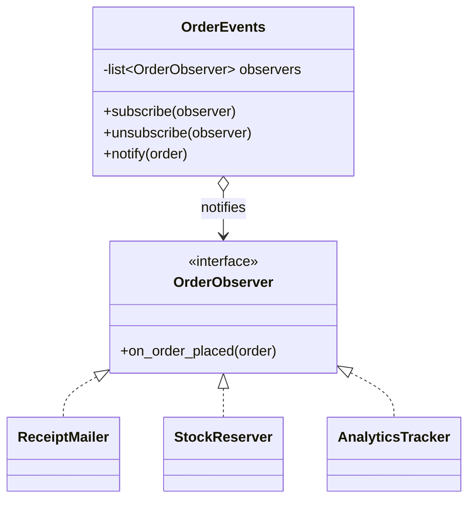
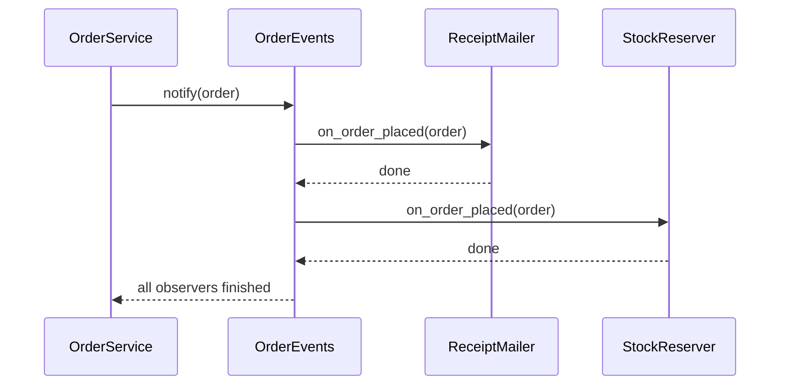

# Observer Pattern

## Introduction

**Observer** lets one object (the **subject**, or publisher) notify any number of other objects (the **observers**, or subscribers) when something happens, without knowing who they are.

A newsletter is the classic analogy. The publisher does not keep a hard-coded list of readers in its printing press. Readers subscribe and unsubscribe whenever they like, and every new issue goes to whoever is on the list at that moment.

Observer is everywhere in modern software:

- a button click handler in a browser
- a spreadsheet cell that recalculates when the cells it depends on change
- a "send welcome email when a user signs up" hook
- reactive UI frameworks that re-render when state changes

In this page you will build Observer from scratch in Python, look at a typed TypeScript version, learn the real problems it brings (error handling, ordering, memory leaks, hidden control flow) and see when a direct function call or a message queue is the better choice.

## The Problem: A Service That Knows Too Much

Your online bookstore places orders. When an order is placed, several things must happen: email a receipt, reserve stock, record analytics and award loyalty points.

```python
from dataclasses import dataclass


@dataclass
class Order:
    id: str
    customer_email: str
    total: float


class EmailService:
    def send_receipt(self, order: Order) -> None:
        print(f"email: receipt for {order.id} to {order.customer_email}")


class Inventory:
    def reserve(self, order: Order) -> None:
        print(f"inventory: reserved items for {order.id}")


class Analytics:
    def track(self, name: str, order: Order) -> None:
        print(f"analytics: {name} {order.total}")


class OrderService:
    def __init__(self) -> None:
        self.email = EmailService()
        self.inventory = Inventory()
        self.analytics = Analytics()

    def place(self, order: Order) -> None:
        print(f"order {order.id} saved")
        self.email.send_receipt(order)
        self.inventory.reserve(order)
        self.analytics.track("order_placed", order)
        # loyalty points next sprint... and fraud checks after that...


OrderService().place(Order("A-100", "ana@example.com", 42.0))
```

Output:

```text
order A-100 saved
email: receipt for A-100 to ana@example.com
inventory: reserved items for A-100
analytics: order_placed 42.0
```

What hurts:

- **`OrderService` depends on every reaction.** It imports email, inventory and analytics code, so it changes whenever any of them changes.
- **Adding a reaction means editing the core flow.** Loyalty points, fraud checks and a Slack alert each require changing `place`.
- **Testing `place` drags in everything.** You must stub email and analytics just to test that an order is saved.
- **Teams collide.** The marketing team's analytics change and the warehouse team's inventory change land in the same method.

## The Pattern

The subject keeps a list of observers and calls each one when its state changes. Observers implement a tiny interface, usually one `update` or `notify` method.



### Step 1: A classic subject and observers

```python
from dataclasses import dataclass
from typing import Protocol


@dataclass(frozen=True)
class Order:
    id: str
    customer_email: str
    total: float


class OrderObserver(Protocol):
    def on_order_placed(self, order: Order) -> None: ...


class OrderEvents:
    def __init__(self) -> None:
        self._observers: list[OrderObserver] = []

    def subscribe(self, observer: OrderObserver) -> None:
        self._observers.append(observer)

    def unsubscribe(self, observer: OrderObserver) -> None:
        self._observers.remove(observer)

    def notify(self, order: Order) -> None:
        for observer in list(self._observers):  # copy: observers may unsubscribe while notified
            observer.on_order_placed(order)


class ReceiptMailer:
    def on_order_placed(self, order: Order) -> None:
        print(f"email: receipt for {order.id}")


class StockReserver:
    def on_order_placed(self, order: Order) -> None:
        print(f"inventory: reserved items for {order.id}")


class OrderService:
    def __init__(self, events: OrderEvents) -> None:
        self.events = events

    def place(self, order: Order) -> None:
        print(f"order {order.id} saved")
        self.events.notify(order)


events = OrderEvents()
events.subscribe(ReceiptMailer())
events.subscribe(StockReserver())
OrderService(events).place(Order("A-101", "bo@example.com", 18.5))
```

Output:

```text
order A-101 saved
email: receipt for A-101
inventory: reserved items for A-101
```

`OrderService` now depends only on `OrderEvents`. It has no idea that emails or inventory exist. New reactions are added by subscribing, in the code that wires the application together, not by editing `place`.

### Step 2: Callbacks instead of observer classes

As with [Strategy](./0-arch-strategy.mdx), a one-method observer is really just a function. Most Python and JavaScript code uses callbacks.

```python
from collections.abc import Callable
from dataclasses import dataclass


@dataclass(frozen=True)
class Order:
    id: str
    total: float


Handler = Callable[[Order], None]


class Signal:
    def __init__(self, name: str) -> None:
        self.name = name
        self._handlers: list[Handler] = []

    def connect(self, handler: Handler) -> Handler:
        self._handlers.append(handler)
        return handler  # returning it lets us use connect as a decorator

    def disconnect(self, handler: Handler) -> None:
        self._handlers.remove(handler)

    def send(self, order: Order) -> None:
        for handler in list(self._handlers):
            handler(order)


order_placed = Signal("order_placed")


@order_placed.connect
def award_points(order: Order) -> None:
    print(f"loyalty: +{int(order.total)} points for {order.id}")


@order_placed.connect
def track(order: Order) -> None:
    print(f"analytics: order_placed {order.total}")


order_placed.send(Order("A-102", 27.0))
order_placed.disconnect(track)
order_placed.send(Order("A-103", 5.0))
```

Output:

```text
loyalty: +27 points for A-102
analytics: order_placed 27.0
loyalty: +5 points for A-103
```

This is very close to how Django signals and many plugin systems look.

### Step 3: Handling a failing observer

In the naive loop, if one observer raises an exception, **the remaining observers never run**, and the exception bubbles into the publisher. An analytics bug should not stop the receipt email. Decide on a policy and make it explicit.

```python
# continues from above
@order_placed.connect
def flaky_fraud_check(order: Order) -> None:
    raise RuntimeError("fraud API timeout")


@order_placed.connect
def send_receipt(order: Order) -> None:
    print(f"email: receipt for {order.id}")


def send_robust(signal: Signal, order: Order) -> list[tuple[str, Exception]]:
    """Call every handler; collect errors instead of stopping at the first one."""
    errors: list[tuple[str, Exception]] = []
    for handler in list(signal._handlers):
        try:
            handler(order)
        except Exception as exc:  # isolate observers from each other
            errors.append((handler.__name__, exc))
    return errors


for name, exc in send_robust(order_placed, Order("A-104", 12.0)):
    print(f"handler {name} failed: {exc}")
```

Output:

```text
loyalty: +12 points for A-104
email: receipt for A-104
handler flaky_fraud_check failed: fraud API timeout
```

Django offers exactly this choice: `Signal.send()` lets an exception stop the dispatch, while `send_robust()` catches exceptions and returns them alongside each receiver's response.

## The Same Idea in TypeScript

A typed event map is where TypeScript shines: the compiler checks that each event name is paired with the right payload.

```typescript
type Events = {
  orderPlaced: { id: string; total: number };
  orderCancelled: { id: string; reason: string };
};

type Listener<T> = (payload: T) => void;

class TypedEmitter<E extends Record<string, unknown>> {
  private listeners: { [K in keyof E]?: Listener<E[K]>[] } = {};

  on<K extends keyof E>(event: K, fn: Listener<E[K]>): () => void {
    (this.listeners[event] ??= []).push(fn);
    return () => this.off(event, fn); // return an unsubscribe function
  }

  off<K extends keyof E>(event: K, fn: Listener<E[K]>): void {
    this.listeners[event] = (this.listeners[event] ?? []).filter((l) => l !== fn);
  }

  emit<K extends keyof E>(event: K, payload: E[K]): void {
    for (const fn of [...(this.listeners[event] ?? [])]) fn(payload);
  }
}

const bus = new TypedEmitter<Events>();
const stop = bus.on("orderPlaced", (o) => console.log(`email: receipt for ${o.id}`));
bus.on("orderCancelled", (o) => console.log(`refund: ${o.id} (${o.reason})`));

bus.emit("orderPlaced", { id: "A-200", total: 30 });
bus.emit("orderCancelled", { id: "A-200", reason: "duplicate" });
stop();
bus.emit("orderPlaced", { id: "A-201", total: 12 }); // nobody listening now
// bus.emit("orderPlaced", { id: "A-202" });  // compile error: 'total' is missing
```

Output:

```text
email: receipt for A-200
refund: A-200 (duplicate)
```

Returning an unsubscribe function from `on` is a widely used convention (React effects, RxJS subscriptions and many store libraries do the same). It makes cleanup hard to forget.

## Where You Have Already Met Observer

- **The browser DOM.** `button.addEventListener("click", handler)` subscribes an observer; `removeEventListener` unsubscribes it.
- **Node.js `EventEmitter`.** `emitter.on("data", fn)` and `emitter.emit("data", chunk)`. Node streams are built on it.
- **Django signals.** `post_save`, `request_finished` and custom signals, connected with the `@receiver` decorator.
- **Spring application events.** `ApplicationEventPublisher.publishEvent(...)` plus `@EventListener` methods. Listeners run **synchronously** in the publisher's thread by default, unless you make them `@Async`.
- **Reactive libraries.** RxJS `Observable.subscribe`, and the state stores behind many UI frameworks, extend Observer with operators for filtering, mapping and combining streams.
- **Java's original `java.util.Observer` and `Observable`.** These were **deprecated in Java 9**. The Javadoc explains that the model was too limited (for example, notification order is unspecified) and points to `java.beans` property change listeners, `java.util.concurrent` and the `Flow` API instead. It is a good reminder that a naive Observer is easy to write and hard to get right.

## Push vs Pull, Sync vs Async

Two design decisions shape every Observer implementation:

| Decision | Option A | Option B |
| --- | --- | --- |
| What observers receive | **Push**: the subject sends the data (`notify(order)`) | **Pull**: the subject sends "I changed" and observers query it |
| When observers run | **Synchronous**: inside the publisher's call, same thread and transaction | **Asynchronous**: later, from a queue or event loop |

Push is simpler and the most common choice. Pull avoids sending large payloads that most observers ignore.

Synchronous dispatch is easy to reason about and test, but a slow observer slows down the publisher, and a crash can break it. Asynchronous dispatch protects the publisher, but you then need retries, ordering guarantees and monitoring. At that point you have moved from an in-process pattern to [messaging](../10-arch-integration-and-apis/5-arch-messaging-patterns.mdx) and [event-driven architecture](../6-arch-architectural-styles/5-arch-event-driven.mdx).



In the synchronous case, the diagram shows the important consequence: `OrderService.place` does not return until every observer finishes.

## Real-World Scenario

Your team builds a **SaaS helpdesk**. When a ticket's status changes, many features must react: the requester gets an email, the assigned agent sees a live update in the browser, an SLA timer starts or stops, and the audit log records the change. New reactions arrive every quarter (Slack integration, webhooks for customers, AI summarization).

### The solution

Inside the ticket module, publish an in-process `TicketStatusChanged` event and register handlers at startup. Handlers that are fast and must succeed with the change (the audit log) run synchronously. Slow or external ones (emails, webhooks, AI) only **enqueue a job**, so the request is never blocked by a third-party API.

```python
from collections import defaultdict
from collections.abc import Callable
from dataclasses import dataclass
from typing import Any


@dataclass(frozen=True)
class TicketStatusChanged:
    ticket_id: int
    old: str
    new: str


class EventBus:
    def __init__(self) -> None:
        self._handlers: dict[type, list[Callable[[Any], None]]] = defaultdict(list)

    def subscribe(self, event_type: type, handler: Callable[[Any], None]) -> None:
        self._handlers[event_type].append(handler)

    def publish(self, event: object) -> None:
        for handler in list(self._handlers[type(event)]):
            handler(event)


job_queue: list[tuple[str, int]] = []   # stands in for a real queue such as RabbitMQ
audit_log: list[str] = []


def write_audit(e: TicketStatusChanged) -> None:          # fast, must not be lost
    audit_log.append(f"ticket {e.ticket_id}: {e.old} -> {e.new}")


def enqueue_email(e: TicketStatusChanged) -> None:        # slow, external: defer it
    job_queue.append(("send_status_email", e.ticket_id))


def enqueue_webhooks(e: TicketStatusChanged) -> None:
    job_queue.append(("deliver_webhooks", e.ticket_id))


bus = EventBus()
bus.subscribe(TicketStatusChanged, write_audit)
bus.subscribe(TicketStatusChanged, enqueue_email)
bus.subscribe(TicketStatusChanged, enqueue_webhooks)

bus.publish(TicketStatusChanged(ticket_id=7, old="open", new="pending"))
print(audit_log)
print(job_queue)
```

Output:

```text
['ticket 7: open -> pending']
[('send_status_email', 7), ('deliver_webhooks', 7)]
```

:::caution
If the ticket update is in a database transaction, enqueue jobs **after the commit**, or use the [Transactional Outbox](../9-arch-distributed-systems/6-arch-outbox.mdx). Otherwise a rollback can leave an email describing a change that never happened. Spring's `@TransactionalEventListener` exists for exactly this reason.
:::

### Why this approach

- **The ticket module stays small.** It publishes one fact ("status changed") and never learns about Slack or AI.
- **Teams own their handlers.** The integrations team adds a webhook handler without touching ticket code.
- **Sync vs async is a per-handler decision.** Audit is synchronous for consistency; external calls go through a queue for resilience.

### When to use it, and when not to

Use Observer when:

- **one change has several independent reactions**, and the set of reactions grows over time
- the publisher **should not know** about the reactions (different modules or teams)
- reactions are **side effects**, such as notifications, caches, metrics and UI updates

Do not use it when:

- there is **exactly one reaction** that is part of the business rule. "Placing an order must reserve stock" is core logic, so call `inventory.reserve()` directly and let the reader see it.
- the publisher **needs a result** from the reaction. Observers are fire-and-forget; a return value means you want a function call.
- the **order of reactions matters** for correctness. Relying on registration order is fragile. Make the sequence explicit.
- you need **cross-process delivery with retries**. Use a message broker, not an in-memory list.

### Alternatives and trade-offs

| Approach | Pros | Cons | Best for |
| --- | --- | --- | --- |
| Direct method calls | Explicit, easy to follow and debug | Publisher depends on every reaction | Core logic, 1-2 required steps |
| In-process Observer or event bus | Decoupled, cheap, synchronous and testable | Hidden control flow, shared failure domain | Side effects inside one application |
| [Mediator](./7-arch-mediator.mdx) | Interaction rules in one place | The mediator can grow into a god object | Many components that talk to each other |
| Message broker (queue or pub/sub) | Durable, retries, cross-service | Infrastructure, eventual consistency | Slow or external work, microservices |
| Reactive streams (RxJS, Flow) | Composable, backpressure-aware operators | Steep learning curve | Streams of UI or data events |

## Common Mistakes

1. **Memory leaks from forgotten subscriptions.** The subject holds a strong reference to every observer. A UI component that subscribes but never unsubscribes stays alive forever. Return an unsubscribe handle, use `weakref.WeakMethod` or `weakref.WeakSet` where appropriate, or tie subscriptions to a lifecycle. Django stores receivers as weak references by default for this reason.
2. **Mutating the list during notification.** An observer that unsubscribes itself during `notify` can make the loop skip the next observer. Iterate over a copy, as the examples here do.
3. **Event cascades.** Observer A updates something that notifies observer B, which updates something that notifies A again. Keep handlers free of changes that re-trigger the same event, or detect re-entry.
4. **Hiding core logic in handlers.** Django's own documentation warns that signals "give the appearance of loose coupling" but can make code hard to understand and debug, and suggests calling the handling code directly where possible. If reading `place()` no longer tells you what placing an order does, you have gone too far.
5. **Huge, vague events.** `something_changed(obj)` forces every observer to work out what changed. Publish specific events with the data observers need, such as `TicketStatusChanged(old, new)`.

## Summary

- Observer lets a subject notify any number of subscribers without depending on them.
- In Python and TypeScript, observers are usually **callbacks**; return an unsubscribe handle.
- Decide explicitly on **error isolation**, **ordering** and **sync vs async** delivery.
- You use Observer through DOM events, Node `EventEmitter`, Django signals and Spring events.
- Keep **core business steps as direct calls**. Use Observer for independent side effects, and a message broker once delivery must survive crashes.

## Exercises

1. Add `once(handler)` to the `Signal` class: a subscription that removes itself after the first call. Make sure it does not break the notification loop.
2. Make `EventBus.publish` call handlers for a base class too, so a handler subscribed to `TicketEvent` receives `TicketStatusChanged`. (Hint: walk `type(event).__mro__`.)
3. Rewrite the helpdesk example so that external handlers run on a `concurrent.futures.ThreadPoolExecutor`. What new problems appear (errors, shutdown, ordering)?
4. Review a codebase you know and find one event handler that should really be a direct call, and one direct call that should be an event. Justify each.

Related pages: compare Observer with the [Mediator Pattern](./7-arch-mediator.mdx), see how events become first-class domain concepts in [Domain Events](../8-arch-domain-driven-design/5-arch-domain-events.mdx), and continue with the [Command Pattern](./2-arch-command.mdx).
