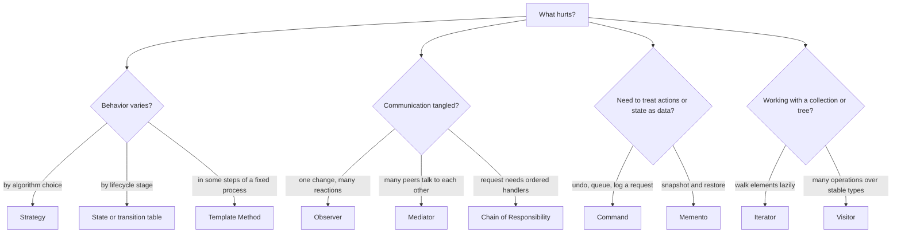
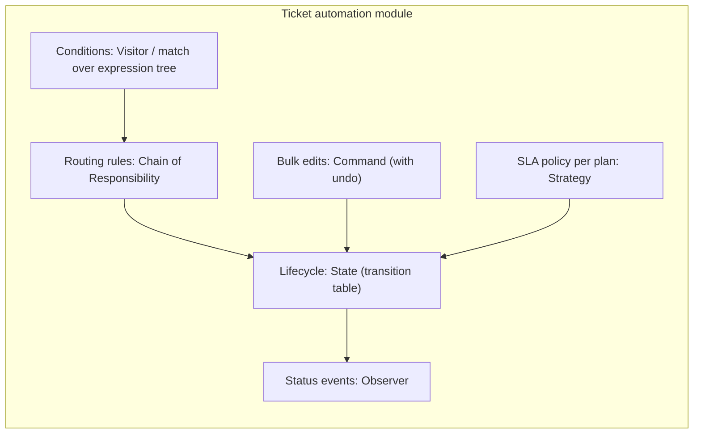

# Choosing a Behavioral Pattern

## Introduction

You have now met ten behavioral patterns. Each one answers a slightly different question about **how responsibilities and communication are distributed** among objects. Knowing the patterns is the easy part; the hard part is recognizing which problem you actually have, and whether you need a pattern at all.

This page is a decision guide. It:

- restates each pattern as the **question it answers**
- gives a **decision flowchart** from symptom to pattern
- untangles the **pairs people confuse** most often
- shows how patterns **combine** in one realistic feature
- lists the signals that a pattern is **over-engineering**

A good rule before reading further: start with the simplest code that works, such as a function, an `if` statement or a list. Reach for a pattern when you feel a **specific pain** that the pattern removes: duplicated branches, classes that know too much, missing undo, tangled dependencies. Patterns are refactoring targets more than starting points; see [Refactoring to Patterns](../5-arch-modern-patterns/8-arch-refactoring-to-patterns.mdx).

## Ten Patterns, Ten Questions

| Pattern | The question it answers | Core mechanism | Typical Python form |
| --- | --- | --- | --- |
| [Strategy](./0-arch-strategy.mdx) | "How do I swap one algorithm for another?" | Context delegates to an interchangeable object | A function passed as an argument |
| [Observer](./1-arch-observer.mdx) | "How do many parts react to one change without the source knowing them?" | Subscribers register with a subject | Callbacks, signals, an event bus |
| [Command](./2-arch-command.mdx) | "How do I store, queue, undo or log a request?" | Request turned into an object | Dataclass plus handler, or a closure |
| [State](./3-arch-state.mdx) | "How does behavior change as an object moves through stages?" | Delegate to the current state object | Enum plus transition table |
| [Template Method](./4-arch-template-method.mdx) | "How do variants share a fixed sequence of steps?" | Base class skeleton, subclass steps | ABC with `@final` template |
| [Chain of Responsibility](./5-arch-chain-of-responsibility.mdx) | "Who should handle this request, in what order?" | Pass along handlers until one handles it | List of rules, or middleware functions |
| [Iterator](./6-arch-iterator.mdx) | "How do I walk through elements without knowing the storage?" | Separate traversal object | Generator with `yield` |
| [Mediator](./7-arch-mediator.mdx) | "How do many peers coordinate without knowing each other?" | Central hub holds interaction rules | A coordinator class |
| [Memento](./8-arch-memento.mdx) | "How do I save and restore state without exposing it?" | Opaque snapshot from the originator | Frozen dataclass snapshot |
| [Visitor](./9-arch-visitor.mdx) | "How do I add operations to a stable set of types?" | Double dispatch, one method per type | `match` over a union type |

## A Decision Flowchart

Start from the symptom you are experiencing, not from the pattern you would like to use.



:::tip
It helps to group the ten patterns by the kind of problem they solve:

- **Varying behavior:** Strategy, State, Template Method
- **Managing communication:** Observer, Mediator, Chain of Responsibility
- **Treating actions and state as data:** Command, Memento
- **Working with structures:** Iterator, Visitor

If you can say which group your problem belongs to, you are down to two or three candidates.
:::

Use the chart as a starting point, then check the "when not to use it" section of the pattern's page. Several symptoms have a non-pattern answer that is better: a parameter, a dictionary, a direct call.

## The Confusable Pairs

Several behavioral patterns have nearly identical class diagrams. What separates them is **intent**: who decides, who knows whom, and what changes over time.

| Pair | The difference in one sentence | Quick test |
| --- | --- | --- |
| Strategy vs State | Strategy is chosen by the **client**; states choose **their successors**. | Do the variants know about each other? If yes, it is State. |
| Strategy vs Template Method | Strategy varies the algorithm by **composition** at runtime; Template Method varies steps by **inheritance**. | Can you swap it on a live object? If yes, Strategy. |
| Observer vs Mediator | Observer broadcasts to **anonymous subscribers**; Mediator **knows** the participants and applies rules. | Does the hub make decisions? If yes, Mediator. |
| Chain vs Decorator | A chain handler **may stop** the request; a decorator **always** forwards and adds behavior. | Can a link short-circuit? If yes, Chain. |
| Command vs Strategy | A command is **one request** with its parameters; a strategy is **a way of doing** something, called repeatedly. | Would you put it in a queue or history? If yes, Command. |
| Command vs Memento | Command undo **reverses** an operation; Memento undo **restores** a snapshot. | Is reversing the operation hard? Then Memento. |
| Iterator vs Visitor | Iterator controls **traversal order**; Visitor controls **what happens per type**. | Are you choosing order, or behavior per type? |
| Observer vs Chain | Observer notifies **everyone**; a chain stops at the **first** handler (classic flavor). | Should all react, or one? |

## Python Often Has a Lighter Form

Many GoF patterns were described for languages without first-class functions or generators. In Python, the idea often survives while the class structure shrinks. The [Design Patterns in Modern Languages](../5-arch-modern-patterns/0-arch-patterns-in-modern-languages.mdx) page covers this in depth. Here is the same notification feature in two forms:

```python
from collections.abc import Callable
from dataclasses import dataclass


@dataclass(frozen=True)
class TicketClosed:
    ticket_id: int
    csat_survey: bool


# Heavy form: an observer interface, concrete classes, a subject class... (not shown)

# Light form: Observer as a list of functions, Strategy as a function parameter.
handlers: list[Callable[[TicketClosed], None]] = []


def on(handler: Callable[[TicketClosed], None]) -> Callable[[TicketClosed], None]:
    handlers.append(handler)
    return handler


@on
def send_survey(e: TicketClosed) -> None:
    if e.csat_survey:
        print(f"survey sent for ticket {e.ticket_id}")


@on
def update_stats(e: TicketClosed) -> None:
    print(f"stats: ticket {e.ticket_id} closed")


def close_ticket(ticket_id: int, survey_policy: Callable[[int], bool] = lambda _id: True) -> None:
    event = TicketClosed(ticket_id, csat_survey=survey_policy(ticket_id))
    for h in handlers:
        h(event)


close_ticket(7)
close_ticket(8, survey_policy=lambda tid: tid % 2 == 1)   # strategy: survey odd tickets only
```

Output:

```text
survey sent for ticket 7
stats: ticket 7 closed
stats: ticket 8 closed
```

Both patterns are present, Observer (`handlers`) and Strategy (`survey_policy`), but there is not a single extra class. Move to the class-based forms when you need what classes add: several methods, named types for logging, dependency injection, or interfaces shared across teams.

| Pattern | Light Python form | Move to classes when |
| --- | --- | --- |
| Strategy | Function or `functools.partial` | Strategies need several methods or dependencies |
| Observer | List of callbacks | You need unsubscribe handles, priorities or error policies |
| Command | Closure, or dataclass plus handler | You need undo, descriptions or serialization |
| State | `Enum` plus transition dict | States have rich, different behavior and data |
| Template Method | Function with function parameters | You must enforce invariants subclasses cannot skip |
| Chain | List of rule functions | Handlers must wrap each other (before and after logic) |
| Iterator | Generator | You need `close`, `peek` or other extra methods |
| Visitor | `match` or `singledispatch` | Many operations, many teams, strict exhaustiveness |

## Real-World Scenario

Your team builds **ticket automation** for a SaaS helpdesk. When a ticket arrives, the system must:

1. route it to the right queue using admin-defined rules, with a fallback
2. apply SLA rules that differ by customer plan (Basic, Pro, Enterprise)
3. move the ticket through its lifecycle (new, open, pending, solved, closed) with illegal moves rejected
4. notify integrations (email, Slack, webhooks) whenever the status changes
5. let admins **undo** a bulk change made by mistake
6. evaluate admin-written conditions such as "priority is urgent AND tag is vip", and also show them as text and export them to SQL

### Mapping requirements to patterns



| Requirement | Pattern | Why this one | Simpler option considered |
| --- | --- | --- | --- |
| Routing rules | Chain of Responsibility (list of rules, first match wins) | Order is configurable data; fallback guarantees a result | Hard-coded `if/elif`: rejected, admins edit rules |
| SLA by plan | Strategy (one function per plan) | Plan chosen at runtime per ticket; rules differ substantially | A table of hours per plan: **chosen for Basic and Pro**, Strategy only for Enterprise's custom calendars |
| Lifecycle | State, as an enum plus transition table | States mostly differ in allowed transitions | State classes: rejected, behavior per state is thin |
| Integrations | Observer (in-process events, then a queue) | New integrations arrive every quarter; ticket code must not know them | Direct calls: rejected, too many teams involved |
| Bulk undo | Command, storing previous values | Needs queueing, audit and reversal | Memento of all tickets: rejected, too much state |
| Conditions | Visitor, written as `match` functions | Node types are stable; operations keep growing | Methods on nodes: rejected, five teams add operations |

Notice the "simpler option" column. In two places (SLA hours, lifecycle) the team chose a **table** over a full pattern, because the variation was data, not behavior. That restraint is as important as the patterns themselves.

### A sketch of the core flow

```python
from collections.abc import Callable
from dataclasses import dataclass, field
from enum import Enum


class Status(Enum):
    NEW = "new"
    OPEN = "open"
    SOLVED = "solved"


ALLOWED = {(Status.NEW, Status.OPEN), (Status.OPEN, Status.SOLVED)}          # State as data
SLA_HOURS = {"basic": 48, "pro": 24, "enterprise": 4}                        # a table, not a pattern


@dataclass
class Ticket:
    id: int
    subject: str
    plan: str
    status: Status = Status.NEW
    queue: str = ""


@dataclass(frozen=True)
class Rule:
    matches: Callable[[Ticket], bool]
    queue: str


RULES = [Rule(lambda t: "outage" in t.subject.lower(), "on-call"),           # Chain (first match)
         Rule(lambda t: t.plan == "enterprise", "priority")]

listeners: list[Callable[[Ticket, Status], None]] = []                       # Observer


def route(t: Ticket) -> None:
    t.queue = next((r.queue for r in RULES if r.matches(t)), "tier-1")


def transition(t: Ticket, new: Status) -> None:
    if (t.status, new) not in ALLOWED:
        raise ValueError(f"{t.status.value} -> {new.value} not allowed")
    old, t.status = t.status, new
    for listener in listeners:
        listener(t, old)


listeners.append(lambda t, old: print(f"notify: #{t.id} {old.value} -> {t.status.value}"))

t = Ticket(1, "Full outage in EU", plan="pro")
route(t)
print(f"#{t.id} queue={t.queue} sla={SLA_HOURS[t.plan]}h")
transition(t, Status.OPEN)
transition(t, Status.SOLVED)
try:
    transition(t, Status.NEW)
except ValueError as e:
    print("Error:", e)
```

Output:

```text
#1 queue=on-call sla=24h
notify: #1 new -> open
notify: #1 open -> solved
Error: solved -> new not allowed
```

Four behavioral ideas fit into about forty lines, because each one is expressed in its lightest form. As the feature grows, each piece can be promoted to a fuller version independently: rules into rule objects with names, listeners into a queued event bus, transitions into a library-backed state machine.

### Why this approach

- **Each pattern addresses one named requirement**, so reviewers can see why it is there.
- **Lightest form first** keeps the code small; promotion to classes happens only when a requirement demands it.
- **Patterns compose**: Command drives State, State emits events to Observers, and Visitor-style conditions feed the Chain.

### When to use a pattern, and when not to

Reach for a behavioral pattern when:

- you can name the **specific pain** (duplicated branches, a class that imports everything, missing undo)
- the **variation is real today**, not hypothetical
- the pattern makes the code **easier for the next reader**, not just more flexible

Hold back when:

- a **parameter, dictionary or enum** captures the variation (the variation is data)
- there is **one implementation** and no concrete second one coming ([YAGNI](../1-arch-design-principles/6-arch-dry-kiss-yagni.mdx))
- the pattern adds **indirection that hides core logic**, such as an event handler that performs a required business step

### Alternatives and trade-offs at a glance

| Approach | Pros | Cons | Best for |
| --- | --- | --- | --- |
| Plain functions and data | Minimal, readable, easy to test | Can sprawl without structure | Small and medium features |
| Light pattern forms (callbacks, tables, generators) | Captures the idea with little code | Less discoverable than named types | Most Python codebases |
| Full class-based patterns | Explicit roles, interfaces, IDE navigation | More files and indirection | Large teams, frameworks, Java and C# codebases |
| Libraries (state machines, event buses, rule engines) | Battle-tested features | Dependencies, learning curve, lock-in | Complex lifecycles, large rule sets |

## Where You Will Meet Each Pattern

Recognizing a pattern in code you already use is the fastest way to understand it. These are the sightings covered in this section's pages:

| Pattern | Python | Java and JVM | JavaScript and TypeScript |
| --- | --- | --- | --- |
| Strategy | `sorted(key=...)`, Django `PASSWORD_HASHERS` | `Comparator` | Passport.js strategies |
| Observer | Django signals | Spring `@EventListener`, `PropertyChangeListener` | DOM `addEventListener`, Node `EventEmitter` |
| Command | `Executor.submit`, Celery tasks | `Runnable`, Swing `UndoManager` | Redux actions, VS Code commands |
| State | `transitions` library | Enums with constant-specific methods | XState |
| Template Method | `unittest.TestCase`, `socketserver` handlers | `HttpServlet.service`, `AbstractList` | Framework lifecycle hooks |
| Chain of Responsibility | Django middleware, `logging` propagation | Servlet `FilterChain`, Spring Security | Express middleware, event bubbling |
| Iterator | `for` loops, generators, `itertools` | `Iterable` and `Iterator` | `Symbol.iterator`, `for await...of` |
| Mediator | Form or workflow coordinators | Dialog controllers | Parent components and stores |
| Memento | Snapshots with frozen dataclasses | Opaque nested snapshot classes | `history.pushState`, Redux DevTools |
| Visitor | `ast.NodeVisitor`, `singledispatch` | `FileVisitor`, sealed types with `switch` | Babel and ESLint visitors |

## Questions to Ask in a Design Review

When someone proposes a behavioral pattern, these questions quickly show whether it earns its place:

1. **What is the "before" code, and what exactly hurts?** If nobody can show it, the pattern is speculative.
2. **How many variants exist today?** Strategy, State and Visitor need at least two real cases to pay off.
3. **Who decides?** The client (Strategy), the object itself (State), a hub (Mediator), or the first willing handler (Chain)?
4. **What happens on failure?** Observers that throw, chains with no terminal handler, and commands that run twice all need an explicit policy.
5. **Can a newcomer follow the flow?** Indirection has a reading cost. Make sure names, logs and diagrams make the runtime path visible.
6. **What is the lighter form?** Could a function, a dictionary, an enum or a generator do the same job?

## Over-Engineering Warning Signs

Patterns go wrong more often by overuse than by underuse. Watch for these signs in code review:

1. **An interface with a single implementation**, created "for flexibility". Delete it until a second implementation exists.
2. **A pattern name in a class name with no pattern pain behind it**: `TicketStrategyFactoryVisitor` is a warning, not an achievement.
3. **Indirection that hides required steps.** If you cannot tell what `place_order` does without searching for event handlers, you have moved core logic into Observer.
4. **A mediator or event bus that everything goes through.** That is a god object with extra steps.
5. **Deep inheritance for Template Method.** More than two levels usually means composition would be clearer.
6. **Patterns copied from a book rather than from a problem.** Every pattern on these pages begins with "before" code that hurts. If you cannot write the "before" code for your case, you probably do not need the pattern.

The [Common Anti-Patterns](../5-arch-modern-patterns/7-arch-anti-patterns.mdx) page covers these and other traps in more detail.

## Summary

- Each behavioral pattern answers a distinct question about **who does what and who talks to whom**.
- Choose by **symptom**: varying algorithms (Strategy), lifecycles (State), fixed workflows (Template Method), many reactions (Observer), tangled peers (Mediator), ordered handlers (Chain), actions as data (Command), snapshots (Memento), traversal (Iterator), operations over stable types (Visitor).
- Several pairs look alike structurally; separate them by **intent and who decides**.
- In Python, start with the **light form** (functions, tables, generators, `match`) and promote to classes when needed.
- Real features combine several patterns; justify each one with a requirement, and prefer data over patterns when the variation is data.

## Exercises

1. For each of these situations, name the pattern you would use (or "none") and justify it in one sentence: (a) a CSV export that must support semicolon and comma delimiters; (b) a document workflow with draft, review, approved and archived stages; (c) undo in a drawing app with complex filters; (d) logging, authentication and compression around every HTTP request; (e) a game where enemies, items and walls must all be rendered, saved and collision-checked.
2. Take the "sketch of the core flow" code and add bulk undo using the Command pattern: a `BulkTransition` command that records previous statuses and can revert them.
3. Pick one confusable pair (for example, Observer vs Mediator) and write two small programs that solve the same problem with each. Which one would you keep, and why?
4. Review a module you know and find one place where a behavioral pattern would help, and one place where an existing pattern could be replaced by something simpler.

You have finished the behavioral patterns. Continue with [Design Patterns in Modern Languages](../5-arch-modern-patterns/0-arch-patterns-in-modern-languages.mdx), or revisit [Choosing a Structural Pattern](../3-arch-structural-patterns/7-arch-choosing-structural.mdx) and [Choosing a Creational Pattern](../2-arch-creational-patterns/7-arch-choosing-creational.mdx) to complete the picture.
