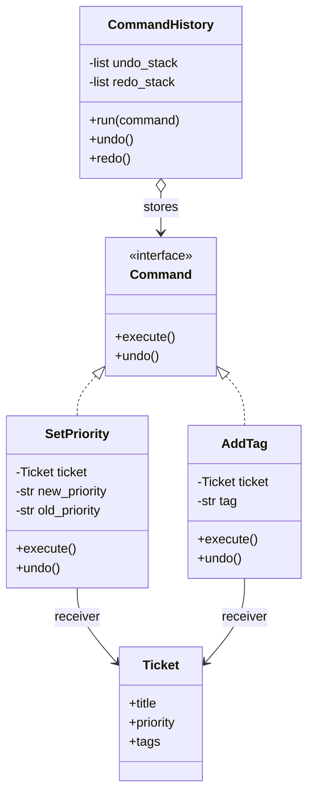
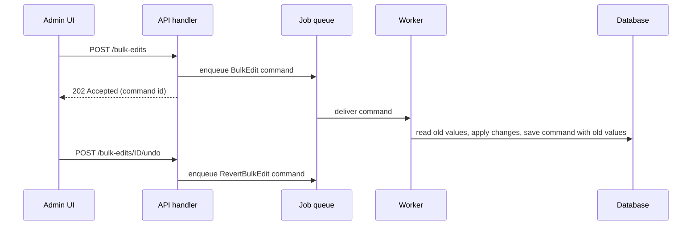

# Command Pattern

## Introduction

**Command** turns a request ("rename this ticket", "charge this card", "bold this text") into an **object**. Once a request is an object, you can do things with it that you cannot do with a plain method call:

- **store** it in a history to undo and redo it
- **queue** it to run later or on another machine
- **log** it for auditing, or replay it after a crash
- **combine** several into a macro
- **pass** it to generic code (a button, a menu, a scheduler) that does not know what it does

A restaurant order ticket is the classic analogy. The waiter does not cook. They write the order on a ticket (the command), and the ticket goes to the kitchen queue. The cook (the **receiver**) executes it when ready. The ticket can be reordered, cancelled, or kept for the bill, and the waiter never needs to know how to make risotto.

The roles are:

| Role | Job | Restaurant |
| --- | --- | --- |
| **Command** | An interface, usually `execute()` and sometimes `undo()` | The order ticket format |
| **Concrete command** | Holds the parameters and knows which receiver to call | "Table 4: risotto, no cheese" |
| **Receiver** | The object that does the real work | The cook |
| **Invoker** | Triggers commands without knowing their details; may keep history | The waiter and the ticket rail |
| **Client** | Creates commands and wires them to receivers | The restaurant owner who set up the system |

## The Problem: Actions Glued to Their Triggers

You are building a small helpdesk ticket editor. Toolbar buttons and keyboard shortcuts call methods on the ticket directly.

```python
from dataclasses import dataclass, field


@dataclass
class Ticket:
    title: str
    priority: str = "normal"
    tags: list[str] = field(default_factory=list)


ticket = Ticket("Printer on fire")


def on_priority_button_clicked() -> None:
    ticket.priority = "urgent"


def on_tag_shortcut_pressed() -> None:
    ticket.tags.append("hardware")


on_priority_button_clicked()
on_tag_shortcut_pressed()
print(ticket)
# The user now presses Ctrl+Z... but nothing remembers what happened or how to reverse it.
```

Output:

```text
Ticket(title='Printer on fire', priority='urgent', tags=['hardware'])
```

What hurts:

- **No undo.** The old priority is gone. To undo, every handler would need its own ad-hoc memory.
- **Duplicated logic.** The toolbar button, the keyboard shortcut and the bulk-edit menu each repeat the same change.
- **No audit trail.** Compliance asks "who changed the priority, and from what?" and the code cannot answer.
- **Cannot defer or batch.** "Apply these 50 edits as one operation" or "run this tonight" is impossible when actions are just lines of code inside handlers.

## The Pattern



### Step 1: Commands with execute and undo

Each command remembers **enough to reverse itself**. Here, `SetPriority` saves the old value at execution time.

```python
from abc import ABC, abstractmethod
from dataclasses import dataclass, field


@dataclass
class Ticket:
    title: str
    priority: str = "normal"
    tags: list[str] = field(default_factory=list)


class Command(ABC):
    @abstractmethod
    def execute(self) -> None: ...

    @abstractmethod
    def undo(self) -> None: ...

    def describe(self) -> str:
        return type(self).__name__


class SetPriority(Command):
    def __init__(self, ticket: Ticket, priority: str) -> None:
        self.ticket = ticket
        self.priority = priority
        self._previous: str | None = None

    def execute(self) -> None:
        self._previous = self.ticket.priority
        self.ticket.priority = self.priority

    def undo(self) -> None:
        assert self._previous is not None
        self.ticket.priority = self._previous

    def describe(self) -> str:
        return f"priority {self._previous} -> {self.priority}"


class AddTag(Command):
    def __init__(self, ticket: Ticket, tag: str) -> None:
        self.ticket = ticket
        self.tag = tag

    def execute(self) -> None:
        self.ticket.tags.append(self.tag)

    def undo(self) -> None:
        self.ticket.tags.remove(self.tag)

    def describe(self) -> str:
        return f"add tag {self.tag!r}"
```

### Step 2: An invoker with undo and redo

The invoker runs commands and keeps two stacks. Running a new command clears the redo stack, which is how every text editor behaves.

```python
# continues from above
class CommandHistory:
    def __init__(self) -> None:
        self._undo: list[Command] = []
        self._redo: list[Command] = []

    def run(self, command: Command) -> None:
        command.execute()
        self._undo.append(command)
        self._redo.clear()
        print(f"run : {command.describe()}")

    def undo(self) -> None:
        if not self._undo:
            print("nothing to undo")
            return
        command = self._undo.pop()
        command.undo()
        self._redo.append(command)
        print(f"undo: {command.describe()}")

    def redo(self) -> None:
        if not self._redo:
            print("nothing to redo")
            return
        command = self._redo.pop()
        command.execute()
        self._undo.append(command)
        print(f"redo: {command.describe()}")


ticket = Ticket("Printer on fire")
history = CommandHistory()

history.run(SetPriority(ticket, "urgent"))
history.run(AddTag(ticket, "hardware"))
print(ticket)
history.undo()
history.undo()
print(ticket)
history.redo()
print(ticket)
```

Output:

```text
run : priority normal -> urgent
run : add tag 'hardware'
Ticket(title='Printer on fire', priority='urgent', tags=['hardware'])
undo: add tag 'hardware'
undo: priority normal -> urgent
Ticket(title='Printer on fire', priority='normal', tags=[])
redo: priority normal -> urgent
Ticket(title='Printer on fire', priority='urgent', tags=[])
```

The toolbar button, the keyboard shortcut and the bulk editor now all build the same command object and hand it to `history.run`. None of them knows how undo works.

### Step 3: Macro commands

A macro is a command made of commands, which is the [Composite pattern](../3-arch-structural-patterns/2-arch-composite.mdx) applied to Command. Undo runs the children in reverse order.

```python
# continues from above
class Macro(Command):
    def __init__(self, name: str, commands: list[Command]) -> None:
        self.name = name
        self.commands = commands

    def execute(self) -> None:
        for c in self.commands:
            c.execute()

    def undo(self) -> None:
        for c in reversed(self.commands):
            c.undo()

    def describe(self) -> str:
        return f"macro {self.name!r} ({len(self.commands)} steps)"


t2 = Ticket("VPN down")
escalate = Macro("escalate", [SetPriority(t2, "urgent"), AddTag(t2, "escalated"), AddTag(t2, "network")])
history.run(escalate)
print(t2)
history.undo()
print(t2)
```

Output:

```text
run : macro 'escalate' (3 steps)
Ticket(title='VPN down', priority='urgent', tags=['escalated', 'network'])
undo: macro 'escalate' (3 steps)
Ticket(title='VPN down', priority='normal', tags=[])
```

### Step 4: Commands as data for queues and logs

To send a command to another process or store it in a log, it must be **serializable**: a name plus plain parameters, with no live object references. The receiver is looked up when the command runs.

```python
import json
from dataclasses import asdict, dataclass

TICKETS: dict[int, dict] = {42: {"priority": "normal", "assignee": None}}


@dataclass(frozen=True)
class AssignTicket:
    ticket_id: int
    agent: str


@dataclass(frozen=True)
class ChangePriority:
    ticket_id: int
    priority: str


COMMAND_TYPES = {cls.__name__: cls for cls in (AssignTicket, ChangePriority)}


def serialize(cmd: object) -> str:
    return json.dumps({"type": type(cmd).__name__, "data": asdict(cmd)})


def handle(cmd: object) -> None:
    match cmd:
        case AssignTicket(ticket_id=tid, agent=agent):
            TICKETS[tid]["assignee"] = agent
        case ChangePriority(ticket_id=tid, priority=p):
            TICKETS[tid]["priority"] = p


# Producer side: build commands and put them on a queue (here, a list of JSON strings).
queue = [serialize(AssignTicket(42, "maria")), serialize(ChangePriority(42, "high"))]
print(queue[0])

# Worker side: rebuild and execute.
for message in queue:
    raw = json.loads(message)
    handle(COMMAND_TYPES[raw["type"]](**raw["data"]))
print(TICKETS[42])
```

Output:

```text
{"type": "AssignTicket", "data": {"ticket_id": 42, "agent": "maria"}}
{'priority': 'high', 'assignee': 'maria'}
```

Here the command is pure data and a separate **handler** executes it. This "command plus handler" split is the shape you will meet in task queues and in [CQRS](../9-arch-distributed-systems/3-arch-cqrs.mdx), where every write to the system is a command.

## The Same Idea in Java

In Java, `Runnable` is the simplest command interface in the standard library: an object that represents "something to run". Executors are invokers that queue and schedule those commands.

```java
import java.util.ArrayDeque;
import java.util.Deque;
import java.util.concurrent.ExecutorService;
import java.util.concurrent.Executors;
import java.util.concurrent.TimeUnit;

public class CommandDemo {
    interface UndoableCommand extends Runnable {
        void undo();
    }

    static final class Counter { int value; }

    record Increment(Counter counter, int by) implements UndoableCommand {
        public void run()  { counter.value += by; }
        public void undo() { counter.value -= by; }
    }

    public static void main(String[] args) throws InterruptedException {
        Counter c = new Counter();
        Deque<UndoableCommand> history = new ArrayDeque<>();

        for (int by : new int[] {5, 10}) {
            UndoableCommand cmd = new Increment(c, by);
            cmd.run();
            history.push(cmd);
        }
        System.out.println("after commands: " + c.value);
        history.pop().undo();
        System.out.println("after undo: " + c.value);

        // A Runnable is a command an executor can queue and run later.
        try (ExecutorService pool = Executors.newSingleThreadExecutor()) {
            pool.submit(() -> System.out.println("queued command ran on " + Thread.currentThread().getName()));
            pool.shutdown();
            pool.awaitTermination(1, TimeUnit.SECONDS);
        }
    }
}
```

Example output:

```text
after commands: 15
after undo: 5
queued command ran on pool-1-thread-1
```

`ExecutorService` implements `AutoCloseable` since Java 19, which is why it can be used in try-with-resources here.

## Where You Have Already Met Command

- **Undo in editors.** Text editors, IDEs and design tools keep a stack of edit commands. Swing ships `javax.swing.undo.UndoableEdit` and `UndoManager` for this purpose.
- **`Runnable`, `Callable` and executors** in Java, and `concurrent.futures.Executor.submit(fn, *args)` in Python: a function plus its arguments, packaged for later execution.
- **Background job queues** such as Celery, Sidekiq or RQ. A task call becomes a message (task name plus arguments) that a worker executes later.
- **Redux actions.** `{ type: "todo/added", payload: ... }` is a serializable request. Reducers are the handlers, and the action log makes time-travel debugging possible.
- **Editor command palettes.** VS Code extensions register named commands with `vscode.commands.registerCommand`, so menus, key bindings and the palette all invoke the same command.
- **Database migrations.** Each migration has an "up" (execute) and often a "down" (undo).

## Real-World Scenario

Your helpdesk product needs **bulk actions**: an admin selects 300 tickets and applies "assign to Tier 2, set priority high, add tag `outage-0611`". Requirements:

- the request must return immediately, and the work runs in the background
- every change must appear in the audit log with who did it
- a mistaken bulk action must be reversible for 24 hours

### The solution

1. The API handler validates the request and creates one `BulkEdit` **command record** (serializable: ticket ids, changes, actor, timestamp) and enqueues it.
2. A worker executes it. For each ticket, it records the **previous values** before applying changes, and writes those into the command record. This is the undo information.
3. The audit log stores the command record itself: it already contains actor, intent and before/after values.
4. "Undo bulk edit" creates a new command that restores the stored previous values, but only for fields nobody has changed since (otherwise it reports a conflict).



### Why this approach

- **The request is data**, so it can be queued, retried and audited without extra design.
- **Undo is a first-class feature**, not something bolted onto controller code.
- **One command, many triggers.** The same `BulkEdit` can be created from the UI, the public API or an automation rule.

### When to use it, and when not to

Use Command when you need at least one of:

- **undo/redo** or reversible operations
- **deferred, queued, scheduled or remote** execution
- an **audit log or replay** of user intent
- **one action triggered from many places** (button, shortcut, API, script)

Do not use it when:

- you simply call a method once, right now, from one place. A command class adds a layer for no benefit.
- undo is **not actually possible**. Sending an email or charging a card cannot be "undone"; you need a **compensating action** (a follow-up email, a refund), which is the idea behind the [Saga pattern](../9-arch-distributed-systems/5-arch-saga.mdx).
- the reversible state is large or hard to reverse step by step. Snapshotting state with [Memento](./8-arch-memento.mdx) can be simpler than writing an `undo` for every command.

### Alternatives and trade-offs

| Approach | Pros | Cons | Best for |
| --- | --- | --- | --- |
| Direct method call | Simplest, no indirection | No undo, queueing or logging | One-off immediate actions |
| Callable or closure (`lambda`, `functools.partial`) | Lightweight deferred execution | Not serializable, no undo, opaque in logs | In-process callbacks, executors |
| Command objects with `undo` | Full undo/redo, macros | Every command must implement reversal | Editors, admin tools |
| Command data plus handler | Serializable, auditable, queueable | Needs a type registry and versioning | Job queues, CQRS, APIs |
| Memento snapshots | Undo without per-command logic | Memory cost of snapshots | Small state, complex operations |
| Event sourcing | Full history and replay | Significant complexity | Audit-critical domains |

## Related and Confusable Patterns

- **Command vs [Strategy](./0-arch-strategy.mdx).** Both wrap behavior in an object. A strategy is *how* a context does its job, and is called repeatedly. A command is *a specific request*, usually executed once, with its parameters inside.
- **Command vs [Memento](./8-arch-memento.mdx).** Two ways to implement undo: commands reverse their own effects, mementos restore a saved snapshot. They are often combined, with a command storing a memento.
- **Command vs [Chain of Responsibility](./5-arch-chain-of-responsibility.mdx).** A chain decides *who handles* a request. The request passed along the chain is often a command object.
- **Command vs domain events.** A command is an intention that may be rejected ("AssignTicket"). An event is a fact that already happened ("TicketAssigned"). See [Domain Events](../8-arch-domain-driven-design/5-arch-domain-events.mdx).

## Common Mistakes

1. **Undo that does not restore the exact state.** `AddTag.undo` using `remove` deletes the *first* matching tag, which is wrong if the tag already existed. Record what actually changed during `execute` (for example, "tag was newly added at index 3").
2. **Commands that hold live objects in a queue.** A command referencing an in-memory `Ticket` cannot be serialized, and by the time it runs, the object may be stale. Queue ids and values, and load the receiver in the handler.
3. **No versioning of serialized commands.** A worker running new code may receive a command written by old code. Add a version field or keep old fields optional.
4. **Non-idempotent queued commands.** Queues usually deliver *at least once*, so a command may run twice. Make handlers [idempotent](../9-arch-distributed-systems/7-arch-idempotency.mdx), for example by recording processed command ids.
5. **A command class per trivial setter.** Forty classes like `SetTitle` and `SetDescription` are a smell. A generic `SetField(field, value)` command, or a snapshot-based undo, may serve better.

## Summary

- Command turns a request into an object with everything needed to perform it.
- That object can be **undone, queued, logged, retried, combined and triggered from anywhere**.
- In Python, small in-process commands can be closures. Use classes when you need `undo` or a description, and **pure data plus a handler** when commands cross process boundaries.
- You use Command through `Runnable` and executors, job queues, Redux actions and editor undo stacks.
- Skip it for one-off direct calls, and use compensating actions when real undo is impossible.

## Exercises

1. Fix the `AddTag.undo` bug from Common Mistakes so that undo is correct even when the tag already existed before `execute`.
2. Add a `limit` to `CommandHistory` so it keeps only the last 50 commands. What should happen to the redo stack?
3. Extend the serialized-command example with a `version` field and write a handler that accepts both version 1 (`agent`) and version 2 (`agent_id`) of `AssignTicket`.
4. Implement "merge consecutive commands": typing five characters should produce one undo step, not five. Where does that logic belong: the command or the history?

Continue with the [State Pattern](./3-arch-state.mdx), or see the undo technique based on snapshots in the [Memento Pattern](./8-arch-memento.mdx).
