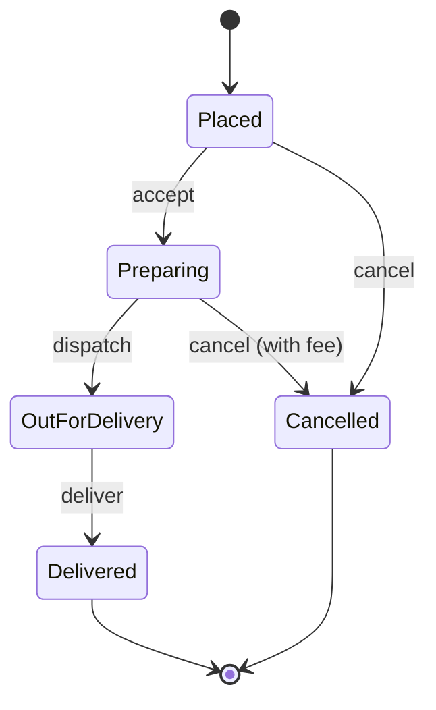
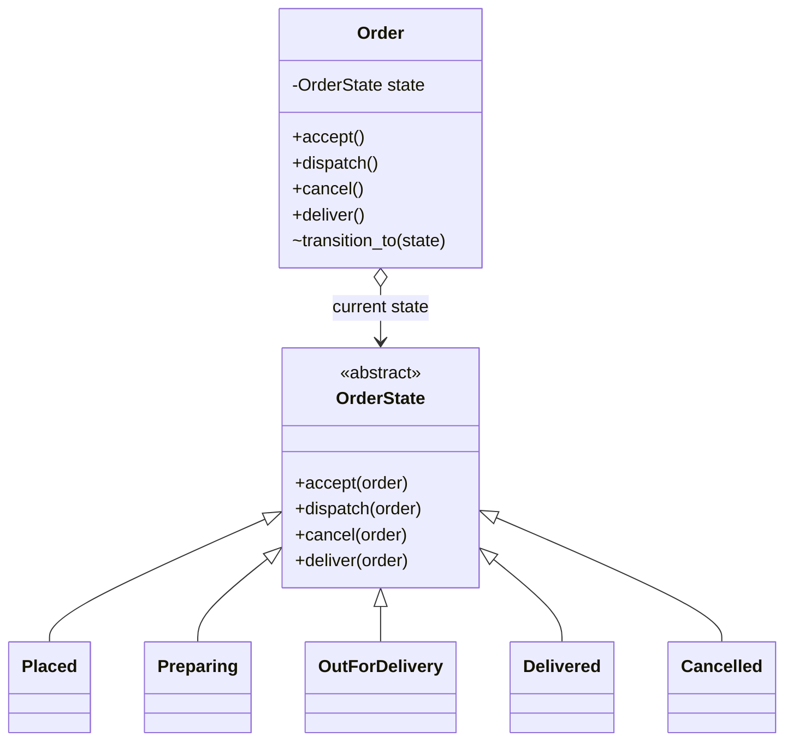

# State Pattern

## Introduction

Many objects behave differently depending on what "stage" they are in. A food delivery order can be cancelled while it is being prepared, but not once it is out for delivery. A document can be edited as a draft, but not after it is published. A TCP connection responds to the same packet differently when it is listening, established or closed.

The **State pattern** lets an object change its behavior when its internal state changes, by delegating to a **state object** that represents the current stage. To the caller, it looks as if the object changed its class.

Think of a vending machine. Pressing "dispense" does nothing when no coin is inserted, dispenses a snack when a coin is inserted, and shows "sold out" when empty. Same button, different behavior, depending on the machine's state.

In this page you will:

- see the status-flag code that the State pattern replaces
- implement state classes in Python, and an enum-based version in Java
- compare the pattern with a simple **transition table**, which is often the better choice
- learn about state machine libraries such as `transitions` (Python) and XState (JavaScript)
- decide when State is worth it and when it is overkill

## The Problem: Status Flags Everywhere

A food delivery order moves through these stages: placed, preparing, out for delivery, delivered, or cancelled.



The first implementation usually stores a string and checks it in every method:

```python
class Order:
    def __init__(self, order_id: str) -> None:
        self.id = order_id
        self.status = "placed"
        self.fee = 0.0

    def accept(self) -> None:
        if self.status == "placed":
            self.status = "preparing"
        else:
            raise ValueError(f"cannot accept an order that is {self.status}")

    def dispatch(self) -> None:
        if self.status == "preparing":
            self.status = "out_for_delivery"
        else:
            raise ValueError(f"cannot dispatch an order that is {self.status}")

    def cancel(self) -> None:
        if self.status == "placed":
            self.status = "cancelled"
        elif self.status == "preparing":
            self.fee = 5.0                     # restaurant already started cooking
            self.status = "cancelled"
        elif self.status in ("out_for_delivery", "delivered"):
            raise ValueError("too late to cancel")
        else:
            raise ValueError(f"cannot cancel an order that is {self.status}")

    def deliver(self) -> None:
        if self.status == "out_for_delivery":
            self.status = "delivered"
        else:
            raise ValueError(f"cannot deliver an order that is {self.status}")


o = Order("F-1")
o.accept()
o.cancel()
print(o.status, o.fee)
```

Output:

```text
cancelled 5.0
```

What hurts:

- **The rules for one state are scattered** across every method. To understand "what can happen while preparing?", you read all of them.
- **Adding a state touches every method.** A new "ready for pickup" state means editing `accept`, `dispatch`, `cancel` and `deliver`, and hoping you did not miss one.
- **Typos are silent.** `self.status = "out_for_delivry"` is a valid string. The order is then stuck forever.
- **State-specific data leaks.** The courier id only makes sense when out for delivery, but it lives on the order in every state.

## The Pattern

The **context** (`Order`) holds a reference to a **state** object and forwards every state-dependent call to it. Each **concrete state** implements the behavior for its stage and decides which state comes next.



### Step 1: State classes in Python

The base class rejects every action by default. Each state overrides only the actions that are legal for it. That default is what makes illegal transitions safe.

```python
from __future__ import annotations

from abc import ABC


class InvalidTransition(Exception):
    pass


class OrderState(ABC):
    name = "abstract"

    def _reject(self, action: str) -> None:
        raise InvalidTransition(f"cannot {action} an order that is {self.name}")

    def accept(self, order: Order) -> None:
        self._reject("accept")

    def dispatch(self, order: Order, courier: str) -> None:
        self._reject("dispatch")

    def cancel(self, order: Order) -> None:
        self._reject("cancel")

    def deliver(self, order: Order) -> None:
        self._reject("deliver")


class Placed(OrderState):
    name = "placed"

    def accept(self, order: Order) -> None:
        order.transition_to(Preparing())

    def cancel(self, order: Order) -> None:
        order.transition_to(Cancelled(fee=0.0))


class Preparing(OrderState):
    name = "preparing"

    def dispatch(self, order: Order, courier: str) -> None:
        order.transition_to(OutForDelivery(courier))

    def cancel(self, order: Order) -> None:
        order.transition_to(Cancelled(fee=5.0))


class OutForDelivery(OrderState):
    name = "out_for_delivery"

    def __init__(self, courier: str) -> None:
        self.courier = courier            # data that only exists in this state

    def deliver(self, order: Order) -> None:
        order.transition_to(Delivered())


class Delivered(OrderState):
    name = "delivered"


class Cancelled(OrderState):
    name = "cancelled"

    def __init__(self, fee: float) -> None:
        self.fee = fee


class Order:
    def __init__(self, order_id: str) -> None:
        self.id = order_id
        self.state: OrderState = Placed()
        self.history: list[str] = [self.state.name]

    def transition_to(self, state: OrderState) -> None:
        self.state = state
        self.history.append(state.name)

    # The public API simply delegates to the current state.
    def accept(self) -> None:
        self.state.accept(self)

    def dispatch(self, courier: str) -> None:
        self.state.dispatch(self, courier)

    def cancel(self) -> None:
        self.state.cancel(self)

    def deliver(self) -> None:
        self.state.deliver(self)


order = Order("F-2")
order.accept()
order.dispatch(courier="sam")
print(order.state.name, "courier:", order.state.courier)
try:
    order.cancel()
except InvalidTransition as e:
    print("Error:", e)
order.deliver()
print(" -> ".join(order.history))
```

Output:

```text
out_for_delivery courier: sam
Error: cannot cancel an order that is out_for_delivery
placed -> preparing -> out_for_delivery -> delivered
```

What improved:

- **Each state is one small class.** "What can happen while preparing?" is answered by reading `Preparing`.
- **Illegal actions fail by default.** A new state only opts in to the actions it supports.
- **State-specific data lives in the state.** `courier` exists only on `OutForDelivery`, and the cancellation fee only on `Cancelled`.
- **Transitions are centralized** in `transition_to`, a natural place for logging, history or persisting the change.

### Step 2: Entry actions and guards

Real state machines often need **guards** (conditions on a transition) and **entry actions** (things that happen when you enter a state). Add hooks to the base class instead of scattering them.

```python
# continues from above
class LoggingOrder(Order):
    def transition_to(self, state: OrderState) -> None:
        old = self.state.name
        super().transition_to(state)
        on_enter = getattr(state, "on_enter", None)
        if on_enter:
            on_enter(self)
        print(f"[{self.id}] {old} -> {state.name}")


class NotifyingDelivered(Delivered):
    def on_enter(self, order: Order) -> None:
        print(f"[{order.id}] push notification: your food has arrived")


class GuardedOutForDelivery(OutForDelivery):
    def deliver(self, order: Order) -> None:
        if not self.courier:
            raise InvalidTransition("no courier assigned")   # guard
        order.transition_to(NotifyingDelivered())


o = LoggingOrder("F-3")
o.accept()
o.transition_to(GuardedOutForDelivery("lee"))   # shortcut for the demo; normally Preparing.dispatch does this
o.deliver()
```

Output:

```text
[F-3] placed -> preparing
[F-3] preparing -> out_for_delivery
[F-3] push notification: your food has arrived
[F-3] out_for_delivery -> delivered
```

Look at the last two lines: the customer is notified *before* the transition is logged, because `transition_to` runs the entry hook first. If logging or saving the new state failed at that point, the customer would already have been told the food arrived. Even in this tiny example, the order of side effects during a transition needs a deliberate choice. State machine libraries make that order explicit, typically exit actions, then transition actions, then entry actions.

## A Simpler Alternative: The Transition Table

When states differ only in **which transitions are allowed** and not in rich behavior, a class per state is overkill. A dictionary of `(state, event) -> next_state` is shorter, and the whole machine fits on one screen.

```python
from enum import Enum, auto


class S(Enum):
    PLACED = auto()
    PREPARING = auto()
    OUT_FOR_DELIVERY = auto()
    DELIVERED = auto()
    CANCELLED = auto()


TRANSITIONS: dict[tuple[S, str], S] = {
    (S.PLACED, "accept"): S.PREPARING,
    (S.PLACED, "cancel"): S.CANCELLED,
    (S.PREPARING, "dispatch"): S.OUT_FOR_DELIVERY,
    (S.PREPARING, "cancel"): S.CANCELLED,
    (S.OUT_FOR_DELIVERY, "deliver"): S.DELIVERED,
}


def fire(state: S, event: str) -> S:
    try:
        return TRANSITIONS[(state, event)]
    except KeyError:
        raise ValueError(f"{event!r} not allowed in {state.name}") from None


state = S.PLACED
for event in ["accept", "dispatch", "cancel"]:
    try:
        state = fire(state, event)
        print(f"{event:9} -> {state.name}")
    except ValueError as e:
        print("Error:", e)

# The table is data, so you can generate documentation or diagrams from it.
allowed = sorted(e for (s, e) in TRANSITIONS if s is S.PREPARING)
print("allowed while preparing:", allowed)
```

Output:

```text
accept    -> PREPARING
dispatch  -> OUT_FOR_DELIVERY
Error: 'cancel' not allowed in OUT_FOR_DELIVERY
allowed while preparing: ['cancel', 'dispatch']
```

Enums also fix the typo problem: `S.OUT_FOR_DELIVRY` is an `AttributeError` immediately, unlike a misspelled string.

## The Same Idea in Java: Enums With Behavior

Java enums can have **constant-specific method bodies**, which gives you a compact State pattern with a fixed, compiler-known set of states.

```java
public class EnumStateDemo {
    enum OrderState {
        PLACED {
            @Override OrderState accept() { return PREPARING; }
            @Override OrderState cancel() { return CANCELLED; }
        },
        PREPARING {
            @Override OrderState dispatch() { return OUT_FOR_DELIVERY; }
            @Override OrderState cancel() { return CANCELLED; }
        },
        OUT_FOR_DELIVERY {
            @Override OrderState deliver() { return DELIVERED; }
        },
        DELIVERED, CANCELLED;

        OrderState accept()   { throw illegal("accept"); }
        OrderState dispatch() { throw illegal("dispatch"); }
        OrderState cancel()   { throw illegal("cancel"); }
        OrderState deliver()  { throw illegal("deliver"); }

        IllegalStateException illegal(String action) {
            return new IllegalStateException("cannot " + action + " when " + this);
        }
    }

    public static void main(String[] args) {
        OrderState s = OrderState.PLACED.accept().dispatch();
        System.out.println(s);
        try {
            s.cancel();
        } catch (IllegalStateException e) {
            System.out.println("Error: " + e.getMessage());
        }
        System.out.println(s.deliver());
    }
}
```

Output:

```text
OUT_FOR_DELIVERY
Error: cannot cancel when OUT_FOR_DELIVERY
DELIVERED
```

This version is immutable: each call returns the next state, and the caller stores it. That makes it easy to test and safe to share across threads.

## Where You Have Already Met State

- **Network protocols.** The GoF book's original example is a TCP connection whose behavior depends on states like listening, established and closed.
- **Python `transitions`.** A popular, lightweight state machine library (MIT-licensed; 0.9.x at the time of writing). You declare states and transitions, and it adds trigger methods such as `order.accept()` to your model, with callbacks and conditions.
- **XState** for JavaScript and TypeScript. Version 5 builds machines with `createMachine` (often via `setup(...)`) and runs them as actors with `createActor`. It follows statecharts, which add nested and parallel states. See the [Stately docs](https://stately.ai/docs/machines).
- **Workflow engines** such as AWS Step Functions describe long-running processes as state machines.
- **UI components.** A form that is idle, submitting, succeeded or failed, or a media player that is playing, paused or buffering.

Library versions and APIs change, so check the official documentation before adopting one.

## Real-World Scenario

Your team builds the **order service** for a food delivery app. Orders already move through five states. Product now wants:

- a "ready for pickup" state for customers who collect their own food
- different cancellation fees depending on how far preparation has gone
- a full history of transitions for support agents
- a diagram of the lifecycle that stays in sync with the code

### The solution

1. Model the lifecycle as an explicit state machine with an `Enum` of states and a **transition table**, because most states differ only in which events they accept.
2. Keep the **rich behavior** (fee calculation, courier assignment) in a few small functions attached to specific transitions, not in a class per state.
3. Persist the state as the enum's name in the database column and write every transition to an `order_transitions` table (from, to, event, actor, timestamp). Support agents read this history.
4. Generate the mermaid `stateDiagram` from the `TRANSITIONS` dictionary in CI, so the documentation never drifts.
5. If the lifecycle later grows nested states (for example, "out for delivery" containing "picked up", "nearby", "at door"), consider adopting a state machine library rather than growing your own.

### Why this approach

- **Explicit states make illegal transitions impossible** instead of merely unlikely.
- **The table is reviewable.** Product managers can read it, and tests can check every allowed and forbidden pair.
- **Class-per-state is reserved for where it pays off**: states with genuinely different behavior.

### When to use it, and when not to

Use the State pattern (state classes) when:

- an object has **several states and several operations**, and behavior differs substantially per state
- states carry **their own data** (the courier, the retry count, the error message)
- the `if status == ...` checks are **repeated across many methods**

Prefer a transition table or enum when:

- states mainly control **which transitions are allowed**
- you want the lifecycle **visible as data** for docs, validation or diagrams

Do not use either when:

- there are **two states** and they will stay two. A boolean like `is_active` is fine.
- the "state" is really **independent flags** (`is_paid`, `is_gift`, `is_express`). Combining them into one state machine multiplies states. Keep them as separate fields.

### Alternatives and trade-offs

| Approach | Pros | Cons | Best for |
| --- | --- | --- | --- |
| Status string plus `if` checks | Quick to write | Scattered rules, silent typos | Prototypes, 2-3 states |
| Enum plus `match` | Type-safe, readable | Rules still spread over methods | Few operations, simple rules |
| Transition table | Whole machine as data, easy to test and draw | Rich per-state behavior needs extra hooks | Lifecycles, workflows, approvals |
| State classes (this pattern) | Behavior and data grouped by state | Many small classes, transitions spread across them | Rich, behavior-heavy states |
| State machine library (`transitions`, XState) | Guards, callbacks, nesting, visualization | A dependency and its concepts to learn | Complex or nested lifecycles |
| Workflow engine (Step Functions, Temporal) | Durable, long-running, retries | Infrastructure and vendor concepts | Multi-day, multi-service processes |

## Related and Confusable Patterns

- **State vs [Strategy](./0-arch-strategy.mdx).** Same structure, different intent. With Strategy, the **client** chooses an algorithm and strategies are independent. With State, the **states choose their successors** and know about each other. refactoring.guru describes State as an extension of Strategy for exactly this reason.
- **State vs [Command](./2-arch-command.mdx).** Commands are the *events* that drive a state machine ("accept", "cancel"). A state machine decides whether each command is allowed.
- **State and [Memento](./8-arch-memento.mdx).** Saving the current state lets you restore an object, for example after a failed multi-step transition.
- **State and [Aggregates](../8-arch-domain-driven-design/4-arch-aggregates.mdx).** In domain-driven design, an aggregate often guards its lifecycle with exactly this kind of state machine.

## Common Mistakes

1. **Allowing direct writes to the status field.** If any code can do `order.status = "delivered"`, the state machine is a suggestion. Make transitions the only way to change state.
2. **Combinatorial explosion.** Modeling `paid`, `gift-wrapped` and `express` as one state machine creates states like `PaidGiftWrappedExpressPreparing`. Separate independent dimensions.
3. **Side effects inside transition logic without a plan.** Sending an email in `on_enter` and then failing to save the new state to the database gives you an email for a transition that never happened. Persist first, then trigger side effects (or use an outbox).
4. **Concurrent transitions.** Two requests cancel and dispatch the same order at the same time. Use optimistic locking (a version column) or a conditional update such as `UPDATE ... WHERE status = 'preparing'`.
5. **Forgetting terminal states.** Delivered and cancelled orders should reject every action. Test that explicitly.

## Summary

- The State pattern moves state-specific behavior into state objects, and the context delegates to the current one.
- Illegal actions are rejected by default, and each state owns its data and its successors.
- A **transition table** or an **enum with behavior** is often simpler and keeps the lifecycle visible as data.
- State machine libraries (`transitions`, XState) and workflow engines take over when you need guards, nesting or durability.
- Do not model independent flags as states, and do not reach for state classes for two simple states.

## Exercises

1. Add a `READY_FOR_PICKUP` state to the transition-table version. It is reachable from `PREPARING` with the event `"ready"` and ends in `DELIVERED` with `"collect"`. Write tests for every allowed and forbidden event in the new state.
2. Write a function that turns the `TRANSITIONS` dictionary into mermaid `stateDiagram-v2` text.
3. Convert the class-based Python version so that states are **stateless singletons** and state-specific data (the courier) moves to the order. What do you gain and lose?
4. Model a support ticket lifecycle (new, open, pending customer, resolved, closed, reopened) and decide whether it needs state classes or a table. Justify your choice.

Next up is the [Template Method Pattern](./4-arch-template-method.mdx). To compare State with its look-alike, revisit the [Strategy Pattern](./0-arch-strategy.mdx).
