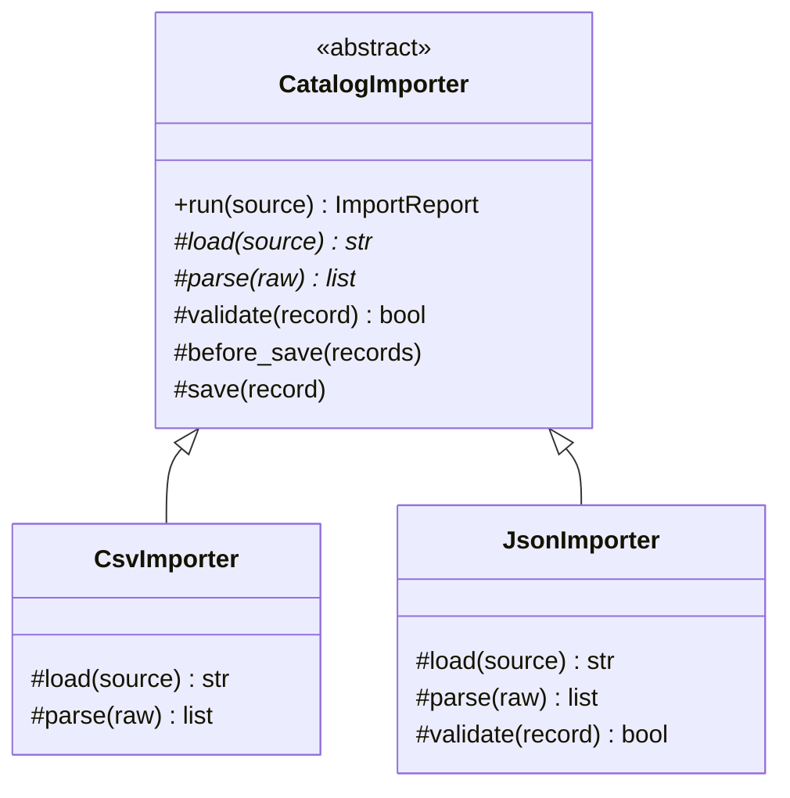
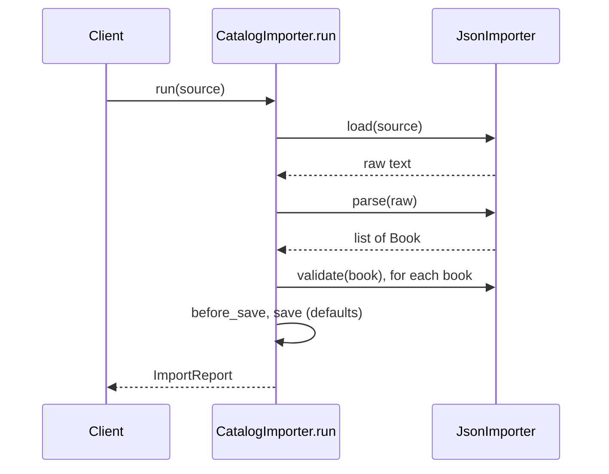

# Template Method Pattern

## Introduction

Some processes always follow the same steps in the same order, but the details of a few steps vary. Importing data is a good example: open the source, parse records, validate them, save them, write a report. Whether the source is a CSV file, a JSON API or an Excel sheet changes *how* you open and parse, but not the overall sequence.

**Template Method** puts that fixed sequence (the **skeleton**) in a base class method, and lets subclasses fill in the varying **steps**:

> Define the skeleton of an algorithm in a method, deferring some steps to subclasses. Subclasses redefine certain steps without changing the algorithm's structure.

A recipe card for "any stir-fry" is a good analogy. It says: heat the wok, cook the protein, add vegetables, add sauce, serve. A chicken stir-fry and a tofu stir-fry fill in "protein" and "sauce" differently, but nobody re-orders the steps or forgets to heat the wok.

Template Method is the one classic behavioral pattern built on **inheritance** rather than composition. That makes it simple to apply and also easy to overuse. This page shows both sides.

## The Problem: Copy-Paste Pipelines

Your online bookstore imports catalog updates from publishers. Two publishers send CSV, one sends JSON. Each importer was written separately:

```python
import csv
import io
import json


def import_csv(text: str) -> None:
    print("start import")
    rows = list(csv.DictReader(io.StringIO(text)))
    valid = [r for r in rows if r["isbn"] and float(r["price"]) > 0]
    for r in valid:
        print(f"  save {r['isbn']} at {float(r['price']):.2f}")
    print(f"done: {len(valid)} saved, {len(rows) - len(valid)} rejected")


def import_json(text: str) -> None:
    print("start import")
    rows = json.loads(text)["books"]
    valid = [r for r in rows if r.get("isbn") and r.get("price", 0) > 0]
    for r in valid:
        print(f"  save {r['isbn']} at {r['price']:.2f}")
    # someone forgot the summary line here


import_csv("isbn,price\n978-1,12.5\n,3\n")
import_json('{"books": [{"isbn": "978-2", "price": 20}]}')
```

Output:

```text
start import
  save 978-1 at 12.50
done: 1 saved, 1 rejected
start import
  save 978-2 at 20.00
```

What hurts:

- **The workflow is duplicated.** Logging, validation, saving and reporting are copied into every importer.
- **Copies drift.** The JSON importer already forgot the summary. Next, one importer will add a transaction and the others will not.
- **Cross-cutting changes are expensive.** "Add metrics to every import" means editing every function.
- **The steps are hidden.** Nothing in the code says "every importer must load, parse, validate, save and report."

## The Pattern



The base class has three kinds of methods:

| Kind | Who defines it | Example |
| --- | --- | --- |
| **Template method** | Base class only, never overridden | `run()` |
| **Abstract steps** | Each subclass must implement | `load()`, `parse()` |
| **Hooks** | Base class gives a default; subclasses *may* override | `validate()`, `before_save()` |

### Step 1: The skeleton in an abstract base class

```python
import csv
import io
import json
from abc import ABC, abstractmethod
from dataclasses import dataclass
from typing import final


@dataclass(frozen=True)
class Book:
    isbn: str
    price: float


@dataclass
class ImportReport:
    source: str
    saved: int = 0
    rejected: int = 0


class CatalogImporter(ABC):
    @final
    def run(self, source: str) -> ImportReport:
        """The template method: the fixed order of steps."""
        report = ImportReport(source=type(self).__name__)
        raw = self.load(source)
        records = self.parse(raw)
        valid = [r for r in records if self.validate(r)]
        report.rejected = len(records) - len(valid)
        self.before_save(valid)
        for record in valid:
            self.save(record)
            report.saved += 1
        return report

    # Abstract steps: every importer must provide these.
    @abstractmethod
    def load(self, source: str) -> str: ...

    @abstractmethod
    def parse(self, raw: str) -> list[Book]: ...

    # Hooks: sensible defaults that subclasses may override.
    def validate(self, book: Book) -> bool:
        return bool(book.isbn) and book.price > 0

    def before_save(self, books: list[Book]) -> None:
        pass

    def save(self, book: Book) -> None:
        print(f"  save {book.isbn} at {book.price:.2f}")


class CsvImporter(CatalogImporter):
    def load(self, source: str) -> str:
        return source                    # in real code: read a file or download it

    def parse(self, raw: str) -> list[Book]:
        return [Book(r["isbn"], float(r["price"] or 0)) for r in csv.DictReader(io.StringIO(raw))]


class JsonImporter(CatalogImporter):
    def load(self, source: str) -> str:
        return source

    def parse(self, raw: str) -> list[Book]:
        return [Book(b.get("isbn", ""), float(b.get("price", 0))) for b in json.loads(raw)["books"]]

    def validate(self, book: Book) -> bool:     # this publisher also sends free samples
        return super().validate(book) and not book.isbn.startswith("SAMPLE")


print(CsvImporter().run("isbn,price\n978-1,12.5\n,3\n"))
print(JsonImporter().run('{"books": [{"isbn": "978-2", "price": 20}, {"isbn": "SAMPLE-9", "price": 1}]}'))
```

Output:

```text
  save 978-1 at 12.50
ImportReport(source='CsvImporter', saved=1, rejected=1)
  save 978-2 at 20.00
ImportReport(source='JsonImporter', saved=1, rejected=1)
```

Key details:

- `run` is decorated with `typing.final`. Python does not enforce it at runtime, but type checkers such as mypy and pyright report an error if a subclass overrides it. That is how you say "the skeleton is not up for negotiation."
- `@abstractmethod` steps are enforced at runtime: you cannot instantiate a subclass that forgets `parse`.
- Hooks (`validate`, `before_save`) let a subclass customize behavior **without** copying the workflow.
- Adding metrics or a transaction to every importer is a change to `run` alone.

### Step 2: The Hollywood principle

Template Method inverts the usual direction of calls. The subclass does not call the base class to get work done; the **base class calls the subclass's steps** at the right moment. This is often summarized as the Hollywood principle: "Don't call us, we'll call you."



This inversion is exactly what frameworks do. You write a subclass with a few methods, and the framework decides when to call them.

## The Same Idea in Java

Java expresses the intent precisely: the template method is `final`, abstract steps are `protected abstract`, and hooks are `protected` with a default body.

```java
import java.util.List;

public class TemplateDemo {
    static abstract class ReportGenerator {
        public final String generate(List<Integer> sales) {   // template method
            StringBuilder out = new StringBuilder();
            out.append(header());
            for (int s : sales) out.append(row(s));
            out.append(footer(sales.stream().mapToInt(Integer::intValue).sum()));
            return out.toString();
        }
        protected abstract String header();
        protected abstract String row(int sale);
        protected String footer(int total) { return "total=" + total + "\n"; }  // hook
    }

    static final class CsvReport extends ReportGenerator {
        protected String header() { return "sale\n"; }
        protected String row(int sale) { return sale + "\n"; }
    }

    static final class MarkdownReport extends ReportGenerator {
        protected String header() { return "| sale |\n| --- |\n"; }
        protected String row(int sale) { return "| " + sale + " |\n"; }
        @Override protected String footer(int total) { return "**Total: " + total + "**\n"; }
    }

    public static void main(String[] args) {
        List<Integer> sales = List.of(30, 12);
        System.out.print(new CsvReport().generate(sales));
        System.out.print(new MarkdownReport().generate(sales));
    }
}
```

Output:

```text
sale
30
12
total=42
| sale |
| --- |
| 30 |
| 12 |
**Total: 42**
```

## Where You Have Already Met Template Method

- **Python `unittest.TestCase`.** The test runner calls `setUp()`, then your `test_*` method, then `tearDown()`. You override the hooks; the runner owns the sequence.
- **Python `socketserver.BaseRequestHandler`.** The server calls `setup()`, `handle()` and `finish()` in that order. You normally override only `handle()`.
- **Python `threading.Thread`.** `start()` sets up the thread and then calls `run()`, which subclasses may override.
- **Django class-based views.** `View.dispatch()` routes to `get()` or `post()`, and generic views expose hooks such as `get_queryset()` and `get_context_data()`.
- **Jakarta Servlet `HttpServlet`.** `service()` inspects the HTTP method and calls `doGet()`, `doPost()` and so on, which your servlet overrides.
- **Java `AbstractList`.** Implement `get(int)` and `size()`, and you inherit `iterator()`, `contains()`, `indexOf()` and more, all built on your two methods.

```python
import unittest


class CartTest(unittest.TestCase):
    def setUp(self) -> None:            # hook, called before every test
        self.cart: list[str] = ["Dune"]

    def test_add(self) -> None:
        self.cart.append("Emma")
        self.assertEqual(len(self.cart), 2)

    def test_starts_with_one(self) -> None:
        self.assertEqual(self.cart, ["Dune"])


suite = unittest.defaultTestLoader.loadTestsFromTestCase(CartTest)
result = unittest.TextTestRunner(verbosity=0).run(suite)
print("ran:", result.testsRun, "failures:", len(result.failures))
```

Example output (the runner also prints its own summary to stderr):

```text
ran: 2 failures: 0
```

Each test sees a fresh cart because the runner's template calls `setUp` before every test method.

## Real-World Scenario

Your SaaS helpdesk has **integrations** that sync tickets from external systems: email (IMAP), a chat widget, and a public form. Each integration runs every few minutes and must:

1. fetch new items since the last sync cursor
2. convert them into tickets
3. skip duplicates
4. save tickets and the new cursor in one transaction
5. emit metrics and handle errors uniformly

Three teams have written their own sync loops, and an incident showed that one of them forgot to save the cursor in the transaction, which created duplicate tickets after a crash.

### The solution

Write a `TicketSource` base class whose `sync()` template method owns steps 3 to 5, the parts that **must not differ**. Each integration implements only `fetch_since(cursor)` and `to_ticket(item)`. Duplicate detection is a hook with a default (by external id) that the email integration overrides to also check the `Message-ID` header.

```python
from abc import ABC, abstractmethod
from dataclasses import dataclass
from typing import Any, final


@dataclass(frozen=True)
class Ticket:
    external_id: str
    subject: str


class TicketSource(ABC):
    def __init__(self) -> None:
        self.cursor = 0
        self.seen: set[str] = set()
        self.saved: list[Ticket] = []

    @final
    def sync(self) -> int:
        items, new_cursor = self.fetch_since(self.cursor)
        tickets = [self.to_ticket(i) for i in items]
        fresh = [t for t in tickets if not self.is_duplicate(t)]
        # In production: one database transaction for tickets and cursor.
        self.saved.extend(fresh)
        self.seen.update(t.external_id for t in fresh)
        self.cursor = new_cursor
        print(f"{type(self).__name__}: {len(fresh)} new, {len(tickets) - len(fresh)} duplicate, cursor={self.cursor}")
        return len(fresh)

    @abstractmethod
    def fetch_since(self, cursor: int) -> tuple[list[Any], int]: ...

    @abstractmethod
    def to_ticket(self, item: Any) -> Ticket: ...

    def is_duplicate(self, ticket: Ticket) -> bool:   # hook
        return ticket.external_id in self.seen


class ChatWidgetSource(TicketSource):
    MESSAGES = [(1, "c-1", "Cannot log in"), (2, "c-2", "Refund?"), (3, "c-2", "Refund?")]

    def fetch_since(self, cursor: int) -> tuple[list[Any], int]:
        items = [m for m in self.MESSAGES if m[0] > cursor]
        return items, max((m[0] for m in items), default=cursor)

    def to_ticket(self, item: Any) -> Ticket:
        _, chat_id, text = item
        return Ticket(external_id=chat_id, subject=text)


source = ChatWidgetSource()
source.sync()
source.sync()   # nothing new: cursor prevents re-fetching
```

Output:

```text
ChatWidgetSource: 3 new, 0 duplicate, cursor=3
ChatWidgetSource: 0 new, 0 duplicate, cursor=3
```

Look closely: the third chat message (`c-2` again) was fetched in the same batch as the second, and it was *not* reported as a duplicate, so the first sync reports 3 new tickets instead of 2. The hook only checks tickets saved in **earlier** syncs. This kind of bug is easy to fix once, in the base class, for every integration. Fixing it is Exercise 2.

### Why this approach

- **Invariants live in one place.** Transaction, cursor handling and metrics are written once and cannot be skipped.
- **Integrations stay small.** A new source is two methods, which a new team member can write in an afternoon.
- **The skeleton documents the process.** Reading `sync()` tells you exactly what every integration does.

### When to use it, and when not to

Use Template Method when:

- several classes share an **algorithm whose order is fixed and important**
- you want to **enforce invariants** (transactions, logging, cleanup) that subclasses must not skip
- you are building a **framework or base class** where users plug in a few steps

Avoid it when:

- the variation is in **one step only**. Pass a function or a [Strategy](./0-arch-strategy.mdx) instead of creating a subclass.
- you need to **mix and match** variations (CSV parsing with strict validation, JSON parsing with lenient validation). Subclasses multiply; composition handles combinations.
- the steps must change **at runtime**. Inheritance fixes behavior when the object is created.
- the hierarchy is already **more than two levels deep**. Template methods calling hooks that call other template methods become very hard to follow.

### Alternatives and trade-offs

| Approach | Pros | Cons | Best for |
| --- | --- | --- | --- |
| Copy-paste functions | No abstraction to learn | Drift, duplicated bugs | One-off scripts |
| Template Method (inheritance) | Enforces order and invariants, little code per variant | Tight coupling to base class, one axis of variation | Frameworks, fixed workflows |
| Strategy or injected steps (composition) | Mix and match at runtime, easy to test | More objects to wire | Several independent variation points |
| Higher-order function (`run(load=..., parse=...)`) | Very light, no classes | Many parameters get unwieldy | Small pipelines, scripts |
| Pipeline of functions | Steps reorderable and reusable | Order not enforced | Data processing, see [Pipes and Filters](../6-arch-architectural-styles/9-arch-pipes-and-filters.mdx) |

Here is the composition-based alternative for comparison. Notice it is shorter, but nothing prevents a caller from skipping validation by passing `lambda b: True`.

```python
from collections.abc import Callable
from dataclasses import dataclass


@dataclass(frozen=True)
class Book:
    isbn: str
    price: float


def run_import(raw: str,
               parse: Callable[[str], list[Book]],
               validate: Callable[[Book], bool] = lambda b: bool(b.isbn) and b.price > 0) -> int:
    books = [b for b in parse(raw) if validate(b)]
    for b in books:
        print(f"  save {b.isbn}")
    return len(books)


def parse_pipe(raw: str) -> list[Book]:
    return [Book(isbn, float(price)) for isbn, price in (line.split("|") for line in raw.splitlines())]


print(run_import("978-5|10\n978-6|0", parse=parse_pipe))
```

Output:

```text
  save 978-5
1
```

## Related and Confusable Patterns

- **Template Method vs [Strategy](./0-arch-strategy.mdx).** Both vary parts of an algorithm. Template Method varies **steps through inheritance**, fixed at construction. Strategy swaps the **whole algorithm through composition**, possibly at runtime. When in doubt, prefer composition; see [Composition over Inheritance](../1-arch-design-principles/7-arch-composition-over-inheritance.mdx).
- **Template Method and [Factory Method](../2-arch-creational-patterns/2-arch-factory-method.mdx).** A factory method is often one step inside a template method: the skeleton calls `create_parser()` and subclasses decide which parser to build.
- **Template Method vs hooks in frameworks.** Many frameworks offer both: subclass hooks (Template Method) and registered callbacks ([Observer](./1-arch-observer.mdx)). Callbacks are more flexible; subclass hooks are more discoverable.

## Common Mistakes

1. **Overriding the template method itself.** A subclass that rewrites `run()` defeats the pattern. Mark it `final` (`typing.final` in Python, `final` in Java) so tools catch it.
2. **Too many hooks.** A base class with fifteen optional hooks is a configuration language in disguise. Keep the number of steps small, and group related hooks.
3. **Hooks that must call `super()` in a specific order.** If subclasses must remember to call `super().before_save()` first, someone will forget. Have the template method call base logic itself, and keep hooks empty by default.
4. **Deep hierarchies.** `BaseImporter -> FileImporter -> CsvImporter -> PublisherXCsvImporter` makes it hard to know which step runs where. Flatten, or switch to composition.
5. **Using inheritance only to share code.** If subclasses do not share an algorithm skeleton, a helper function or a separate collaborator is a better way to reuse code.

## Summary

- Template Method fixes an algorithm's skeleton in a base class and lets subclasses fill in steps.
- Use **abstract steps** for required variation, **hooks** for optional variation, and keep the template method **final**.
- It inverts control: the base class calls your code, as frameworks such as `unittest`, Django views and servlets do.
- It is ideal for enforcing invariants across variants, and weak when you need several independent axes of variation or runtime changes.
- Composition (Strategy, injected functions) is the main alternative and is usually more flexible.

## Exercises

1. Add an `XlsxImporter` to Step 1 that only implements `load` and `parse` (fake the spreadsheet with a list of tuples). Confirm it inherits validation and reporting.
2. Fix the duplicate bug in the helpdesk `sync()` so duplicates **within the same batch** are also skipped. Did you change the hook, the template method, or both? Why?
3. Rewrite `TicketSource` using composition: a `Syncer` class that receives a `fetch_since` and a `to_ticket` function. Compare the two designs for testability and for enforcing the transaction.
4. Find a framework class you have subclassed (a test case, a view, a handler). List its template method, its abstract steps and its hooks.

Continue with the [Chain of Responsibility Pattern](./5-arch-chain-of-responsibility.mdx), or compare all behavioral patterns in [Choosing a Behavioral Pattern](./10-arch-choosing-behavioral.mdx).
