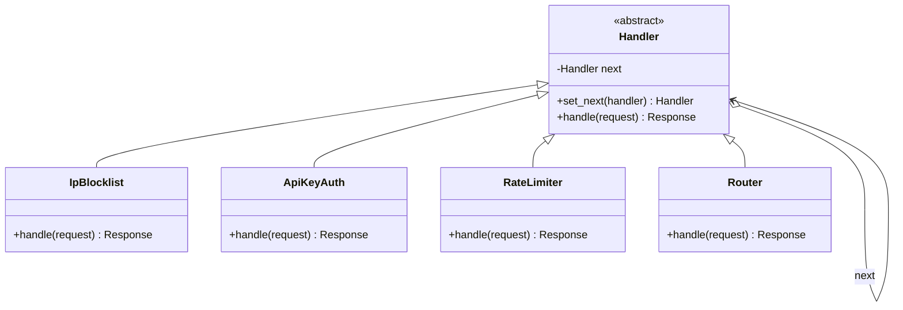
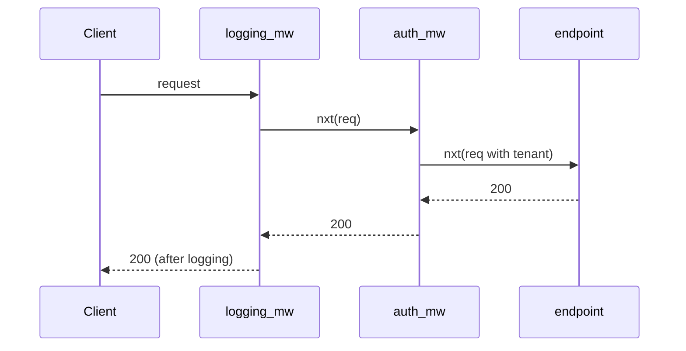

# Chain of Responsibility Pattern

## Introduction

**Chain of Responsibility** passes a request along a chain of handlers. Each handler decides either to **handle** the request or to **pass it to the next** handler. The sender does not know which handler will deal with it.

Calling a company's support line is a familiar example. The first-line agent answers simple questions. If they cannot help, they escalate to second-line support, who may escalate to an engineer. You talk to "support", not to a specific person, and the chain decides who resolves your problem.

In modern code, you meet this pattern most often as **middleware**: every web request in Express, Django or ASP.NET Core flows through a chain of functions for logging, authentication, rate limiting and so on, before it reaches your route handler.

There are two flavors, and it helps to name them early:

| Flavor | What each handler does | Example |
| --- | --- | --- |
| **Classic (GoF)** | Handles the request *or* passes it on; usually one handler wins | Support escalation, approval limits |
| **Pipeline / middleware** | Does some work, then *usually* passes it on; any handler may stop the chain | Express, Django and Servlet middleware |

## The Problem: One Function That Checks Everything

Your SaaS helpdesk exposes a public API. Every request needs several checks before reaching the business logic:

```python
from dataclasses import dataclass, field


@dataclass
class Request:
    path: str
    api_key: str | None
    ip: str
    headers: dict[str, str] = field(default_factory=dict)


REQUEST_COUNTS: dict[str, int] = {}
VALID_KEYS = {"key-123": "acme"}


def handle_api_request(req: Request) -> tuple[int, str]:
    print(f"log: {req.path}")
    if req.ip in {"10.6.6.6"}:
        return 403, "blocked"
    if req.api_key not in VALID_KEYS:
        return 401, "invalid key"
    REQUEST_COUNTS[req.api_key] = REQUEST_COUNTS.get(req.api_key, 0) + 1
    if REQUEST_COUNTS[req.api_key] > 2:
        return 429, "slow down"
    if req.path.startswith("/tickets"):
        return 200, f"tickets for {VALID_KEYS[req.api_key]}"
    return 404, "not found"


for _ in range(3):
    print(handle_api_request(Request("/tickets", "key-123", "1.2.3.4")))
```

Output:

```text
log: /tickets
(200, 'tickets for acme')
log: /tickets
(200, 'tickets for acme')
log: /tickets
(429, 'slow down')
```

What hurts:

- **Every concern lives in one function.** Logging, IP blocking, authentication, rate limiting and routing are tangled together.
- **Order is implicit.** Should rate limiting happen before or after authentication? The answer is buried in line order.
- **Checks cannot be reused or reconfigured.** The internal admin API needs authentication but not rate limiting; today that means copying the function.
- **Testing one check requires all the others.** To test rate limiting, you must pass the IP and key checks first.

## The Classic Pattern

Each handler holds a reference to the next one. The base class provides the "pass it on" behavior.



### Step 1: Handler objects linked together

```python
from __future__ import annotations

from abc import ABC, abstractmethod
from dataclasses import dataclass, field

Response = tuple[int, str]


@dataclass
class Request:
    path: str
    api_key: str | None
    ip: str
    context: dict[str, str] = field(default_factory=dict)


class Handler(ABC):
    def __init__(self) -> None:
        self._next: Handler | None = None

    def set_next(self, handler: Handler) -> Handler:
        self._next = handler
        return handler          # returning it allows a.set_next(b).set_next(c)

    def pass_on(self, req: Request) -> Response:
        if self._next is None:
            return 404, "no handler"     # end of chain: never silently drop a request
        return self._next.handle(req)

    @abstractmethod
    def handle(self, req: Request) -> Response: ...


class IpBlocklist(Handler):
    def __init__(self, blocked: set[str]) -> None:
        super().__init__()
        self.blocked = blocked

    def handle(self, req: Request) -> Response:
        if req.ip in self.blocked:
            return 403, "blocked"
        return self.pass_on(req)


class ApiKeyAuth(Handler):
    def __init__(self, keys: dict[str, str]) -> None:
        super().__init__()
        self.keys = keys

    def handle(self, req: Request) -> Response:
        tenant = self.keys.get(req.api_key or "")
        if tenant is None:
            return 401, "invalid key"
        req.context["tenant"] = tenant          # enrich the request for later handlers
        return self.pass_on(req)


class RateLimiter(Handler):
    def __init__(self, limit: int) -> None:
        super().__init__()
        self.limit = limit
        self.counts: dict[str, int] = {}

    def handle(self, req: Request) -> Response:
        tenant = req.context["tenant"]
        self.counts[tenant] = self.counts.get(tenant, 0) + 1
        if self.counts[tenant] > self.limit:
            return 429, "slow down"
        return self.pass_on(req)


class TicketsRoute(Handler):
    def handle(self, req: Request) -> Response:
        if req.path.startswith("/tickets"):
            return 200, f"tickets for {req.context['tenant']}"
        return self.pass_on(req)


# Build the public API chain.
public = IpBlocklist({"10.6.6.6"})
public.set_next(ApiKeyAuth({"key-123": "acme"})).set_next(RateLimiter(limit=2)).set_next(TicketsRoute())

print(public.handle(Request("/tickets", "key-123", "1.2.3.4")))
print(public.handle(Request("/tickets", "nope", "1.2.3.4")))
print(public.handle(Request("/tickets", "key-123", "10.6.6.6")))
print(public.handle(Request("/billing", "key-123", "1.2.3.4")))
print(public.handle(Request("/tickets", "key-123", "1.2.3.4")))

# The internal admin chain reuses handlers in a different combination: no rate limit.
admin = ApiKeyAuth({"admin-key": "staff"})
admin.set_next(TicketsRoute())
print(admin.handle(Request("/tickets", "admin-key", "10.0.0.1")))
```

Output:

```text
(200, 'tickets for acme')
(401, 'invalid key')
(403, 'blocked')
(404, 'no handler')
(429, 'slow down')
(200, 'tickets for staff')
```

What improved:

- Each check is **one small class** that can be tested by itself with a stub `next`.
- **Order is explicit** in the line that builds the chain.
- **Chains are configurable.** The admin API reuses `ApiKeyAuth` and `TicketsRoute` without the rate limiter.
- Handlers can **enrich** the request (`context["tenant"]`) for those that come later.

### Step 2: Middleware as functions

Linked handler objects are the textbook shape. In practice, most frameworks compose **functions**: each middleware receives the request and a `next` callable. Wrapping functions this way is also how [decorators](../3-arch-structural-patterns/3-arch-decorator.mdx) stack.

```python
import time
from collections.abc import Callable
from functools import reduce

Request = dict
Response = tuple[int, str]
Next = Callable[[Request], Response]
Middleware = Callable[[Request, Next], Response]


def logging_mw(req: Request, nxt: Next) -> Response:
    start = time.perf_counter()
    resp = nxt(req)                                   # call the rest of the chain
    ms = (time.perf_counter() - start) * 1000
    print(f"log: {req['path']} -> {resp[0]} ({ms:.0f} ms)")
    return resp


def auth_mw(req: Request, nxt: Next) -> Response:
    if req.get("api_key") != "key-123":
        return 401, "invalid key"                     # stop: do not call nxt
    return nxt({**req, "tenant": "acme"})


def endpoint(req: Request) -> Response:
    return 200, f"tickets for {req['tenant']}"


def build_chain(middlewares: list[Middleware], final: Next) -> Next:
    def wrap(nxt: Next, mw: Middleware) -> Next:
        return lambda req: mw(req, nxt)
    return reduce(wrap, reversed(middlewares), final)


app = build_chain([logging_mw, auth_mw], endpoint)
print(app({"path": "/tickets", "api_key": "key-123"}))
print(app({"path": "/tickets", "api_key": "bad"}))
```

Example output (timings vary):

```text
log: /tickets -> 200 (0 ms)
(200, 'tickets for acme')
log: /tickets -> 401 (0 ms)
(401, 'invalid key')
```

Notice that `logging_mw` runs code **both before and after** `nxt(req)`. That "onion" shape is what makes middleware so useful: timing, transactions, error handling and response headers all wrap the rest of the chain.



## The Same Idea in TypeScript (Express)

Express middleware is the most widely known chain in web development. Each function receives `(req, res, next)`. It either ends the response or calls `next()`. Express documents that if a middleware does neither, the request is left hanging. Error-handling middleware is recognized by its **four** parameters, `(err, req, res, next)`.

```typescript
import express, { type Request, type Response, type NextFunction } from "express";

const app = express();

function requestLogger(req: Request, res: Response, next: NextFunction) {
  const start = Date.now();
  res.on("finish", () => console.log(`${req.method} ${req.path} ${res.statusCode} ${Date.now() - start}ms`));
  next();
}

function apiKeyAuth(req: Request, res: Response, next: NextFunction) {
  if (req.header("x-api-key") !== process.env.API_KEY) {
    res.status(401).json({ error: "invalid key" }); // stop the chain
    return;
  }
  next();
}

app.use(requestLogger);
app.use("/tickets", apiKeyAuth);
app.get("/tickets", (_req, res) => {
  res.json([{ id: 1, subject: "Printer on fire" }]);
});

// Error handler: must declare all four parameters to be treated as one.
app.use((err: Error, _req: Request, res: Response, _next: NextFunction) => {
  console.error(err);
  res.status(500).json({ error: "internal error" });
});

app.listen(3000);
```

Express 5 is the current major version and, unlike Express 4, forwards rejected promises from async middleware to the error handler automatically. Check the [Express middleware guide](https://expressjs.com/en/guide/using-middleware.html) for details.

## Where You Have Already Met Chain of Responsibility

- **Express and Koa middleware**, as shown above.
- **Django middleware.** Each middleware is constructed with a `get_response` callable (the next link) and can act before and after calling it. The `MIDDLEWARE` setting lists the chain order.
- **Jakarta Servlet filters.** A `Filter` receives a `FilterChain` and calls `chain.doFilter(request, response)` to pass control on. Spring Security is built as a chain of such filters.
- **ASP.NET Core middleware.** `app.Use(...)` adds components that call `next` to continue the pipeline.
- **Browser event bubbling.** A click event travels from the target element up through its ancestors until a handler calls `stopPropagation()`.
- **Python `logging`.** A log record handled by a logger is passed to its parent loggers' handlers unless `propagate` is set to `False`.
- **Exception handling.** A raised exception travels up the call stack until a matching `except` block handles it.

## Real-World Scenario

Your helpdesk routes **incoming tickets** automatically. A new ticket should be handled by the first rule that matches:

1. VIP customers go straight to the account manager.
2. Tickets mentioning "outage" go to the on-call engineer.
3. Billing questions go to the finance queue.
4. Anything else goes to the general Tier 1 queue.

Customers on the Enterprise plan can add their own custom rules at the top of the chain, and the order must be visible and editable in the admin UI.

### The solution

This is the **classic** flavor: one handler wins. Because rules are configurable per tenant, represent each rule as a small object with `matches` and `route`, and build the chain from configuration. A plain loop over a list is the simplest chain implementation, and it is perfectly valid.

```python
from collections.abc import Callable
from dataclasses import dataclass


@dataclass(frozen=True)
class Ticket:
    subject: str
    customer_tier: str


@dataclass(frozen=True)
class Rule:
    name: str
    matches: Callable[[Ticket], bool]
    queue: str


DEFAULT_RULES = [
    Rule("vip", lambda t: t.customer_tier == "vip", "account-manager"),
    Rule("outage", lambda t: "outage" in t.subject.lower(), "on-call"),
    Rule("billing", lambda t: any(w in t.subject.lower() for w in ("invoice", "refund")), "finance"),
]
FALLBACK = "tier-1"


def route(ticket: Ticket, custom_rules: list[Rule]) -> tuple[str, str]:
    for rule in [*custom_rules, *DEFAULT_RULES]:     # custom rules come first
        if rule.matches(ticket):
            return rule.queue, rule.name
    return FALLBACK, "fallback"                       # the chain always ends somewhere


acme_rules = [Rule("acme-sso", lambda t: "sso" in t.subject.lower(), "identity-team")]
tickets = [
    Ticket("Full outage in EU", "standard"),
    Ticket("Refund for invoice 991", "vip"),
    Ticket("SSO login loop", "standard"),
    Ticket("How do I export?", "standard"),
]
for t in tickets:
    queue, rule = route(t, acme_rules)
    print(f"{t.subject:24} -> {queue:16} (rule: {rule})")
```

Output:

```text
Full outage in EU        -> on-call          (rule: outage)
Refund for invoice 991   -> account-manager  (rule: vip)
SSO login loop           -> identity-team    (rule: acme-sso)
How do I export?         -> tier-1           (rule: fallback)
```

Returning the rule name is important: support agents can see **why** a ticket landed in a queue, which is the most common question with any routing chain.

### Why this approach

- **First match wins** is exactly the classic Chain of Responsibility semantics.
- **Order is data.** Admins reorder rules; no deploy needed.
- **There is always a fallback**, so no ticket is ever dropped.
- **A list is enough.** Linked handler objects add nothing here, because rules never need to wrap each other.

### When to use it, and when not to

Use Chain of Responsibility when:

- **several handlers might process a request**, and which one should is decided at runtime
- you want to **add, remove or reorder** processing steps without changing the sender
- you have **cross-cutting steps** around a core action (auth, logging, caching, error handling), which is the middleware flavor

Avoid it when:

- there is **one obvious handler**. Call it directly.
- **every** request must be handled by a specific, known sequence that never changes. A plain sequence of function calls is clearer.
- you need to **know which handler ran**, and the chain is long and dynamic. Debugging "why did nobody handle this?" is the pattern's main cost. If you use it, log the decision.
- you need **all** handlers to react independently. That is [Observer](./1-arch-observer.mdx), not a chain.

### Alternatives and trade-offs

| Approach | Pros | Cons | Best for |
| --- | --- | --- | --- |
| `if/elif` cascade | Visible, simple | Hard-coded order, not configurable | A few fixed rules |
| List of rules (first match) | Simple, order is data, easy to show in UI | Rules cannot wrap each other | Routing, validation, pricing rules |
| Linked handler objects | Handlers control forwarding, can wrap | Harder to debug, risk of broken links | Classic escalation, framework hooks |
| Middleware functions (onion) | Before and after logic, composable | Order bugs, hidden control flow | Web request pipelines |
| Rules engine | Business users edit rules, complex conditions | Heavy dependency, testing is harder | Large rule sets that change weekly |
| [Observer](./1-arch-observer.mdx) | All handlers react | No "stop" or "handled" concept | Independent side effects |

## Related and Confusable Patterns

- **Chain vs [Decorator](../3-arch-structural-patterns/3-arch-decorator.mdx).** The structure is nearly identical (each object wraps the next). A decorator **always** forwards and adds behavior. A chain handler **may stop** the request. Middleware sits in between.
- **Chain vs [Command](./2-arch-command.mdx).** The request travelling along the chain is often a command object.
- **Chain vs [Mediator](./7-arch-mediator.mdx).** A chain passes a request along a line; a mediator routes messages between peers through a hub.
- **Chain and [Composite](../3-arch-structural-patterns/2-arch-composite.mdx).** Browser event bubbling is a chain along a composite tree: from child to parent.

## Common Mistakes

1. **Requests that fall off the end.** A chain without a terminal handler returns `None` or hangs. Always end with a fallback, a default 404, or an explicit error.
2. **Forgetting to call `next`.** In Express this leaves the request hanging until it times out. In custom chains, it silently skips everything after. Make "pass on" the default in your base class.
3. **Wrong order.** Rate limiting before authentication counts anonymous traffic against no tenant; logging after error handling misses errors. Write a test that asserts the chain order.
4. **Handlers that depend on each other implicitly.** `RateLimiter` above reads `context["tenant"]`, set by `ApiKeyAuth`. Document such dependencies, or fail loudly if the key is missing.
5. **Very long chains.** Thirty middlewares cost latency on every request, and stack traces become unreadable. Group related concerns and remove dead ones.

## Summary

- Chain of Responsibility passes a request along handlers until one handles it, or through all of them as a pipeline.
- The **classic** flavor picks one handler; the **middleware** flavor wraps the core action with before and after logic.
- Express, Django, Servlet filters and ASP.NET Core are all chains; browser events and exceptions bubble along chains too.
- Always define what happens at the **end** of the chain, and make the **order** explicit and tested.
- A simple list of rules is often the best implementation.

## Exercises

1. Add a `CacheHandler` to the Step 1 chain that returns a cached response for repeated `GET /tickets` requests from the same tenant. Where in the chain must it go, and why?
2. Rewrite `build_chain` from Step 2 without `functools.reduce`, using a simple loop. Which version would you rather debug?
3. Extend the ticket router so each rule can also **add a tag** without stopping the chain, while routing still stops at the first match. Which flavor of the pattern have you combined?
4. Write a test that fails if someone reorders the public API chain so that `RateLimiter` comes before `ApiKeyAuth`.

Next, see how collections hide their internals with the [Iterator Pattern](./6-arch-iterator.mdx). For the web-layer view of middleware, see [API Gateway and Backend for Frontend](../10-arch-integration-and-apis/4-arch-api-gateway.mdx).
