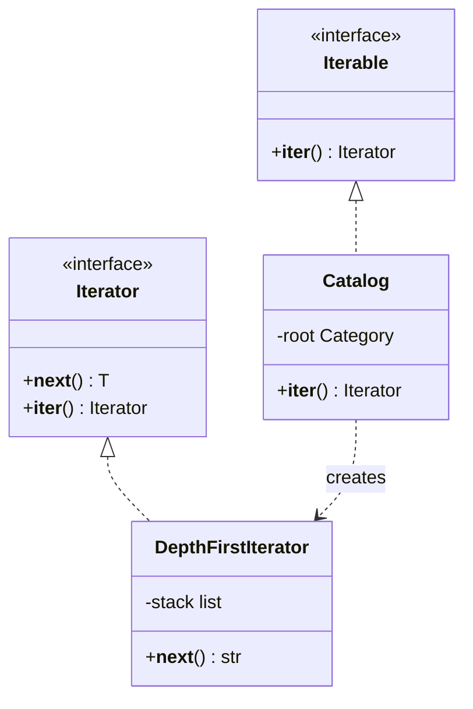

# Iterator Pattern

## Introduction

**Iterator** gives you a standard way to walk through the elements of a collection **without knowing how the collection is stored**. The collection might be an array, a tree, a database result set, a file that is too big for memory, or an API that returns results one page at a time. The caller writes the same loop in every case.

Think of a TV remote's "next channel" button. You do not need to know how the TV stores its channel list or which frequencies they use. You press "next" until you find something to watch.

Iterator is so useful that modern languages have built it into their syntax. Python's `for` loop, Java's enhanced `for`, JavaScript's `for...of` and C#'s `foreach` all work through an iterator protocol. You rarely implement the GoF class structure by hand anymore, but you still design iterators constantly, usually as **generators**.

This page covers:

- the problem: callers that depend on a collection's internal structure
- Python's iterator protocol, implemented by hand and then with generators
- lazy iteration over a paginated API (the most common real use today)
- Java's `Iterable` and `Iterator`
- pitfalls: exhausted iterators, modifying while iterating, and leaking resources

## The Problem: Callers Know Too Much

Your bookstore stores its catalog in a category tree. Version one exposes the internals, and every caller writes its own traversal:

```python
catalog = {
    "name": "Books",
    "items": ["Atlas"],
    "children": [
        {"name": "Fiction", "items": ["Dune", "Emma"], "children": []},
        {"name": "Tech", "items": ["SICP"], "children": [
            {"name": "Python", "items": ["Fluent Python"], "children": []},
        ]},
    ],
}


# Caller 1: a sitemap generator
def all_titles(node: dict) -> list[str]:
    titles = list(node["items"])
    for child in node["children"]:
        titles.extend(all_titles(child))
    return titles


# Caller 2: a search indexer copies the same recursion... and caller 3 does it again.
print(all_titles(catalog))
```

Output:

```text
['Atlas', 'Dune', 'Emma', 'SICP', 'Fluent Python']
```

What hurts:

- **Every caller depends on the storage format.** If the catalog moves from nested dicts to a database table with `parent_id`, every traversal breaks.
- **Traversal logic is duplicated** in the sitemap, the search indexer and the export job.
- **Everything is loaded at once.** `all_titles` builds a full list even when the caller only needs the first ten books.
- **Different traversal orders** (depth-first, breadth-first, only one level) mean yet more copies.

## The Pattern

The collection (the **aggregate**) creates an **iterator** object. The iterator knows the current position and how to get the next element. The caller only uses the iterator's interface.



In Python the two interfaces are part of the language:

| Protocol | Method | Meaning |
| --- | --- | --- |
| **Iterable** | `__iter__()` | "Give me a fresh iterator over your elements" |
| **Iterator** | `__next__()` | "Give me the next element, or raise `StopIteration`" |
| | `__iter__()` | Returns `self`, so an iterator can be used in a `for` loop too |

The abstract base classes `collections.abc.Iterable` and `collections.abc.Iterator` describe these protocols for type hints.

### Step 1: A hand-written iterator class

```python
from __future__ import annotations

from collections.abc import Iterator
from dataclasses import dataclass, field


@dataclass
class Category:
    name: str
    items: list[str] = field(default_factory=list)
    children: list[Category] = field(default_factory=list)


class DepthFirstTitles:
    """An explicit iterator object: it owns the traversal state."""

    def __init__(self, root: Category) -> None:
        self._stack: list[Category] = [root]
        self._pending: list[str] = []

    def __iter__(self) -> DepthFirstTitles:
        return self

    def __next__(self) -> str:
        while not self._pending:
            if not self._stack:
                raise StopIteration
            node = self._stack.pop()
            self._pending = list(node.items)
            self._stack.extend(reversed(node.children))   # keep left-to-right order
        return self._pending.pop(0)


class Catalog:
    def __init__(self, root: Category) -> None:
        self._root = root          # private: callers never touch the tree

    def __iter__(self) -> Iterator[str]:
        return DepthFirstTitles(self._root)   # a fresh iterator every time


catalog = Catalog(Category("Books", ["Atlas"], [
    Category("Fiction", ["Dune", "Emma"]),
    Category("Tech", ["SICP"], [Category("Python", ["Fluent Python"])]),
]))

for title in catalog:
    print(title)
print(sorted(catalog)[:2])          # any function that accepts an iterable works
print("Emma" in catalog)            # so does 'in'
```

Output:

```text
Atlas
Dune
Emma
SICP
Fluent Python
['Atlas', 'Dune']
True
```

Callers now loop over a `Catalog` like any list. Built-ins such as `sorted`, `sum`, `list`, `in` and `zip` work with it for free, because they all speak the iterator protocol.

### Step 2: Generators make iterators easy

Writing `__next__` by hand means managing state manually. A **generator function** (a function containing `yield`) creates an iterator automatically, and its local variables *are* the state.

```python
from __future__ import annotations

from collections.abc import Iterator
from dataclasses import dataclass, field


@dataclass
class Category:
    name: str
    items: list[str] = field(default_factory=list)
    children: list[Category] = field(default_factory=list)

    def __iter__(self) -> Iterator[str]:          # default traversal: depth-first
        yield from self.items
        for child in self.children:
            yield from child

    def breadth_first(self) -> Iterator[str]:      # an alternative traversal
        queue = [self]
        while queue:
            node = queue.pop(0)
            yield from node.items
            queue.extend(node.children)

    def with_paths(self, prefix: str = "") -> Iterator[tuple[str, str]]:
        path = f"{prefix}/{self.name}"
        for item in self.items:
            yield path, item
        for child in self.children:
            yield from child.with_paths(path)


root = Category("Books", ["Atlas"], [
    Category("Fiction", ["Dune", "Emma"]),
    Category("Tech", ["SICP"], [Category("Python", ["Fluent Python"])]),
])
print(list(root))
print(list(root.breadth_first()))
for path, title in root.with_paths():
    print(f"{path:20} {title}")
```

Output:

```text
['Atlas', 'Dune', 'Emma', 'SICP', 'Fluent Python']
['Atlas', 'Dune', 'Emma', 'SICP', 'Fluent Python']
/Books               Atlas
/Books/Fiction       Dune
/Books/Fiction       Emma
/Books/Tech          SICP
/Books/Tech/Python   Fluent Python
```

The two traversals happen to produce the same order for this small tree; on a deeper tree, breadth-first lists every top-level category's books before descending. Offering **several iterators over the same collection** is one of the pattern's original motivations.

### Step 3: Laziness and pipelines

Iterators produce values **on demand**. That means you can chain them into pipelines that never hold the whole dataset in memory, and stop early without doing wasted work.

```python
from collections.abc import Iterator
from itertools import islice


def read_orders() -> Iterator[dict]:
    """Pretend this reads a 10 GB file line by line."""
    for i in range(1, 1_000_000_000):
        print(f"  reading order {i}")
        yield {"id": i, "total": (i * 37) % 100}


big_orders = (o for o in read_orders() if o["total"] > 80)    # generator expression: lazy
first_two = list(islice(big_orders, 2))                        # stop after two matches
print(first_two)
```

Output:

```text
  reading order 1
  reading order 2
  reading order 3
  reading order 4
  reading order 5
  reading order 6
  reading order 7
  reading order 8
[{'id': 5, 'total': 85}, {'id': 8, 'total': 96}]
```

Only eight orders are read out of a billion. The [functional patterns](../5-arch-modern-patterns/5-arch-functional-patterns.mdx) page builds on exactly this idea.

## The Same Idea in Java

Java splits the pattern into `Iterable<T>` (has an `iterator()` method) and `Iterator<T>` (`hasNext()` and `next()`). Anything `Iterable` works in the enhanced `for` loop.

```java
import java.util.Iterator;
import java.util.NoSuchElementException;

public class IteratorDemo {
    /** Page numbers 1..n without storing them: a lazy range. */
    record PageRange(int pages) implements Iterable<Integer> {
        @Override
        public Iterator<Integer> iterator() {
            return new Iterator<>() {
                private int next = 1;
                public boolean hasNext() { return next <= pages; }
                public Integer next() {
                    if (!hasNext()) throw new NoSuchElementException();
                    return next++;
                }
            };
        }
    }

    public static void main(String[] args) {
        for (int page : new PageRange(3)) {
            System.out.println("fetching page " + page);
        }
    }
}
```

Output:

```text
fetching page 1
fetching page 2
fetching page 3
```

JavaScript and TypeScript follow the same design: an object is iterable if it has a `[Symbol.iterator]()` method, and generator functions (`function*`) create iterators. For asynchronous sources, there are async iterators consumed with `for await...of`. Python has the async equivalent too: `async for` over an object implementing `__aiter__` and `__anext__`, usually written as an async generator.

## Where You Have Already Met Iterator

- **Every `for` loop in Python**, over lists, dicts, files (`for line in open(path)` reads lazily), `range` and database cursors.
- **`itertools`** (`islice`, `chain`, `groupby`) and built-ins like `zip`, `map`, `filter` and `enumerate`, which all accept and return iterators.
- **Java collections**: `List`, `Set` and `Map.entrySet()` are `Iterable`; `ResultSet.next()` in JDBC is an iterator in spirit.
- **Paginated SDK helpers.** Many cloud and SaaS client libraries offer "paginators" or auto-paging iterators that fetch the next page when you reach the end of the current one.
- **Python's `os.scandir` and `pathlib.Path.iterdir`**, which yield directory entries lazily.

## Real-World Scenario

Your helpdesk needs a nightly job that exports **all tickets** from a partner's REST API into your data warehouse. The API returns 100 tickets per page with a `next_cursor` field. There may be millions of tickets. Today, three different jobs each contain their own `while next_cursor:` loop, and one of them has a bug that skips the last page.

### The solution

Wrap pagination in **one generator**. Callers see a flat, lazy stream of tickets and never deal with cursors.

```python
from collections.abc import Iterator

# A fake API: 5 tickets, page size 2, cursor-based.
TICKETS = [{"id": i, "subject": f"Ticket {i}"} for i in range(1, 6)]


def fake_api_get(cursor: int | None, limit: int = 2) -> dict:
    start = cursor or 0
    page = TICKETS[start:start + limit]
    next_cursor = start + limit if start + limit < len(TICKETS) else None
    print(f"  GET /tickets?cursor={cursor} -> {len(page)} items")
    return {"data": page, "next_cursor": next_cursor}


def iter_tickets(page_size: int = 2) -> Iterator[dict]:
    cursor: int | None = None
    while True:
        resp = fake_api_get(cursor, page_size)
        yield from resp["data"]
        cursor = resp["next_cursor"]
        if cursor is None:            # last page handled once, here, for everyone
            return


# Caller 1: export everything
print([t["id"] for t in iter_tickets()])

# Caller 2: find the first matching ticket and stop fetching pages
first = next(t for t in iter_tickets() if t["id"] >= 2)
print("found:", first)
```

Output:

```text
  GET /tickets?cursor=None -> 2 items
  GET /tickets?cursor=2 -> 2 items
  GET /tickets?cursor=4 -> 1 items
[1, 2, 3, 4, 5]
  GET /tickets?cursor=None -> 2 items
found: {'id': 2, 'subject': 'Ticket 2'}
```

The second caller fetched only one page, because the generator pauses at `yield` until someone asks for more.

In production you would add retries with backoff inside `iter_tickets` (see [Circuit Breaker, Retry and Timeout](../9-arch-distributed-systems/8-arch-circuit-breaker.mdx)), and record the last cursor so a crashed export can resume.

### Why this approach

- **One implementation of pagination**, so the last-page bug is fixed everywhere at once.
- **Constant memory**: only one page is held at a time.
- **Early exit is free**: callers that need a few items stop fetching.
- **Callers stay simple** and can use `itertools`, comprehensions and `for` loops.

### When to use it, and when not to

Write a custom iterator or generator when:

- the data is **large, infinite or remote**, and you want to stream it
- the internal structure is **complex** (trees, graphs, paginated APIs) and should stay hidden
- you need **several traversal orders** over the same data

Do not bother when:

- you already have a **list or dict** of reasonable size. Just loop over it, or return a list. Lists can be indexed, measured with `len` and iterated many times; generators cannot.
- callers need **random access** (`items[500]`) or the total count up front.
- the data must be **iterated several times** and is cheap to hold. A generator is exhausted after one pass.

### Alternatives and trade-offs

| Approach | Pros | Cons | Best for |
| --- | --- | --- | --- |
| Return a list | Reusable, indexable, `len` works | All in memory, all work done up front | Small, finite results |
| Generator function | Lazy, simple code, constant memory | Single pass, no `len`, errors appear late | Streams, pagination, pipelines |
| Iterator class | Full control, can add methods like `peek` or `close` | More code | Complex cursors, resource handles |
| Callback (`for_each(fn)`) | Collection controls the loop | Caller cannot stop easily or compose | Internal iteration in some frameworks |
| Async iterator | Non-blocking I/O while streaming | Async everywhere | Streaming HTTP, websockets, async DB drivers |

## Related and Confusable Patterns

- **Iterator and [Composite](../3-arch-structural-patterns/2-arch-composite.mdx).** Iterators are the natural way to walk composite trees, as in the catalog example.
- **Iterator vs [Visitor](./9-arch-visitor.mdx).** An iterator controls *how you move* through elements; a visitor controls *what you do* with each element type. They are often combined.
- **Iterator and [Factory Method](../2-arch-creational-patterns/2-arch-factory-method.mdx).** `__iter__()` and Java's `iterator()` are factory methods that create the right iterator for each collection.
- **Iterator and [Memento](./8-arch-memento.mdx).** Saving a cursor so an export can resume is a memento of the iterator's position.

## Common Mistakes

1. **Iterating a generator twice.** The second loop silently yields nothing.

   ```python
   squares = (n * n for n in range(3))
   print(sum(squares))
   print(sum(squares))   # already exhausted
   ```

   Output:

   ```text
   5
   0
   ```

   Make the collection an *iterable* (whose `__iter__` returns a fresh iterator each time), or convert to a list if you need several passes.
2. **Modifying a collection while iterating it.** Python raises `RuntimeError: dictionary changed size during iteration`, and Java's collections throw `ConcurrentModificationException`. Iterate over a copy, or collect changes and apply them afterwards.
3. **Leaking resources.** A generator that opens a file or database cursor and is abandoned halfway keeps the resource open until it is garbage collected. Use `with` inside the generator and consume it fully, or close it explicitly (`gen.close()`, or `contextlib.closing`).
4. **Surprising laziness.** With generators, errors (a failed API call, a bad row) appear while the *caller* is looping, far from where the generator was created. Log enough context in the generator to debug it.
5. **Returning a generator where callers expect a list.** `len(get_tickets())` fails on a generator. Make the return type explicit with `Iterator[...]` or `list[...]` in the signature.

## Summary

- Iterator separates *how to traverse* a collection from the collection itself.
- In Python, implement `__iter__` and `__next__`, or, much more often, write a **generator** with `yield`.
- Iterators are **lazy**: they enable streaming, pipelines and early exit with constant memory.
- Wrapping a paginated API in a generator is one of the most valuable everyday uses of the pattern.
- Watch out for single-pass exhaustion, modification during iteration and unreleased resources.

## Exercises

1. Add a `depth_limited(max_depth)` generator to `Category` that yields titles only down to a given depth.
2. Write a `chunked(iterable, size)` generator that yields lists of `size` items, and use it to insert tickets into the warehouse in batches of 500. (Python 3.12 added `itertools.batched`, which yields tuples; compare your version with it.)
3. Convert `iter_tickets` into an async generator using `asyncio.sleep` to simulate the API call, and consume it with `async for`.
4. Implement a `peekable` iterator class wrapping any iterator, with a `peek()` method that returns the next item without consuming it.

Continue with the [Mediator Pattern](./7-arch-mediator.mdx), or explore lazy pipelines further in [Functional Patterns](../5-arch-modern-patterns/5-arch-functional-patterns.mdx).
