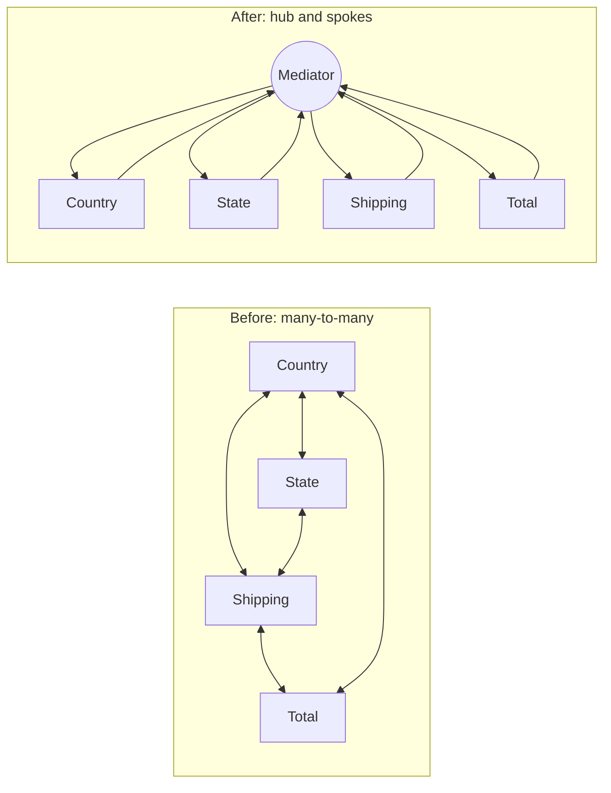
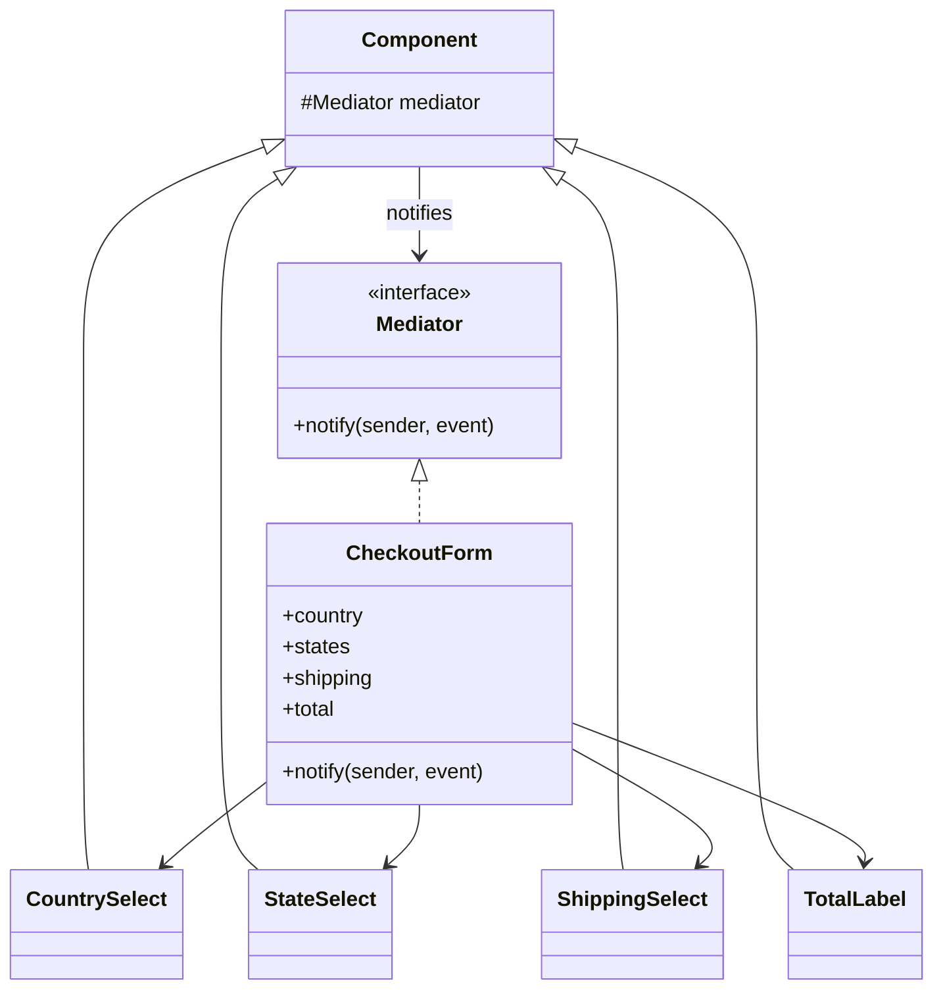
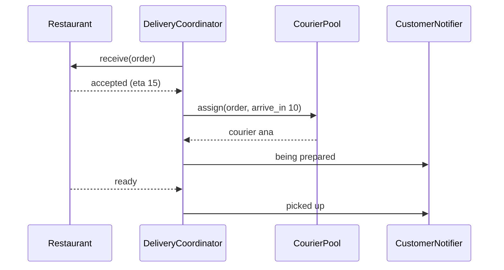

# Mediator Pattern

## Introduction

When many objects talk to each other directly, the number of connections grows quickly. Five components that all know about each other have up to twenty one-way dependencies. Change one, and you may need to change several others.

**Mediator** introduces a central object that coordinates the interaction. Components no longer reference each other; they notify the **mediator**, and the mediator decides who else needs to react.

An airport control tower is the classic analogy. Pilots do not negotiate runway access with every other plane in the sky. Each pilot talks only to the tower, and the tower sequences takeoffs and landings. The rules for who goes next live in one place.



In this page you will untangle a checkout form, see a TypeScript UI version, and apply the idea to a food delivery dispatch service. You will also learn the pattern's main risk: the mediator itself becoming a giant "god object".

## The Problem: Components That Know Each Other

A bookstore checkout form has a country selector, a state selector, a shipping option list and an order total. The rules are:

- Changing the country reloads the state list (only the US and Canada have states here).
- Changing the country also changes which shipping options exist.
- Changing the shipping option updates the total.

The first version wires components directly to each other:

```python
class TotalLabel:
    def __init__(self, subtotal: float) -> None:
        self.subtotal = subtotal
        self.text = ""

    def update(self, shipping_cost: float) -> None:
        self.text = f"Total: {self.subtotal + shipping_cost:.2f}"


class ShippingSelect:
    def __init__(self, total: TotalLabel) -> None:
        self.total = total               # knows the total label
        self.options: dict[str, float] = {}
        self.selected = ""

    def load_for(self, country: str) -> None:
        self.options = {"standard": 4.99, "express": 12.99} if country == "US" else {"international": 24.99}
        self.select(next(iter(self.options)))

    def select(self, option: str) -> None:
        self.selected = option
        self.total.update(self.options[option])


class StateSelect:
    def __init__(self) -> None:
        self.options: list[str] = []

    def load_for(self, country: str) -> None:
        self.options = {"US": ["CA", "NY"], "CA": ["ON", "QC"]}.get(country, [])


class CountrySelect:
    def __init__(self, states: StateSelect, shipping: ShippingSelect) -> None:
        self.states = states             # knows the state select
        self.shipping = shipping         # and the shipping select
        self.value = ""

    def choose(self, country: str) -> None:
        self.value = country
        self.states.load_for(country)
        self.shipping.load_for(country)


total = TotalLabel(subtotal=30.0)
shipping = ShippingSelect(total)
states = StateSelect()
country = CountrySelect(states, shipping)

country.choose("US")
shipping.select("express")
print(states.options, shipping.selected, total.text)
country.choose("FR")
print(states.options, shipping.selected, total.text)
```

Output:

```text
['CA', 'NY'] express Total: 42.99
[] international Total: 54.99
```

What hurts:

- **No component is reusable.** `CountrySelect` cannot be used on the account settings page, where there is no shipping select.
- **The rules are scattered.** "What happens when the country changes?" is split across three classes.
- **Construction order is fragile.** Components must be built in exactly the right order to pass references.
- **New rules ripple.** "Free shipping when a coupon is applied" needs the coupon box to know the shipping select and the total, adding more arrows.

## The Pattern



Components only know the mediator interface. The concrete mediator knows all components and contains the interaction rules.

### Step 1: A form mediator in Python

```python
from __future__ import annotations

from typing import Protocol


class Mediator(Protocol):
    def notify(self, sender: object, event: str) -> None: ...


class Component:
    def __init__(self) -> None:
        self.mediator: Mediator | None = None

    def emit(self, event: str) -> None:
        if self.mediator:
            self.mediator.notify(self, event)


class CountrySelect(Component):
    def __init__(self) -> None:
        super().__init__()
        self.value = ""

    def choose(self, country: str) -> None:
        self.value = country
        self.emit("changed")             # no idea who cares


class StateSelect(Component):
    def __init__(self) -> None:
        super().__init__()
        self.options: list[str] = []

    def set_options(self, options: list[str]) -> None:
        self.options = options


class ShippingSelect(Component):
    def __init__(self) -> None:
        super().__init__()
        self.options: dict[str, float] = {}
        self.selected = ""

    def set_options(self, options: dict[str, float]) -> None:
        self.options = options
        self.select(next(iter(options)))

    def select(self, option: str) -> None:
        self.selected = option
        self.emit("changed")

    @property
    def cost(self) -> float:
        return self.options[self.selected]


class TotalLabel(Component):
    def __init__(self) -> None:
        super().__init__()
        self.text = ""

    def show(self, amount: float) -> None:
        self.text = f"Total: {amount:.2f}"


class CheckoutForm:
    """The concrete mediator: every interaction rule for this form lives here."""

    STATES = {"US": ["CA", "NY"], "CA": ["ON", "QC"]}

    def __init__(self, subtotal: float) -> None:
        self.subtotal = subtotal
        self.country, self.states = CountrySelect(), StateSelect()
        self.shipping, self.total = ShippingSelect(), TotalLabel()
        for c in (self.country, self.states, self.shipping, self.total):
            c.mediator = self

    def notify(self, sender: object, event: str) -> None:
        if sender is self.country and event == "changed":
            code = self.country.value
            self.states.set_options(self.STATES.get(code, []))
            self.shipping.set_options(self._shipping_for(code))
        elif sender is self.shipping and event == "changed":
            self.total.show(self.subtotal + self.shipping.cost)

    @staticmethod
    def _shipping_for(country: str) -> dict[str, float]:
        return {"standard": 4.99, "express": 12.99} if country == "US" else {"international": 24.99}


form = CheckoutForm(subtotal=30.0)
form.country.choose("US")
form.shipping.select("express")
print(form.states.options, form.shipping.selected, form.total.text)
form.country.choose("FR")
print(form.states.options, form.shipping.selected, form.total.text)

# CountrySelect is now reusable on its own, for example on an account settings page:
standalone = CountrySelect()
standalone.choose("CA")
print("standalone:", standalone.value)
```

Output:

```text
['CA', 'NY'] express Total: 42.99
[] international Total: 54.99
standalone: CA
```

What improved:

- **Components are independent.** None of them imports another; `CountrySelect` works on any page.
- **All rules are in `notify`.** Reading one method tells you how the form behaves.
- **New rules touch one class.** A coupon box only needs to emit `"changed"`; the mediator decides what that means.

## The Same Idea in TypeScript

In UI code, the mediator is usually the **parent component or a store** that owns the state, while children receive values and emit events. Here is the idea without any framework:

```typescript
type FormEvent =
  | { type: "countryChanged"; country: string }
  | { type: "couponApplied"; code: string };

interface Mediator {
  notify(event: FormEvent): void;
}

class CheckoutMediator implements Mediator {
  state = { country: "", shipping: 0, discount: 0, subtotal: 30 };

  notify(event: FormEvent): void {
    switch (event.type) {
      case "countryChanged":
        this.state.country = event.country;
        this.state.shipping = event.country === "US" ? 4.99 : 24.99;
        break;
      case "couponApplied":
        this.state.discount = event.code === "FREESHIP" ? this.state.shipping : 0;
        break;
    }
    const { subtotal, shipping, discount } = this.state;
    console.log(`${event.type}: total ${(subtotal + shipping - discount).toFixed(2)}`);
  }
}

const form = new CheckoutMediator();
form.notify({ type: "countryChanged", country: "US" });
form.notify({ type: "couponApplied", code: "FREESHIP" });
```

Output:

```text
countryChanged: total 34.99
couponApplied: total 30.00
```

React apps often express this as "lift state up": sibling components do not talk to each other; the common parent (or a reducer, context or store) owns the rules. That parent plays the mediator role.

## Where You Have Already Met Mediator

- **Dialogs and forms in UI toolkits.** A dialog or form controller coordinating its widgets is the textbook example from the GoF book.
- **Chat rooms.** Users do not send messages to each other directly; the room (or server) relays them.
- **Air traffic control, and dispatch systems** in ride-hailing and delivery apps, where one coordinator matches requests to drivers.
- **In-process request dispatchers.** In .NET, MediatR is a widely used library that sends a request object to its single handler and runs pipeline behaviors around it. (MediatR moved to a commercial, dual-license model in 2025, with a free community tier; check the current terms before adopting it.) Python and Java codebases sometimes build similar "command bus" or "message bus" objects.
- **Message brokers** play a mediator-like role between services, although they route by topic rather than by business rules.

## Real-World Scenario

You work on a **food delivery platform**. When an order is placed, several parties must coordinate:

- the **restaurant** must accept the order and report when food is ready
- a **courier** must be assigned, ideally timed so they arrive when the food is ready
- the **customer** must receive status updates
- if the restaurant rejects or no courier is found within a time limit, the order must be refunded

Originally, the restaurant module called the courier module, which called the notification module, which called back into the restaurant module for timing. Every change caused regressions in another team's code.

### The solution

Introduce a `DeliveryCoordinator` that owns the delivery workflow. The restaurant, courier and customer modules only report events to it and receive commands from it.

```python
from dataclasses import dataclass, field


@dataclass
class Restaurant:
    name: str
    coordinator: "DeliveryCoordinator | None" = None

    def receive(self, order_id: str) -> None:
        print(f"[restaurant] {self.name} accepts {order_id}, ready in 15 min")
        assert self.coordinator
        self.coordinator.on_event("accepted", order_id, eta=15)

    def food_ready(self, order_id: str) -> None:
        assert self.coordinator
        self.coordinator.on_event("ready", order_id)


@dataclass
class CourierPool:
    available: list[str] = field(default_factory=list)

    def assign(self, order_id: str, arrive_in: int) -> str | None:
        if not self.available:
            return None
        courier = self.available.pop(0)
        print(f"[couriers] {courier} assigned to {order_id}, arrive in {arrive_in} min")
        return courier


@dataclass
class CustomerNotifier:
    def send(self, order_id: str, message: str) -> None:
        print(f"[customer] {order_id}: {message}")


class DeliveryCoordinator:
    """The mediator: the delivery workflow rules live only here."""

    def __init__(self, restaurant: Restaurant, couriers: CourierPool, notifier: CustomerNotifier) -> None:
        self.restaurant, self.couriers, self.notifier = restaurant, couriers, notifier
        restaurant.coordinator = self
        self.assignments: dict[str, str] = {}

    def place(self, order_id: str) -> None:
        self.notifier.send(order_id, "order received")
        self.restaurant.receive(order_id)

    def on_event(self, event: str, order_id: str, eta: int = 0) -> None:
        if event == "accepted":
            courier = self.couriers.assign(order_id, arrive_in=max(eta - 5, 0))
            if courier is None:
                self.notifier.send(order_id, "no courier available, refund issued")
                return
            self.assignments[order_id] = courier
            self.notifier.send(order_id, f"being prepared, {courier} will deliver")
        elif event == "ready":
            self.notifier.send(order_id, f"picked up by {self.assignments[order_id]}")


coordinator = DeliveryCoordinator(Restaurant("Pho 88"), CourierPool(["ana"]), CustomerNotifier())
coordinator.place("D-1")
coordinator.restaurant.food_ready("D-1")
coordinator.place("D-2")   # no couriers left
```

Output:

```text
[customer] D-1: order received
[restaurant] Pho 88 accepts D-1, ready in 15 min
[couriers] ana assigned to D-1, arrive in 10 min
[customer] D-1: being prepared, ana will deliver
[customer] D-1: picked up by ana
[customer] D-2: order received
[restaurant] Pho 88 accepts D-2, ready in 15 min
[customer] D-2: no courier available, refund issued
```



In a distributed system, the same role is played by a **saga orchestrator**: a service that sends commands to participants and reacts to their replies. See the [Saga pattern](../9-arch-distributed-systems/5-arch-saga.mdx), which compares orchestration (a mediator) with choreography (participants reacting to each other's events).

### Why this approach

- **The workflow is visible in one place.** Product and support can read one class to understand delivery.
- **Teams are decoupled.** The courier team changes assignment logic without touching restaurant code.
- **Failure handling is centralized.** Refund rules live in the coordinator, not scattered across modules.

### When to use it, and when not to

Use Mediator when:

- **many objects interact in complex, many-to-many ways**, and the interaction rules change more often than the objects
- you want to **reuse components** in different contexts with different rules
- a **workflow** spans several modules, and someone needs to own it

Do not use it when:

- two or three objects interact simply. A direct call is clearer than a hub.
- the mediator would just **forward calls** without any rules. That is an unnecessary layer.
- the interactions are really **independent reactions** to an event. [Observer](./1-arch-observer.mdx) or domain events fit better.
- in .NET-style codebases, wrapping **every** controller call in a mediator request "for decoupling" often adds indirection with little benefit. Many teams now prefer plain service classes unless they need the pipeline behaviors.

### Alternatives and trade-offs

| Approach | Pros | Cons | Best for |
| --- | --- | --- | --- |
| Direct references | Simple, explicit, easy to navigate in an IDE | Many-to-many coupling grows | Few, stable collaborators |
| Mediator | Rules in one place, reusable components | Mediator can grow into a god object | Forms, workflows, coordination |
| [Observer](./1-arch-observer.mdx) or event bus | Very loose coupling, easy to add listeners | Flow is implicit and hard to trace | Independent side effects |
| Saga orchestrator | Explicit cross-service workflow, compensations | A central service to run and scale | Multi-service business processes |
| Choreography (events between services) | No central coordinator | Workflow emerges and is hard to see | Simple flows, autonomous teams |

## Related and Confusable Patterns

- **Mediator vs [Observer](./1-arch-observer.mdx).** Observer sets up one-way subscriptions; subscribers come and go and the publisher has no rules. A mediator has **knowledge**: it decides who reacts and how. A mediator is often *implemented* using Observer-style notifications, as `emit` does above.
- **Mediator vs [Facade](../3-arch-structural-patterns/4-arch-facade.mdx).** A facade gives outsiders a simpler interface to a subsystem, and the subsystem's classes may still talk to each other. A mediator sits *between* peers, and they talk only through it.
- **Mediator vs [Chain of Responsibility](./5-arch-chain-of-responsibility.mdx).** A chain passes a request along a line of handlers; a mediator routes between peers through one hub.
- **Mediator and [Command](./2-arch-command.mdx).** Request-dispatching mediators (like MediatR) route command objects to their handlers.

## Common Mistakes

1. **The god-object mediator.** If every rule in the application ends up in one `AppMediator`, you have moved the mess, not removed it. Have one mediator per **interaction context** (one per form, one per workflow) and keep it focused.
2. **Components that still talk directly.** A component that calls the mediator *and* a sibling defeats the purpose. Enforce the rule with imports: components should not import each other.
3. **Stringly typed events.** `notify(self, "changed")` is easy to misspell. Use enums, dataclasses or TypeScript discriminated unions for events, as the TypeScript example does.
4. **Hidden recursion.** The mediator updates a component, which emits an event, which the mediator handles again. Guard against loops, or have components only emit events for *user* actions, not for programmatic updates.
5. **Mediators as pass-through layers.** A mediator that receives `GetBookRequest` and calls `book_service.get()` adds a file and a hop, and nothing else.

## Summary

- Mediator replaces many-to-many communication with a hub that holds the interaction rules.
- Components become **reusable**, and the rules become **visible in one place**.
- In UI code the mediator is often a parent component or store; across services it becomes a **saga orchestrator**.
- The main risk is a **god object**: keep one mediator per interaction context.
- Use direct calls for simple interactions and Observer for independent reactions.

## Exercises

1. Add a coupon box to the Python `CheckoutForm` that makes shipping free when the code `"FREESHIP"` is applied. Which classes did you change?
2. Replace the string events in `CheckoutForm` with an `Enum` or dataclasses and a `match` statement.
3. Add a timeout rule to `DeliveryCoordinator`: if the restaurant has not reported `"ready"` within 30 minutes of acceptance, notify the customer and alert support. Where does the timer state live?
4. Draw the dependency graph of a screen or module you work on. If it has many-to-many arrows, sketch how a mediator would change it, and decide honestly whether it is worth it.

Continue with the [Memento Pattern](./8-arch-memento.mdx), or see Mediator at the scale of services in the [Saga Pattern](../9-arch-distributed-systems/5-arch-saga.mdx).
