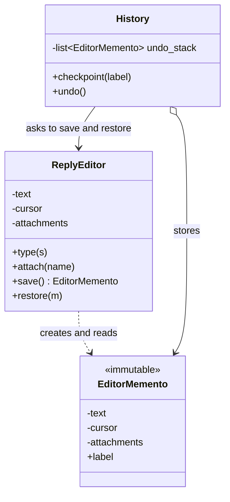
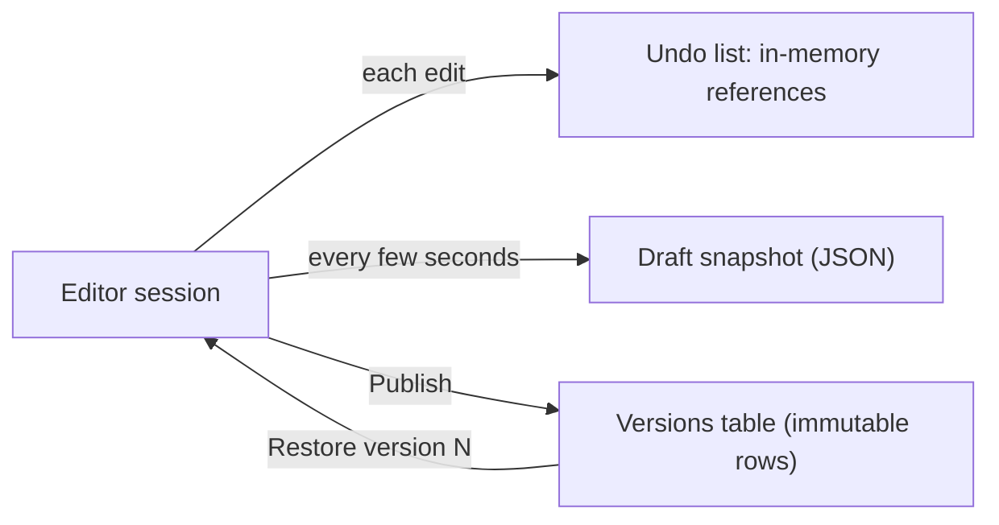

# Memento Pattern

## Introduction

**Memento** captures an object's internal state in a snapshot so it can be **restored later**, without exposing that state to the rest of the program.

Think of a save point in a video game. Before the boss fight, the game saves your position, health and inventory. If you lose, you reload the save. You never edit the save file yourself, and you do not need to know its format. You just ask the game to "save" and "load".

Memento is the main alternative to [Command](./2-arch-command.mdx)-based undo. A command knows how to *reverse* its own effect. A memento simply *remembers how things were*. For operations that are hard to reverse (a complex image filter, an auto-format of a whole document, a bulk recalculation), taking a snapshot is often far simpler.

There are three roles:

| Role | Job | Video game |
| --- | --- | --- |
| **Originator** | The object whose state is saved; creates and restores mementos | The game world |
| **Memento** | An opaque snapshot of the originator's state | The save file |
| **Caretaker** | Keeps mementos and decides when to save or restore, but never looks inside | The save-slot menu |

## The Problem: Undo That Reaches Into Private State

Your helpdesk has a **ticket reply editor** with features like "insert template", "auto-format" and "translate". Users want undo. The first attempt lets the UI copy fields out of the editor and write them back:

```python
class ReplyEditor:
    def __init__(self) -> None:
        self.text = ""
        self.cursor = 0
        self.attachments: list[str] = []
        self._word_count_cache: int | None = None   # internal detail

    def type(self, s: str) -> None:
        self.text = self.text[: self.cursor] + s + self.text[self.cursor :]
        self.cursor += len(s)
        self._word_count_cache = None


editor = ReplyEditor()
editor.type("Hello")

# The UI saves state by reaching into the editor...
saved = (editor.text, editor.cursor, editor.attachments)
editor.type(", world")
editor.attachments.append("log.txt")

# ...and restores it the same way.
editor.text, editor.cursor, editor.attachments = saved
print(repr(editor.text), editor.cursor, editor.attachments)
```

Output:

```text
'Hello' 5 ['log.txt']
```

Two problems are already visible:

- **The attachment survived the undo.** `saved` held a reference to the same list, which was mutated afterwards. Snapshots must be copies.
- **The UI knows the editor's internals.** It must list every field to save, and it forgot to reset `_word_count_cache`. When the editor gains a new field (say, `selection`), every caller that saves state must be updated.

## The Pattern

The originator is the only object that knows what to put in a memento and how to restore from it. The caretaker treats mementos as opaque tokens.



### Step 1: Originator, memento and caretaker

Using a frozen dataclass with **immutable** fields (strings, ints, tuples) means a memento cannot be changed after it is taken, so the shared-list bug cannot happen.

```python
from dataclasses import dataclass
from datetime import datetime


@dataclass(frozen=True)
class EditorMemento:
    label: str                     # public: safe for the caretaker to display
    _text: str
    _cursor: int
    _attachments: tuple[str, ...]  # tuple, not list: snapshot cannot be mutated
    taken_at: datetime


class ReplyEditor:
    def __init__(self) -> None:
        self._text = ""
        self._cursor = 0
        self._attachments: list[str] = []

    def type(self, s: str) -> None:
        self._text = self._text[: self._cursor] + s + self._text[self._cursor :]
        self._cursor += len(s)

    def attach(self, name: str) -> None:
        self._attachments.append(name)

    def auto_format(self) -> None:
        """Hard to reverse: capitalizes sentences and normalizes spaces."""
        sentences = [s.strip().capitalize() for s in self._text.split(".") if s.strip()]
        self._text = ". ".join(sentences) + "."
        self._cursor = len(self._text)

    def save(self, label: str) -> EditorMemento:
        return EditorMemento(label, self._text, self._cursor, tuple(self._attachments), datetime.now())

    def restore(self, m: EditorMemento) -> None:
        self._text, self._cursor = m._text, m._cursor
        self._attachments = list(m._attachments)    # fresh mutable copy

    def __repr__(self) -> str:
        return f"ReplyEditor(text={self._text!r}, attachments={self._attachments})"


class History:
    """The caretaker: stores mementos, never looks inside them."""

    def __init__(self, editor: ReplyEditor, limit: int = 50) -> None:
        self.editor = editor
        self.limit = limit
        self._stack: list[EditorMemento] = []

    def checkpoint(self, label: str) -> None:
        self._stack.append(self.editor.save(label))
        del self._stack[: -self.limit]              # keep only the newest snapshots

    def undo(self) -> str | None:
        if not self._stack:
            return None
        m = self._stack.pop()
        self.editor.restore(m)
        return m.label

    def labels(self) -> list[str]:
        return [m.label for m in self._stack]


editor = ReplyEditor()
history = History(editor)

editor.type("hi there.  thanks for  waiting. we are on it")
history.checkpoint("before attach")
editor.attach("log.txt")
history.checkpoint("before auto-format")
editor.auto_format()
print(editor)
print("undo stack:", history.labels())

print("undo ->", history.undo())
print(editor)
print("undo ->", history.undo())
print(editor)
```

Output:

```text
ReplyEditor(text='Hi there. Thanks for  waiting. We are on it.', attachments=['log.txt'])
undo stack: ['before attach', 'before auto-format']
undo -> before auto-format
ReplyEditor(text='hi there.  thanks for  waiting. we are on it', attachments=['log.txt'])
undo -> before attach
ReplyEditor(text='hi there.  thanks for  waiting. we are on it', attachments=[])
```

Notice:

- `auto_format` has **no undo logic** at all. The snapshot taken before it is enough.
- The caretaker only reads `label`. Everything else is private by convention (leading underscores), and only `ReplyEditor` touches it.
- The attachment really disappears on the second undo, because the memento stored an immutable tuple.
- `limit` bounds memory: old snapshots are dropped.

:::note
Python cannot truly hide the memento's fields; the underscores are a convention that linters and code review enforce. Languages with nested classes and access modifiers, such as Java, can make the memento genuinely opaque, as shown next.
:::

## The Same Idea in Java

Here the memento is a private nested record. Code outside `Editor` can hold a `Snapshot` and pass it back, but cannot read its fields, because `Snapshot` exposes nothing publicly and its type is only usable through the editor.

```java
import java.util.ArrayDeque;
import java.util.Deque;

public class MementoDemo {
    static final class Editor {
        private String text = "";
        private int cursor = 0;

        /** Opaque to everyone except Editor. */
        public static final class Snapshot {
            private final String text;
            private final int cursor;
            private Snapshot(String text, int cursor) { this.text = text; this.cursor = cursor; }
        }

        void type(String s) { text = text.substring(0, cursor) + s + text.substring(cursor); cursor += s.length(); }
        Snapshot save() { return new Snapshot(text, cursor); }
        void restore(Snapshot s) { text = s.text; cursor = s.cursor; }
        @Override public String toString() { return "'" + text + "' cursor=" + cursor; }
    }

    public static void main(String[] args) {
        Editor editor = new Editor();
        Deque<Editor.Snapshot> history = new ArrayDeque<>();

        editor.type("Hello");
        history.push(editor.save());
        editor.type(", world");
        System.out.println(editor);

        editor.restore(history.pop());
        System.out.println(editor);
    }
}
```

Output:

```text
'Hello, world' cursor=12
'Hello' cursor=5
```

Strictly, Java lets the enclosing class `MementoDemo` see private members of nested classes too, so in a real codebase you would put `Editor` in its own file and package. The point stands: only the originator can read the snapshot.

## Snapshot Strategies and Memory

Full snapshots are simple but can be expensive. Pick a strategy that fits the size of the state and how often you save.

| Strategy | How it works | Pros | Cons |
| --- | --- | --- | --- |
| Full copy | `copy.deepcopy(state)` or explicit fields | Simplest, always correct | Memory and CPU grow with state size |
| Immutable state with structural sharing | State is immutable; each change creates a new version sharing unchanged parts | Snapshots are nearly free (keep a reference) | Requires an immutable design throughout |
| Diffs or deltas | Store only what changed since the previous snapshot | Small memory footprint | Restoring needs replay; more complex |
| Persisted snapshots | Serialize to JSON or a database row | Survives restarts, enables drafts and versions | Versioning of the format, I/O cost |

The immutable approach is why time-travel debugging works well in Redux-style stores: every state is a new immutable object, so the history is just a list of references.

```python
import sys
from dataclasses import dataclass, replace


@dataclass(frozen=True)
class Settings:
    theme: str
    signature: str
    shortcuts: tuple[tuple[str, str], ...]


v1 = Settings("light", "Best, Ana", tuple((f"k{i}", f"action{i}") for i in range(1000)))
v2 = replace(v1, theme="dark")                     # new version, shares the shortcuts tuple

print(v2.shortcuts is v1.shortcuts)                # True: no copy of the big part
history = [v1, v2]                                 # snapshots are just references
print(history[0].theme, "->", history[1].theme)

print(sys.getsizeof(history), "bytes for the list of two references")
```

Example output (sizes vary by Python version and platform):

```text
True
light -> dark
72 bytes for the list of two references
```

## Where You Have Already Met Memento

- **Database savepoints.** `SAVEPOINT before_import;` then `ROLLBACK TO SAVEPOINT before_import;` restores the transaction's state to a named point. The database is the originator; you only hold the savepoint's name.
- **Browser history state.** `history.pushState(state, "", url)` stores a state object that the browser hands back in the `popstate` event when the user navigates back.
- **Editor undo and autosave drafts.** Many editors combine command-based undo with periodic snapshots.
- **Redux DevTools time travel**, built on immutable state snapshots.
- **VM and disk snapshots** in virtualization and cloud platforms: a full snapshot you can roll back to, without knowing the disk's internal layout.
- **Python `pickle` and Java serialization** are general-purpose ways to produce persisted snapshots. Never unpickle data from untrusted sources: loading a pickle can execute arbitrary code.

## Real-World Scenario

Your helpdesk lets admins edit **automation rules** in a visual editor: conditions, actions, schedules. Admins make many changes and then click "Publish". Requirements:

- unlimited undo while editing, including for complex operations like "duplicate rule set"
- "discard changes" to go back to the last published version
- drafts must survive a browser crash or a server deploy
- support staff must be able to see and restore any **previously published** version

### The solution

1. Represent the rule set as **immutable data** (frozen dataclasses on the server, immutable objects in the frontend store). Every edit produces a new version.
2. Keep the **in-session undo history** as a list of references to previous versions in the frontend, capped at a few hundred entries.
3. **Autosave** the latest draft every few seconds as a persisted snapshot (JSON with a `schema_version` field) so it survives crashes.
4. On "Publish", store the snapshot as an immutable row in a `rule_set_versions` table. "Restore version 12" creates a new draft from version 12's snapshot.
5. The rule engine (the originator) owns serialization: `RuleSet.to_snapshot()` and `RuleSet.from_snapshot()`. The editor UI and the versions table never parse the internals.



### Why this approach

- **Complex operations get undo for free**, because no operation needs reverse logic.
- **One snapshot format** serves undo, drafts and published versions.
- **Encapsulation holds**: only the rule engine knows how a rule set is serialized, so internal changes do not break the UI or storage.

### When to use it, and when not to

Use Memento when:

- you need **undo, rollback or "revert to saved"**, and operations are hard to reverse individually
- the state is **reasonably small**, or can be made immutable so snapshots share structure
- you want to restore state **without exposing the object's internals** to the code that triggers the restore

Do not use it when:

- the state is **huge** (a 2 GB image, a whole database) and snapshots would be too costly. Use commands with reverse operations, or deltas.
- the object holds **external resources** (open connections, file handles, sent emails). Restoring a snapshot does not un-send an email. Snapshots only cover in-memory state.
- you need an **audit trail of what happened**, not just the ability to go back. Snapshots show states, not intentions. Commands or event sourcing record *why* things changed.

### Alternatives and trade-offs

| Approach | Pros | Cons | Best for |
| --- | --- | --- | --- |
| Memento snapshots | Simple, works for any operation | Memory per snapshot | Editors, forms, settings |
| [Command](./2-arch-command.mdx) with `undo` | Small memory, records intent | Every operation needs reverse logic | Many small, reversible edits |
| Immutable state plus history | Cheap snapshots, easy time travel | Needs immutable design | Frontend stores, functional code |
| [Event Sourcing](../9-arch-distributed-systems/4-arch-event-sourcing.mdx) | Full history, rebuild any past state | High complexity, schema evolution | Audit-critical domains |
| Database transactions and savepoints | Built in, consistent | Only within a transaction | Multi-step database changes |

## Related and Confusable Patterns

- **Memento vs [Command](./2-arch-command.mdx).** Two ways to implement undo: reverse the change, or restore a snapshot. Combining them is common: a command stores a memento before executing.
- **Memento vs [Prototype](../2-arch-creational-patterns/5-arch-prototype.mdx).** Both copy an object. A prototype creates a **new, independent object** to use; a memento is a **private snapshot** used to restore the original.
- **Memento and [Iterator](./6-arch-iterator.mdx).** Saving an iterator's position (a cursor) so a job can resume is a memento.
- **Memento and [State](./3-arch-state.mdx).** Snapshotting a state machine lets you roll back a failed multi-step transition.

## Common Mistakes

1. **Shallow copies.** Storing a reference to a mutable list or dict means later changes leak into "old" snapshots, as the first example showed. Store immutable values or deep copies.
2. **Unbounded history.** A snapshot on every keystroke, kept forever, will exhaust memory. Cap the history, merge snapshots taken close together, or save on meaningful boundaries.
3. **Caretakers that read or edit mementos.** Once the UI starts reading `memento._text`, the originator can no longer change its internals freely. Keep the caretaker's view to metadata like labels and timestamps.
4. **No format version on persisted snapshots.** A draft saved by last month's code must still load today. Add a `schema_version` and migrate old snapshots on load.
5. **Restoring references to external things.** A memento that contains a database connection or a "payment sent" flag will restore a state that no longer matches the outside world. Keep snapshots to pure data.

## Summary

- Memento captures an object's state so it can be restored later, without exposing internals.
- The **originator** creates and reads mementos; the **caretaker** stores them as opaque tokens.
- Use **immutable snapshots** to avoid shared-reference bugs and to make history cheap.
- Bound history size, version persisted snapshots, and keep external effects out of them.
- Choose Memento when operations are hard to reverse; choose Command when you need small memory or a record of intent.

## Exercises

1. Add **redo** to the `History` caretaker. What must happen to the redo stack when a new checkpoint is taken?
2. Make `History.checkpoint` merge snapshots: if the previous checkpoint was taken less than one second ago with the same label, replace it instead of adding a new one.
3. Add `to_json()` and `from_json()` methods on `ReplyEditor` that persist a snapshot with a `schema_version`, and write a migration that loads version 1 snapshots without the `attachments` field.
4. Compare memory use: implement undo for 1,000 edits of a 100 KB text using full snapshots and using a command that stores only the inserted text. Measure with `tracemalloc`.

Continue with the [Visitor Pattern](./9-arch-visitor.mdx), or compare undo techniques in [Choosing a Behavioral Pattern](./10-arch-choosing-behavioral.mdx).
