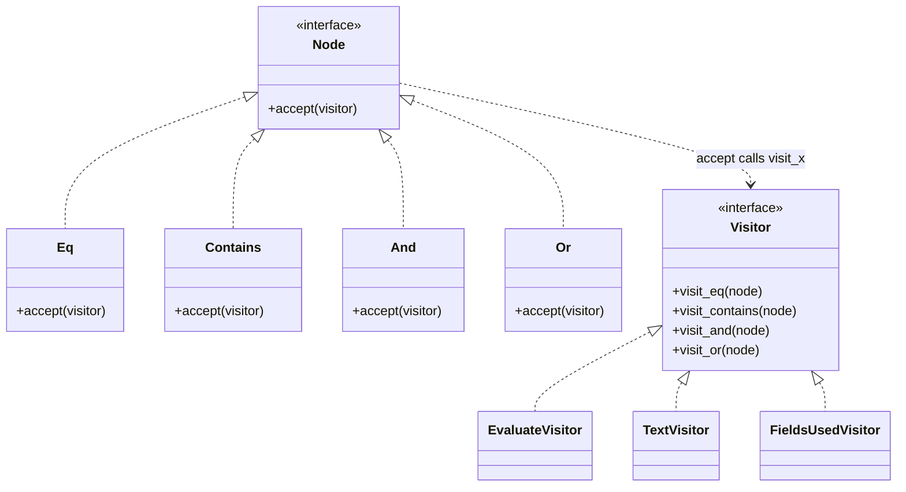
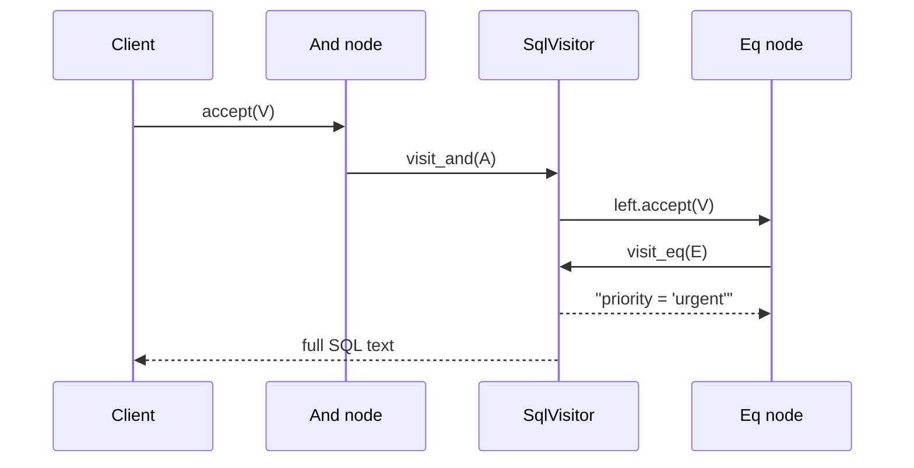

# Visitor Pattern

## Introduction

Suppose you have a **stable set of node types** (shapes in a drawing, nodes in a syntax tree, rows in a document) and an **ever-growing list of operations** on them: render, export, validate, count, price, translate. If every operation becomes a method on every node class, the node classes bloat, and every new operation touches every class.

**Visitor** moves each operation into its own object, the **visitor**, with one method per node type. Nodes only need a single generic method, `accept(visitor)`, which calls the right visitor method for that node.

Think of a tax inspector visiting different businesses. A restaurant, a shop and a factory are each audited differently. The businesses do not contain the audit rules; they just open the door ("accept the visitor"), and the inspector applies the procedure for that kind of business. Next year a fire-safety inspector visits with completely different procedures, and the businesses do not change at all.

Visitor is one of the more advanced GoF patterns, and modern languages offer lighter alternatives (structural pattern matching, `functools.singledispatch`, sealed types). This page shows the classic version so you can recognize it in compilers and frameworks, and then shows when the alternatives are a better fit.

## The Problem: Operations Spread Across Every Class

Your helpdesk lets admins write **automation conditions** like "priority is urgent AND (tag is vip OR subject contains outage)". They are stored as a small expression tree:

```python
from __future__ import annotations

from dataclasses import dataclass


@dataclass
class Eq:
    field: str
    value: str

    def evaluate(self, ticket: dict) -> bool:
        return ticket.get(self.field) == self.value

    def to_text(self) -> str:
        return f"{self.field} = {self.value!r}"


@dataclass
class Contains:
    field: str
    needle: str

    def evaluate(self, ticket: dict) -> bool:
        return self.needle.lower() in str(ticket.get(self.field, "")).lower()

    def to_text(self) -> str:
        return f"{self.field} contains {self.needle!r}"


@dataclass
class And:
    left: Eq | Contains | And | Or
    right: Eq | Contains | And | Or

    def evaluate(self, ticket: dict) -> bool:
        return self.left.evaluate(ticket) and self.right.evaluate(ticket)

    def to_text(self) -> str:
        return f"({self.left.to_text()} AND {self.right.to_text()})"


@dataclass
class Or:
    left: Eq | Contains | And | Or
    right: Eq | Contains | And | Or

    def evaluate(self, ticket: dict) -> bool:
        return self.left.evaluate(ticket) or self.right.evaluate(ticket)

    def to_text(self) -> str:
        return f"({self.left.to_text()} OR {self.right.to_text()})"


rule = And(Eq("priority", "urgent"), Or(Eq("tag", "vip"), Contains("subject", "outage")))
print(rule.to_text())
print(rule.evaluate({"priority": "urgent", "tag": "free", "subject": "Total OUTAGE"}))
```

Output:

```text
(priority = 'urgent' AND (tag = 'vip' OR subject contains 'outage'))
True
```

This is fine with two operations. Then the requests arrive: "export rules to SQL for reporting", "list all fields used, so we can warn before a field is deleted", "estimate how expensive a rule is", "translate rule text for the UI". Each new operation means:

- **editing all four node classes**, which may belong to a different team than the feature
- **mixing unrelated concerns** in each class: evaluation, SQL generation, i18n and cost estimation
- **no single place** to read how one operation works across all node types

## The Pattern



The key mechanism is **double dispatch**. Calling `node.accept(visitor)` dispatches on the *node's* type (which `accept` runs), and inside it, `visitor.visit_eq(self)` dispatches on the *visitor's* type (which operation runs). Together, the pair (node type, operation) selects the right code without any `isinstance` checks.



### Step 1: Classic Visitor in Python

```python
from __future__ import annotations

from abc import ABC, abstractmethod
from dataclasses import dataclass
from typing import Generic, TypeVar

T = TypeVar("T")


class Visitor(ABC, Generic[T]):
    @abstractmethod
    def visit_eq(self, node: Eq) -> T: ...
    @abstractmethod
    def visit_contains(self, node: Contains) -> T: ...
    @abstractmethod
    def visit_and(self, node: And) -> T: ...
    @abstractmethod
    def visit_or(self, node: Or) -> T: ...


class Node(ABC):
    @abstractmethod
    def accept(self, visitor: Visitor[T]) -> T: ...


@dataclass(frozen=True)
class Eq(Node):
    field: str
    value: str
    def accept(self, visitor: Visitor[T]) -> T:
        return visitor.visit_eq(self)


@dataclass(frozen=True)
class Contains(Node):
    field: str
    needle: str
    def accept(self, visitor: Visitor[T]) -> T:
        return visitor.visit_contains(self)


@dataclass(frozen=True)
class And(Node):
    left: Node
    right: Node
    def accept(self, visitor: Visitor[T]) -> T:
        return visitor.visit_and(self)


@dataclass(frozen=True)
class Or(Node):
    left: Node
    right: Node
    def accept(self, visitor: Visitor[T]) -> T:
        return visitor.visit_or(self)


# --- Operations live in visitors, not in the nodes ---

class Evaluate(Visitor[bool]):
    def __init__(self, ticket: dict) -> None:
        self.ticket = ticket
    def visit_eq(self, n: Eq) -> bool:
        return self.ticket.get(n.field) == n.value
    def visit_contains(self, n: Contains) -> bool:
        return n.needle.lower() in str(self.ticket.get(n.field, "")).lower()
    def visit_and(self, n: And) -> bool:
        return n.left.accept(self) and n.right.accept(self)
    def visit_or(self, n: Or) -> bool:
        return n.left.accept(self) or n.right.accept(self)


class ToSql(Visitor[str]):
    """New operation: no node class changed to add it."""
    def visit_eq(self, n: Eq) -> str:
        return f"{n.field} = '{n.value}'"      # demo only: use bound parameters in real SQL
    def visit_contains(self, n: Contains) -> str:
        return f"LOWER({n.field}) LIKE '%{n.needle.lower()}%'"
    def visit_and(self, n: And) -> str:
        return f"({n.left.accept(self)} AND {n.right.accept(self)})"
    def visit_or(self, n: Or) -> str:
        return f"({n.left.accept(self)} OR {n.right.accept(self)})"


class FieldsUsed(Visitor[set[str]]):
    def visit_eq(self, n: Eq) -> set[str]:
        return {n.field}
    def visit_contains(self, n: Contains) -> set[str]:
        return {n.field}
    def visit_and(self, n: And) -> set[str]:
        return n.left.accept(self) | n.right.accept(self)
    def visit_or(self, n: Or) -> set[str]:
        return n.left.accept(self) | n.right.accept(self)


rule = And(Eq("priority", "urgent"), Or(Eq("tag", "vip"), Contains("subject", "outage")))
print(rule.accept(Evaluate({"priority": "urgent", "tag": "free", "subject": "Total OUTAGE"})))
print(rule.accept(ToSql()))
print(sorted(rule.accept(FieldsUsed())))
```

Output:

```text
True
(priority = 'urgent' AND (tag = 'vip' OR LOWER(subject) LIKE '%outage%'))
['priority', 'subject', 'tag']
```

What changed:

- **Nodes are tiny and stable.** They hold data and one `accept` method.
- **Each operation is one class** you can read top to bottom: all SQL generation lives in `ToSql`.
- **Adding an operation touches no node class.** `FieldsUsed` was added without editing `Eq`, `And` or the others.
- **Visitors can hold state** (the ticket being evaluated) and return typed results.

:::warning
The `ToSql` visitor builds SQL with string formatting to keep the example short. Real code must use parameterized queries to prevent SQL injection; see [Security by Design](../12-arch-quality-and-operations/4-arch-security-by-design.mdx).
:::

### The trade-off: the expression problem

Visitor makes one kind of change easy and another hard:

| Change | Methods on node classes | Visitor |
| --- | --- | --- |
| Add a new **operation** | Edit every node class | Add one visitor class |
| Add a new **node type** | Add one class | Edit **every** visitor |

This tension is known as the **expression problem**. Choose Visitor when node types are stable and operations keep growing (compilers, document models, rule engines). Avoid it when new node types arrive often.

## Lighter Alternatives in Modern Python

### Structural pattern matching

Since Python 3.10, `match` can dispatch on type and destructure dataclasses in one step. For many codebases this replaces Visitor entirely: no `accept` methods, and each operation is one function.

```python
from __future__ import annotations

from dataclasses import dataclass


@dataclass(frozen=True)
class Eq:
    field: str
    value: str

@dataclass(frozen=True)
class Contains:
    field: str
    needle: str

@dataclass(frozen=True)
class And:
    left: Node
    right: Node

@dataclass(frozen=True)
class Or:
    left: Node
    right: Node

type Node = Eq | Contains | And | Or      # Python 3.12 type alias syntax


def to_text(node: Node) -> str:
    match node:
        case Eq(field, value):
            return f"{field} = {value!r}"
        case Contains(field, needle):
            return f"{field} contains {needle!r}"
        case And(left, right):
            return f"({to_text(left)} AND {to_text(right)})"
        case Or(left, right):
            return f"({to_text(left)} OR {to_text(right)})"
        case _:
            raise TypeError(f"unknown node {node!r}")


print(to_text(And(Eq("priority", "urgent"), Contains("subject", "outage"))))
```

Output:

```text
(priority = 'urgent' AND subject contains 'outage')
```

Positional patterns like `Eq(field, value)` work because dataclasses generate `__match_args__` automatically. Type checkers such as mypy and pyright can warn when a `match` over a union does not handle every member, if you end with `assert_never(node)` from `typing` instead of the generic `case _`.

### `functools.singledispatch`

`singledispatch` builds a function that dispatches on the type of its first argument. It works even for classes you do not own, such as built-in types.

```python
from datetime import date
from decimal import Decimal
from functools import singledispatch


@singledispatch
def to_json_value(value: object) -> object:
    raise TypeError(f"cannot serialize {type(value).__name__}")


@to_json_value.register
def _(value: date) -> str:
    return value.isoformat()


@to_json_value.register
def _(value: Decimal) -> str:
    return str(value)            # keep exact money values as strings


@to_json_value.register
def _(value: int | float) -> float:
    return float(value)


print([to_json_value(v) for v in [date(2026, 3, 1), Decimal("19.99"), 3]])
```

Output:

```text
['2026-03-01', '19.99', 3.0]
```

Registering with a union annotation such as `int | float` requires Python 3.11 or later.

## The Same Idea in Java: Classic and Modern

Classic Visitor is common in Java codebases and libraries. Since **Java 21**, pattern matching for `switch` (JEP 441) together with **sealed interfaces** and **records** gives a compiler-checked alternative: the switch must cover every permitted subtype, so adding a node type produces compile errors in every switch that needs updating, which is the same safety Visitor gives you.

```java
public class VisitorDemo {
    sealed interface Node permits Eq, And {}
    record Eq(String field, String value) implements Node {}
    record And(Node left, Node right) implements Node {}

    // Classic visitor
    interface Visitor<R> {
        R visitEq(Eq n);
        R visitAnd(And n);
    }
    static <R> R accept(Node n, Visitor<R> v) {          // stand-in for an accept() method
        return switch (n) {
            case Eq e -> v.visitEq(e);
            case And a -> v.visitAnd(a);
        };
    }
    static final class TextVisitor implements Visitor<String> {
        public String visitEq(Eq n) { return n.field() + " = '" + n.value() + "'"; }
        public String visitAnd(And n) { return "(" + accept(n.left(), this) + " AND " + accept(n.right(), this) + ")"; }
    }

    // Modern alternative: an exhaustive switch with record patterns, no visitor needed
    static String toText(Node n) {
        return switch (n) {
            case Eq(String f, String v) -> f + " = '" + v + "'";
            case And(Node l, Node r) -> "(" + toText(l) + " AND " + toText(r) + ")";
        };
    }

    public static void main(String[] args) {
        Node rule = new And(new Eq("priority", "urgent"), new Eq("tag", "vip"));
        System.out.println(accept(rule, new TextVisitor()));
        System.out.println(toText(rule));
    }
}
```

Output:

```text
(priority = 'urgent' AND tag = 'vip')
(priority = 'urgent' AND tag = 'vip')
```

No `default` branch is needed in either switch, because the compiler knows `Node` permits only `Eq` and `And`.

## Where You Have Already Met Visitor

- **Python's `ast.NodeVisitor`.** Subclass it and define `visit_Name`, `visit_Call`, `visit_Constant` and so on; `visit(node)` dispatches to `visit_<ClassName>` and falls back to `generic_visit`, which visits children. (The old `visit_Num` and `visit_Str` methods were deprecated in 3.8 and are no longer called from Python 3.14; use `visit_Constant`.) `ast.NodeTransformer` is the variant that returns modified nodes.
- **Java's `java.nio.file.FileVisitor`.** `Files.walkFileTree` calls `preVisitDirectory`, `visitFile`, `visitFileFailed` and `postVisitDirectory` on your visitor; `SimpleFileVisitor` provides defaults.
- **Compilers and linters.** Babel plugins, ESLint rules and the Java annotation-processing API (`javax.lang.model.element.ElementVisitor`) all define visitors over syntax trees.
- **Document converters** that walk a document model and emit HTML, Markdown or PDF use one visitor per output format.

```python
import ast

source = """
import os
def handler(event):
    password = "hunter2"
    return os.environ.get("TOKEN")
"""


class SecretFinder(ast.NodeVisitor):
    def __init__(self) -> None:
        self.findings: list[str] = []

    def visit_Assign(self, node: ast.Assign) -> None:
        for target in node.targets:
            if isinstance(target, ast.Name) and "password" in target.id.lower():
                if isinstance(node.value, ast.Constant) and isinstance(node.value.value, str):
                    self.findings.append(f"line {node.lineno}: hard-coded {target.id}")
        self.generic_visit(node)       # keep walking into children


finder = SecretFinder()
finder.visit(ast.parse(source))
print(finder.findings)
```

Output:

```text
['line 4: hard-coded password']
```

That is a tiny linter rule, written as a visitor over Python's own syntax tree.

## Real-World Scenario

Your helpdesk's automation rules (the expression tree above) are central to the product. The node types have been stable for two years: `Eq`, `Contains`, `And`, `Or`, `Not`, `InList`. Meanwhile, new operations keep coming: evaluation, display text, SQL export for reports, "fields used" for safe schema changes, translation, cost estimation and a validator that rejects rules referencing deleted fields. Five teams contribute operations.

### The solution

- Keep nodes as **frozen dataclasses** with no behavior beyond data.
- Implement each operation as a **separate module**, owned by the team that needs it.
- In Python, use **`match` with a `Node` union type and `assert_never`** for each operation, so type checkers flag operations that miss a node type. Teams that prefer classes can use a `Visitor` base class with an abstract method per node type, which fails at instantiation if a method is missing.
- When a new node type is genuinely needed (rarely), the type checker lists every operation to update, and the change is made in one pull request.

### Why this approach

- **Operations grow; node types do not.** That is exactly the side of the expression problem that Visitor (or exhaustive matching) handles well.
- **Team ownership is clear.** The reporting team owns `to_sql.py` and never edits node classes.
- **Exhaustiveness is checked by tools**, not by memory.

### When to use it, and when not to

Use Visitor (or exhaustive matching) when:

- the **set of types is stable**, and **operations keep being added**
- operations are **unrelated** to each other and you do not want them mixed into the data classes
- you walk **trees or graphs** (syntax trees, documents, file systems) and want each traversal operation in one place

Do not use it when:

- **new types are added often**. Every visitor must change each time; put behavior on the classes instead (plain polymorphism).
- there are only **one or two operations**. Methods on the classes are simpler.
- the classes are **not under your control** and lack `accept`. Use `match` or `singledispatch` instead.
- your language has **exhaustive pattern matching** and the team finds `accept`/`visit` indirection hard to read. The matching version is usually shorter.

### Alternatives and trade-offs

| Approach | Pros | Cons | Best for |
| --- | --- | --- | --- |
| Methods on each class (polymorphism) | Simple, adding a type is local | Adding an operation touches every class | Few operations, growing types |
| Classic Visitor (`accept`/`visit`) | Operations isolated, works in any OO language | Boilerplate, adding a type touches every visitor | Compilers, document models in Java or C# |
| `match` on a union or sealed type | Short, readable, exhaustiveness checks with tooling | Needs Python 3.10+ or Java 21+ | Modern codebases with stable types |
| `functools.singledispatch` | Works on types you do not own, extensible by registration | No exhaustiveness check, first argument only | Serializers, formatters, plugins |
| `isinstance` chains | No setup | Easy to miss a type, grows messy | Throwaway scripts |

## Related and Confusable Patterns

- **Visitor and [Composite](../3-arch-structural-patterns/2-arch-composite.mdx).** Visitors usually run over composite trees; the tree structure is a composite, and each operation is a visitor.
- **Visitor vs [Iterator](./6-arch-iterator.mdx).** An iterator decides the *order* of traversal; a visitor decides *what to do* with each kind of element.
- **Visitor vs [Strategy](./0-arch-strategy.mdx).** A strategy is one algorithm for one kind of object. A visitor is one operation across **many** kinds of objects, with a method per kind.
- **Visitor and Interpreter.** The rule `Evaluate` visitor is effectively an interpreter for a small language. The GoF Interpreter pattern puts `evaluate` on the nodes instead.

## Common Mistakes

1. **Forgetting to recurse.** A visitor method for a parent node that does not visit its children silently ignores the subtree. In `ast.NodeVisitor`, call `self.generic_visit(node)` unless you mean to stop.
2. **Using Visitor for a fast-changing type hierarchy.** If you add node types every sprint, every visitor changes every sprint. Prefer methods on the classes.
3. **Visitors that break encapsulation.** Visitors need access to node data, which pushes you to make everything public. With immutable data classes, that is fine; with rich domain objects, it can leak invariants.
4. **Catch-all defaults that hide gaps.** A `visit_default` or `case _` that returns `None` means a new node type silently produces wrong results. Prefer abstract methods or `assert_never` so missing cases fail loudly.
5. **Over-engineering simple data.** Three record types and one function to format them do not need `accept` methods. Use `match`.

## Summary

- Visitor moves operations out of a stable set of classes into separate visitor objects, using **double dispatch** (`accept` then `visit_x`).
- It makes **adding operations easy** and **adding types hard**: the expression problem.
- Python's `ast.NodeVisitor` and Java's `FileVisitor` are visitors you can use today.
- In modern Python and Java, **exhaustive pattern matching** over a union or sealed type often replaces the classic pattern with less code.
- Use it for stable trees with many operations (compilers, rule engines, document models); avoid it for fast-changing hierarchies.

## Exercises

1. Add a `Not` node to the classic Python visitor version. List every place you had to change. Then add it to the `match` version and compare.
2. Write a `Cost` visitor that estimates evaluation cost: `Eq` costs 1, `Contains` costs 5, and `And`/`Or` cost the sum of their children. Use it to reject rules above a cost of 20.
3. Use `ast.NodeVisitor` to list every function name called in a Python file (`visit_Call`, looking at `node.func`). Handle both `foo()` and `obj.method()`.
4. Rewrite the `match`-based `to_text` so that it ends with `assert_never(node)`, then run mypy or pyright after adding a new node type to the union without handling it. What does the type checker report?

Finish the section with [Choosing a Behavioral Pattern](./10-arch-choosing-behavioral.mdx), which compares all the patterns covered here.
