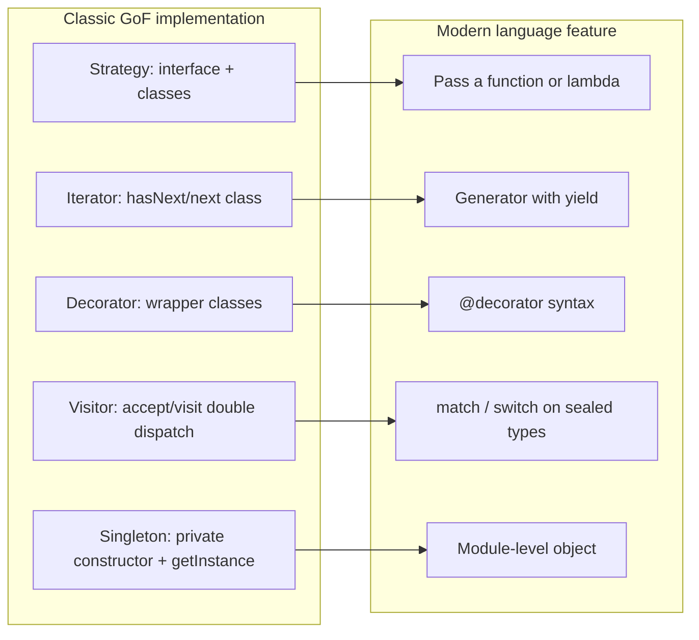

# Design Patterns in Modern Languages

## Introduction

The *Design Patterns* book by Gamma, Helm, Johnson and Vlissides (the "Gang of Four", or GoF) appeared in 1994. Its examples are in C++ and Smalltalk, and many of its patterns work around things those languages made awkward: passing behavior around, walking a collection, adding behavior to an object without subclassing.

Languages have moved on. Python, Java, TypeScript, Kotlin, C# and Rust all have first-class functions and lambdas. Most have generators or streams, structural or interface-based typing, records or data classes, and pattern matching. Many problems that once needed a pattern with three classes now take a few lines of plain language features.

Peter Norvig made this point early. In his 1996 talk *Design Patterns in Dynamic Programming*, he argued that 16 of the 23 GoF patterns become "invisible or simpler" in dynamic languages such as Lisp and Dylan. Luciano Ramalho's *Fluent Python* revisits the claim for Python. The point is not that patterns are obsolete. It is that **the problem a pattern solves is permanent, while its implementation depends on the language**.

Think of it like directions to a friend's house. In 1994 you wrote turn-by-turn instructions on paper. Today you share a map pin. The goal is the same and you still need to know where you are going, but the tool removed most of the effort.

In this page you will see, side by side:

- Strategy and Command as plain functions
- Iterator as a generator
- Decorator as a language feature
- Singleton as a module
- Visitor replaced by pattern matching and `functools.singledispatch`
- Interfaces through `typing.Protocol`, structural typing without inheritance
- Prototype as `dataclasses.replace`
- Java 21 sealed types and records as an alternative to class hierarchies

## The Big Picture



Each arrow keeps the **intent** and changes the **mechanism**. You still need to recognize the intent, because that is how you spot when to reach for the feature.

## Strategy: From Class Hierarchy to Function

The [Strategy pattern](../4-arch-behavioral-patterns/0-arch-strategy.mdx) swaps an algorithm at runtime. The classic form needs an interface and one class per algorithm:

```python
from abc import ABC, abstractmethod


class ShippingStrategy(ABC):
    @abstractmethod
    def cost(self, weight_kg: float) -> float: ...


class Standard(ShippingStrategy):
    def cost(self, weight_kg: float) -> float:
        return 4.99 + 0.5 * weight_kg


class Express(ShippingStrategy):
    def cost(self, weight_kg: float) -> float:
        return 12.99 + 1.0 * weight_kg


def checkout_classic(weight_kg: float, strategy: ShippingStrategy) -> float:
    return round(strategy.cost(weight_kg), 2)
```

Each class has exactly one method and no state. In Python, a function **is** an object with one method, so the classes add nothing:

```python
from collections.abc import Callable

type ShippingFn = Callable[[float], float]


def standard(weight_kg: float) -> float:
    return 4.99 + 0.5 * weight_kg


def express(weight_kg: float) -> float:
    return 12.99 + 1.0 * weight_kg


def checkout(weight_kg: float, shipping: ShippingFn) -> float:
    return round(shipping(weight_kg), 2)


print(checkout_classic(2, Express()), checkout(2, express),
      checkout(2, lambda kg: 0.0))
```

Output:

```text
14.99 14.99 0.0
```

The function version is shorter, and a one-off strategy (free shipping) is a lambda instead of a new class. The `type` alias statement requires Python 3.12 or later.

**When to keep the class version:** when a strategy carries configuration or state (an API client, a rate table loaded from a file), has several related methods, or needs a name in a plugin registry. A [`Protocol`](#interfaces-without-inheritance-protocol) with one method is a good middle ground: callers can pass a function-like object or a full class.

Java reached the same place with lambdas in Java 8. Any interface with a single abstract method is a *functional interface*, so `Comparator<Book> byPrice = Comparator.comparing(Book::price);` is a strategy in one line. [Command](../4-arch-behavioral-patterns/2-arch-command.mdx) shrinks the same way: a callback, a `Runnable`, or a `functools.partial` object is a command without the ceremony. Keep command classes when you need undo, serialization or queuing with metadata.

## Iterator: Generators

The [Iterator pattern](../4-arch-behavioral-patterns/6-arch-iterator.mdx) traverses a collection without exposing its structure. Writing it by hand means a class that tracks position and implements `__next__`. A generator function does the bookkeeping for you:

```python
from collections.abc import Iterator


def pages(items: list[str], size: int) -> Iterator[list[str]]:
    for start in range(0, len(items), size):
        yield items[start:start + size]


for page in pages(["a", "b", "c", "d", "e"], 2):
    print(page)
```

Output:

```text
['a', 'b']
['c', 'd']
['e']
```

The pattern is now so built into the language (`for` loops, `yield`, Java's enhanced `for` and streams, JavaScript's `function*`) that most developers use it daily without naming it. That is Norvig's "invisible" category.

## Decorator: A Language Feature

The [Decorator pattern](../3-arch-structural-patterns/3-arch-decorator.mdx) wraps an object to add behavior. Python's `@` syntax applies a wrapping function to a function at definition time. The standard library ships ready-made decorators such as `functools.cache` and `functools.lru_cache`.

```python
import functools
from collections.abc import Callable


def logged[**P, R](fn: Callable[P, R]) -> Callable[P, R]:
    @functools.wraps(fn)
    def wrapper(*args: P.args, **kwargs: P.kwargs) -> R:
        result = fn(*args, **kwargs)
        print(f"{fn.__name__}{args} -> {result}")
        return result
    return wrapper


@logged
@functools.cache
def shipping_zone(postcode: str) -> int:
    return 1 if postcode.startswith("1") else 2


shipping_zone("10115")
shipping_zone("10115")
print(shipping_zone.__wrapped__.cache_info())
```

Output:

```text
shipping_zone('10115',) -> 1
shipping_zone('10115',) -> 1
CacheInfo(hits=1, misses=1, maxsize=None, currsize=1)
```

Two decorators stack, just like wrapper objects in the GoF version. The second call is a cache hit. `functools.wraps` copies the name and docstring and stores the inner function as `__wrapped__`, which is how we reach the cache statistics.

:::note
Python's `@decorator` wraps **functions and classes at definition time**. The GoF Decorator wraps **objects at runtime** behind the same interface. They overlap in intent (add behavior without changing the original), but they are not identical. Java's `new BufferedReader(new InputStreamReader(in))` is the GoF form.
:::

## Singleton: Just Use a Module

The [Singleton](../2-arch-creational-patterns/1-arch-singleton.mdx) guarantees one instance. In Python, a module is imported once per process and cached in `sys.modules`, so module-level objects are already single instances.

```python
# settings.py: a module is created once per process, so it is a natural singleton
TAX_RATE = 0.2
_cache: dict[str, str] = {}
```

```python
import settings
import settings as again
print(settings is again, settings.TAX_RATE)
```

Output:

```text
True 0.2
```

The warning from the Singleton page still applies: global state makes testing harder. Usually the better modern answer is to create one instance at startup and pass it in through [dependency injection](../1-arch-design-principles/10-arch-dependency-injection.mdx).

## Interfaces Without Inheritance: Protocol

Many GoF patterns start with "define an interface". In Python, `typing.Protocol` (PEP 544) gives you **structural typing**: any class with matching methods satisfies the protocol, even one you did not write and cannot change.

```python
from typing import Protocol, runtime_checkable


@runtime_checkable
class Notifier(Protocol):
    def send(self, to: str, message: str) -> None: ...


class SmsClient:            # third-party class, does not inherit anything
    def send(self, to: str, message: str) -> None:
        print(f"SMS to {to}: {message}")


def notify_shipped(n: Notifier, customer: str) -> None:
    n.send(customer, "Your order has shipped")


client = SmsClient()
notify_shipped(client, "+15550100")
print(isinstance(client, Notifier))
```

Output:

```text
SMS to +15550100: Your order has shipped
True
```

This often removes the need for an [Adapter](../3-arch-structural-patterns/0-arch-adapter.mdx) when the shapes already match. A type checker such as mypy or pyright verifies the match statically. `@runtime_checkable` only checks that the method names exist, not their signatures.

**`Protocol` or `abc.ABC`?**

| | `typing.Protocol` | `abc.ABC` |
| --- | --- | --- |
| How a class conforms | Has the right methods (structural) | Explicitly inherits (nominal) |
| Works with third-party classes | Yes | Only if you register or wrap them |
| Error if a method is missing | From the type checker | At instantiation, at runtime |
| Can share implementation | No (in practice) | Yes, concrete helper methods |
| Good for | Ports, callbacks, test fakes | Template Method, shared base logic |

TypeScript and Go use structural typing by default. Java and C# are nominal, so the explicit `implements` is still how you declare conformance there.

## Visitor: Pattern Matching and singledispatch

The [Visitor pattern](../4-arch-behavioral-patterns/9-arch-visitor.mdx) adds operations over a fixed set of types using double dispatch (`accept` and `visit` methods). It is one of the most ceremony-heavy GoF patterns. Modern languages offer two lighter routes.

**Structural pattern matching** (Python 3.10+) dispatches on type and shape in one place. **`functools.singledispatch`** registers one implementation per type, which keeps the operation open for extension from other modules.

```python
from dataclasses import dataclass
from functools import singledispatch


@dataclass(frozen=True)
class Card:
    last4: str


@dataclass(frozen=True)
class PayPal:
    email: str


@dataclass(frozen=True)
class GiftCard:
    code: str
    balance_cents: int


type Payment = Card | PayPal | GiftCard


def describe(p: Payment) -> str:
    match p:
        case Card(last4=last4):
            return f"card ending {last4}"
        case PayPal(email=email):
            return f"PayPal account {email}"
        case GiftCard(balance_cents=b) if b == 0:
            return "empty gift card"
        case GiftCard(code=code):
            return f"gift card {code}"


@singledispatch
def fee_cents(p: object) -> int:
    raise NotImplementedError(type(p).__name__)


@fee_cents.register
def _(p: Card) -> int:
    return 30


@fee_cents.register
def _(p: PayPal) -> int:
    return 45


@fee_cents.register
def _(p: GiftCard) -> int:
    return 0


payments: list[Payment] = [Card("4242"), PayPal("ada@example.com"), GiftCard("XMAS", 0)]
for p in payments:
    print(f"{describe(p):32} fee={fee_cents(p)}")
```

Output:

```text
card ending 4242                 fee=30
PayPal account ada@example.com   fee=45
empty gift card                  fee=0
```

Neither `Card` nor `PayPal` has an `accept` method. Adding a new operation is a new function. Adding a new payment type means updating each `match`, and a type checker catches the ones you forget. If you delete the `PayPal` case, mypy reports `Missing return statement` for `describe`. Adding `case _: assert_never(p)` (from `typing`) makes the exhaustiveness check explicit.

### Java: sealed interfaces, records and switch

Java shows this shift especially clearly, which is why the example uses it. Records (Java 16), sealed types (Java 17) and pattern matching for `switch` with record patterns (final in Java 21) turn a visitor into a type-checked `switch`:

```java
sealed interface Payment permits Card, PayPal, GiftCard {}
record Card(String last4) implements Payment {}
record PayPal(String email) implements Payment {}
record GiftCard(String code, int balanceCents) implements Payment {}

class Payments {
    static String describe(Payment p) {
        return switch (p) {
            case Card c -> "card ending " + c.last4();
            case PayPal(String email) -> "PayPal account " + email;
            case GiftCard g when g.balanceCents() == 0 -> "empty gift card";
            case GiftCard g -> "gift card " + g.code();
        };   // no default needed: the compiler knows the hierarchy is sealed
    }
}
```

Because `Payment` is sealed, the compiler rejects the `switch` if you add `ApplePay` and forget to handle it. That is the safety the Visitor pattern used to provide, with a fraction of the code. TypeScript gets the same effect with discriminated unions and a `never` check in the `default` branch.

**When the classic Visitor still wins:** when the type hierarchy is large, owned by a library, and the library wants users to add operations without touching its code. Compiler ASTs are the textbook case, and Python's `ast.NodeVisitor` is still a visitor.

## Prototype: Copying Immutable Data

The [Prototype pattern](../2-arch-creational-patterns/5-arch-prototype.mdx) creates objects by copying a configured instance. With frozen dataclasses, `dataclasses.replace` copies an object and changes selected fields:

```python
from dataclasses import dataclass, replace


@dataclass(frozen=True)
class EmailTemplate:
    subject: str
    sender: str = "shop@example.com"
    footer: str = "Thanks for shopping with us"


base = EmailTemplate(subject="Your order")
shipped = replace(base, subject="Your order has shipped")
print(shipped)
```

Output:

```text
EmailTemplate(subject='Your order has shipped', sender='shop@example.com', footer='Thanks for shopping with us')
```

Python 3.13 added a general `copy.replace()` that works for dataclasses, named tuples and any class implementing `__replace__`. Java records, Kotlin's `data class` `copy()` and the JavaScript spread syntax (`{ ...base, subject: "..." }`) serve the same purpose. Immutable data also makes the [functional patterns](./5-arch-functional-patterns.mdx) later in this section practical.

## What Has Not Changed

Language features shrink the **mechanism**, but several patterns are about structure and responsibilities, not syntax. They look much the same in any language:

- **[Facade](../3-arch-structural-patterns/4-arch-facade.mdx)**: a simple entry point to a complex subsystem.
- **[Observer](../4-arch-behavioral-patterns/1-arch-observer.mdx)**: callbacks make it lighter, but subscription management and error handling remain design work.
- **[State](../4-arch-behavioral-patterns/3-arch-state.mdx)**: still about modeling allowed transitions.
- **[Composite](../3-arch-structural-patterns/2-arch-composite.mdx)**: trees are trees.
- **Architectural patterns**: [Repository](./1-arch-repository-pattern.mdx), [Unit of Work](./2-arch-unit-of-work.mdx) and everything in later sections address system structure, so no language feature makes them disappear.

## Real-World Scenario

Your team maintains a Python pricing service for an online bookstore. It was written by developers coming from enterprise Java and contains `DiscountStrategy` interfaces with eleven one-method subclasses, a `DiscountStrategyFactory`, a `PriceVisitor` with `accept` methods on every product type, and a `ConfigSingleton` class with a `get_instance()` method. New developers take a week to find where a discount is calculated.

**The solution, step by step:**

1. Replace the eleven strategy classes with functions in a `discounts.py` module, registered in a plain dict: `DISCOUNTS: dict[str, DiscountFn]`. The factory becomes a dict lookup.
2. Keep one class, `LoyaltyDiscount`, because it holds a client for the loyalty API and caches tiers. It conforms to a `DiscountFn`-shaped `Protocol` via `__call__`.
3. Replace the visitor with a `match` statement over the product union (`Book | EBook | GiftCard`), since the set of product types changes rarely and lives in this service.
4. Turn `ConfigSingleton` into a frozen dataclass created once at startup and passed into the handlers. Tests now build their own config.

**Why this approach:** the intent of each pattern is preserved (swappable discounts, per-type pricing, one shared config), but the code now reads like idiomatic Python, and there is less of it to maintain.

**When to use language features instead of classic patterns:**

- the "pattern" classes have one method and no state
- the type set is closed and owned by your code (match or sealed types)
- you control both sides and a function signature is a sufficient contract

**When to keep the classic form:**

- implementations need state, several methods, or lifecycle management
- third parties must extend your hierarchy without editing your code (plugin systems, compilers)
- your team works across languages and the explicit structure helps communication
- you need tooling support such as dependency injection containers that wire classes

**Alternatives and trade-offs:**

| Approach | Pros | Cons | Best for |
| --- | --- | --- | --- |
| Classic GoF classes | Explicit, familiar, language-neutral | Boilerplate, many tiny classes | Stateful or extensible hierarchies |
| Functions and lambdas | Minimal code, easy to test | Less discoverable, no place for state | Stateless strategies, callbacks |
| Callable class with `__call__` | Function-like, but can hold state | Slightly unusual for newcomers | Configured strategies |
| `match` or sealed `switch` | Exhaustive, all cases in one place | Adding a type touches every match | Closed sets of types |
| `singledispatch` | Open to new types from other modules | Dispatches on first argument only | Extensible operations |

## Common Mistakes

1. **Translating Java patterns line by line into Python.** `AbstractStrategyFactoryImpl` in Python is a sign the language is being fought, not used.
2. **Over-correcting into clever code.** A chain of nested lambdas is not simpler than two named classes. Named functions beat anonymous ones once logic grows past one expression.
3. **Forgetting the intent.** Replacing a strategy class with a function is fine. Inlining every strategy into an `if` chain is not. That reverses the pattern instead of modernizing it.
4. **Assuming runtime checks from type hints.** `Protocol` and `match` exhaustiveness are checked by a type checker such as mypy or pyright, not by Python at runtime. Run one in CI.
5. **Ignoring the team.** If your codebase mixes Java and Python teams, a small amount of consistent structure can be worth more than the shortest possible code.
6. **Using features your runtime lacks.** The `type` statement and `def f[T]` syntax need Python 3.12, `copy.replace` needs 3.13, and pattern matching for `switch` needs Java 21. Check your deployment targets.

## Summary

- Patterns describe recurring **problems and intents**. Their implementation depends on the language.
- First-class functions shrink Strategy and Command. Generators make Iterator invisible. `@decorators` and `functools` cover common Decorator uses.
- Modules replace most Singletons, though dependency injection is usually better still.
- `typing.Protocol` gives structural interfaces and fakes without inheritance.
- Pattern matching, `singledispatch`, and Java sealed types with records replace most Visitors over closed type sets.
- Keep the classic form when you need state, extensibility by third parties, or explicit structure.

## Exercises

1. Take the classic Command example from the [Command pattern](../4-arch-behavioral-patterns/2-arch-command.mdx) page and rewrite it with functions and `functools.partial`. What do you lose if you need undo?
2. Add an `ApplePay` type to the payment example. Run mypy or pyright on the `match` version and observe the warning, then fix it.
3. Rewrite a hand-written iterator class from one of your projects as a generator. Compare line counts and readability.
4. Write a `Protocol` for a `PaymentGateway` and two classes that satisfy it without inheritance. Write a test fake that also satisfies it.

**Next steps:**

- [Repository Pattern](./1-arch-repository-pattern.mdx), the first architecture-level pattern in this section
- [Functional Patterns](./5-arch-functional-patterns.mdx) for pipelines, higher-order functions and immutability
- [Design Patterns Introduction](../2-arch-creational-patterns/0-arch-design-patterns-introduction.mdx) to revisit the classic catalog
