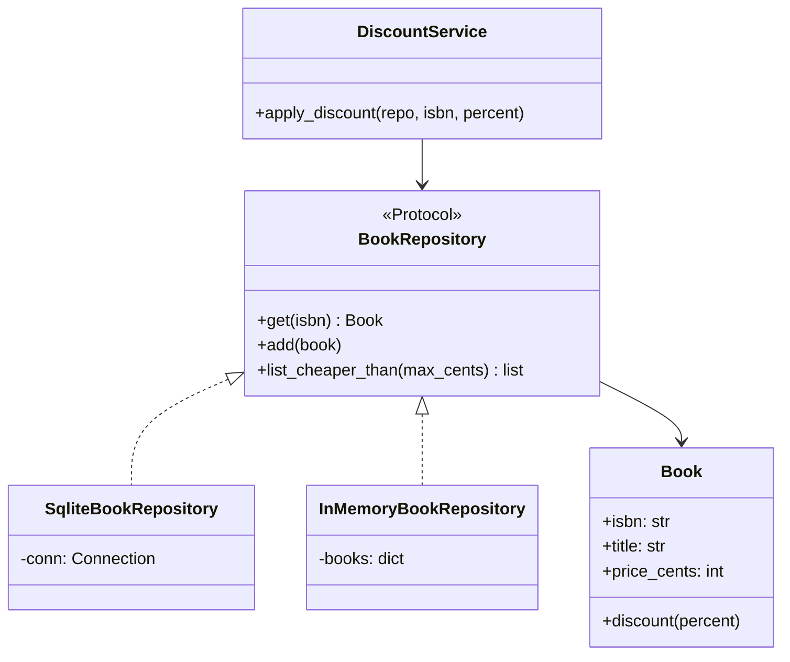
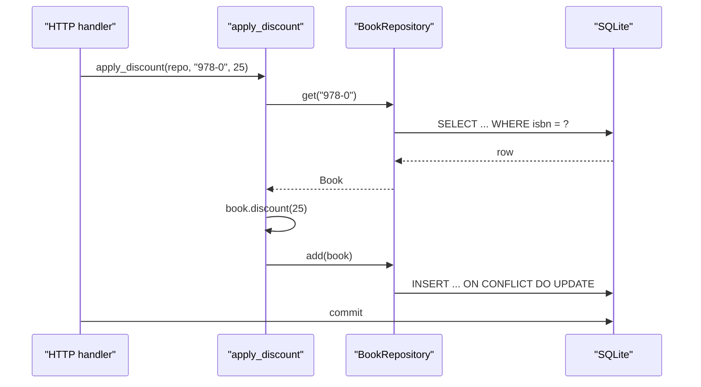

# Repository Pattern

## Introduction

Open a typical young codebase and look at a business function such as "apply a discount to a book". You will often find SQL strings, connection handling, row-to-object mapping and the actual business rule all mixed together in about fifteen lines. It works, but every test needs a real database, every schema change touches business code, and nobody can see the rule for the plumbing.

The **Repository** pattern fixes that by putting a collection-like object between your domain code and your storage. Martin Fowler's catalog entry in *Patterns of Enterprise Application Architecture* describes it as mediating between the domain and data mapping layers with an interface that behaves like an in-memory collection of domain objects ([martinfowler.com/eaaCatalog/repository.html](https://martinfowler.com/eaaCatalog/repository.html)). Your business code says "give me book 978-0" or "add this order", and the repository worries about tables, queries and drivers.

A good analogy is a library's front desk. You ask the librarian for a book by its ISBN. You do not care whether it lives on shelf 4B, in the basement archive, or on a cart waiting to be reshelved. The librarian hides the storage layout behind a simple request-and-return conversation.

In this page you will:

- see the "before" code that mixes persistence and business logic
- build a repository interface with `typing.Protocol`
- write a SQLite implementation and an in-memory fake
- see where you already use repositories in Spring Data, Entity Framework Core and SQLAlchemy
- learn when a repository is pure overhead

## The Problem: Business Logic Tangled with SQL

Here is an online bookstore function that applies a percentage discount to a book.

```python
import sqlite3

def apply_discount(conn: sqlite3.Connection, isbn: str, percent: int) -> None:
    row = conn.execute(
        "SELECT price_cents FROM books WHERE isbn = ?", (isbn,)
    ).fetchone()
    if row is None:
        raise ValueError(f"No book {isbn}")
    new_price = row[0] * (100 - percent) // 100
    conn.execute(
        "UPDATE books SET price_cents = ? WHERE isbn = ?", (new_price, isbn)
    )
    conn.commit()

conn = sqlite3.connect(":memory:")
conn.execute("CREATE TABLE books (isbn TEXT PRIMARY KEY, title TEXT, price_cents INTEGER)")
conn.execute("INSERT INTO books VALUES ('978-0', 'Domain Modeling', 4000)")
apply_discount(conn, "978-0", 25)
print(conn.execute("SELECT * FROM books").fetchall())
```

Output:

```text
[('978-0', 'Domain Modeling', 3000)]
```

It runs, so what hurts?

- **The rule is buried.** The only business logic is `price * (100 - percent) // 100`. Everything else is plumbing.
- **Testing needs a database.** To test the discount math you must create a schema and insert rows.
- **The function decides the transaction.** It calls `commit()` itself, so you cannot combine it with other changes in one atomic operation.
- **Queries spread everywhere.** The next feature will write its own `SELECT price_cents FROM books`, and the one after that. When the column is renamed, you grep the whole codebase.
- **No validation lives anywhere.** Nothing stops a 150 percent discount.

## The Pattern Applied

The repository introduces three pieces:

1. A **domain object** (`Book`) that owns its rules.
2. A **repository interface** (`BookRepository`) that speaks in domain terms: get, add, list.
3. One or more **implementations**: SQLite for production, a dictionary for tests.



### Step 1: The domain object

```python
from dataclasses import dataclass


@dataclass
class Book:
    isbn: str
    title: str
    price_cents: int

    def discount(self, percent: int) -> None:
        if not 0 < percent < 100:
            raise ValueError("percent must be between 1 and 99")
        self.price_cents = self.price_cents * (100 - percent) // 100
```

The rule now lives on the object it concerns, and it is validated. `Book` knows nothing about SQL.

### Step 2: The repository interface

```python
from typing import Protocol


class BookRepository(Protocol):
    def get(self, isbn: str) -> Book | None: ...
    def add(self, book: Book) -> None: ...
    def list_cheaper_than(self, max_cents: int) -> list[Book]: ...
```

Two design choices are worth noticing:

- **The methods speak the domain language.** `list_cheaper_than` is a business question. A generic `query(sql)` method would leak storage details right back out.
- **It is a `Protocol`, not an `ABC`.** Any class with matching methods satisfies it structurally, so a test fake does not need to inherit anything. An `abc.ABC` works too and gives you a runtime error if a method is missing. The [Design Patterns in Modern Languages](./0-arch-patterns-in-modern-languages.mdx) page compares both.

### Step 3: A SQLite implementation

```python
import sqlite3


class SqliteBookRepository:
    def __init__(self, conn: sqlite3.Connection) -> None:
        self._conn = conn

    def get(self, isbn: str) -> Book | None:
        row = self._conn.execute(
            "SELECT isbn, title, price_cents FROM books WHERE isbn = ?", (isbn,)
        ).fetchone()
        return Book(*row) if row else None

    def add(self, book: Book) -> None:
        # Upsert: works for new books and for books we changed in memory.
        self._conn.execute(
            "INSERT INTO books (isbn, title, price_cents) VALUES (?, ?, ?) "
            "ON CONFLICT(isbn) DO UPDATE SET title = excluded.title, "
            "price_cents = excluded.price_cents",
            (book.isbn, book.title, book.price_cents),
        )

    def list_cheaper_than(self, max_cents: int) -> list[Book]:
        rows = self._conn.execute(
            "SELECT isbn, title, price_cents FROM books "
            "WHERE price_cents < ? ORDER BY price_cents",
            (max_cents,),
        ).fetchall()
        return [Book(*r) for r in rows]
```

Notice what the repository does **not** do: it never calls `commit()`. Deciding when a business transaction is complete belongs to the caller, or better, to a [Unit of Work](./2-arch-unit-of-work.mdx).

### Step 4: An in-memory fake

```python
class InMemoryBookRepository:
    def __init__(self, books: list[Book] | None = None) -> None:
        self._books = {b.isbn: b for b in books or []}

    def get(self, isbn: str) -> Book | None:
        return self._books.get(isbn)

    def add(self, book: Book) -> None:
        self._books[book.isbn] = book

    def list_cheaper_than(self, max_cents: int) -> list[Book]:
        return sorted(
            (b for b in self._books.values() if b.price_cents < max_cents),
            key=lambda b: b.price_cents,
        )
```

This is a *fake*, not a mock. It has real behavior, so tests read like normal code instead of a list of expected calls.

### Step 5: The service depends on the interface

```python
def apply_discount(repo: BookRepository, isbn: str, percent: int) -> Book:
    book = repo.get(isbn)
    if book is None:
        raise ValueError(f"No book {isbn}")
    book.discount(percent)
    repo.add(book)
    return book


if __name__ == "__main__":
    conn = sqlite3.connect(":memory:")
    conn.execute(
        "CREATE TABLE books (isbn TEXT PRIMARY KEY, title TEXT, price_cents INTEGER)"
    )
    sql_repo = SqliteBookRepository(conn)
    sql_repo.add(Book("978-0", "Domain Modeling", 4000))
    sql_repo.add(Book("978-1", "Refactoring", 3500))
    sql_repo.add(Book("978-2", "Python Tricks", 2500))

    print(apply_discount(sql_repo, "978-0", 25))
    conn.commit()
    print([b.title for b in sql_repo.list_cheaper_than(3200)])

    fake = InMemoryBookRepository([Book("978-9", "Test Book", 1000)])
    print(apply_discount(fake, "978-9", 10))
```

Output:

```text
Book(isbn='978-0', title='Domain Modeling', price_cents=3000)
['Python Tricks', 'Domain Modeling']
Book(isbn='978-9', title='Test Book', price_cents=900)
```

The same `apply_discount` works against both storages. This is the [Dependency Inversion Principle](../1-arch-design-principles/5-arch-dependency-inversion.mdx) in action: the high-level policy depends on an abstraction it owns, and the database code depends on that same abstraction.

### Step 6: Fast tests without a database

Save the code above as `repo_after.py`, then:

```python
from repo_after import Book, InMemoryBookRepository, apply_discount


def test_discount_lowers_price() -> None:
    repo = InMemoryBookRepository([Book("1", "A", 2000)])
    apply_discount(repo, "1", 50)
    assert repo.get("1").price_cents == 1000


def test_unknown_book_raises() -> None:
    repo = InMemoryBookRepository()
    try:
        apply_discount(repo, "missing", 10)
    except ValueError as exc:
        assert "missing" in str(exc)
    else:
        raise AssertionError("expected ValueError")


if __name__ == "__main__":
    test_discount_lowers_price()
    test_unknown_book_raises()
    print("2 tests passed")
```

Output:

```text
2 tests passed
```

These tests run in microseconds and need no setup. You still want a small set of integration tests for `SqliteBookRepository` itself, run against a real database, so the SQL is checked too.

## How a Call Flows



The handler (or a unit of work) owns the commit. The service only knows about books.

## Where You Have Already Met Repositories

You have probably used this pattern without writing it yourself.

- **Spring Data (Java).** You declare an interface such as `interface CustomerRepository extends CrudRepository<Customer, Long>` and Spring generates the implementation at runtime, including derived queries from method names like `findByLastname`. See the [Spring Data JPA reference](https://docs.spring.io/spring-data/jpa/reference/).
- **Entity Framework Core (.NET).** A `DbSet<T>` on a `DbContext` behaves like a repository for one entity type, and Microsoft's documentation says a `DbContext` instance is designed for a single unit of work ([DbContext lifetime](https://learn.microsoft.com/en-us/ef/core/dbcontext-configuration/)).
- **SQLAlchemy (Python).** The `Session` gives you `add()`, `get()` and query methods, which is already repository-like. The book *Architecture Patterns with Python* ([cosmicpython.com](https://www.cosmicpython.com/book/chapter_02_repository.html)) wraps it in a thin, domain-specific repository.

Here is the Spring Data version of the bookstore repository. It shows why Java teams often never write a repository class by hand:

```java
import org.springframework.data.repository.CrudRepository;
import java.util.List;

public interface BookRepository extends CrudRepository<Book, String> {
    // Spring derives the query from the method name.
    List<Book> findByPriceCentsLessThanOrderByPriceCents(int maxCents);
}
```

:::note
Django's model managers (`Book.objects.filter(...)`) look similar, but Django models follow the **Active Record** style, where the object saves itself (`book.save()`). That is a different trade-off: less code, but the domain object is tied to the ORM. Neither is wrong.
:::

## Design Decisions

### Collection-oriented or persistence-oriented?

There are two common flavors.

| Flavor | Interface feels like | Saving changes | Example |
| --- | --- | --- | --- |
| Collection-oriented | A set: `add`, `get`, `remove` | Automatic, via change tracking in a unit of work | SQLAlchemy session, EF Core `DbSet` |
| Persistence-oriented | A store: `save`, `find`, `delete` | Explicit `save(entity)` after each change | Spring Data `CrudRepository.save` |

Our SQLite example is persistence-oriented: you call `add` again after changing the book. That is simpler to build by hand. Collection-oriented repositories need change tracking, which the [Unit of Work](./2-arch-unit-of-work.mdx) page builds.

### One repository per aggregate, not per table

In [Domain-Driven Design](../8-arch-domain-driven-design/4-arch-aggregates.mdx) you create a repository per **aggregate root**. An `Order` with its `OrderLine` items gets one `OrderRepository`. You do not add an `OrderLineRepository`, because order lines should only change through their order.

### Generic repositories

A tempting shortcut is one `GenericRepository[T]` with `get_by_id`, `get_all`, `add` and `delete` for every entity. It saves typing, but it also:

- exposes operations some entities should never allow, such as deleting a payment
- pushes query logic back into services (`get_all()` then filter in Python)
- duplicates what your ORM already provides

A small generic base is fine for shared mechanics. The public interface should still be specific.

### Where do complex queries go?

Repositories get bloated when every screen adds a `find_by_x_and_y_sorted_by_z` method. Two common remedies:

- The [Specification pattern](./3-arch-specification-pattern.mdx), which passes query criteria as objects.
- Separate read models for reporting screens, as in [CQRS](../9-arch-distributed-systems/3-arch-cqrs.mdx). Reads go straight to SQL or a view, and the repository only serves the write side.

## Real-World Scenario

Your team runs a SaaS helpdesk. Tickets are stored in PostgreSQL through SQLAlchemy. The ticket assignment logic ("assign to the agent with the fewest open tickets in the customer's region, but never to someone on leave") has grown to 300 lines. Tests take four minutes because each one spins up a database container, and two developers have recently broken assignment while changing unrelated queries.

**The solution:**

1. Define `TicketRepository` and `AgentRepository` protocols with the questions assignment actually asks: `open_count_by_agent(region)`, `available_agents(region, on_date)`, `get(ticket_id)`, `add(ticket)`.
2. Move the SQLAlchemy queries into `SqlAlchemyTicketRepository` and `SqlAlchemyAgentRepository`. Each gets a handful of integration tests against a real PostgreSQL.
3. Rewrite the assignment service to accept the protocols. Its 40 unit tests now use in-memory fakes and run in under a second.
4. Leave reporting dashboards alone. They keep using direct SQL, because they only read data and gain nothing from domain objects.

**Why this approach:** the pain was specific. Complex business rules were hard to test, and queries were scattered. Repositories target both problems and nothing else.

**When to use it:**

- business logic is non-trivial and deserves fast unit tests
- several services ask the same storage questions
- you follow DDD or [Hexagonal Architecture](../7-arch-clean-architecture/0-arch-hexagonal.mdx), where the domain must not import infrastructure
- you might really change storage, for example moving one aggregate to a document store

**When not to use it:**

- CRUD apps where the "logic" is validation and saving form fields. The ORM is already your repository.
- Reporting and analytics code. Wrapping SQL aggregations in domain objects adds cost and removes power.
- Small scripts and prototypes. Wait until testing pain shows up.
- When the only justification is "we might switch databases one day". Teams rarely do, and the repository will not hide every difference anyway.

**Alternatives and trade-offs:**

| Approach | Pros | Cons | Best for |
| --- | --- | --- | --- |
| Raw SQL in services | Simplest, full SQL power | Hard to test, queries scattered | Scripts, reporting |
| ORM used directly (Active Record or session) | Little code, framework support | Domain tied to ORM, slower tests | CRUD apps, Django and Rails style apps |
| Repository over ORM | Domain isolated, fast fakes | Extra layer, mapping code | Rich domain logic, DDD, hexagonal |
| Generic repository | Less boilerplate | Leaky, encourages `get_all` then filter | Rarely; internal plumbing only |
| CQRS read models plus repositories for writes | Each side optimized | More moving parts | Complex domains with heavy reads |

## Common Mistakes

1. **Returning ORM or driver objects.** If `get()` returns a SQLAlchemy row or a cursor, callers depend on storage again. Return domain objects.
2. **Committing inside the repository.** Two repository calls can then never be atomic. Leave transactions to a unit of work or the caller.
3. **`IQueryable` leaks.** In .NET, returning `IQueryable<T>` lets callers compose any query, which defeats the purpose of a focused interface. The same applies to returning a SQLAlchemy `Select` in Python.
4. **A repository per table.** Child tables should be reached through their aggregate root.
5. **Mock-heavy tests.** Mocking `repo.get` with a fixed return value tests call order, not behavior. Prefer a small fake class.
6. **No integration tests for the real repository.** Fakes can drift from reality. Test the SQL version against a real database, ideally the same engine as production.
7. **Adding it everywhere by rule.** A repository around a two-field settings table is ceremony. Apply the pattern where logic justifies it.

## Related and Confusable Patterns

| Pattern | How it differs from Repository |
| --- | --- |
| Data Access Object (DAO) | Usually table-oriented with CRUD methods; a repository is domain-oriented and works on aggregates. In practice the names are often used loosely. |
| Table Data Gateway / Active Record | Fowler's other data-source patterns. Active Record puts `save()` on the domain object itself. |
| [Unit of Work](./2-arch-unit-of-work.mdx) | Tracks changes and commits them together; repositories are often accessed through it. |
| [Facade](../3-arch-structural-patterns/4-arch-facade.mdx) | A repository is a facade over persistence, but with a collection-like contract. |
| [Specification](./3-arch-specification-pattern.mdx) | Passed into a repository to describe which objects you want. |

## Summary

- A **repository** gives domain code a collection-like interface and hides storage details.
- Define the interface in domain terms, with `typing.Protocol` or `abc.ABC`, and keep it small.
- Provide a real implementation plus an **in-memory fake** for fast, readable tests.
- Repositories should not commit. Transactions belong to a unit of work or the caller.
- Spring Data, EF Core and SQLAlchemy already give you repository-like objects. Wrap them only when your domain logic benefits.
- Skip the pattern for CRUD apps, reporting code and prototypes.

## Exercises

1. Add a `remove(isbn)` method to both repositories and write a test that uses only the fake.
2. Add an `OrderRepository` for an `Order` with a list of `OrderLine` items stored in two tables. Load and save the whole aggregate in one method each.
3. Write an integration test that runs the same test functions against both `InMemoryBookRepository` and `SqliteBookRepository`. This "contract test" keeps the fake honest.
4. Take a CRUD endpoint in a project you know. Decide, with reasons, whether a repository would help or only add a layer.

**Next steps:**

- [Unit of Work Pattern](./2-arch-unit-of-work.mdx) to commit several repository changes atomically
- [Specification Pattern](./3-arch-specification-pattern.mdx) to keep query methods from multiplying
- [Hexagonal Architecture](../7-arch-clean-architecture/0-arch-hexagonal.mdx), where repositories are the classic "driven port"
- [Designing for Testability](../12-arch-quality-and-operations/5-arch-testability.mdx)
