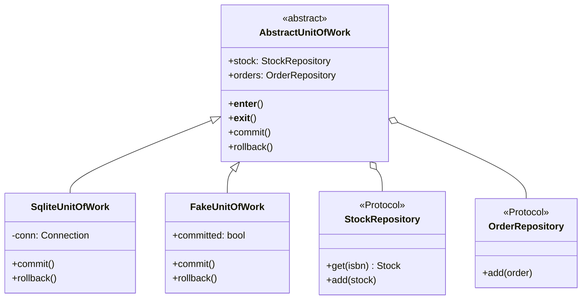
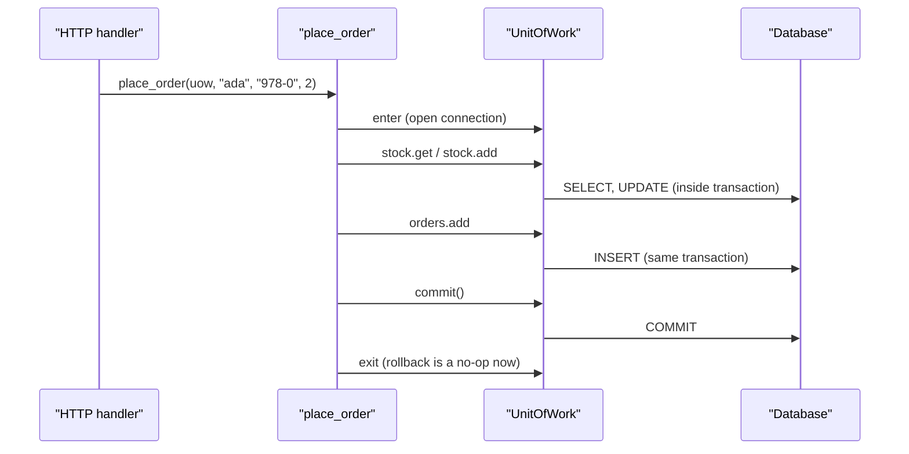

# Unit of Work Pattern

## Introduction

A customer orders two copies of a book. Your code must do two things: reduce the stock and create the order. If the first step succeeds and the second fails, you have sold stock to nobody. If the second succeeds and the first fails, you have promised books you do not have.

Both changes must succeed together or fail together. Databases give you transactions for that, but someone in your code has to decide **where a business transaction starts and ends**. The **Unit of Work** pattern is that someone.

Martin Fowler's catalog describes a Unit of Work as an object that keeps a list of the objects affected by a business transaction and coordinates writing out the changes ([martinfowler.com/eaaCatalog/unitOfWork.html](https://martinfowler.com/eaaCatalog/unitOfWork.html)). In everyday Python it usually looks like this:

```python
with uow:
    ...change things through uow's repositories...
    uow.commit()
```

Think of a shopping cart at a supermarket. You walk around putting items in the cart (registering changes). Nothing is paid for until the checkout (commit). If you abandon the cart, nothing happens to your bank account (rollback).

This page builds on the [Repository Pattern](./1-arch-repository-pattern.mdx). Repositories give you collection-like access to objects. The unit of work groups what you do with them into one atomic change.

## The Problem: Every Function Commits

Here is a bookstore that reserves stock and creates an order, with each helper committing its own work.

```python
import sqlite3

conn = sqlite3.connect(":memory:")
conn.executescript("""
CREATE TABLE stock (isbn TEXT PRIMARY KEY, qty INTEGER NOT NULL);
CREATE TABLE orders (id INTEGER PRIMARY KEY, customer TEXT NOT NULL,
                     isbn TEXT NOT NULL, qty INTEGER NOT NULL);
INSERT INTO stock VALUES ('978-0', 5);
""")


def reserve_stock(isbn: str, qty: int) -> None:
    conn.execute("UPDATE stock SET qty = qty - ? WHERE isbn = ?", (qty, isbn))
    conn.commit()


def create_order(customer: str | None, isbn: str, qty: int) -> None:
    conn.execute(
        "INSERT INTO orders (customer, isbn, qty) VALUES (?, ?, ?)",
        (customer, isbn, qty),
    )
    conn.commit()


def place_order(customer: str | None, isbn: str, qty: int) -> None:
    reserve_stock(isbn, qty)
    create_order(customer, isbn, qty)  # fails if customer is missing


try:
    place_order(None, "978-0", 2)
except sqlite3.IntegrityError as exc:
    print("order failed:", exc)

print("stock left:", conn.execute("SELECT qty FROM stock").fetchone()[0])
print("orders:", conn.execute("SELECT COUNT(*) FROM orders").fetchone()[0])
```

Output:

```text
order failed: NOT NULL constraint failed: orders.customer
stock left: 3
orders: 0
```

Two books vanished from stock, and no order exists. The bug is not in either helper. Each one is correct on its own. The bug is that **nobody owns the transaction boundary**.

Other symptoms of the same problem:

- helpers that cannot be reused inside a bigger operation because they commit early
- a global connection that every function reaches for
- tests that need a real database just to check that "nothing is saved on failure"

## The Pattern Applied

The unit of work:

1. opens a transaction (or session) when the block starts
2. exposes the repositories that work inside that transaction
3. commits only when the service explicitly says so
4. rolls back everything else, including on exceptions



### Step 1: Domain objects and repository interfaces

```python
from __future__ import annotations

import abc
import sqlite3
from dataclasses import dataclass
from typing import Callable, Protocol, Self


@dataclass
class Stock:
    isbn: str
    qty: int

    def reserve(self, qty: int) -> None:
        if qty > self.qty:
            raise ValueError(f"only {self.qty} left of {self.isbn}")
        self.qty -= qty


@dataclass
class Order:
    customer: str
    isbn: str
    qty: int


class StockRepository(Protocol):
    def get(self, isbn: str) -> Stock | None: ...
    def add(self, stock: Stock) -> None: ...


class OrderRepository(Protocol):
    def add(self, order: Order) -> None: ...
```

### Step 2: The abstract unit of work

```python
class AbstractUnitOfWork(abc.ABC):
    stock: StockRepository
    orders: OrderRepository

    def __enter__(self) -> Self:
        return self

    def __exit__(self, *exc_info: object) -> None:
        # Anything not explicitly committed is thrown away.
        self.rollback()

    @abc.abstractmethod
    def commit(self) -> None: ...

    @abc.abstractmethod
    def rollback(self) -> None: ...
```

The key design decision is in `__exit__`: it **always** rolls back. After a successful `commit()` there is nothing left to roll back, so this is harmless. On any other path, including a forgotten `commit()`, nothing is saved. The safe outcome is the default. *Architecture Patterns with Python* argues for the same explicit-commit design ([cosmicpython.com, chapter 6](https://www.cosmicpython.com/book/chapter_06_uow.html)).

### Step 3: A SQLite implementation

```python
class SqliteStockRepository:
    def __init__(self, conn: sqlite3.Connection) -> None:
        self._conn = conn

    def get(self, isbn: str) -> Stock | None:
        row = self._conn.execute(
            "SELECT isbn, qty FROM stock WHERE isbn = ?", (isbn,)
        ).fetchone()
        return Stock(*row) if row else None

    def add(self, stock: Stock) -> None:
        self._conn.execute(
            "INSERT INTO stock (isbn, qty) VALUES (?, ?) "
            "ON CONFLICT(isbn) DO UPDATE SET qty = excluded.qty",
            (stock.isbn, stock.qty),
        )


class SqliteOrderRepository:
    def __init__(self, conn: sqlite3.Connection) -> None:
        self._conn = conn

    def add(self, order: Order) -> None:
        self._conn.execute(
            "INSERT INTO orders (customer, isbn, qty) VALUES (?, ?, ?)",
            (order.customer, order.isbn, order.qty),
        )


class SqliteUnitOfWork(AbstractUnitOfWork):
    def __init__(self, connect: Callable[[], sqlite3.Connection]) -> None:
        self._connect = connect

    def __enter__(self) -> Self:
        self._conn = self._connect()
        self.stock = SqliteStockRepository(self._conn)
        self.orders = SqliteOrderRepository(self._conn)
        return super().__enter__()

    def __exit__(self, *exc_info: object) -> None:
        super().__exit__(*exc_info)

    def commit(self) -> None:
        self._conn.commit()

    def rollback(self) -> None:
        self._conn.rollback()
```

Both repositories share the same connection, so they share the same transaction. That is the whole trick.

:::note
Python's `sqlite3` module (in its default, legacy transaction mode) opens a transaction implicitly before the first `INSERT` or `UPDATE`. Other drivers and ORMs differ. Check your driver's transaction rules before relying on implicit behavior.
:::

### Step 4: The service owns the boundary

```python
def place_order(uow: AbstractUnitOfWork, customer: str, isbn: str, qty: int) -> None:
    with uow:
        stock = uow.stock.get(isbn)
        if stock is None:
            raise ValueError(f"unknown book {isbn}")
        stock.reserve(qty)
        uow.stock.add(stock)
        uow.orders.add(Order(customer, isbn, qty))
        uow.commit()


if __name__ == "__main__":
    db = sqlite3.connect(":memory:")
    db.executescript("""
    CREATE TABLE stock (isbn TEXT PRIMARY KEY, qty INTEGER NOT NULL);
    CREATE TABLE orders (id INTEGER PRIMARY KEY, customer TEXT NOT NULL,
                         isbn TEXT NOT NULL, qty INTEGER NOT NULL);
    INSERT INTO stock VALUES ('978-0', 5);
    """)
    db.commit()
    uow = SqliteUnitOfWork(lambda: db)  # share one in-memory DB for the demo

    place_order(uow, "ada", "978-0", 2)
    try:
        place_order(uow, None, "978-0", 2)  # type: ignore[arg-type]
    except sqlite3.IntegrityError as exc:
        print("order failed:", exc)
    try:
        place_order(uow, "bob", "978-0", 10)
    except ValueError as exc:
        print("order failed:", exc)

    print("stock left:", db.execute("SELECT qty FROM stock").fetchone()[0])
    print("orders:", db.execute("SELECT customer, qty FROM orders").fetchall())
```

Output:

```text
order failed: NOT NULL constraint failed: orders.customer
order failed: only 3 left of 978-0
stock left: 3
orders: [('ada', 2)]
```

Compare with the "before" run. Ada's order reduced stock from 5 to 3. The broken second order had already updated stock inside the transaction, but `__exit__` rolled it back, so stock is still 3. The third order failed a business rule before touching the database.

### Step 5: Testing with a fake unit of work

Save the code above as `uow.py`. The fake records whether `commit()` was called, so you can test "nothing is saved on failure" without any database.

```python
from uow import AbstractUnitOfWork, Order, Stock, place_order


class FakeStockRepository:
    def __init__(self, items: list[Stock]) -> None:
        self._items = {s.isbn: s for s in items}

    def get(self, isbn: str) -> Stock | None:
        return self._items.get(isbn)

    def add(self, stock: Stock) -> None:
        self._items[stock.isbn] = stock


class FakeOrderRepository:
    def __init__(self) -> None:
        self.saved: list[Order] = []

    def add(self, order: Order) -> None:
        self.saved.append(order)


class FakeUnitOfWork(AbstractUnitOfWork):
    def __init__(self, stock: list[Stock]) -> None:
        self.stock = FakeStockRepository(stock)
        self.orders = FakeOrderRepository()
        self.committed = False

    def commit(self) -> None:
        self.committed = True

    def rollback(self) -> None:
        pass


def test_successful_order_commits() -> None:
    uow = FakeUnitOfWork([Stock("978-0", 5)])
    place_order(uow, "ada", "978-0", 2)
    assert uow.committed
    assert uow.stock.get("978-0").qty == 3
    assert uow.orders.saved == [Order("ada", "978-0", 2)]


def test_out_of_stock_does_not_commit() -> None:
    uow = FakeUnitOfWork([Stock("978-0", 1)])
    try:
        place_order(uow, "ada", "978-0", 2)
    except ValueError:
        pass
    assert not uow.committed
    assert uow.orders.saved == []


if __name__ == "__main__":
    test_successful_order_commits()
    test_out_of_stock_does_not_commit()
    print("2 tests passed")
```

Output:

```text
2 tests passed
```

## The Request Lifecycle



If anything raises before `commit()`, the exit step issues `ROLLBACK` and the database looks as if the request never happened.

## Classic Change Tracking

The version above leans on the database transaction. Fowler's original pattern goes further: the unit of work **remembers which objects are new, changed ("dirty") or removed**, and at commit time it works out the minimal set of SQL statements. Objects are registered either by the caller or by the objects themselves when they change.

Here is a tiny version that prints the statements it would run:

```python
from dataclasses import dataclass, field


@dataclass(eq=False)
class Customer:
    id: int
    email: str


@dataclass
class TrackingUnitOfWork:
    new: list[Customer] = field(default_factory=list)
    dirty: list[Customer] = field(default_factory=list)
    removed: list[Customer] = field(default_factory=list)

    def register_new(self, obj: Customer) -> None:
        self.new.append(obj)

    def register_dirty(self, obj: Customer) -> None:
        if obj not in self.new and obj not in self.dirty:
            self.dirty.append(obj)

    def register_removed(self, obj: Customer) -> None:
        if obj in self.new:          # created and deleted in the same unit
            self.new.remove(obj)
            return
        if obj in self.dirty:
            self.dirty.remove(obj)
        self.removed.append(obj)

    def commit(self) -> list[str]:
        statements = [f"INSERT customer {c.id} {c.email}" for c in self.new]
        statements += [f"UPDATE customer {c.id} SET email={c.email}" for c in self.dirty]
        statements += [f"DELETE customer {c.id}" for c in self.removed]
        self.new.clear()
        self.dirty.clear()
        self.removed.clear()
        return statements


uow = TrackingUnitOfWork()
ada = Customer(1, "ada@example.com")
bob = Customer(2, "bob@example.com")      # pretend Bob was loaded from the DB
tmp = Customer(3, "tmp@example.com")

uow.register_new(ada)
bob.email = "robert@example.com"
uow.register_dirty(bob)
uow.register_dirty(bob)                    # second change, still one UPDATE
uow.register_new(tmp)
uow.register_removed(tmp)                  # never hits the database

for sql in uow.commit():
    print(sql)
```

Output:

```text
INSERT customer 1 ada@example.com
UPDATE customer 2 SET email=robert@example.com
```

Two changes to Bob produce one `UPDATE`. A customer created and deleted in the same unit produces no SQL at all. Real ORMs add an **identity map** on top (one in-memory object per database row), and they detect dirty objects automatically instead of asking you to register them.

:::tip
You almost never need to write change tracking yourself. Use it as a mental model for what your ORM is doing, and for debugging surprises such as "why did this object get saved, I never called save?"
:::

## Where You Have Already Met Unit of Work

- **SQLAlchemy `Session`.** The session tracks new, dirty and deleted objects and flushes them on commit. `with Session(engine) as session, session.begin():` commits at the end of the block and rolls back if an exception escapes ([SQLAlchemy session basics](https://docs.sqlalchemy.org/en/20/orm/session_basics.html)).
- **Entity Framework Core `DbContext`.** Microsoft's documentation states that a `DbContext` instance is designed for a single unit of work, and `SaveChanges` writes all tracked changes ([DbContext lifetime](https://learn.microsoft.com/en-us/ef/core/dbcontext-configuration/)). ASP.NET Core registers it per request by default.
- **JPA / Hibernate.** The persistence context plays the same role, and Spring's `@Transactional` marks the boundary.
- **Django.** `transaction.atomic()` gives you the transaction boundary, though not separate change tracking, since Django models save themselves.

The SQLAlchemy idiom looks like this, shown for orientation only:

```python
from sqlalchemy import create_engine
from sqlalchemy.orm import Session

engine = create_engine("sqlite:///shop.db")

with Session(engine) as session, session.begin():
    stock = session.get(Stock, "978-0")   # Stock is a mapped class
    stock.qty -= 2                        # tracked automatically
    session.add(Order(customer="ada", isbn="978-0", qty=2))
# commit happens here; an exception inside the block rolls back instead
```

So why write `AbstractUnitOfWork` at all? Because it **narrows** a huge ORM interface down to "start, get repositories, commit, roll back", keeps the ORM out of your service layer, and lets you swap in a fake. If those benefits do not matter to you, using the session directly is a perfectly good choice.

## Real-World Scenario

Your team runs a food delivery platform. When a customer checks out, the backend must create the order, reserve a delivery slot, apply a loyalty-points redemption and write an audit entry. All four tables live in one PostgreSQL database. A recent incident left hundreds of orders with points deducted but no order created, because the loyalty helper committed on its own.

**The solution:**

1. Remove every `commit()` from helpers and repositories. Grep for them in code review.
2. Introduce a `CheckoutUnitOfWork` exposing `orders`, `slots`, `loyalty` and `audit` repositories that share one SQLAlchemy session.
3. Make `checkout()` the only place that calls `uow.commit()`.
4. Add a unit test per failure point ("slot unavailable", "not enough points") asserting `committed is False`, using a fake unit of work.
5. Charging the card happens **after** commit, through a separate step. A database transaction cannot roll back an external payment call.

**Why this approach:** all the changes live in one database, so a single local transaction is the simplest correct tool. The unit of work makes that boundary visible and testable.

**When to use it:**

- a use case touches more than one repository or table and must be all-or-nothing
- you want a clear, single place that decides commit vs rollback
- you use repositories and want to test transactional behavior with fakes

**When not to use it:**

- single-table CRUD, where the ORM's own transaction handling is enough
- when your framework already manages the boundary well (`@Transactional`, `transaction.atomic()`, a request-scoped `DbContext`) and you do not need the abstraction for testing
- across services or databases. A local unit of work cannot make two databases atomic. Use a [Saga](../9-arch-distributed-systems/5-arch-saga.mdx) and the [Transactional Outbox](../9-arch-distributed-systems/6-arch-outbox.mdx) instead.

**Alternatives and trade-offs:**

| Approach | Pros | Cons | Best for |
| --- | --- | --- | --- |
| Commit in each helper | Simple to write | Partial updates on failure | Nothing important |
| ORM session or `DbContext` used directly | No extra code, mature change tracking | Service layer tied to the ORM | Most CRUD-heavy apps |
| Framework annotation (`@Transactional`, `atomic()`) | Declarative, little code | Boundary is implicit, proxy surprises | Spring and Django apps |
| Custom unit of work over repositories | Explicit boundary, easy fakes, ORM hidden | One more abstraction to maintain | Hexagonal or DDD codebases |
| Saga with compensations | Works across services | Eventual consistency, complex | Multi-service workflows |

## Common Mistakes

1. **Committing inside repositories or helpers.** This silently breaks atomicity for every caller. Only the use-case layer should commit.
2. **Implicit commit on a clean exit.** It feels convenient, but a code path that returns early will save half-finished work. Prefer explicit `commit()` with rollback as the default.
3. **Calling external systems inside the transaction.** Sending an email or charging a card inside the block cannot be rolled back, and it holds database locks while you wait on the network. Do it after commit, or record an outbox message instead.
4. **Long-lived units of work.** Keeping one session open across many requests causes stale data and lock contention. One unit of work per use case or request is the usual rule.
5. **Sharing a unit of work between threads.** Sessions and `DbContext` instances are not thread-safe. Create one per thread or task.
6. **Nesting without a plan.** Calling a service that opens its own unit of work from inside another one leads to confusing partial commits. Decide whether inner calls join the outer transaction or use savepoints, and make it explicit.
7. **Forgetting expiry after commit.** ORMs like SQLAlchemy expire loaded objects after commit by default, so accessing an attribute triggers a new query. That surprises people who return ORM objects from a closed session.

## Related and Confusable Patterns

| Pattern | Relationship |
| --- | --- |
| [Repository](./1-arch-repository-pattern.mdx) | Repositories provide access; the unit of work provides the atomic boundary. They are usually used together. |
| Identity Map | Ensures one in-memory object per row; usually lives inside the unit of work. |
| [Command](../4-arch-behavioral-patterns/2-arch-command.mdx) | A use case wrapped in a command often opens exactly one unit of work. |
| [Saga](../9-arch-distributed-systems/5-arch-saga.mdx) | The distributed counterpart: a sequence of local transactions with compensations. |
| [Transactional Outbox](../9-arch-distributed-systems/6-arch-outbox.mdx) | Writes outgoing messages in the same unit of work as the data change. |

## Summary

- A **unit of work** defines the boundary of a business transaction and commits all its changes together.
- In Python, a context manager with an explicit `commit()` and a default `rollback()` is clean and safe.
- Repositories inside one unit of work share one connection or session, and therefore one transaction.
- ORMs (SQLAlchemy `Session`, EF Core `DbContext`, JPA persistence context) already implement the pattern, with change tracking and identity maps.
- Wrap them only when you want to hide the ORM and test with fakes.
- A local unit of work cannot span services or databases. Use sagas and outboxes there.

## Exercises

1. Add a `payments` repository to the SQLite example and make `place_order` record a payment row. Write a test that forces the payment insert to fail and checks that stock is unchanged.
2. Modify `AbstractUnitOfWork` so it collects domain events from changed objects and publishes them only after a successful commit.
3. Extend `TrackingUnitOfWork` with an identity map: `load(id)` returns the same `Customer` object for repeated calls with the same id.
4. Find a place in a codebase you know where a helper commits on its own. Sketch how you would move the boundary up to the use case.

**Next steps:**

- [Specification Pattern](./3-arch-specification-pattern.mdx) for reusable query criteria
- [Aggregates and Consistency Boundaries](../8-arch-domain-driven-design/4-arch-aggregates.mdx) to decide what belongs in one transaction
- [Transactional Outbox](../9-arch-distributed-systems/6-arch-outbox.mdx) for publishing events reliably after commit
