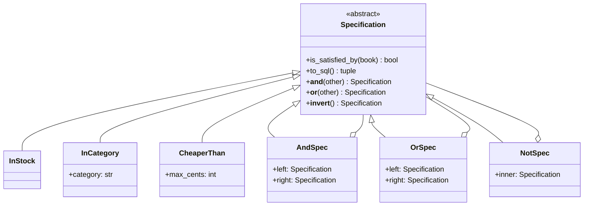
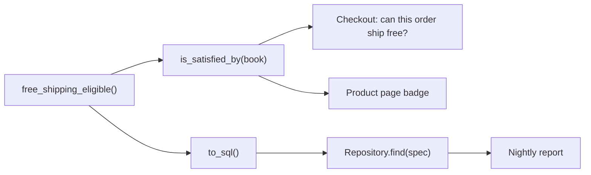

# Specification Pattern

## Introduction

Business rules love to hide in `if` statements. "A book ships free if it is in stock and costs at least 30.00" might appear in the checkout code, in the product page template, in a nightly report query and in a marketing export, each written slightly differently. When marketing changes the threshold to 25.00, someone updates three of the four.

The **Specification** pattern gives such a rule a name and a home. A specification is an object that answers one question: *does this candidate satisfy me?* Specifications can be combined with `and`, `or` and `not`, so small named rules build bigger ones.

Eric Evans and Martin Fowler described the pattern in their paper *Specifications* ([martinfowler.com/apsupp/spec.pdf](https://martinfowler.com/apsupp/spec.pdf)), and Evans used it in *Domain-Driven Design*. They list three uses:

1. **Validation**: does this object meet the rule?
2. **Selection**: find all objects that meet the rule, often from a database.
3. **Building to order**: describe what a new object must satisfy.

An everyday analogy is a job posting. "Must know Python AND (has 3 years of experience OR has a relevant degree) AND NOT require visa sponsorship" is a specification. HR uses the same posting to screen one applicant (validation) and to search a CV database (selection).

This page covers validation and selection, which are the two you will use most.

## The Problem: Rules Scattered and Repositories Exploding

Here is what typically happens without the pattern.

```python
from dataclasses import dataclass


@dataclass(frozen=True)
class Book:
    isbn: str
    title: str
    category: str
    price_cents: int
    stock: int


class BookRepository:
    def find_in_stock(self) -> list[Book]: ...
    def find_in_stock_by_category(self, category: str) -> list[Book]: ...
    def find_cheaper_than(self, cents: int) -> list[Book]: ...
    def find_in_stock_cheaper_than(self, cents: int) -> list[Book]: ...
    def find_by_category_in_stock_or_cheaper_than(
        self, category: str, cents: int
    ) -> list[Book]: ...
    def find_free_shipping_eligible(self) -> list[Book]: ...
    # ...and one more for every new screen


# Elsewhere, in the checkout service:
def ships_free(book: Book) -> bool:
    return book.stock > 0 and book.price_cents >= 3000


# And in a reporting script someone wrote last quarter:
FREE_SHIPPING_SQL = "SELECT * FROM books WHERE stock > 0 AND price_cents > 3000"
```

Two problems are visible:

- **Method explosion.** Each new combination of filters adds a repository method. The repository's interface grows without limit, and each method duplicates the SQL fragments of the others.
- **Rule duplication.** The free-shipping rule exists twice, and the copies already disagree: `>= 3000` versus `> 3000`. A book priced exactly 30.00 ships free at checkout but is missing from the report.

## The Pattern Applied

A specification has one core method, `is_satisfied_by(candidate) -> bool`. Composite specifications combine others. Python's operator overloading lets you write `a & b`, `a | b` and `~a`, which reads almost like the business rule.



If the shape looks familiar, it should. The `And`, `Or` and `Not` nodes form a [Composite](../3-arch-structural-patterns/2-arch-composite.mdx): a tree of specifications that is itself a specification.

### Step 1: The base class and composites

```python
from __future__ import annotations

import sqlite3
from abc import ABC, abstractmethod
from dataclasses import dataclass


@dataclass(frozen=True)
class Book:
    isbn: str
    title: str
    category: str
    price_cents: int
    stock: int


class Specification(ABC):
    @abstractmethod
    def is_satisfied_by(self, book: Book) -> bool: ...

    @abstractmethod
    def to_sql(self) -> tuple[str, list[object]]: ...

    def __and__(self, other: Specification) -> Specification:
        return AndSpec(self, other)

    def __or__(self, other: Specification) -> Specification:
        return OrSpec(self, other)

    def __invert__(self) -> Specification:
        return NotSpec(self)


@dataclass(frozen=True)
class AndSpec(Specification):
    left: Specification
    right: Specification

    def is_satisfied_by(self, book: Book) -> bool:
        return self.left.is_satisfied_by(book) and self.right.is_satisfied_by(book)

    def to_sql(self) -> tuple[str, list[object]]:
        ls, lp = self.left.to_sql()
        rs, rp = self.right.to_sql()
        return f"({ls} AND {rs})", lp + rp


@dataclass(frozen=True)
class OrSpec(Specification):
    left: Specification
    right: Specification

    def is_satisfied_by(self, book: Book) -> bool:
        return self.left.is_satisfied_by(book) or self.right.is_satisfied_by(book)

    def to_sql(self) -> tuple[str, list[object]]:
        ls, lp = self.left.to_sql()
        rs, rp = self.right.to_sql()
        return f"({ls} OR {rs})", lp + rp


@dataclass(frozen=True)
class NotSpec(Specification):
    inner: Specification

    def is_satisfied_by(self, book: Book) -> bool:
        return not self.inner.is_satisfied_by(book)

    def to_sql(self) -> tuple[str, list[object]]:
        s, p = self.inner.to_sql()
        return f"(NOT {s})", p
```

Each specification knows how to answer in two ways: in memory (`is_satisfied_by`) and as a SQL fragment with bound parameters (`to_sql`). Keeping both on one class is what stops the two copies of a rule from drifting apart.

### Step 2: Leaf specifications are your business vocabulary

```python
@dataclass(frozen=True)
class InStock(Specification):
    def is_satisfied_by(self, book: Book) -> bool:
        return book.stock > 0

    def to_sql(self) -> tuple[str, list[object]]:
        return "stock > 0", []


@dataclass(frozen=True)
class InCategory(Specification):
    category: str

    def is_satisfied_by(self, book: Book) -> bool:
        return book.category == self.category

    def to_sql(self) -> tuple[str, list[object]]:
        return "category = ?", [self.category]


@dataclass(frozen=True)
class CheaperThan(Specification):
    max_cents: int

    def is_satisfied_by(self, book: Book) -> bool:
        return book.price_cents < self.max_cents

    def to_sql(self) -> tuple[str, list[object]]:
        return "price_cents < ?", [self.max_cents]


def free_shipping_eligible() -> Specification:
    """Business rule: in-stock books from 30.00 upward ship free."""
    return InStock() & ~CheaperThan(3000)
```

`free_shipping_eligible()` is now the **single definition** of the rule. Anyone who needs it, whether checkout, product page or report, calls this function.

:::caution
The SQL fragments are fixed strings written by developers, and every value goes through a `?` parameter. Never build a fragment from user input with an f-string, or a specification becomes a SQL injection vector.
:::

### Step 3: One repository method instead of many

```python
class SqliteBookRepository:
    def __init__(self, conn: sqlite3.Connection) -> None:
        self._conn = conn

    def find(self, spec: Specification) -> list[Book]:
        where, params = spec.to_sql()
        rows = self._conn.execute(
            f"SELECT isbn, title, category, price_cents, stock FROM books "
            f"WHERE {where} ORDER BY title",
            params,
        ).fetchall()
        return [Book(*r) for r in rows]
```

The [Repository](./1-arch-repository-pattern.mdx) now has one `find(spec)` method. New screens combine existing specifications instead of adding methods.

### Step 4: Use it for validation and selection

```python
if __name__ == "__main__":
    books = [
        Book("1", "Clean Code", "programming", 3500, 4),
        Book("2", "Dune", "fiction", 1200, 0),
        Book("3", "Refactoring", "programming", 4200, 0),
        Book("4", "Python Tricks", "programming", 2500, 9),
        Book("5", "Neuromancer", "fiction", 3100, 2),
    ]

    # 1. In-memory check: validation of a single object
    spec = free_shipping_eligible()
    for b in books:
        print(f"{b.title:15} free shipping: {spec.is_satisfied_by(b)}")

    # 2. Same rule, translated to SQL
    conn = sqlite3.connect(":memory:")
    conn.execute(
        "CREATE TABLE books (isbn TEXT, title TEXT, category TEXT, "
        "price_cents INTEGER, stock INTEGER)"
    )
    conn.executemany("INSERT INTO books VALUES (?, ?, ?, ?, ?)",
                     [(b.isbn, b.title, b.category, b.price_cents, b.stock) for b in books])
    repo = SqliteBookRepository(conn)

    query = InCategory("programming") & (InStock() | CheaperThan(4000))
    print(query.to_sql())
    print([b.title for b in repo.find(query)])
    print([b.title for b in repo.find(free_shipping_eligible())])
```

Output:

```text
Clean Code      free shipping: True
Dune            free shipping: False
Refactoring     free shipping: False
Python Tricks   free shipping: False
Neuromancer     free shipping: True
('(category = ? AND (stock > 0 OR price_cents < ?))', ['programming', 4000])
['Clean Code', 'Python Tricks']
['Clean Code', 'Neuromancer']
```

The in-memory answer and the database answer agree, because they come from the same object.



## The Lightweight Version: Predicates as Functions

You do not always need classes. If you only validate in memory and never translate to SQL, a specification can simply be a function that returns `bool`, combined with small helpers. This uses Python 3.12 type parameter syntax.

```python
from collections.abc import Callable
from dataclasses import dataclass


@dataclass(frozen=True)
class Book:
    title: str
    price_cents: int
    stock: int


type Predicate[T] = Callable[[T], bool]


def all_of[T](*preds: Predicate[T]) -> Predicate[T]:
    return lambda x: all(p(x) for p in preds)


def negate[T](pred: Predicate[T]) -> Predicate[T]:
    return lambda x: not pred(x)


def in_stock(b: Book) -> bool:
    return b.stock > 0


def cheaper_than(cents: int) -> Predicate[Book]:
    return lambda b: b.price_cents < cents


free_shipping = all_of(in_stock, negate(cheaper_than(3000)))

books = [Book("Clean Code", 3500, 4), Book("Dune", 1200, 0), Book("Neuromancer", 3100, 2)]
print([b.title for b in books if free_shipping(b)])
```

Output:

```text
['Clean Code', 'Neuromancer']
```

This is the functional form of the same idea, and it is often all a Python project needs. The trade-off: a lambda cannot explain itself. You cannot turn it into SQL, print it for debugging, or serialize it to store a saved search. The [Functional Patterns](./5-arch-functional-patterns.mdx) page explores this style further.

## Where You Have Already Met Specifications

- **Spring Data JPA.** Repositories that extend `JpaSpecificationExecutor<T>` accept specification objects that build JPA Criteria predicates. Since Spring Data JPA 4.0 there is also a query-type-agnostic `PredicateSpecification<T>` alongside the classic `Specification<T>`. Specifications combine with `.and(...)` and `.or(...)` ([Spring Data JPA: Specifications](https://docs.spring.io/spring-data/jpa/reference/jpa/specifications.html)). The API has changed between major versions, so check the reference for the version you use.
- **SQLAlchemy and Django.** Composable filter expressions are specification-like. In Django, `Q(category="fiction") & ~Q(stock=0)` combines conditions with the same operators used above. In SQLAlchemy, `and_()`, `or_()` and `not_()` build expression trees.
- **Validation libraries and access rules.** Policy objects in authorization libraries ("user is owner OR user is admin") are specifications under another name.

A Spring Data JPA version of the leaf rules looks like this. It is based on the reference documentation for 4.x, and `Book_` is the JPA metamodel class generated at build time:

```java
import org.springframework.data.jpa.domain.PredicateSpecification;

class BookSpecs {
    static PredicateSpecification<Book> inStock() {
        return (from, cb) -> cb.greaterThan(from.get(Book_.stock), 0);
    }

    static PredicateSpecification<Book> cheaperThan(int cents) {
        return (from, cb) -> cb.lessThan(from.get(Book_.priceCents), cents);
    }
}

// usage: bookRepository.findAll(BookSpecs.inStock().and(BookSpecs.cheaperThan(4000)));
```

Java benefits from the interface here: the lambda is type-checked against `PredicateSpecification`, and the framework handles translation to SQL. In Python you would usually lean on the ORM's own expressions or the hand-written version above.

## Real-World Scenario

Your team runs a SaaS helpdesk. Customers build **saved views** such as "urgent tickets from enterprise customers that are unassigned or waiting more than 4 hours". The same conditions also drive **automation rules** ("when a ticket matches, notify the on-call lead") and **SLA alerts**. Today, views are SQL in the API, automations are Python `if` chains in a worker, and they disagree about what "urgent" means.

**The solution:**

1. Define leaf specifications for the vocabulary the product already uses: `PriorityIs`, `CustomerTier`, `Unassigned`, `WaitingLongerThan`.
2. Give each one `is_satisfied_by(ticket)` for the automation worker, which evaluates events one ticket at a time, and `to_sql()` for saved views, which query thousands of tickets.
3. Store saved views and automation rules as a small JSON tree (`and`, `or`, `not`, leaf name and arguments) and parse it into specification objects. The UI builder and the backend now share one model.
4. Add contract tests: for a fixture set of tickets, the in-memory result must equal the SQL result for every leaf and for random combinations.

**Why this approach:** the rules are user-defined, combined at runtime, and must be evaluated both in memory and in the database. That is exactly the case the pattern was made for.

**When to use it:**

- the same business rule is needed for validation and for querying
- users or admins compose filters at runtime (saved searches, segments, alert rules)
- repository methods keep multiplying for combinations of the same few filters
- a rule has a clear business name and changes on its own schedule

**When not to use it:**

- one-off filters used in one place. A plain `if` or ORM filter is clearer.
- complex reporting queries with joins, grouping and window functions. Specifications compose `WHERE` clauses well and almost everything else badly.
- when your ORM's expressions (Django `Q`, SQLAlchemy expressions, Spring specifications) already give you composition. Do not build a second framework on top.

**Alternatives and trade-offs:**

| Approach | Pros | Cons | Best for |
| --- | --- | --- | --- |
| Inline `if` and ad hoc SQL | Simple, obvious | Rules duplicate and drift | One-off checks |
| Repository method per query | Explicit, easy to optimize | Method explosion | A few stable queries |
| Predicate functions | Tiny, idiomatic Python | No SQL translation, opaque | In-memory validation |
| ORM expressions (`Q`, `and_`) | Built in, translated to SQL | Tied to the ORM, not reusable in memory | Most query filtering |
| Full Specification objects | One rule for memory and SQL, serializable | More code, must keep two evaluations in sync | User-defined filters, rule engines |

## Common Mistakes

1. **Specifications for everything.** Wrapping `book.stock > 0` in a class when it is used once is ceremony. Introduce a specification when a rule is named, reused or composed.
2. **Divergent evaluations.** If `is_satisfied_by` and `to_sql` disagree (for example on `NULL` handling, which SQL treats differently from Python), results differ silently. Contract-test them against each other.
3. **Loading everything to filter in memory.** Calling `is_satisfied_by` on every row of a large table defeats the database. Use the SQL translation for selection.
4. **Unsafe SQL fragments.** Interpolating values into the fragment opens SQL injection. Always return parameters separately.
5. **Leaking storage into the domain.** If leaf specifications import your ORM, the domain now depends on it. Put the translation in an infrastructure visitor or adapter if you need a clean separation, as hexagonal designs do.
6. **Deep, unreadable trees.** Ten nested `&` and `|` operators are as hard to read as the `if` chain they replaced. Name intermediate rules with functions such as `free_shipping_eligible()`.

## Related and Confusable Patterns

| Pattern | Relationship |
| --- | --- |
| [Composite](../3-arch-structural-patterns/2-arch-composite.mdx) | `And`, `Or` and `Not` nodes form a composite tree of specifications. |
| [Strategy](../4-arch-behavioral-patterns/0-arch-strategy.mdx) | A specification is a strategy whose algorithm returns `bool`. The difference is intent: a specification names a business rule and composes. |
| Interpreter | A serialized specification tree evaluated at runtime is a small interpreter. |
| [Visitor](../4-arch-behavioral-patterns/9-arch-visitor.mdx) | Use a visitor to translate one specification tree into SQL, Elasticsearch or another target without changing the specification classes. |
| [Repository](./1-arch-repository-pattern.mdx) | Accepts specifications in a single `find(spec)` method. |

## Summary

- A **specification** is a named, reusable business rule that answers "does this candidate satisfy me?"
- Combine specifications with `and`, `or` and `not`. Python's `&`, `|` and `~` make this read naturally.
- Use one specification for both **validation** in memory and **selection** in the database, so the rule cannot drift.
- A repository with `find(spec)` replaces an ever-growing list of `find_by_x_and_y` methods.
- Plain predicate functions are enough when you only filter in memory.
- Skip the pattern for one-off filters and complex reporting queries, and reuse your ORM's own expressions where they suffice.

## Exercises

1. Add a `PublishedAfter(year)` specification and a `bestseller()` rule built from existing specifications. Test both evaluation paths.
2. Write a function `from_dict(data: dict) -> Specification` that parses a JSON tree such as an `and` node with two children into specification objects.
3. Write a contract test that generates 100 random books, evaluates five random specifications in memory and via SQLite, and asserts that the results match.
4. Replace `to_sql` on each class with a separate `SqlTranslator` visitor. Compare which design is easier to extend with a new storage target.

**Next steps:**

- [Null Object and Optional](./4-arch-null-object.mdx) for another way to remove conditionals
- [Functional Patterns](./5-arch-functional-patterns.mdx) for predicates and higher-order functions
- [CQRS](../9-arch-distributed-systems/3-arch-cqrs.mdx) for when read queries outgrow specifications
