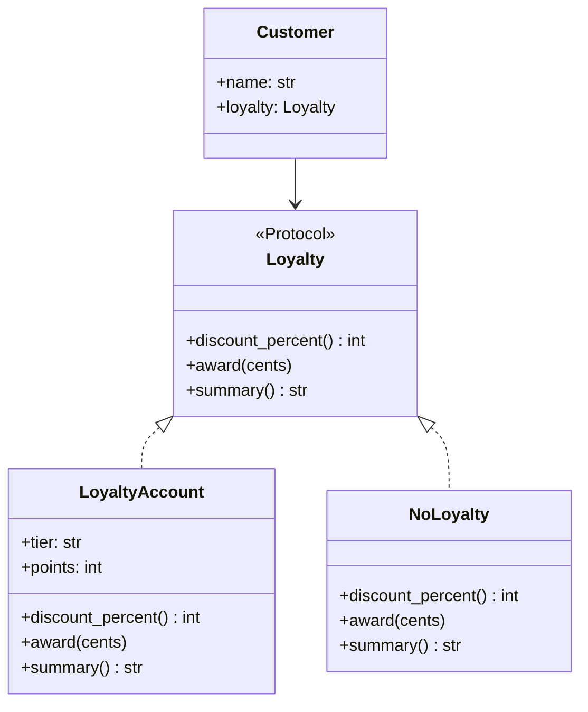
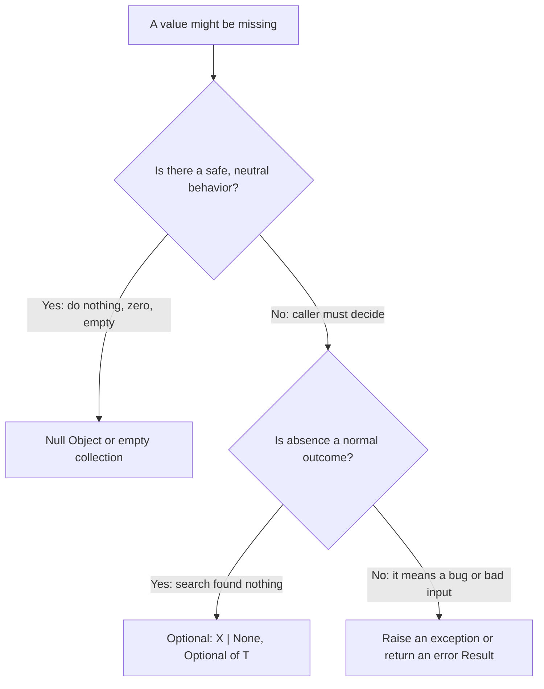

# Null Object and Optional

## Introduction

Tony Hoare, who introduced null references in ALGOL W in 1965, later called them his "billion-dollar mistake". Whatever the true cost, every developer has met the symptom: `AttributeError: 'NoneType' object has no attribute ...` in Python, `NullPointerException` in Java, `Cannot read properties of undefined` in JavaScript.

The real problem is not that values can be missing. Missing values are a fact of life: guests have no account, a customer may not have joined the loyalty program, a lookup may find nothing. The problem is **absence that is invisible** in the code, so one forgotten check crashes production.

This page covers two complementary answers:

- **Null Object**: replace "nothing" with an object that does nothing, safely. Callers stop checking because there is nothing to check. Bobby Woolf documented the pattern in the late 1990s in *Pattern Languages of Program Design 3*, and Martin Fowler lists **Introduce Null Object** (also called Introduce Special Case) as a refactoring ([refactoring.guru](https://refactoring.guru/introduce-null-object)).
- **Optional types**: make absence part of the type (`Customer | None` in Python, `Optional<Customer>` in Java), so the type checker or the API forces callers to handle it.

An analogy: a hotel with a "do not disturb" sign versus an empty room. The Null Object is a polite placeholder that answers every question with a sensible default ("no towels needed today"). Optional is a sign on the door saying "this room may be empty, check before you walk in".

## The Problem: None Checks Everywhere

An online bookstore models customers who may or may not have a loyalty account, and code that may or may not have a customer at all (guest checkout).

```python
from dataclasses import dataclass


@dataclass
class LoyaltyAccount:
    tier: str
    points: int

    def discount_percent(self) -> int:
        return {"gold": 10, "silver": 5}.get(self.tier, 0)


@dataclass
class Customer:
    name: str
    loyalty: LoyaltyAccount | None = None


def price_for(customer: Customer | None, base_cents: int) -> int:
    if customer is not None and customer.loyalty is not None:
        return base_cents * (100 - customer.loyalty.discount_percent()) // 100
    return base_cents


def greeting(customer: Customer | None) -> str:
    if customer is None:
        return "Hello, guest"
    return f"Hello, {customer.name}"


def award_points(customer: Customer | None, cents: int) -> None:
    if customer is not None and customer.loyalty is not None:
        customer.loyalty.points += cents // 100


def banner(customer: Customer | None) -> str:
    # Someone forgot one of the checks:
    return f"You have {customer.loyalty.points} points"


ada = Customer("Ada", LoyaltyAccount("gold", 120))
print(price_for(ada, 2000), greeting(None), banner(ada))
try:
    print(banner(Customer("Bob")))
except AttributeError as exc:
    print("crash:", exc)
```

Output:

```text
1800 Hello, guest You have 120 points
crash: 'NoneType' object has no attribute 'points'
```

What hurts:

- **Repeated checks.** Every function that touches loyalty repeats `customer is not None and customer.loyalty is not None`.
- **Defaults scattered.** "No loyalty means 0 percent discount" is decided in `price_for`. "No loyalty means no points" is decided in `award_points`. A new function must rediscover each default.
- **One forgotten check crashes.** `banner` worked in every test with Ada and failed for the first customer without an account.

## Solution 1: The Null Object Pattern

A Null Object implements the same interface as the real object, with neutral behavior: return zero, do nothing, return an empty list, or show a sensible default message.



```python
from dataclasses import dataclass, field
from typing import Protocol


class Loyalty(Protocol):
    def discount_percent(self) -> int: ...
    def award(self, cents: int) -> None: ...
    def summary(self) -> str: ...


@dataclass
class LoyaltyAccount:
    tier: str
    points: int = 0

    def discount_percent(self) -> int:
        return {"gold": 10, "silver": 5}.get(self.tier, 0)

    def award(self, cents: int) -> None:
        self.points += cents // 100

    def summary(self) -> str:
        return f"You have {self.points} points"


class NoLoyalty:
    """Null Object: a valid Loyalty that does nothing."""

    def discount_percent(self) -> int:
        return 0

    def award(self, cents: int) -> None:
        pass

    def summary(self) -> str:
        return "Join our rewards program"


NO_LOYALTY = NoLoyalty()  # stateless, so one shared instance is enough


@dataclass
class Customer:
    name: str
    loyalty: Loyalty = field(default=NO_LOYALTY)


GUEST = Customer("guest")


def price_for(customer: Customer, base_cents: int) -> int:
    return base_cents * (100 - customer.loyalty.discount_percent()) // 100


def greeting(customer: Customer) -> str:
    return f"Hello, {customer.name}"


def banner(customer: Customer) -> str:
    return customer.loyalty.summary()


ada = Customer("Ada", LoyaltyAccount("gold", 120))
bob = Customer("Bob")
for c in (ada, bob, GUEST):
    c.loyalty.award(2500)
    print(f"{greeting(c):13} price={price_for(c, 2000)}  {banner(c)}")
```

Output:

```text
Hello, Ada    price=1800  You have 145 points
Hello, Bob    price=2000  Join our rewards program
Hello, guest  price=2000  Join our rewards program
```

Every `if` is gone. The defaults for "no loyalty" live in exactly one class, `NoLoyalty`, and the guest is a `Customer` too (a "special case" object), so functions no longer accept `None`.

Design notes:

- **Share one instance** of a stateless null object (`NO_LOYALTY`). It never changes, so there is no reason to create many. This is one of the few places where a single shared object is harmless.
- **Make it type-check.** `NoLoyalty` satisfies the `Loyalty` protocol structurally. mypy verifies that it has every method with matching signatures.
- **Choose defaults with the business.** "Zero discount" is obvious. "Show a sign-up banner" is a product decision. A null object encodes decisions, so they deserve review like any other logic.

## Where You Have Already Met Null Objects

Python's standard library ships several:

```python
import logging
from contextlib import nullcontext
from threading import Lock

# 1. A library logger that stays silent unless the app configures logging
lib_log = logging.getLogger("bookstore.pricing")
lib_log.addHandler(logging.NullHandler())
lib_log.warning("no handler configured, nothing printed")


# 2. An optional lock without an if/else around the with-block
def update_stock(qty: int, lock: Lock | None = None) -> int:
    with lock or nullcontext():
        return qty - 1


print(update_stock(5), update_stock(5, Lock()))
```

Output:

```text
4 4
```

- **`logging.NullHandler`** is a handler that discards records. The [logging HOWTO](https://docs.python.org/3/howto/logging.html#configuring-logging-for-a-library) recommends that libraries attach one to their top-level logger, so the application decides what gets printed.
- **`contextlib.nullcontext`** is a context manager that does nothing, so optional resources can share one `with` statement.
- **Empty collections** are the most common null objects of all. Returning `[]` instead of `None` from "find all orders" lets callers loop without checking. Java's `Collections.emptyList()` exists for the same reason.
- **SLF4J's `NOPLogger`** in Java, `/dev/null` on Unix, and "no-op" tracer implementations in OpenTelemetry SDKs follow the same idea: a real implementation of the interface that does nothing.

## Solution 2: Optional Types Make Absence Visible

Sometimes "nothing" is **not** a safe default. If a customer lookup by ID finds nobody, inventing a fake customer would hide a real problem. Here you want the opposite of a null object: make absence loud, so callers must decide what to do.

### Optional in Python: `X | None` plus a type checker

In Python, `Customer | None` (the same as `typing.Optional[Customer]`) documents that a value may be missing. On its own it does nothing at runtime. Its power comes from a type checker. Here is the `banner` bug again, in a minimal file:

```python
from dataclasses import dataclass


@dataclass
class LoyaltyAccount:
    tier: str
    points: int


@dataclass
class Customer:
    name: str
    loyalty: LoyaltyAccount | None = None


def banner(customer: Customer) -> str:
    return f"You have {customer.loyalty.points} points"
```

```bash
mypy null_mypy.py
```

Example output:

```text
null_mypy.py:17: error: Item "None" of "LoyaltyAccount | None" has no attribute "points"  [union-attr]
Found 1 error in 1 file (checked 1 source file)
```

The crash that reached production in the "before" example is now caught before the code even runs. This is the cheapest null-safety you can buy in Python: annotate honestly and run mypy or pyright in CI.

Idiomatic handling looks like this. Use `X | None` where absence is a normal outcome, and raise when absence is a bug:

```python
from dataclasses import dataclass


@dataclass
class Customer:
    name: str
    email: str | None


CUSTOMERS = {"c1": Customer("Ada", "ada@example.com"), "c2": Customer("Bob", None)}


def find_customer(customer_id: str) -> Customer | None:
    return CUSTOMERS.get(customer_id)


def email_domain(customer_id: str) -> str:
    customer = find_customer(customer_id)
    if customer is None or customer.email is None:
        return "unknown"
    return customer.email.split("@", 1)[1]


def require_customer(customer_id: str) -> Customer:
    customer = find_customer(customer_id)
    if customer is None:
        raise LookupError(f"customer {customer_id} not found")
    return customer


for cid in ("c1", "c2", "nope"):
    print(cid, email_domain(cid))
try:
    require_customer("nope")
except LookupError as exc:
    print("error:", exc)
```

Output:

```text
c1 example.com
c2 unknown
nope unknown
error: customer nope not found
```

A common convention, used by Django's `get()` versus `filter().first()` and SQLAlchemy's `session.get()` versus `Result.one()`, is to offer both shapes: `find_x()` returns `X | None`, and `get_x()` or `require_x()` raises.

### Optional in Java

Java chose a wrapper type, `java.util.Optional<T>`, added in Java 8. Its methods let you chain transformations without writing `null` checks:

```java
import java.util.Map;
import java.util.Optional;

public class CustomerLookup {
    record Customer(String name, String email) {}

    private static final Map<String, Customer> DB = Map.of(
        "c1", new Customer("Ada", "ada@example.com"),
        "c2", new Customer("Bob", null));

    // Optional as a return type: "there may be no result"
    static Optional<Customer> findById(String id) {
        return Optional.ofNullable(DB.get(id));
    }

    static String emailDomain(String id) {
        return findById(id)
            .map(Customer::email)               // email may be null: map handles it
            .map(e -> e.substring(e.indexOf('@') + 1))
            .orElse("unknown");
    }

    public static void main(String[] args) {
        System.out.println(emailDomain("c1"));
        System.out.println(emailDomain("c2"));
        System.out.println(emailDomain("nope"));
        findById("nope").ifPresentOrElse(
            c -> System.out.println("found " + c.name()),
            () -> System.out.println("no such customer"));
    }
}
```

Output:

```text
example.com
unknown
unknown
no such customer
```

`map` returns an empty `Optional` when the mapping function returns `null`, so the missing email of Bob flows through safely. The JDK's own guidance is narrow: `Optional` is intended mainly as a **method return type** where "no result" must be represented clearly. Brian Goetz, Java's language architect, has advised against using it for fields or method parameters, and the Javadoc's API note says it is primarily for return types. Records require Java 16 or later. `ifPresentOrElse` needs Java 9 or later.

### Other languages

| Language | Absence is expressed as | Safe access |
| --- | --- | --- |
| Python | `X \| None` checked by mypy or pyright | `if x is not None`, early return |
| Java | `Optional<T>` for return values | `map`, `orElse`, `orElseThrow` |
| Kotlin | Nullable types `T?` built into the type system | `?.`, `?:` (Elvis) |
| TypeScript | `T \| undefined` with `strictNullChecks` | `?.`, `??` |
| Rust | `Option<T>`, no null at all | `match`, `?`, `unwrap_or` |
| C# | Nullable reference types (`string?`) | `?.`, `??` |

The trend across modern languages is clear: absence belongs in the type, and the compiler checks it.

## Null Object or Optional?



- **Null Object** when the neutral behavior is genuinely correct for every caller: no discount, no logging, no points, empty list.
- **Optional** when callers need to react differently: show a 404, fall back to another source, ask the user.
- **Exception or Result** when absence means something went wrong. The [Result Types](./6-arch-result-type.mdx) page covers that case.

## Real-World Scenario

Your team runs a SaaS helpdesk. Tickets can be assigned to an agent, but many are unassigned. The codebase has about 140 checks of the form `if ticket.assignee is not None`, and recent bugs include an SLA job crashing on unassigned tickets and an email template showing "Assigned to: None".

**The solution:**

1. Split the uses. Some code needs a **display value** ("Unassigned" in templates and exports). Other code needs to **act** on the assignee (send notifications, compute workload).
2. For display, introduce an `UNASSIGNED` special-case agent with `name = "Unassigned"`, an empty `email` and `notify()` that does nothing. Templates and exports stop checking.
3. For acting, keep `assignee: Agent | None` in the domain model and turn on mypy's strict optional checking in CI. The SLA job is forced to handle the unassigned case explicitly, which is correct, because unassigned tickets are exactly what it must escalate.
4. Add a test listing every place that receives the special case, so new code does not accidentally "notify" nobody when it should escalate.

**Why this approach:** a null object is right where the neutral behavior is correct, and wrong where absence carries meaning. The SLA job must treat "unassigned" as a signal, so hiding it would be a bug.

**When to use a Null Object:**

- many call sites repeat the same `None` check with the same default
- the default behavior is safe for every caller (no-op logging, zero discount, empty list)
- you want optional collaborators (loggers, metrics, caches) without `if` statements

**When not to use it:**

- absence is a meaningful business state that some callers must react to
- the "do nothing" behavior could hide failures (a null payment gateway that silently "succeeds" is dangerous)
- only one or two call sites check for `None`. A plain check is clearer.

**Alternatives and trade-offs:**

| Approach | Pros | Cons | Best for |
| --- | --- | --- | --- |
| Bare `None` with ad hoc checks | No new types | Easy to forget, crashes at runtime | Small scripts |
| `X \| None` plus type checker | Absence visible, checked before runtime | Needs a type checker in CI | Most Python code |
| Null Object or special case | No checks at call sites, one place for defaults | Can hide real absence, extra class | Optional collaborators, display defaults |
| Java `Optional` | Explicit, chainable | Allocation, misuse as field or parameter | Java return values |
| Exception on absence | Fails fast and loud | Callers must catch | Absence means a bug |

## Common Mistakes

1. **A null object that hides failures.** `NullPaymentGateway.charge()` returning success means unpaid orders ship. Null objects are for behavior where doing nothing is truly correct.
2. **Checking for the null object.** If code says `if customer.loyalty is NO_LOYALTY:` everywhere, you have reinvented `None` with extra steps. The behavior should live in the null class.
3. **Mutable shared null objects.** If `NoLoyalty` stored points, every customer without an account would share them. Keep shared null objects stateless.
4. **Using Java `Optional` for fields, parameters or collections.** Return an empty list instead of `Optional<List<T>>`, and accept nullable parameters or overloads instead of `Optional` parameters.
5. **Calling `.get()` without checking.** `Optional.get()` on an empty value throws `NoSuchElementException`, which is a `NullPointerException` with a new name. Prefer `orElse`, `orElseThrow` or `map`.
6. **Returning `None` from functions typed as returning a list.** Return `[]`. Callers can loop over an empty list, but not over `None`.
7. **Annotating `X | None` but never running a type checker.** The annotation alone protects nothing.

## Related and Confusable Patterns

| Pattern | Relationship |
| --- | --- |
| [Strategy](../4-arch-behavioral-patterns/0-arch-strategy.mdx) | A null object is often a "do nothing" strategy. |
| [Proxy](../3-arch-structural-patterns/6-arch-proxy.mdx) | Both stand in for a real object; a proxy forwards to it, while a null object replaces it. |
| Special Case (Fowler, *PoEAA*) | The general form: an object for any special situation, such as `GuestCustomer` or `UnknownProduct`. Null Object is the most common special case. |
| [Result Types](./6-arch-result-type.mdx) | Like Optional, but the "missing" side carries an error explaining why. |
| [Liskov Substitution](../1-arch-design-principles/3-arch-liskov-substitution.mdx) | A null object must honor the interface's contract, or substituting it will break callers. |

## Summary

- Missing values are normal. **Invisible** missing values are the bug.
- A **Null Object** implements the interface with safe, neutral behavior, removing repeated `None` checks and centralizing defaults.
- The standard library already has them: `logging.NullHandler`, `contextlib.nullcontext`, and empty collections.
- **Optional types** (`X | None` with mypy or pyright, Java's `Optional`, Kotlin's `T?`, Rust's `Option`) make absence explicit and checked.
- Use a null object only when doing nothing is correct for every caller. Use Optional when callers must decide, and raise or return an error when absence means something went wrong.

## Exercises

1. Add a `NullNotifier` for customers who opted out of email. Make sure it cannot be confused with a failing notifier in logs.
2. Run mypy on the "before" example of this page. Fix each error, choosing between a null object, an early return, and an exception for each case. Explain each choice in a comment.
3. Find three functions in a project you know that return `None` or `null` for "no results" and decide whether each should return an empty collection, an Optional, or raise.
4. Write a `GuestCustomer` special case for checkout and list which behaviors differ from a registered customer. Which of them should not be silent defaults?

**Next steps:**

- [Functional Patterns](./5-arch-functional-patterns.mdx) for chaining operations safely
- [Result Types and Error Handling Patterns](./6-arch-result-type.mdx) for absence that carries a reason
- [Liskov Substitution Principle](../1-arch-design-principles/3-arch-liskov-substitution.mdx) for the contract any null object must respect
