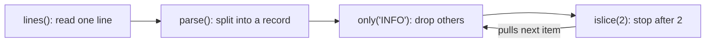
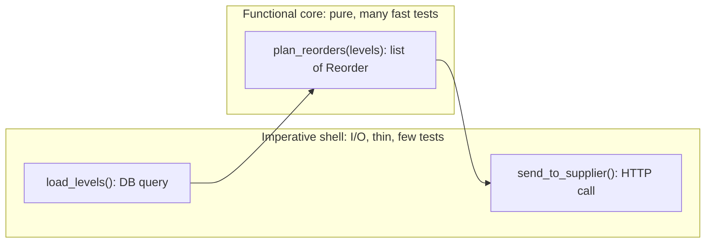

# Functional Patterns: Pipelines, Higher-Order Functions and Immutability

## Introduction

You do not need Haskell to benefit from functional programming. Python, Java, JavaScript, C# and Kotlin all borrow its most useful ideas, and many bugs that object-oriented patterns try to manage simply cannot happen when you apply them.

This page covers the functional patterns that pay off most in everyday code:

- **Pure functions**: same input, same output, no side effects.
- **Immutability**: data that cannot change after creation, so nobody changes it behind your back.
- **Higher-order functions**: functions that take or return functions, such as `map`, `filter`, `sorted(key=...)`, closures and `functools.partial`.
- **Pipelines**: data flowing through a chain of small steps, often lazily with generators.
- **Functional core, imperative shell**: an architecture that keeps decisions pure and pushes I/O to the edges.

An analogy: a car wash. Each station (soap, rinse, dry) does one job, takes a car in and passes it on. No station reaches back to change what an earlier one did, and you can add a wax station without rebuilding the others. That is a pipeline of pure steps.

The goal is not "functional good, objects bad". The goal is to know which tool removes which kind of bug.

## The Problem: Shared Mutable State

Here is a revenue report for an online bookstore. It looks innocent.

```python
orders = [
    {"id": 1, "customer": "ada", "status": "paid", "total": 4200, "country": "DE"},
    {"id": 2, "customer": "bob", "status": "refunded", "total": 1500, "country": "US"},
    {"id": 3, "customer": "ada", "status": "paid", "total": 1800, "country": "DE"},
    {"id": 4, "customer": "cy", "status": "paid", "total": 9900, "country": "US"},
]

VAT = {"DE": 0.19, "US": 0.0}


def revenue_report(orders: list[dict]) -> dict[str, int]:
    report: dict[str, int] = {}
    for o in orders:
        if o["status"] != "paid":
            continue
        o["total"] = round(o["total"] / (1 + VAT[o["country"]]))  # strip VAT in place!
        report[o["customer"]] = report.get(o["customer"], 0) + o["total"]
    return report


print(revenue_report(orders))
print(revenue_report(orders))   # same input, different answer
```

Output:

```text
{'ada': 5042, 'cy': 9900}
{'ada': 4237, 'cy': 9900}
```

Calling the same function twice gives two different answers, because the first call **mutated its input**. In a real system the second caller might be an email job, a dashboard or a retry after a timeout. Bugs like this are painful because the faulty line and the visible symptom are far apart.

Other problems hiding here:

- Filtering, VAT logic and aggregation are tangled in one loop, so none of them can be reused or tested alone.
- `VAT` is a global mutable dict. Any code anywhere could change the rates.
- Plain dicts give no protection and no type checking for typos such as `o["totl"]`.

## Pattern 1: Pure Functions and Immutable Data

```python
from collections.abc import Iterable
from dataclasses import dataclass, replace
from functools import reduce
from types import MappingProxyType


@dataclass(frozen=True)
class Order:
    id: int
    customer: str
    status: str
    total_cents: int
    country: str


VAT = MappingProxyType({"DE": 0.19, "US": 0.0})   # read-only view


# ---- small pure functions ----
def is_paid(o: Order) -> bool:
    return o.status == "paid"


def net_of_vat(o: Order) -> Order:
    net = round(o.total_cents / (1 + VAT[o.country]))
    return replace(o, total_cents=net)              # new object, input untouched


def add_to_report(report: dict[str, int], o: Order) -> dict[str, int]:
    return {**report, o.customer: report.get(o.customer, 0) + o.total_cents}


def revenue_report(orders: Iterable[Order]) -> dict[str, int]:
    net_paid = map(net_of_vat, filter(is_paid, orders))
    return reduce(add_to_report, net_paid, {})


ORDERS = (
    Order(1, "ada", "paid", 4200, "DE"),
    Order(2, "bob", "refunded", 1500, "US"),
    Order(3, "ada", "paid", 1800, "DE"),
    Order(4, "cy", "paid", 9900, "US"),
)

print(revenue_report(ORDERS))
print(revenue_report(ORDERS))
print(ORDERS[0])

try:
    ORDERS[0].total_cents = 0  # type: ignore[misc]
except AttributeError as exc:
    print("blocked:", exc)
```

Output:

```text
{'ada': 5042, 'cy': 9900}
{'ada': 5042, 'cy': 9900}
Order(id=1, customer='ada', status='paid', total_cents=4200, country='DE')
blocked: cannot assign to field 'total_cents'
```

What changed:

- **`frozen=True`** makes assignment raise `dataclasses.FrozenInstanceError` (a subclass of `AttributeError`). A tuple holds the orders, and `MappingProxyType` gives a read-only view of the VAT table.
- **`dataclasses.replace`** creates a modified copy instead of mutating. Python 3.13 and later also offer `copy.replace()`, which works the same way for dataclasses and other supporting types.
- **Each function does one thing** and can be tested with a single line: `assert is_paid(Order(1, "a", "paid", 1, "US"))`.
- **The report is repeatable.** Run it once or a thousand times, from any thread, and the answer is the same.

:::note
Python's immutability is shallow. A frozen dataclass holding a `list` still lets you append to that list. Use tuples, `frozenset` and nested frozen dataclasses for data that must not change.
:::

### Be pragmatic about local mutation

The `reduce` version copies the report dict for every order, which is wasteful for large inputs, and many Python developers find `reduce` harder to read than a loop. **Mutation that never escapes a function is harmless.** This version is equally pure from the caller's point of view, and more idiomatic:

```python
from collections import defaultdict


def revenue_report(orders: Iterable[Order]) -> dict[str, int]:
    totals: defaultdict[str, int] = defaultdict(int)   # local, never shared
    for o in filter(is_paid, orders):
        totals[o.customer] += net_of_vat(o).total_cents
    return dict(totals)
```

The rule that matters is: **do not mutate what you did not create**.

## Pattern 2: Higher-Order Functions and Closures

A higher-order function takes a function as an argument or returns one. You use them constantly: `sorted(key=...)`, `map`, `filter`, decorators, and callbacks. Returning a function lets you **configure behavior once and use it many times**.

```python
from collections.abc import Callable
from functools import partial


# A function that returns a function (a closure over `percent`)
def percent_off(percent: int) -> Callable[[int], int]:
    def apply(cents: int) -> int:
        return cents * (100 - percent) // 100
    return apply


def flat_off(amount: int, cents: int) -> int:
    return max(cents - amount, 0)


def pipe[T](*steps: Callable[[T], T]) -> Callable[[T], T]:
    def run(value: T) -> T:
        for step in steps:
            value = step(value)
        return value
    return run


black_friday = pipe(percent_off(20), partial(flat_off, 500))
student = percent_off(10)

print(black_friday(4000), student(4000))
print(sorted([("Dune", 1200), ("SICP", 5500), ("Emma", 900)], key=lambda b: b[1]))
```

Output:

```text
2700 3600
[('Emma', 900), ('Dune', 1200), ('SICP', 5500)]
```

- `percent_off(20)` is a **closure**: the inner function remembers `percent`.
- `partial(flat_off, 500)` fixes the first argument, turning a two-argument function into a one-argument step.
- `pipe(...)` **composes** steps left to right. A promotion is now data, a list of steps, that marketing could configure.

Compare this with the [Strategy](../4-arch-behavioral-patterns/0-arch-strategy.mdx) and [Decorator](../3-arch-structural-patterns/3-arch-decorator.mdx) patterns: closures and composition cover many of the same needs with far less code, as the [Design Patterns in Modern Languages](./0-arch-patterns-in-modern-languages.mdx) page showed.

## Pattern 3: Lazy Pipelines with Generators

When data is large or streaming (log files, CSV exports, message queues), build the pipeline from generators. Each step pulls one item at a time from the previous one, so memory use stays flat and work stops as soon as you have enough.

```python
from collections.abc import Iterable, Iterator
from itertools import islice

LOG = """\
2026-10-01 INFO order=1 total=4200
2026-10-01 ERROR order=2 payment declined
2026-10-01 INFO order=3 total=1800
garbage line
2026-10-02 INFO order=4 total=9900
"""


def lines(text: str) -> Iterator[str]:
    for line in text.splitlines():
        print(f"  read: {line[:24]}")
        yield line


def parse(rows: Iterable[str]) -> Iterator[dict[str, str]]:
    for row in rows:
        parts = row.split()
        if len(parts) >= 3 and parts[1] in {"INFO", "ERROR"}:
            yield {"date": parts[0], "level": parts[1], "msg": " ".join(parts[2:])}


def only(level: str, records: Iterable[dict[str, str]]) -> Iterator[dict[str, str]]:
    return (r for r in records if r["level"] == level)


pipeline = only("INFO", parse(lines(LOG)))
for record in islice(pipeline, 2):
    print(record["msg"])
```

Output:

```text
  read: 2026-10-01 INFO order=1 
order=1 total=4200
  read: 2026-10-01 ERROR order=2
  read: 2026-10-01 INFO order=3 
order=3 total=1800
```

The `read:` lines show the laziness. Lines are read only when the consumer asks for the next record, and the last two lines are never read at all, because `islice` stopped after two results. Replace `LOG.splitlines()` with a file object and the same pipeline processes a 10 GB file in constant memory.



This is the [Pipes and Filters](../6-arch-architectural-styles/9-arch-pipes-and-filters.mdx) architectural style at function scale. Unix pipes (`grep ERROR app.log | sort | uniq -c`) apply the same idea between processes.

:::caution
Generators can be consumed only once. If you iterate `pipeline` a second time, you get nothing. Materialize with `list(...)` when you need to reuse results.
:::

## Pattern 4: Functional Core, Imperative Shell

Pure functions are easy to test, but real programs must read databases and call APIs. Gary Bernhardt's *Functional Core, Imperative Shell* idea (from his Destroy All Software screencasts and "Boundaries" talk) resolves the tension: **put all decisions in pure functions, and keep a thin outer layer that does I/O and calls them**.



```python
from dataclasses import dataclass


@dataclass(frozen=True)
class StockLevel:
    isbn: str
    on_hand: int
    sold_last_7_days: int


@dataclass(frozen=True)
class Reorder:
    isbn: str
    qty: int


# ---- functional core: pure, no I/O, trivial to test ----
def plan_reorders(levels: list[StockLevel], days_of_cover: int = 14) -> list[Reorder]:
    plans = []
    for s in levels:
        daily = s.sold_last_7_days / 7
        target = round(daily * days_of_cover)
        if s.on_hand < target:
            plans.append(Reorder(s.isbn, target - s.on_hand))
    return plans


# ---- imperative shell: I/O at the edges ----
def load_levels() -> list[StockLevel]:            # would query the database
    return [StockLevel("978-0", 3, 14), StockLevel("978-1", 50, 7),
            StockLevel("978-2", 0, 21)]


def send_to_supplier(r: Reorder) -> None:         # would call an API
    print(f"POST /purchase-orders isbn={r.isbn} qty={r.qty}")


def nightly_job() -> None:
    for r in plan_reorders(load_levels()):
        send_to_supplier(r)


nightly_job()

# A test of the core needs no mocks at all:
assert plan_reorders([StockLevel("x", 10, 7)]) == [Reorder("x", 4)]
print("core test passed")
```

Output:

```text
POST /purchase-orders isbn=978-0 qty=25
POST /purchase-orders isbn=978-2 qty=42
core test passed
```

The core **returns decisions as data** (`Reorder` objects) instead of acting on them. The shell executes them. This is the same separation that [Hexagonal Architecture](../7-arch-clean-architecture/0-arch-hexagonal.mdx) and [Clean Architecture](../7-arch-clean-architecture/2-arch-clean-architecture.mdx) aim for at a larger scale, and it is one of the most practical ways to improve [testability](../12-arch-quality-and-operations/5-arch-testability.mdx).

## Where You Have Already Met These Patterns

- **Java Streams** (`orders.stream().filter(Order::isPaid).map(...).collect(...)`) are lazy pipelines of higher-order functions, added in Java 8.
- **JavaScript array methods** (`map`, `filter`, `reduce`) and **C# LINQ** are the same idea.
- **Redux** requires reducers to be pure functions that return new state instead of mutating the old one, which is what makes time-travel debugging possible. **React** state updates follow the same rule: you create a new object or array instead of mutating, so React can detect the change.
- **pandas** method chaining (`df.query(...).assign(...).groupby(...)`) reads like a pipeline, and most of its methods return new objects rather than mutating by default.
- **Python's `itertools`** and **`functools`** modules (`islice`, `chain`, `groupby`, `partial`, `reduce`, `cache`) are a toolkit of higher-order building blocks.
- **Event sourcing** rebuilds state by folding (reducing) a list of events, as the [Event Sourcing](../9-arch-distributed-systems/4-arch-event-sourcing.mdx) page shows.

## Real-World Scenario

Your team runs a food delivery platform. The **delivery fee** depends on distance, surge level, restaurant promotions, subscription status and city rules. The current code is a 400-line method on a `Checkout` class that reads the database midway, mutates the cart while it calculates, and is covered by a handful of slow end-to-end tests. Finance found that fees shown in the app sometimes differ from fees charged, because the calculation runs twice and the second run sees a mutated cart.

**The solution:**

1. Model inputs as frozen dataclasses: `FeeInput(distance_km, surge, city, is_subscriber, promo)`. The shell loads everything **before** calculating.
2. Write each rule as a pure function `FeeRule = Callable[[FeeInput, Money], Money]`: base distance fee, surge multiplier, subscriber waiver, city cap.
3. Compose rules with `pipe` in a configured order per city. City rule sets become data, reviewed like configuration.
4. Return a `FeeBreakdown` value that lists each rule's effect, so support staff can explain any fee.
5. Test every rule and every city pipeline with fast table-driven unit tests. Keep a few end-to-end tests for the shell.

**Why this approach:** the bug came from mutation and hidden I/O. Pure rules over immutable inputs make the calculation repeatable by construction: the app preview and the charge use the same function with the same input, so they cannot disagree.

**When to use functional patterns:**

- calculations, pricing, validation, transformations and reports
- data processing pipelines, especially large or streaming data
- concurrent code, where immutable data removes whole classes of race conditions
- any logic you want to test exhaustively without mocks

**When not to use them, or not purely:**

- performance-critical inner loops where copying large structures is too slow. Mutate locally, or use specialized libraries such as NumPy.
- code that is fundamentally about effects, such as device drivers or UI event wiring. Keep it imperative and thin.
- when the team finds deep composition or point-free style hard to read. A clear loop beats a clever `reduce`.
- long-lived entities with identity and a lifecycle, such as an `Order` moving through states. Objects with controlled mutation, as in [DDD aggregates](../8-arch-domain-driven-design/4-arch-aggregates.mdx), often model these more naturally.

**Alternatives and trade-offs:**

| Approach | Pros | Cons | Best for |
| --- | --- | --- | --- |
| Imperative loops with shared mutable state | Familiar, fast to write | Hidden coupling, order-dependent bugs | Throwaway scripts |
| Pure functions with local mutation | Idiomatic Python, testable, efficient | Discipline needed at boundaries | Most business logic |
| Fully immutable pipelines (`map`, `filter`, `reduce`) | Composable, safe to parallelize | Copying cost, can be harder to read | Data transformations |
| Generator pipelines | Constant memory, early exit | Single-use iterators, harder debugging | Large or streaming data |
| Rich objects with encapsulated mutation | Natural for lifecycles and invariants | Harder to test without setup | Entities and aggregates |

## Common Mistakes

1. **Mutating arguments.** Sorting a list in place with `items.sort()` inside a helper changes the caller's data. Use `sorted(items)` or document the mutation loudly.
2. **Mutable default arguments.** `def add(item, bucket=[])` shares one list across calls. Use `None` and create the list inside, or a `field(default_factory=list)` in dataclasses.
3. **Assuming frozen means deeply immutable.** A frozen dataclass containing a list is only shallowly frozen.
4. **Hidden I/O in "pure" functions.** Reading `datetime.now()`, environment variables or a global cache makes a function impure. Pass the current time and configuration in as arguments.
5. **Reusing exhausted generators.** The second loop over a generator silently does nothing.
6. **`reduce` for everything.** Python's `sum`, `max`, `any`, `all`, `collections.Counter` and comprehensions are usually clearer.
7. **Lambdas that grow.** If a lambda needs a comment, make it a named function with a docstring and a test.

## Summary

- **Pure functions** return the same output for the same input and change nothing else, which makes them easy to test, cache and run concurrently.
- **Immutable data** (frozen dataclasses, tuples, `MappingProxyType`, `dataclasses.replace`) prevents changes behind your back. Local mutation that never escapes is fine.
- **Higher-order functions**, closures and `functools.partial` let you configure behavior and compose small steps with a `pipe`.
- **Generator pipelines** process large or streaming data lazily in constant memory.
- **Functional core, imperative shell** keeps decisions pure and I/O at the edges, a small-scale version of hexagonal architecture.
- Use these patterns for calculations and transformations, and keep pragmatic, readable code over functional purity.

## Exercises

1. Rewrite the "before" report so it is pure, but keep it as a single readable loop with local mutation. Write three tests, including one that calls it twice.
2. Extend the log pipeline with a `group_by_date` step that yields `(date, count)` pairs, using `itertools.groupby`. What does `groupby` require of its input order?
3. Take a function in a project you know that both reads from a database and makes decisions. Split it into a pure core and a shell, and count how many mocks its tests need before and after.
4. Implement the food delivery fee rules from the scenario with `pipe` and frozen dataclasses, and return a breakdown listing each rule's effect.

**Next steps:**

- [Result Types and Error Handling Patterns](./6-arch-result-type.mdx), where failures also become values in a pipeline
- [Pipes and Filters Architecture](../6-arch-architectural-styles/9-arch-pipes-and-filters.mdx) for the same idea at system scale
- [Designing for Testability](../12-arch-quality-and-operations/5-arch-testability.mdx)
