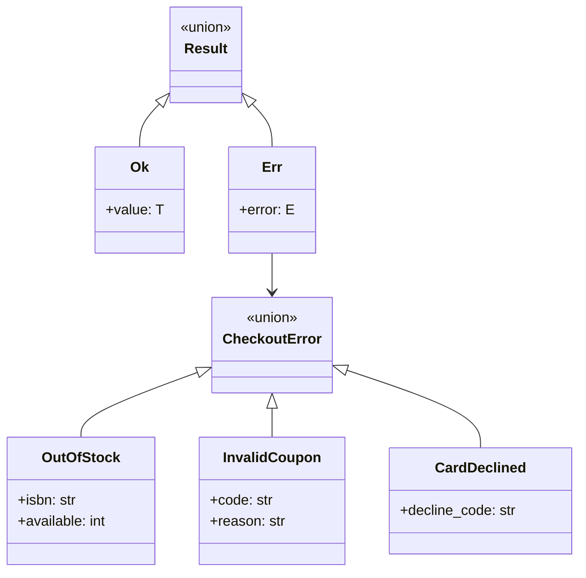
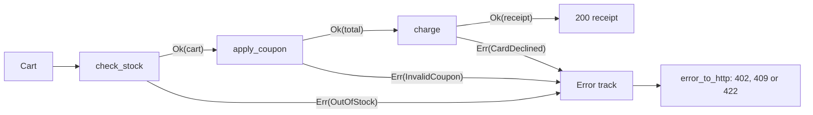

# Result Types and Error Handling Patterns

## Introduction

Every non-trivial operation can fail. A book is out of stock, a coupon has expired, the bank declines a card, the database times out, or a developer made a typo. How your code **represents** these failures decides whether callers handle them correctly or ignore them.

There are two broad families:

- **Exceptions** interrupt normal control flow and travel up the call stack until something catches them. Python, Java, C# and JavaScript use them by default.
- **Errors as values** are returned like any other result. Go returns `(value, err)` pairs. Rust, Swift, F#, Haskell and Kotlin libraries use a **Result type**: a value that is either `Ok(value)` or `Err(error)`.

Neither is better everywhere. The skill is knowing **which kind of failure** you are dealing with. A useful split, following Scott Wlaschin's essay [Against Railway-Oriented Programming](https://fsharpforfunandprofit.com/posts/against-railway-oriented-programming/):

| Kind of failure | Example | Usually best handled with |
| --- | --- | --- |
| **Domain error**, expected and part of the business | Out of stock, invalid coupon, card declined | A Result type or a specific, documented exception |
| **Infrastructure error**, expected but technical | Timeout, connection refused | Exceptions plus retries; translate at the boundary |
| **Bug or panic**, unexpected | `NameError`, `KeyError` on a typo, broken invariant | Let it crash loudly; fix the code |

An analogy: a restaurant kitchen. "We're out of salmon" is a domain error. The waiter tells the customer and offers alternatives. "The oven is broken" is infrastructure. The kitchen escalates to the manager. "The chef put salt in the dessert" is a bug. You do not quietly serve it, you fix the process.

## The Problem: Swallowed Errors and Mystery `None`s

Here is a checkout function that tries to be safe by catching everything.

```python
import logging
from dataclasses import dataclass

logging.basicConfig(level=logging.ERROR, format="%(levelname)s %(message)s")

STOCK = {"978-0": 5, "978-1": 0}
COUPONS = {"WELCOME10": 10}


@dataclass
class Cart:
    isbn: str
    qty: int
    price_cents: int
    coupon: str | None = None


class PaymentError(Exception):
    pass


def charge(total_cents: int) -> str:
    if total_cents > 10_000:
        raise PaymentError("declined")
    return f"receipt-{total_cents}"


def checkout(cart: Cart) -> str | None:
    try:
        if STOCK[cart.isbn] < cart.qty:
            return None                                   # out of stock... silently
        total = cart.qty * cart.price_cents
        if cart.coupon:
            if cart.coupon not in COUPONS:
                raise ValueError("bad coupon")
            total = total * (100 - COUPONS[cart.coupon]) // 100
        return charge(totl)                               # typo: NameError
    except Exception as exc:
        logging.error("checkout failed: %s", exc)
        return None


print(checkout(Cart("978-0", 2, 2500)))
print(checkout(Cart("978-1", 1, 2500)))
print(checkout(Cart("999-9", 1, 2500)))
```

Output:

```text
ERROR checkout failed: name 'totl' is not defined
None
None
ERROR checkout failed: '999-9'
None
```

Everything is broken, and nothing looks broken:

- **A bug is disguised as a business failure.** The `totl` typo means *no checkout ever succeeds*, yet it is logged like a declined card. Monitoring sees "some checkouts fail", which is normal.
- **`None` carries no reason.** The caller cannot tell "out of stock" from "invalid coupon" from "card declined", so the UI shows one generic message.
- **Failure modes are invisible in the signature.** `-> str | None` says nothing about coupons or payments. Callers find out by reading the code or by production incidents.
- **Mixed conventions.** Out of stock returns `None`, a bad coupon raises `ValueError`, payment raises `PaymentError`. Each caller must know all three.

## Pattern 1: Use Exceptions Well

Before reaching for Result types, note that idiomatic Python uses exceptions, and most problems above come from using them **badly**. The fixes:

1. **Catch only what you can handle.** Never `except Exception` in business logic. A bug such as `NameError` should crash the request and show up in error tracking.
2. **Define a small domain exception hierarchy** so callers can catch business failures precisely:

```python
class CheckoutError(Exception):
    """Base class for expected checkout failures."""


class OutOfStock(CheckoutError):
    def __init__(self, isbn: str, available: int) -> None:
        super().__init__(f"only {available} of {isbn} left")
        self.isbn = isbn
        self.available = available


class InvalidCoupon(CheckoutError): ...
class CardDeclined(CheckoutError): ...
```

3. **Catch at the boundary.** The HTTP handler catches `CheckoutError` and maps each subclass to a status code. Everything else becomes a 500 with a stack trace.
4. **Chain exceptions when translating** with `raise CheckoutError(...) from exc`, so the original cause stays in the traceback.

This is often enough. The weakness that remains is that nothing **forces** a caller to handle `OutOfStock`. Python has no checked exceptions, and a type checker cannot see what a function raises.

## Pattern 2: Result Types

A Result type makes failure part of the return type. The caller gets back either a success value or an error value, and the type checker insists that both are handled.



### A minimal Result in modern Python

Python has no built-in Result, but frozen dataclasses, generics (Python 3.12 syntax) and pattern matching make one tiny:

```python
from __future__ import annotations

from collections.abc import Callable
from dataclasses import dataclass
from typing import assert_never


@dataclass(frozen=True)
class Ok[T]:
    value: T


@dataclass(frozen=True)
class Err[E]:
    error: E


type Result[T, E] = Ok[T] | Err[E]


def bind[T, U, E](r: Result[T, E], fn: Callable[[T], Result[U, E]]) -> Result[U, E]:
    """Run fn on the success value; pass errors through untouched."""
    match r:
        case Ok(value):
            return fn(value)
        case Err():
            return r
```

`bind` is the key helper. It lets you chain steps without writing `if isinstance(r, Err): return r` after every call.

### Errors as data

Domain errors become small frozen dataclasses that carry the details a caller needs:

```python
@dataclass(frozen=True)
class OutOfStock:
    isbn: str
    available: int


@dataclass(frozen=True)
class InvalidCoupon:
    code: str
    reason: str


@dataclass(frozen=True)
class CardDeclined:
    decline_code: str


type CheckoutError = OutOfStock | InvalidCoupon | CardDeclined
```

### Each step returns a Result

```python
STOCK = {"978-0": 5, "978-1": 0}
COUPONS = {"WELCOME10": 10}


@dataclass(frozen=True)
class Cart:
    isbn: str
    qty: int
    price_cents: int
    coupon: str | None = None


def check_stock(cart: Cart) -> Result[Cart, CheckoutError]:
    available = STOCK.get(cart.isbn, 0)
    if cart.qty > available:
        return Err(OutOfStock(cart.isbn, available))
    return Ok(cart)


def apply_coupon(cart: Cart) -> Result[int, CheckoutError]:
    total = cart.qty * cart.price_cents
    if cart.coupon is None:
        return Ok(total)
    percent = COUPONS.get(cart.coupon)
    if percent is None:
        return Err(InvalidCoupon(cart.coupon, "unknown or expired"))
    return Ok(total * (100 - percent) // 100)


def charge(total_cents: int) -> Result[str, CheckoutError]:
    if total_cents > 10_000:                    # pretend the bank declines big orders
        return Err(CardDeclined("insufficient_funds"))
    return Ok(f"receipt-{total_cents}")


def checkout(cart: Cart) -> Result[str, CheckoutError]:
    return bind(bind(check_stock(cart), apply_coupon), charge)
```

The signature `-> Result[str, CheckoutError]` now **documents every expected failure**. A reader knows exactly what can go wrong without opening the function.

### Handle every case at the boundary

```python
def error_to_http(error: CheckoutError) -> tuple[int, str]:
    match error:
        case OutOfStock(isbn, available):
            return 409, f"Only {available} copies of {isbn} left"
        case InvalidCoupon(code, reason):
            return 422, f"Coupon {code}: {reason}"
        case CardDeclined(decline_code):
            return 402, f"Payment declined ({decline_code})"
        case _:
            assert_never(error)   # mypy fails here if a case is missing


def to_http(result: Result[str, CheckoutError]) -> tuple[int, str]:
    match result:
        case Ok(receipt):
            return 200, receipt
        case Err(error):
            return error_to_http(error)


if __name__ == "__main__":
    carts = [
        Cart("978-0", 2, 2500, "WELCOME10"),
        Cart("978-1", 1, 2500),
        Cart("978-0", 1, 2500, "SUMMER99"),
        Cart("978-0", 5, 2500),
    ]
    for cart in carts:
        print(to_http(checkout(cart)))
```

Output:

```text
(200, 'receipt-4500')
(409, 'Only 0 copies of 978-1 left')
(422, 'Coupon SUMMER99: unknown or expired')
(402, 'Payment declined (insufficient_funds)')
```

Each failure gets its own status and message. Now the important part: if a teammate adds `AddressInvalid` to `CheckoutError` and forgets to update `error_to_http`, the type checker catches it. Deleting the `CardDeclined` case shows what mypy reports:

```text
error: Argument 1 to "assert_never" has incompatible type "CardDeclined"; expected "Never"  [arg-type]
```

That is the main benefit of Result types: **the compiler (here, mypy) checks that every expected failure is handled**. Note what is *not* in `CheckoutError`: there is no `NameError` or `DatabaseTimeout`. Bugs and infrastructure failures still raise exceptions.

## Railway-Oriented Programming

Scott Wlaschin popularized a picture for this style, [railway-oriented programming](https://fsharpforfunandprofit.com/rop/). Each step is a switch with two tracks. Success continues on the top track. The first failure switches to the bottom track, and every later step passes the error through untouched.



`bind` is the switch. It is the same idea as the pipelines on the [Functional Patterns](./5-arch-functional-patterns.mdx) page, with failure built into each step.

## Where You Have Already Met Result Types

**Rust** has no exceptions for recoverable errors. Functions return `Result<T, E>`, and the `?` operator returns early on `Err`:

```rust
use std::num::ParseIntError;

fn parse_qty(raw: &str) -> Result<u32, ParseIntError> {
    let qty: u32 = raw.trim().parse()?; // on Err, return it to the caller
    Ok(qty)
}

fn main() {
    for raw in ["3", "three"] {
        match parse_qty(raw) {
            Ok(q) => println!("qty {q}"),
            Err(e) => println!("error: {e}"),
        }
    }
}
```

Example output:

```text
qty 3
error: invalid digit found in string
```

Rust uses `panic!` for bugs, which matches the three-way split from the introduction.

Other languages and libraries:

- **Go** returns errors as a second value, `qty, err := strconv.Atoi(raw)`, and wraps them with `fmt.Errorf("...: %w", err)`. It is errors as values without a Result type.
- **Kotlin** has `Result<T>` and `runCatching`. **Swift** has a `Result` enum alongside `throws`.
- **TypeScript** libraries such as [neverthrow](https://github.com/supermacro/neverthrow) provide `ok`, `err`, `Result` and `ResultAsync` with `map` and `andThen`. Check the project's README for the current API before adopting it.
- **Python**: the [returns](https://github.com/dry-python/returns) library (version 0.29 at the time of writing, Python 3.11+) provides `Result`, `Success`, `Failure`, a `@safe` decorator that converts exceptions to `Failure`, and pipeline helpers:

```python
import json

from returns.pipeline import flow
from returns.pointfree import bind
from returns.result import Failure, Result, Success, safe


@safe
def parse(payload: str) -> dict[str, object]:
    data: dict[str, object] = json.loads(payload)
    return data


def read_qty(data: dict[str, object]) -> Result[int, Exception]:
    qty = data.get("qty")
    if not isinstance(qty, int) or qty < 1:
        return Failure(ValueError(f"invalid qty: {qty!r}"))
    return Success(qty)


def parse_order(payload: str) -> Result[int, Exception]:
    return flow(payload, parse, bind(read_qty))


for raw in ['{"qty": 2}', '{"qty": 0}', "not json"]:
    print(parse_order(raw))
```

Output:

```text
<Success: 2>
<Failure: invalid qty: 0>
<Failure: Expecting value: line 1 column 1 (char 0)>
```

Install it with `pip install returns`. Its documentation says full type inference needs the library's mypy plugin. For many teams, the twenty-line version above is enough and avoids a dependency.

## Other Error Handling Patterns Worth Knowing

### Fail fast versus collect all errors

`bind` stops at the **first** error, which is right for checkout: there is no point charging a card if stock is missing. Form validation is different. Users want **every** problem at once ("email is invalid" and "password too short"), so validate each field independently and return a list of errors. Libraries such as Pydantic do this: one `ValidationError` lists every failing field.

### Translate errors at boundaries

Each layer should speak its own language. A repository may see `psycopg.OperationalError`, but the service layer should raise or return `InventoryUnavailable`, and the HTTP layer should turn that into a 503. Translating at each boundary (with `raise ... from exc` to keep the cause) stops low-level details leaking into the domain. This mirrors the ports-and-adapters idea from [Hexagonal Architecture](../7-arch-clean-architecture/0-arch-hexagonal.mdx).

### Retry only what is retryable

Timeouts and 503 responses may succeed on retry. A declined card or an invalid coupon never will. Modeling domain errors as values makes this distinction explicit. The [Circuit Breaker, Retry and Timeout](../9-arch-distributed-systems/8-arch-circuit-breaker.mdx) page covers retry policies.

## Real-World Scenario

Your team runs a payment-processing service for a SaaS billing platform. Charging a customer can fail in about a dozen expected ways: expired card, insufficient funds, fraud block, currency not supported, amount over limit, 3-D Secure required, and so on. Each needs a different reaction: email the customer, retry tomorrow, ask for authentication, alert risk operations. Today the code raises a generic `PaymentError(message)`, and callers parse the message string to decide what to do. A provider changed a message last month, and retries for insufficient funds silently stopped.

**The solution:**

1. Model expected payment outcomes as a closed union of frozen dataclasses: `CardExpired`, `InsufficientFunds(retry_after)`, `AuthenticationRequired(redirect_url)`, `FraudBlocked`, and so on.
2. The provider adapter maps provider-specific decline codes to these types in one place, with unit tests for each code.
3. `charge()` returns `Result[Receipt, PaymentFailure]`. The dunning workflow handles every case in a `match`, with `assert_never` making mypy fail if a new failure type is added without a handler.
4. Network timeouts and provider 5xx responses stay as **exceptions**, handled by the retry and circuit-breaker layer. Bugs raise and page the on-call engineer.

**Why this approach:** the failures are part of the business, the set is known, and every caller must react to each one. That is exactly the case where Wlaschin and others recommend modeling errors in types. Infrastructure and bugs keep using exceptions, which is idiomatic in Python.

**When to use Result types:**

- expected, business-meaningful failures that callers must handle distinctly
- pipelines of steps where any step can fail and later steps should be skipped
- public functions where you want the type signature to document failures
- languages built around them (Rust, F#, Go's error values)

**When not to use them:**

- for bugs and broken invariants. Crash loudly with an exception.
- for every possible I/O error. You will never enumerate them all. Let infrastructure errors raise and translate them at the boundary.
- when the team and codebase are thoroughly exception-based and only one or two call sites would benefit. A precise exception hierarchy is cheaper.
- deep inside performance-critical loops, without measuring first.

**Alternatives and trade-offs:**

| Approach | Pros | Cons | Best for |
| --- | --- | --- | --- |
| Return `None` or a magic value | Trivial | No reason, easy to ignore | Absence that needs no explanation (see [Null Object and Optional](./4-arch-null-object.mdx)) |
| Broad `except Exception` | Never crashes | Hides bugs, loses error types | Top-level crash handlers only |
| Precise exception hierarchy | Idiomatic Python, keeps stack traces | Not visible in signatures, easy to forget to catch | Most Python code, infrastructure errors |
| Error codes or `(value, err)` tuples | Explicit, simple | Verbose, easy to ignore the error | Go, C, low-level APIs |
| Result type with exhaustive `match` | Failures in the signature, checker-enforced | Extra types, unfamiliar to some teams | Domain errors with distinct handling |

## Common Mistakes

1. **Catching `Exception` in business code.** It turns bugs into business failures. Catch specific types, and let the framework's top-level handler deal with the rest.
2. **Putting bugs in the Result.** A `Result[T, Exception]` that wraps `KeyError` from a typo just hides the crash in a different way. Keep error unions to expected, domain-meaningful cases.
3. **Unwrapping without checking.** Accessing `.value` on an `Err`, or calling Rust's `.unwrap()` everywhere, brings back crashes. Handle both cases or use `bind`.
4. **Stringly-typed errors.** `Err("out of stock")` cannot be matched reliably. Use small types with fields.
5. **Losing the cause.** When translating exceptions, use `raise NewError(...) from exc`. When wrapping in Result, keep the original exception or code as a field.
6. **Mixing styles randomly.** Decide per layer: for example, Result types for domain failures in the service layer, exceptions for infrastructure, and HTTP status codes at the edge. Write it down in an [Architecture Decision Record](../13-arch-documenting-and-evolving/0-arch-decision-records.mdx).
7. **Skipping the type checker.** In Python, the exhaustiveness guarantee exists only if mypy or pyright runs in CI.

## Summary

- Separate **domain errors** (expected, business-meaningful), **infrastructure errors** (expected, technical) and **bugs** (unexpected).
- Use exceptions well first: specific types, a small hierarchy, catching only at boundaries, and `raise ... from` to keep causes.
- A **Result type** (`Ok | Err`) puts expected failures in the signature, and `match` with `assert_never` makes the type checker enforce handling.
- `bind` chains fallible steps into a **railway**: the first failure skips the rest.
- Rust, Go, Kotlin, Swift and libraries like `returns` and neverthrow use errors as values. Python can do it in about twenty lines.
- Do not model bugs or every I/O error as Results, and do not swallow exceptions with `except Exception`.

## Exercises

1. Fix the "before" example using only exceptions: a `CheckoutError` hierarchy and a handler that maps each subclass to a status code. Make the `totl` typo crash visibly.
2. Add an `AddressInvalid` error to the Result version. Run mypy before and after updating `error_to_http`.
3. Write a `validate_signup(form)` function that collects **all** field errors into a list instead of failing fast. When is each approach the right one?
4. Write a `map_result(r, fn)` helper that transforms only the success value (unlike `bind`, `fn` returns a plain value). Use it to format the receipt.

**Next steps:**

- [Common Anti-Patterns](./7-arch-anti-patterns.mdx), including error-swallowing and other habits to avoid
- [Circuit Breaker, Retry and Timeout](../9-arch-distributed-systems/8-arch-circuit-breaker.mdx) for infrastructure failures
- [Designing for Reliability and Resilience](../12-arch-quality-and-operations/2-arch-reliability.mdx)
