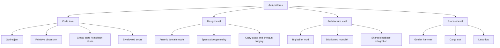
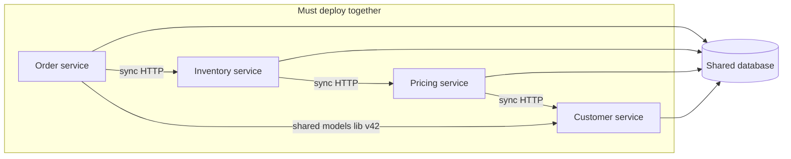

# Common Anti-Patterns

## Introduction

A **design pattern** is a proven solution to a recurring problem. An **anti-pattern** is a recurring "solution" that looks reasonable at the time but causes more problems than it solves. The term was popularized by the 1998 book *AntiPatterns* by Brown, Malveau, McCormick and Mowbray. What makes something an anti-pattern rather than just a mistake is that it is **common and tempting**. Smart people fall into it for understandable reasons, usually time pressure, a half-remembered best practice, or code that grew one reasonable change at a time.

Each anti-pattern on this page comes with:

- what it looks like, with code where it helps
- why teams fall into it, because blaming people does not prevent the next one
- how to get out, and when the "anti-pattern" is actually acceptable

A medical analogy fits. Symptoms (slow tests, scary deployments, bugs that keep coming back) point to an underlying condition (a god object, global state, a distributed monolith). Naming the condition is what lets a team agree on a treatment.



## Code-Level Anti-Patterns

### God object

**What it looks like:** one class that knows and does too much. In a bookstore, `ShopManager` loads books, validates carts, calculates tax, charges cards, sends emails and generates reports.

```python
class ShopManager:
    def __init__(self, db, smtp, payment_client, tax_table, cache): ...
    def add_to_cart(self, user_id, isbn, qty): ...
    def calculate_tax(self, cart, country): ...
    def apply_coupon(self, cart, code): ...
    def charge_card(self, user_id, amount): ...
    def send_receipt(self, user_id, order_id): ...
    def monthly_sales_report(self, month): ...
    def reindex_search(self): ...
    # ...80 more methods, 4,000 lines
```

**Why it happens:** the class started small, and adding "just one more method" to the class everyone already uses was always the fastest change.

**Symptoms:** every feature touches the same file, merge conflicts are constant, and tests need to construct all five dependencies even to test tax.

**Fix:** split by responsibility and by reason to change, following the [Single Responsibility Principle](../1-arch-design-principles/1-arch-single-responsibility.mdx). `CartService`, `TaxCalculator`, `PaymentGateway`, `ReceiptMailer` and `SalesReport` each take only what they need. Do it gradually: extract one cohesive group of methods at a time, as shown on the [Refactoring to Patterns](./8-arch-refactoring-to-patterns.mdx) page.

**When it is acceptable:** a small script or a [Facade](../3-arch-structural-patterns/4-arch-facade.mdx) that only *delegates* to other objects. A facade with many methods is not a god object if it contains no logic.

### Primitive obsession

**What it looks like:** domain concepts represented by raw `str`, `int` or `float`. Money is the classic case:

```python
prices = [0.10, 0.20]
total = sum(prices)
print(total, total == 0.30)
print(round(2.675, 2))         # expected 2.68
```

Output:

```text
0.30000000000000004 False
2.67
```

Binary floating point cannot represent most decimal fractions exactly, so money in `float` produces off-by-a-cent errors. Nothing stops you from adding euros to dollars either, or passing a customer ID where an order ID was expected.

**Fix:** a small [value object](../8-arch-domain-driven-design/3-arch-entities-and-value-objects.mdx) that owns the rules.

```python
from __future__ import annotations

from dataclasses import dataclass
from decimal import ROUND_HALF_UP, Decimal


@dataclass(frozen=True)
class Money:
    amount: Decimal
    currency: str

    @classmethod
    def of(cls, amount: str, currency: str) -> Money:
        return cls(Decimal(amount), currency)

    def __add__(self, other: Money) -> Money:
        if other.currency != self.currency:
            raise ValueError(f"cannot add {other.currency} to {self.currency}")
        return Money(self.amount + other.amount, self.currency)

    def rounded(self) -> Money:
        return Money(self.amount.quantize(Decimal("0.01"), ROUND_HALF_UP), self.currency)


a = Money.of("0.10", "EUR") + Money.of("0.20", "EUR")
print(a, a == Money.of("0.30", "EUR"))
print(Money.of("2.675", "EUR").rounded().amount)
try:
    Money.of("1", "EUR") + Money.of("1", "USD")
except ValueError as exc:
    print("blocked:", exc)
```

Output:

```text
Money(amount=Decimal('0.30'), currency='EUR') True
2.68
blocked: cannot add USD to EUR
```

For lighter cases, `typing.NewType("OrderId", str)` lets a type checker catch mixed-up IDs at zero runtime cost. Storing money as integer cents, as other pages in this tutorial do, is also a sound choice when one currency is involved.

**When it is acceptable:** internal, short-lived values with no rules attached. Not every string needs a class.

### Global state and singleton abuse

**What it looks like:** a [Singleton](../2-arch-creational-patterns/1-arch-singleton.mdx) or module-level variable that code anywhere can read and change.

```python
class Config:
    _instance: "Config | None" = None

    def __init__(self) -> None:
        self.free_shipping_cents = 3000

    @classmethod
    def get(cls) -> "Config":
        if cls._instance is None:
            cls._instance = Config()
        return cls._instance


def ships_free(total_cents: int) -> bool:
    return total_cents >= Config.get().free_shipping_cents


def test_promo_threshold() -> None:
    Config.get().free_shipping_cents = 1000      # changes global state...
    assert ships_free(1500)


def test_default_threshold() -> None:
    assert not ships_free(1500), "fails only when run after test_promo_threshold"


test_default_threshold()
test_promo_threshold()
try:
    test_default_threshold()
except AssertionError as exc:
    print("FAILED:", exc)
```

Output:

```text
FAILED: fails only when run after test_promo_threshold
```

The same test passes or fails depending on what ran before it. In production, the equivalent bug is one request changing a setting that leaks into another.

**Fix:** pass dependencies in. Create configuration once at startup, make it immutable, and inject it, as described on the [Dependency Injection](../1-arch-design-principles/10-arch-dependency-injection.mdx) page.

```python
from dataclasses import dataclass


@dataclass(frozen=True)
class ShippingPolicy:
    free_shipping_cents: int = 3000


def ships_free(total_cents: int, policy: ShippingPolicy) -> bool:
    return total_cents >= policy.free_shipping_cents


assert ships_free(1500, ShippingPolicy(free_shipping_cents=1000))
assert not ships_free(1500, ShippingPolicy())
print("both tests pass in any order")
```

Output:

```text
both tests pass in any order
```

**When it is acceptable:** truly global, read-only, stateless things such as a logger obtained with `logging.getLogger(__name__)`, or constants.

### Swallowed errors

**What it looks like:** `except Exception: pass`, or logging and returning `None`. Bugs then look like ordinary business failures. The [Result Types and Error Handling Patterns](./6-arch-result-type.mdx) page shows a full example and the fixes: catch specific exceptions, catch at boundaries, and let bugs crash loudly.

## Design-Level Anti-Patterns

### Anemic domain model

Martin Fowler named this one in a [2003 bliki post](https://martinfowler.com/bliki/AnemicDomainModel.html). The domain objects have names and fields but no behavior, and all rules live in "service" classes. The objects cannot protect their own invariants:

```python
from dataclasses import dataclass, field


# ---- anemic: data bag + rules somewhere else ----
@dataclass
class Order:
    status: str = "open"
    lines: list[tuple[str, int]] = field(default_factory=list)


class OrderService:
    def add_line(self, order: Order, isbn: str, qty: int) -> None:
        if order.status != "open":
            raise ValueError("order is closed")
        order.lines.append((isbn, qty))


order = Order()
OrderService().add_line(order, "978-0", 1)
order.status = "shipped"
order.lines.append(("978-1", 99))        # nothing stops this bypass
print(order)
```

Output:

```text
Order(status='shipped', lines=[('978-0', 1), ('978-1', 99)])
```

The rule "no changes after shipping" exists, but any code can walk around it. Moving behavior onto the object closes the gap:

```python
from dataclasses import dataclass, field


@dataclass
class Order:
    _status: str = "open"
    _lines: list[tuple[str, int]] = field(default_factory=list)

    def add_line(self, isbn: str, qty: int) -> None:
        if self._status != "open":
            raise ValueError("order is closed")
        if qty < 1:
            raise ValueError("qty must be positive")
        self._lines.append((isbn, qty))

    def ship(self) -> None:
        if not self._lines:
            raise ValueError("cannot ship an empty order")
        self._status = "shipped"

    @property
    def lines(self) -> tuple[tuple[str, int], ...]:
        return tuple(self._lines)      # read-only view for callers


order = Order()
order.add_line("978-0", 1)
order.ship()
try:
    order.add_line("978-1", 99)
except ValueError as exc:
    print("blocked:", exc)
print(order.lines)
```

Output:

```text
blocked: order is closed
(('978-0', 1),)
```

**A fair counterpoint:** not every system needs a rich domain model. Fowler's own *Patterns of Enterprise Application Architecture* presents **Transaction Script** (procedures that each handle one request) as a good fit for simple logic. Functional designs also separate data from functions deliberately, using immutable data and pure functions, as on the [Functional Patterns](./5-arch-functional-patterns.mdx) page. The anti-pattern is paying for a domain model's machinery (ORM entities, repositories, layers) while getting none of its benefits, because invariants are still unprotected.

### Speculative generality and premature abstraction

**What it looks like:** abstractions for needs nobody has yet. An `AbstractPaymentProviderFactory` with one implementation, a plugin system with one plugin, configuration options nobody sets.

```python
class PaymentProvider(ABC): ...                    # one implementation exists
class PaymentProviderFactory(ABC): ...             # one factory exists
class DefaultPaymentProviderFactory(PaymentProviderFactory): ...
class PaymentProviderFactoryRegistry: ...          # registers the one factory
```

**Why it happens:** good intentions, "we might add PayPal later", and the belief that more patterns mean better design. *Speculative Generality* is one of the code smells in Fowler's *Refactoring*, and YAGNI ("You Aren't Gonna Need It") is the principle against it. See [DRY, KISS and YAGNI](../1-arch-design-principles/6-arch-dry-kiss-yagni.mdx).

**Fix:** delete the layers and use the concrete class. When the second provider really arrives, extract an interface then, with two real examples to guide its shape. **Rule of three:** many developers wait until the third duplication before abstracting, because by then the real variation is visible.

**When an early abstraction is justified:** at a real boundary you already know is volatile or must be faked in tests, such as an external payment API, a clock or a message broker.

### Copy-paste programming and shotgun surgery

**What it looks like:** the same logic pasted in several places. When a rule changes, you edit five files (shotgun surgery) and miss the sixth. The free-shipping rule on the [Specification Pattern](./3-arch-specification-pattern.mdx) page that drifted to `>=` in one copy and `>` in another is this anti-pattern.

**Fix:** extract the rule to one named function, class or specification. But be careful with the opposite mistake. Two pieces of code that *look* alike but change for different reasons should stay separate. DRY is about knowledge, not identical characters.

## Architecture-Level Anti-Patterns

### Big ball of mud

Brian Foote and Joseph Yoder described the **Big Ball of Mud** in a paper presented at the PLoP '97 conference ([laputan.org/mud](http://www.laputan.org/mud/)): a system with no recognizable structure, shaped by expedience, quick fixes and piecemeal growth. Their honest observation is that it is the most common architecture in practice, and that it exists for real reasons: deadlines, changing requirements and turnover.

**Symptoms:** any module imports any other, there are no clear boundaries, nobody can explain where a feature "lives", and every change has surprising side effects.

**Ways out:**

- Draw boundaries and enforce them with tools. Import-linter for Python, ArchUnit for Java, or a [fitness function](../13-arch-documenting-and-evolving/3-arch-fitness-functions.mdx) in CI.
- Move toward a [modular monolith](../6-arch-architectural-styles/3-arch-modular-monolith.mdx) one module at a time.
- Use the [Strangler Fig](../9-arch-distributed-systems/11-arch-strangler-fig.mdx) approach for parts that need rewriting.

### Distributed monolith

**What it looks like:** a system split into "microservices" that still have to be built, tested and deployed together. They share a database, call each other synchronously in long chains, and share a library of domain models that forces lockstep upgrades.



You pay the costs of distribution (network failures, latency, harder debugging, many pipelines) and keep the coupling of a monolith. An outage in `Customer service` takes down ordering, because every call chain passes through it.

**Why it happens:** splitting along technical layers or database tables instead of business capabilities, and adopting microservices before the domain boundaries were understood.

**Fixes:** merge services that always change together back into one deployable unit. Give each remaining service its own data, as described on the [Database per Service](../11-arch-data-architecture/0-arch-database-per-service.mdx) page. Replace synchronous chains with asynchronous events where the business allows it. Today's mainstream advice for most teams is to start with a well-structured [modular monolith](../6-arch-architectural-styles/3-arch-modular-monolith.mdx) and extract services only when a clear need appears, such as independent scaling, team autonomy or different release cadences.

### Shared database as integration

**What it looks like:** several applications read and write the same tables directly. It is quick at first, but then nobody can rename a column without coordinating five teams, and business rules are bypassed by whichever app writes directly.

**When it is acceptable:** within a single deployable application, or with read-only reporting replicas that are clearly owned by one team. Across independently developed services, prefer APIs or events.

## Process-Level Anti-Patterns

- **Golden hammer.** "If all you have is a hammer, everything looks like a nail." Using the familiar tool for every problem: Kafka for a queue of ten messages a day, Kubernetes for one small app, a graph database because the last project used one. Fix: write down the requirements first and compare at least two options, ideally in an [ADR](../13-arch-documenting-and-evolving/0-arch-decision-records.mdx).
- **Cargo cult.** Copying the visible practices of successful companies (microservices, monorepos, event sourcing) without their context or problems. Fix: ask "what problem did this solve for them, and do we have that problem?"
- **Lava flow.** Dead or experimental code that hardened into production because nobody dares to remove it. Fix: tests plus coverage data, feature flags with expiry dates, and regular deletion as a normal engineering activity.
- **Design by committee and analysis paralysis.** Endless debate with no decision. Fix: time-boxed decisions with a named owner, recorded in an ADR and revisited when the facts change.

## Real-World Scenario

You join a 15-person team running a SaaS helpdesk. Customers complain about slow feature delivery. A quick review finds a 6,000-line `TicketManager` god class, settings in a mutable singleton, three services that share one PostgreSQL database and always deploy together, and a `NotificationProviderFactoryFactory` with a single SMTP implementation.

**The solution, prioritized by pain rather than by purity:**

1. **Measure first.** Use git history to find hotspots, the files that change most often and have the most bugs. `TicketManager` is one, so it comes first. The unused factory hierarchy is ugly but rarely touched, so it waits.
2. **Make the tests trustworthy.** Replace the mutable settings singleton with an immutable config object injected at startup. Flaky, order-dependent tests disappear.
3. **Split the god class gradually.** Extract `SlaCalculator`, `AssignmentPolicy` and `TicketNotifier` one at a time behind characterization tests, as the next page explains.
4. **Merge the distributed monolith.** The three services always deploy together, so combine them into one modular monolith with enforced module boundaries. Revisit extraction later if a module genuinely needs independent scaling.
5. **Delete the speculative factories** while touching the notification code anyway.

**Why this approach:** anti-pattern fixes cost time. Fixing the ones that slow the team down most, in small safe steps, delivers value early and builds trust for the rest.

**When to fix an anti-pattern:**

- it sits in a hotspot that changes often
- it causes real incidents, flaky tests or slow delivery
- you are touching the code anyway (the "boy scout rule": leave it a little cleaner)

**When to leave it alone:**

- stable code that rarely changes and works
- code scheduled for deletion or replacement
- when the fix needs a big-bang rewrite with no safety net

**Alternatives and trade-offs:**

| Approach | Pros | Cons | Best for |
| --- | --- | --- | --- |
| Ignore it | No immediate cost | Interest compounds | Stable, rarely touched code |
| Opportunistic cleanup | Low risk, continuous | Slow for large problems | Most code-level anti-patterns |
| Planned refactoring | Focused, measurable | Competes with features for time | Hotspot god classes, global state |
| Strangler Fig replacement | Incremental, reversible | Two systems run in parallel for a while | Big balls of mud, legacy modules |
| Big-bang rewrite | Fresh start | High risk, often late, loses hidden knowledge | Rarely; tiny systems only |

## Best Practices

1. **Name anti-patterns without blame.** Most are rational responses to past pressures. Naming the problem should start a fix, not an argument.
2. **Prioritize by hotspots.** Combine change frequency with complexity or bug count, and work on the top of that list. The [Technical Debt](../0-arch-fundamentals/8-arch-technical-debt.mdx) page covers how to track it.
3. **Prevent with automation.** Linters, type checkers, architecture tests and complexity budgets in CI catch drift before it becomes mud.
4. **Do not overcorrect.** The cure for a god object is not 200 one-method classes, and the cure for primitive obsession is not wrapping every string.
5. **Refactor in small, tested steps.** The next page shows how.

## Summary

- An **anti-pattern** is a common, tempting solution that causes more problems than it solves.
- Code level: **god object**, **primitive obsession**, **global state**, **swallowed errors**.
- Design level: **anemic domain model** (fair when logic really is simple), **speculative generality**, **copy-paste and shotgun surgery**.
- Architecture level: **big ball of mud**, **distributed monolith**, **shared database integration**.
- Process level: **golden hammer**, **cargo cult**, **lava flow**, **analysis paralysis**.
- Fix anti-patterns where they hurt most, in small safe steps, and prevent new ones with automated checks.

## Exercises

1. Pick the largest class in a codebase you know. List its methods and group them by reason to change. How many classes would you split it into?
2. Replace a `float` price in a small program with the `Money` value object and add a test for currency mismatch.
3. Draw the dependency graph of a system you know. Which services always deploy together? Would merging them simplify things?
4. Find one abstraction with exactly one implementation. Argue for keeping it or deleting it, using the criteria from this page.

**Next steps:**

- [Refactoring to Patterns](./8-arch-refactoring-to-patterns.mdx) to fix these safely, step by step
- [Technical Debt](../0-arch-fundamentals/8-arch-technical-debt.mdx) for tracking and prioritizing
- [Modular Monolith](../6-arch-architectural-styles/3-arch-modular-monolith.mdx) as the common escape from both the big ball of mud and the distributed monolith
