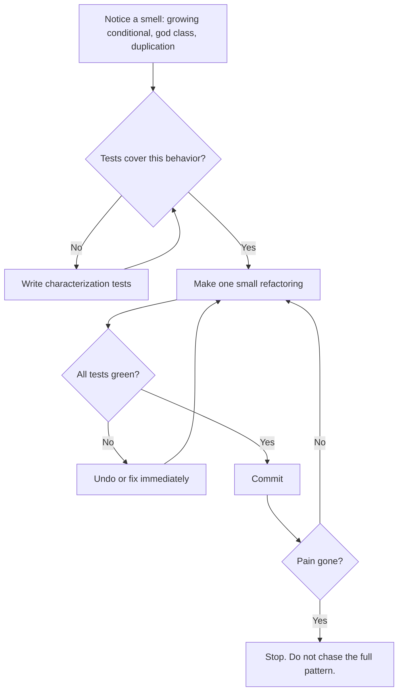
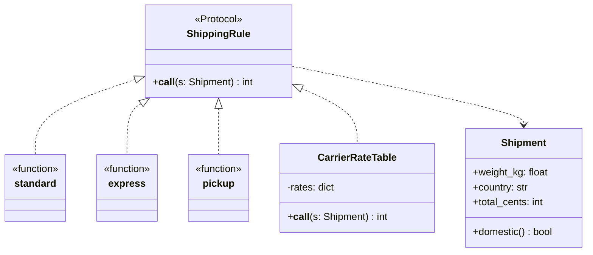

# Refactoring to Patterns

## Introduction

The previous pages and sections taught many patterns. A natural but risky reaction is to design them all in up front: "this will need a Strategy, a Factory and an Observer". That road leads to the speculative generality described on the [Common Anti-Patterns](./7-arch-anti-patterns.mdx) page.

There is a better route. Write the simplest code that works. When it starts to hurt, because a conditional keeps growing or a class does too much, **refactor toward a pattern in small, safe steps**, and stop as soon as the pain is gone.

Joshua Kerievsky's book *Refactoring to Patterns* (2004) is built on this idea. It connects the GoF patterns to the step-by-step refactorings in Martin Fowler's *Refactoring* (second edition 2018, catalog at [refactoring.com](https://refactoring.com/catalog/)). Kerievsky makes three points worth remembering:

- You can refactor **to** a pattern (all the way), **towards** a pattern (part way, stopping when the design is good enough), or **away from** a pattern (removing one that no longer pays for itself).
- Patterns are destinations. Refactorings are the safe roads that lead there.
- Each step keeps the code working, with tests passing.

Some refactorings from his catalog ([industriallogic.com](https://www.industriallogic.com/refactoring-to-patterns/catalog/)) that you will recognize from this tutorial:

| Refactoring | Target pattern |
| --- | --- |
| Replace Conditional Logic With Strategy | [Strategy](../4-arch-behavioral-patterns/0-arch-strategy.mdx) |
| Replace State-Altering Conditionals with State | [State](../4-arch-behavioral-patterns/3-arch-state.mdx) |
| Move Embellishment To Decorator | [Decorator](../3-arch-structural-patterns/3-arch-decorator.mdx) |
| Replace Conditional Dispatcher With Command | [Command](../4-arch-behavioral-patterns/2-arch-command.mdx) |
| Replace Hard-Coded Notifications With Observer | [Observer](../4-arch-behavioral-patterns/1-arch-observer.mdx) |
| Form Template Method | [Template Method](../4-arch-behavioral-patterns/4-arch-template-method.mdx) |
| Introduce Null Object | [Null Object](./4-arch-null-object.mdx) |
| Replace Constructors With Creation Methods | [Factory Method](../2-arch-creational-patterns/2-arch-factory-method.mdx) |
| Encapsulate Composite With Builder | [Builder](../2-arch-creational-patterns/4-arch-builder.mdx) |
| Inline Singleton | Away from [Singleton](../2-arch-creational-patterns/1-arch-singleton.mdx) |

An analogy: renovating a house while living in it. You do not demolish the whole building and live in a tent. You redo one room at a time, and the plumbing works every evening.

## The Refactoring Loop



Three habits make this loop safe:

1. **A safety net first.** No tests, no refactoring.
2. **Tiny steps.** Each step is small enough that if tests fail, the cause is obvious. Commit after each green step.
3. **Refactoring and feature work never mix in one step.** First reshape the code with behavior unchanged, then add the feature. Kent Beck's advice sums it up: make the change easy, then make the easy change.

## Smells That Point to Patterns

Code smells, cataloged in Fowler's *Refactoring*, are surface hints that a deeper problem may exist. They tell you where to look, not what to do.

| Smell | What you see | Often refactored toward |
| --- | --- | --- |
| Repeated switches | The same `if/elif` on a type code in several places | Strategy, State, polymorphism, or a dict of functions |
| Long function | One function doing many steps | Compose Method (extracted, well-named helpers) |
| Large class | A god object | Extract Class, Facade over the new pieces |
| Primitive obsession | Money as `float`, IDs as bare `str` | Value objects |
| Shotgun surgery | One change touches many files | Move function, consolidate into one module |
| Divergent change | One class changes for many reasons | Extract Class per reason |
| Speculative generality | Abstractions with one user | Inline, collapse hierarchy, **away** from a pattern |
| Embellishments | Optional extras (logging, caching) mixed into core logic | Decorator |

## Worked Example: Replace Conditional Logic With Strategy

An online bookstore calculates shipping. The code works, but every new shipping method makes the conditional longer, and a new requirement is coming: a freight carrier whose rates come from a price list.

### Step 0: The starting point

```python
# shipping.py
def shipping_cost(method: str, weight_kg: float, country: str, total_cents: int) -> int:
    if method == "standard":
        if total_cents >= 3000 and country == "DE":
            return 0
        cost = 499 + int(weight_kg * 50)
        if country != "DE":
            cost += 800
        return cost
    elif method == "express":
        cost = 1299 + int(weight_kg * 100)
        if country != "DE":
            cost += 1500
        return cost
    elif method == "pickup":
        return 0
    else:
        raise ValueError(f"unknown method {method}")
```

Smells: a conditional dispatcher on a type code (`method`), repeated "is it domestic?" checks, and four loosely related parameters that always travel together.

### Step 1: Build the safety net with characterization tests

A **characterization test** records what the code does *now*, not what a spec says it should do. Michael Feathers introduced the term in *Working Effectively with Legacy Code*. You call the function with representative inputs, including edge cases such as the free-shipping threshold, and pin down the outputs.

```python
# test_shipping.py
import pytest

from shipping import shipping_cost

# Expected values were recorded from the current code, not from a spec.
CASES = [
    ("standard", 1.0, "DE", 1000, 549),
    ("standard", 1.0, "DE", 3000, 0),      # free-shipping threshold
    ("standard", 2.0, "FR", 5000, 1399),   # no free shipping abroad
    ("express", 1.5, "DE", 1000, 1449),
    ("express", 1.5, "FR", 1000, 2949),
    ("pickup", 9.0, "FR", 100, 0),
]


@pytest.mark.parametrize("method,weight,country,total,expected", CASES)
def test_current_behavior(method: str, weight: float, country: str,
                          total: int, expected: int) -> None:
    assert shipping_cost(method, weight, country, total) == expected


def test_unknown_method_raises() -> None:
    with pytest.raises(ValueError):
        shipping_cost("drone", 1.0, "DE", 1000)
```

```bash
pip install pytest
pytest -q test_shipping.py
```

Example output:

```text
7 passed in 0.01s
```

:::tip
If the current behavior looks wrong, for example free shipping at exactly 30.00 when you expected above 30.00, **still pin it** and write a note. Fixing a bug is a behavior change, so it goes in a separate, deliberate commit, not in the middle of a refactoring.
:::

### Step 2: Extract a function per branch (Compose Method)

Move each branch body into its own function without changing logic. The dispatcher stays.

```python
# shipping.py
def _standard(weight_kg: float, country: str, total_cents: int) -> int:
    if total_cents >= 3000 and country == "DE":
        return 0
    cost = 499 + int(weight_kg * 50)
    if country != "DE":
        cost += 800
    return cost


def _express(weight_kg: float, country: str, total_cents: int) -> int:
    cost = 1299 + int(weight_kg * 100)
    if country != "DE":
        cost += 1500
    return cost


def _pickup(weight_kg: float, country: str, total_cents: int) -> int:
    return 0


def shipping_cost(method: str, weight_kg: float, country: str, total_cents: int) -> int:
    if method == "standard":
        return _standard(weight_kg, country, total_cents)
    elif method == "express":
        return _express(weight_kg, country, total_cents)
    elif method == "pickup":
        return _pickup(weight_kg, country, total_cents)
    else:
        raise ValueError(f"unknown method {method}")
```

Example output of `pytest -q`:

```text
7 passed in 0.01s
```

Notice that all three helpers now share **the same signature**. That is the moment a Strategy becomes possible: interchangeable pieces with one interface.

### Step 3: Replace the dispatcher with a lookup table

```python
# shipping.py (helpers unchanged from step 2)
from collections.abc import Callable

type ShippingRule = Callable[[float, str, int], int]

RULES: dict[str, ShippingRule] = {
    "standard": _standard,
    "express": _express,
    "pickup": _pickup,
}


def shipping_cost(method: str, weight_kg: float, country: str, total_cents: int) -> int:
    try:
        rule = RULES[method]
    except KeyError:
        raise ValueError(f"unknown method {method}") from None
    return rule(weight_kg, country, total_cents)
```

Example output of `pytest -q`:

```text
7 passed in 0.01s
```

The conditional is gone. Adding a method is now one function plus one dict entry, which is the [Open/Closed Principle](../1-arch-design-principles/2-arch-open-closed.mdx) at small scale. This is already the Strategy pattern in its Python form, as described on the [Design Patterns in Modern Languages](./0-arch-patterns-in-modern-languages.mdx) page. **If the pain is gone, stop here.** That is refactoring *towards* a pattern.

### Step 4: Introduce a parameter object and a Protocol

Four parameters that always travel together are a "data clump" smell. *Introduce Parameter Object* gives them a name and a home for the repeated domestic check. A `Protocol` documents the strategy interface and lets callable classes participate later.

```python
# shipping.py
from dataclasses import dataclass
from typing import Protocol

HOME = "DE"


@dataclass(frozen=True)
class Shipment:
    weight_kg: float
    country: str
    total_cents: int

    @property
    def domestic(self) -> bool:
        return self.country == HOME


class ShippingRule(Protocol):
    def __call__(self, s: Shipment) -> int: ...


def standard(s: Shipment) -> int:
    if s.domestic and s.total_cents >= 3000:
        return 0
    return 499 + int(s.weight_kg * 50) + (0 if s.domestic else 800)


def express(s: Shipment) -> int:
    return 1299 + int(s.weight_kg * 100) + (0 if s.domestic else 1500)


def pickup(s: Shipment) -> int:
    return 0


RULES: dict[str, ShippingRule] = {"standard": standard, "express": express, "pickup": pickup}


def shipping_cost(method: str, weight_kg: float, country: str, total_cents: int) -> int:
    """Old signature kept so existing callers keep working."""
    rule = RULES.get(method)
    if rule is None:
        raise ValueError(f"unknown method {method}")
    return rule(Shipment(weight_kg, country, total_cents))
```

Example output of `pytest -q`:

```text
7 passed in 0.01s
```

The public `shipping_cost` signature did not change, so no caller had to change either. Callers can migrate to the `Shipment`-based API later, one at a time.

Here is what the safety net does if a step goes wrong. Suppose that while rewriting `standard` you typed `>` instead of `>=`:

```text
FAILED test_shipping.py::test_current_behavior[standard-1.0-DE-3000-0] - Asse...
1 failed, 6 passed in 0.01s
```

The test names the exact case, and because the step was small, the cause is obvious.

### Step 5: Now add the feature

With the design reshaped, the new freight carrier is easy. It needs state (a rate table), so it is a callable class, and it fits the same `ShippingRule` protocol:

```python
from shipping import RULES, Shipment, shipping_cost


class CarrierRateTable:
    """A stateful rule: rates come from a carrier's price list."""

    def __init__(self, rates_per_kg: dict[str, int]) -> None:
        self._rates = rates_per_kg          # in real life: loaded and cached

    def __call__(self, s: Shipment) -> int:
        rate = self._rates.get(s.country)
        if rate is None:
            raise ValueError(f"carrier does not ship to {s.country}")
        return 299 + int(s.weight_kg * rate)


RULES["freight"] = CarrierRateTable({"DE": 120, "FR": 180})

print(shipping_cost("freight", 10.0, "FR", 20000))
print(shipping_cost("standard", 1.0, "DE", 1000))
```

Output:

```text
2099
549
```

The final shape:



Count what happened: four refactoring steps, each verified by the same seven tests, then one small feature. At no point was the code broken, and at every step you could have stopped and shipped.

## Refactoring Away From a Pattern

Patterns that no longer earn their keep should be removed with the same care. Kerievsky's **Inline Singleton** is the classic example. A singleton clock hides a dependency and makes time-based logic hard to test:

```python
from datetime import datetime, timezone


# Before: a hidden dependency on a global clock singleton
class Clock:
    _instance: "Clock | None" = None

    @classmethod
    def instance(cls) -> "Clock":
        if cls._instance is None:
            cls._instance = cls()
        return cls._instance

    def now(self) -> datetime:
        return datetime.now(timezone.utc)


def is_sale_active_before(end: datetime) -> bool:
    return Clock.instance().now() < end


# After: Inline Singleton. The caller passes the time in.
def is_sale_active(end: datetime, now: datetime) -> bool:
    return now < end


end = datetime(2026, 11, 30, tzinfo=timezone.utc)
print(is_sale_active(end, now=datetime(2026, 11, 29, tzinfo=timezone.utc)))
print(is_sale_active(end, now=datetime(2026, 12, 1, tzinfo=timezone.utc)))
```

Output:

```text
True
False
```

The function is now pure and trivially testable. Only the outermost layer reads the real clock. Other common "away" moves:

- collapse an interface with one implementation into the concrete class (speculative generality)
- replace a one-method Strategy class hierarchy with plain functions
- inline a Factory that always creates the same class
- remove an Observer setup with exactly one, fixed listener in favor of a direct call

## Real-World Scenario

Your team runs a SaaS helpdesk. Ticket status handling lives in one 700-line `update_ticket()` function full of checks like `if ticket.status == "pending" and actor.is_agent and not ticket.sla_paused`. Product wants a new "waiting on third party" status. The last two status changes each caused a production incident.

**The solution:**

1. **Characterize first.** Write table-driven tests capturing current transitions: from each status, for each action and actor type, what is the resulting status and which side effects fire (emails, SLA timers). Use production logs to find realistic combinations. This takes a day and finds two existing bugs, which are recorded and fixed separately.
2. **Compose Method.** Extract helpers such as `can_reopen()`, `pause_sla()` and `notify_requester()`, with tests green after each extraction.
3. **Move towards State.** Introduce a transition table: `TRANSITIONS: dict[tuple[Status, Action], Status]`, and make `update_ticket` look up the next status. For many teams this is enough.
4. **Go fully to State only where needed.** Two statuses have genuinely different behavior (SLA pausing, auto-close timers), so they get small state objects. The rest stay as table entries.
5. **Add the feature.** "Waiting on third party" becomes a new enum value, a few table rows and one state object, reviewed in a small pull request.

**Why this approach:** the risk was in changing behavior nobody fully understood. Characterization tests made the behavior explicit, and small steps meant every intermediate version was deployable.

**When to refactor to patterns:**

- the same conditional or duplication keeps growing with each feature
- an upcoming feature would be hard to add to the current shape
- the code is a hotspot that changes often
- you have, or can build, a safety net of tests

**When not to:**

- code that is stable and rarely changes. Leave it alone.
- right before a deadline without tests. Add tests first, or postpone.
- to reach a pattern for its own sake. Stop when the pain is gone.
- when a rewrite is truly cheaper because the code is small and well understood. Even then, keep the characterization tests.

**Alternatives and trade-offs:**

| Approach | Pros | Cons | Best for |
| --- | --- | --- | --- |
| Patterns designed up front | Structure visible early | Often wrong guesses, speculative generality | Well-understood, stable domains |
| Keep patching the conditional | Fastest today | Complexity and risk grow with each change | Code about to be deleted |
| Refactor towards a pattern in small steps | Safe, stops at "good enough" | Needs tests and discipline | Most growing code |
| Refactor fully to the pattern | Clean extension points | More classes, can overshoot | Hotspots with real, varied behavior |
| Rewrite the module | Fresh design | Risk of losing hidden behavior | Small modules with good tests |

## Best Practices

1. **Tests before refactoring, always.** Characterization tests are fine. Pin today's behavior, including oddities.
2. **One refactoring per commit.** Small commits make review easy and bisecting trivial.
3. **Keep behavior and structure changes separate.** A pull request either refactors or changes behavior, not both.
4. **Use your tools.** IDE automated refactorings (rename, extract function, inline, change signature) are safer than hand edits. A type checker such as mypy catches missed call sites.
5. **Preserve public signatures while migrating.** Keep the old entry point delegating to the new design, as `shipping_cost` did, and remove it once callers have moved.
6. **Stop early.** "Towards" a pattern is often the best destination.
7. **Refactor away, too.** Deleting an abstraction that no longer pays is as valuable as adding one.

## Summary

- Prefer **evolving** into patterns over designing them in up front. Let real pain, visible as code smells, tell you which pattern is needed.
- Kerievsky's framing: refactor **to**, **towards** or **away from** a pattern, using Fowler's small, behavior-preserving refactorings.
- Start with **characterization tests**, move in **tiny steps**, keep tests green, and commit after each step.
- A typical path: Compose Method, then a lookup table of functions (Strategy in Python), then a parameter object and a Protocol, then the new feature.
- **Inline Singleton** and similar refactorings remove patterns that no longer earn their keep.
- Stop when the pain is gone, and never mix refactoring with behavior changes.

## Exercises

1. Add a "same-day courier" method that costs a flat 1999 cents and is only available in Berlin postcodes. Decide whether `Shipment` needs a new field, and keep all characterization tests green.
2. Take the "before" order code from the [Common Anti-Patterns](./7-arch-anti-patterns.mdx) page, write characterization tests, and refactor it towards a rich domain model in at least three committed steps.
3. Find a conditional on a type code in a project you know. Write characterization tests for it and refactor it into a dict of functions. Did you need to go further?
4. Find a singleton or a one-implementation interface in a project you know and apply an "away" refactoring. What became easier to test?

**Next steps:**

- [Architectural Styles Overview](../6-arch-architectural-styles/0-arch-styles-overview.mdx) to apply the same thinking at system scale
- [Strangler Fig Migration](../9-arch-distributed-systems/11-arch-strangler-fig.mdx), refactoring towards a new architecture while the old one keeps running
- [Technical Debt](../0-arch-fundamentals/8-arch-technical-debt.mdx) for deciding which refactorings are worth doing
