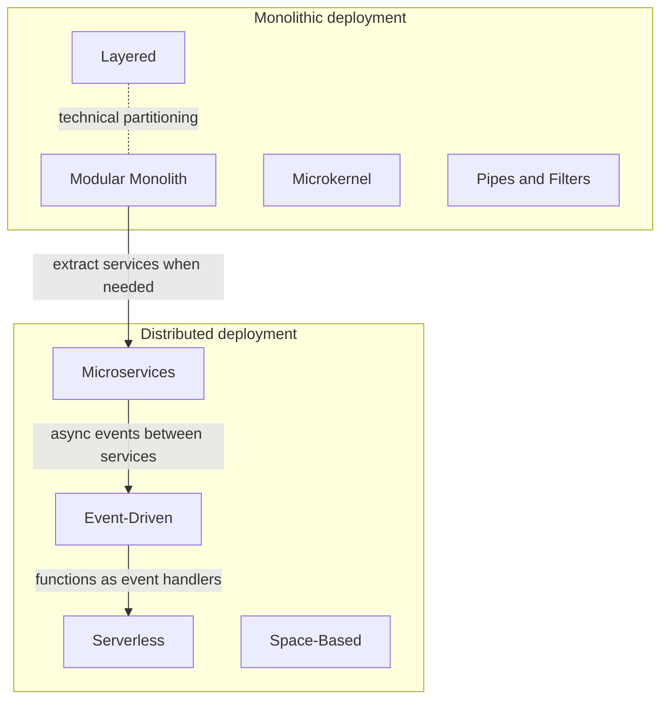
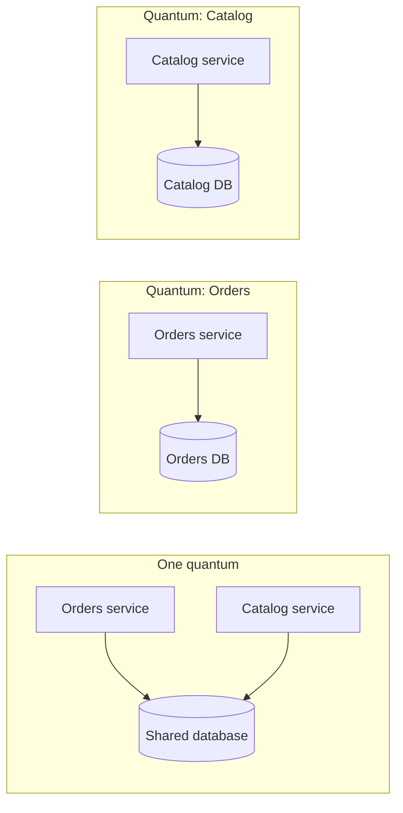
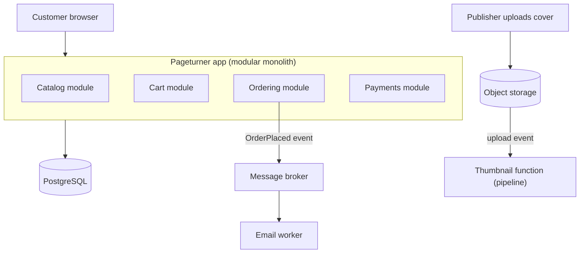

# Architectural Styles Overview

## Introduction

In the earlier sections you learned design patterns such as [Strategy](../4-arch-behavioral-patterns/0-arch-strategy.mdx) and [Repository](../5-arch-modern-patterns/1-arch-repository-pattern.mdx). Those patterns shape a few classes. An **architectural style** shapes the whole system. It decides:

- what the big building blocks are (layers, services, functions, plugins, filters)
- how those blocks talk to each other (in-process calls, HTTP, events, shared memory)
- how the system is deployed (one unit or many)
- where the data lives and who owns it

An analogy helps. A design pattern is like a type of joint a carpenter uses: a dovetail, a mortise and tenon. An architectural style is like the type of building: a single-family house, an apartment block, a campus of separate buildings. You can use dovetail joints in any of them, but the building type decides how people move around, how you add a room, and what happens when the plumbing fails.

This section walks through the styles you will meet most often in real projects. This page gives you the map. The following pages go deep on each style, and the last page helps you choose.

## Style vs Pattern vs Architecture

These three words get mixed up all the time, so let us pin them down.

| Term | Scope | Example | Question it answers |
| --- | --- | --- | --- |
| Design pattern | A few classes or functions | Observer, Factory Method | "How do I structure this piece of code?" |
| Architectural pattern | One recurring system-level problem | Circuit Breaker, CQRS, API Gateway | "How do I solve this specific system concern?" |
| Architectural style | The whole system's shape | Layered, Microservices, Event-Driven | "What kind of system is this?" |
| Architecture | Your actual system | "Our bookstore: modular monolith plus a queue" | "What did we build, and why?" |

The Azure Architecture Center describes an architecture style as "a family of architectures that share specific characteristics", and frames each style as a set of **constraints**: which elements may appear and which relationships between them are allowed ([Azure: Architecture styles](https://learn.microsoft.com/en-us/azure/architecture/guide/architecture-styles/)). That framing is useful. A style is not a technology. It is a set of rules you accept in exchange for certain properties.

For example, microservices impose constraints like "each service owns its data and no other service touches it". If you follow that rule, you get independent deployment and fault isolation. If you break it (two services sharing tables), you keep the costs of microservices but lose most of the benefits.

:::tip
Most real systems mix styles. A modular monolith might use layers inside each module, publish events to a queue, and run a few serverless functions for image resizing. The style names give you a vocabulary for each part.
:::

## Two Big Questions That Split the Styles

"Fundamentals of Software Architecture" (Mark Richards and Neal Ford) sorts styles along two axes. They are the quickest way to place any style on the map.

### 1. How is the code partitioned?

- **Technical partitioning:** code is grouped by technical role. All controllers together, all services together, all database code together. The layered style is the classic example.
- **Domain partitioning:** code is grouped by business capability. Everything about "orders" lives together, everything about "catalog" lives together. Modular monoliths and microservices use this.

```text
Technical partitioning          Domain partitioning
----------------------          -------------------
controllers/                    catalog/
  catalog_controller.py           api.py  service.py  repo.py
  order_controller.py           ordering/
services/                         api.py  service.py  repo.py
  catalog_service.py            payments/
  order_service.py                api.py  service.py  repo.py
repositories/
  catalog_repo.py
  order_repo.py
```

A change like "add gift wrapping to orders" touches every folder on the left but only one folder on the right. That is the core argument for domain partitioning. The core argument for technical partitioning is that it is simple and familiar, and it lets specialists (for example, database experts) own a layer.

### 2. How many deployment units are there?

- **Monolithic styles:** one deployable unit. Layered, modular monolith, microkernel and (usually) pipes and filters.
- **Distributed styles:** many deployable units talking over a network. Microservices, event-driven, space-based, serverless and service-based.

Moving from monolithic to distributed buys you independent scaling and deployment, and costs you the [fallacies of distributed computing](../9-arch-distributed-systems/0-arch-distributed-fundamentals.mdx): the network is not reliable, latency is not zero, and so on.



## The Same Feature in Three Shapes

To feel the difference between styles, look at one feature, "place an order", written in three shapes. The business logic is almost the same. What changes is **who calls whom** and **who knows about whom**.

```python
from collections import defaultdict
from collections.abc import Callable
from dataclasses import dataclass


@dataclass
class Order:
    order_id: str
    isbn: str
    qty: int


# --- Shape 1: layered call chain -------------------------------------------
class OrderRepository:
    def __init__(self) -> None:
        self.rows: dict[str, Order] = {}

    def save(self, order: Order) -> None:
        self.rows[order.order_id] = order


class OrderService:
    def __init__(self, repo: OrderRepository) -> None:
        self.repo = repo

    def place(self, order: Order) -> str:
        if order.qty <= 0:
            raise ValueError("qty must be positive")
        self.repo.save(order)
        return f"layered: saved {order.order_id}"


def order_controller(payload: dict, service: OrderService) -> str:
    return service.place(Order(**payload))


# --- Shape 2: event-driven ---------------------------------------------------
Handler = Callable[[dict], None]
subscribers: dict[str, list[Handler]] = defaultdict(list)


def subscribe(event_type: str, handler: Handler) -> None:
    subscribers[event_type].append(handler)


def publish(event_type: str, event: dict) -> None:
    for handler in subscribers[event_type]:
        handler(event)


subscribe("OrderPlaced", lambda e: print(f"event: inventory reserves {e['isbn']}"))
subscribe("OrderPlaced", lambda e: print(f"event: email sent for {e['order_id']}"))


# --- Shape 3: pipes and filters ----------------------------------------------
def validate(o: Order) -> Order:
    if o.qty <= 0:
        raise ValueError("qty must be positive")
    return o


def price(o: Order) -> tuple[Order, int]:
    return o, o.qty * 1999


def to_receipt(pair: tuple[Order, int]) -> str:
    order, cents = pair
    return f"pipeline: {order.order_id} costs ${cents / 100:.2f}"


if __name__ == "__main__":
    payload = {"order_id": "A-1", "isbn": "978-0134757599", "qty": 2}

    print(order_controller(payload, OrderService(OrderRepository())))

    publish("OrderPlaced", payload)

    print(to_receipt(price(validate(Order(**payload)))))
```

Output:

```text
layered: saved A-1
event: inventory reserves 978-0134757599
event: email sent for A-1
pipeline: A-1 costs $39.98
```

Notice what each shape optimizes for:

- **Layered:** the controller knows the service, the service knows the repository. The flow is easy to read top to bottom, and each layer has one job.
- **Event-driven:** the publisher does not know who listens. You can add a "loyalty points" subscriber without touching the order code. The price is that the full flow is no longer visible in one place.
- **Pipes and filters:** each step takes an input and returns an output. Steps are easy to test, reorder and reuse, but they work best when the processing really is a straight line.

All three run in one process here. In production, the event bus might be [RabbitMQ](/docs/middleware/rabbitmq) or Kafka, and each subscriber might be its own service. That is when the style starts to change your deployment, your monitoring and your team structure.

## A Quick Tour of the Styles

| Style | Core idea | Partitioning | Deployment | Typical fit |
| --- | --- | --- | --- | --- |
| [Layered (N-Tier)](./1-arch-layered.mdx) | Horizontal layers, each calls only the one below | Technical | Monolithic (sometimes tiers on separate servers) | Line-of-business apps, CRUD-heavy systems |
| [Monolith](./2-arch-monolith.mdx) | One codebase, one deployable unit | Either | Monolithic | Startups, small teams, early products |
| [Modular Monolith](./3-arch-modular-monolith.mdx) | One deployable, strong internal module boundaries | Domain | Monolithic | Growing products and teams that want clear boundaries without distribution |
| [Microservices](./4-arch-microservices.mdx) | Small services, each owning a business capability and its data | Domain | Distributed | Large orgs with many teams and different scaling needs |
| [Event-Driven](./5-arch-event-driven.mdx) | Components react to events through a broker | Domain | Distributed | Real-time processing, integrations, fan-out workflows |
| [Serverless](./6-arch-serverless.mdx) | Provider runs your functions on demand | Domain | Distributed, managed | Spiky or event-triggered workloads, glue code |
| [Microkernel (Plugin)](./7-arch-microkernel.mdx) | Small core plus plug-in extensions | Technical core, domain plugins | Usually monolithic | IDEs, tools, products with customer-specific rules |
| [Space-Based](./8-arch-space-based.mdx) | Processing units with replicated in-memory data | Domain | Distributed | Extreme, bursty concurrency such as ticket sales |
| [Pipes and Filters](./9-arch-pipes-and-filters.mdx) | Data flows through a chain of independent steps | Technical | Either | ETL, media processing, compilers, CLIs |

There are other styles worth knowing by name:

- **Service-based architecture:** a handful of coarse-grained services (often 4 to 12) that usually share one database. It is a pragmatic middle ground between a monolith and microservices.
- **Web-Queue-Worker:** a web front end, a queue and a background worker. Azure lists it as a style of its own, and it is very common for "accept the request now, do the slow work later" systems.
- **Big data and big compute:** batch, stream and massively parallel processing across many machines. Azure also lists these as styles.
- **Clean, Hexagonal and Onion:** these are styles for organizing code *inside* a deployable unit. They get their own section: [Clean, Hexagonal and Onion Architecture](../7-arch-clean-architecture/0-arch-hexagonal.mdx).

## Styles Trade Quality Attributes

No style is "best". Each one makes some [quality attributes](../0-arch-fundamentals/3-arch-quality-attributes.mdx) easier and others harder. The table below is a rough, qualitative guide based on the trade-offs described in the sources linked from each page. Your context can change any cell.

| Style | Simplicity | Independent deploy | Elastic scaling | Fault isolation | Cost to start |
| --- | --- | --- | --- | --- | --- |
| Layered | High | Low | Low | Low | Low |
| Modular monolith | Medium-high | Low (one unit) | Low-medium | Low-medium | Low |
| Microservices | Low | High | High | High (if designed for it) | High |
| Event-driven | Low-medium | High | High | High | Medium-high |
| Serverless | Medium | High | Very high (managed) | Medium-high | Low (pay per use) |
| Microkernel | Medium | Medium (plugins) | Low | Medium | Low-medium |
| Space-based | Low | Medium | Very high | Medium | High |
| Pipes and filters | High | Medium | Medium-high | Medium | Low |

:::caution
Do not read this table as a scorecard. "Low simplicity" for microservices is not a flaw if you have twenty teams that need to ship independently. "Low elastic scaling" for a layered app is irrelevant for an internal tool with fifty users. Read [Thinking in Trade-offs](../0-arch-fundamentals/4-arch-trade-offs.mdx) before you use a table like this to make a decision.
:::

## Architecture Quantum: A Useful Lens

Richards and Ford introduce the **architecture quantum**: an independently deployable piece of the system with high functional cohesion that includes everything it needs to run, including its data.

- A classic monolith with one database is **one quantum**. Every part must scale together and be deployed together.
- Microservices that each own a database can be **many quanta**. Each one can have different scaling, availability and security characteristics.
- Microservices that all share one database are often still **one quantum** in practice, because a schema change or a database outage affects all of them.

This lens helps you spot "distributed monoliths": systems with many services that still have to be deployed, scaled and fixed together.



## Real-World Scenario

Your team is building **Pageturner**, an online bookstore. We will use it throughout this section. Today it has:

- 6 developers in one team
- a catalog of about 200,000 books, a shopping cart, checkout, and order history
- traffic that is steady most of the year, with big spikes on holiday sales days
- a request from marketing to "send personalized emails after purchases" and from operations to "generate cover thumbnails when publishers upload images"

The team asks: "Which architectural style should we use?"

**A reasonable answer is several styles, each where it fits:**

1. **The core app as a [modular monolith](./3-arch-modular-monolith.mdx)**: catalog, cart, ordering and payments as separate modules with enforced boundaries, deployed as one unit. Six developers do not need the overhead of a dozen services.
2. **Layers inside each module**: an API layer, a service layer and a data-access layer, so the code is easy to navigate.
3. **Events for side effects**: when an order is placed, publish `OrderPlaced`. The email module subscribes. Marketing can add more reactions later without touching checkout.
4. **A serverless function or a worker for thumbnails**: image processing is bursty and CPU-heavy, and it is a clear pipeline (validate, resize, watermark, publish).



### Why this approach

- The team is small, so a single deployable unit keeps operations simple. There is one thing to deploy, monitor and debug.
- Module boundaries give the team the main benefit of microservices (clear ownership and less accidental coupling) without network calls.
- Events decouple side effects that marketing keeps changing.
- Thumbnails are the one workload with a very different scaling shape, so it gets a different style.

### When to use this approach, and when not to

Use a mixed approach like this when one core domain dominates and a few workloads have clearly different needs. Do not use it if every part of the system is simple. A single plain monolith is fine for a small store. Do not adopt it either if you already have many teams that must deploy independently every day. Then [microservices](./4-arch-microservices.mdx) may be worth their cost.

### Alternatives and trade-offs

| Approach | Pros | Cons | Best for |
| --- | --- | --- | --- |
| Plain layered monolith | Fastest to start, one mental model | Boundaries erode as the code grows | Prototypes, small apps |
| Modular monolith plus events | Clear boundaries, still one deploy, easy to extract later | Needs discipline and tooling to keep boundaries | Most growing products |
| Microservices from day one | Independent deploys and scaling | Network failures, distributed data, high operational cost | Large orgs with proven boundaries |
| Fully serverless | No servers to manage, pay per use | Vendor lock-in, cold starts, harder local testing | Event-heavy, spiky workloads |

## Common Mistakes

1. **Choosing a style because a famous company uses it.** Netflix-scale problems need Netflix-scale solutions. Your problems are probably different. Start from your [quality attributes](../0-arch-fundamentals/3-arch-quality-attributes.mdx), not from conference talks.
2. **Treating a style as all-or-nothing.** Most systems combine styles. Use the vocabulary to describe each part.
3. **Following the shape but not the constraints.** Splitting code into services but sharing one database gives you a distributed monolith. Calling something "event-driven" while every handler waits for a synchronous reply gives you the costs of both worlds.
4. **Ignoring the team.** [Conway's Law](../0-arch-fundamentals/9-arch-conways-law.mdx) says the system will mirror the communication structure of the organization. A style that does not match your team structure will fight you every day.
5. **Never revisiting the choice.** Styles can and should evolve. A monolith that becomes a modular monolith, then extracts two services, is a success story, not a failure.

## How to Read the Rest of This Section

Each style page follows the same outline so you can compare them side by side:

- **The idea**: the constraints that define the style, with a diagram.
- **Code**: a small, runnable Python example that shows the style's shape. Real systems are bigger, but the shape is the same.
- **Strengths and weaknesses**: which quality attributes the style helps and hurts.
- **Real-World Scenario**: a Pageturner situation where the style fits (or does not).
- **When not to use it**: because every style is over-used by someone.

If you only have time for three pages, read [Modular Monolith](./3-arch-modular-monolith.mdx), [Microservices Architecture](./4-arch-microservices.mdx) and [Choosing an Architectural Style](./10-arch-choosing-a-style.mdx).

## Summary

- An **architectural style** is a family of architectures defined by constraints on elements and their relationships. It shapes the whole system, while a design pattern shapes a few classes.
- Two quick questions place most styles: **technical vs domain partitioning**, and **monolithic vs distributed** deployment.
- Each style makes some quality attributes cheaper and others more expensive. There is no universally best style.
- The **architecture quantum** lens shows whether parts of a system are truly independent, including their data.
- Real systems mix styles. A modular monolith with events and a few functions is a common, sensible starting point.

## Further Learning

**Exercises**

1. Take a project you know (at work or open source). Is it technically or domain partitioned? How many deployment units, and how many architecture quanta, does it have?
2. Extend the three-shapes example: add a "loyalty points" feature to each shape. Count how many existing functions or classes you had to change in each one.
3. For the Pageturner scenario, suppose the company grows to 60 developers in 8 teams. Which parts of the design would you revisit first, and why?

**Next pages in this section**

- [Layered (N-Tier) Architecture](./1-arch-layered.mdx)
- [Monolithic Architecture](./2-arch-monolith.mdx)
- [Modular Monolith](./3-arch-modular-monolith.mdx)
- [Choosing an Architectural Style](./10-arch-choosing-a-style.mdx)

**Sources and further reading**

- [Azure Architecture Center: Architecture styles](https://learn.microsoft.com/en-us/azure/architecture/guide/architecture-styles/)
- Mark Richards and Neal Ford, *Fundamentals of Software Architecture* (O'Reilly)
- [Martin Fowler: Software Architecture Guide](https://martinfowler.com/architecture/)
