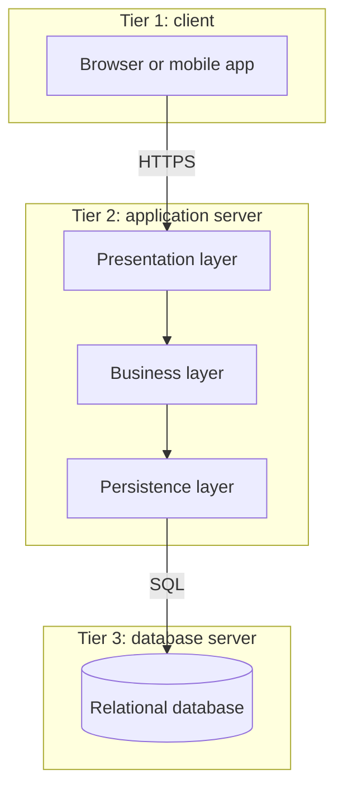
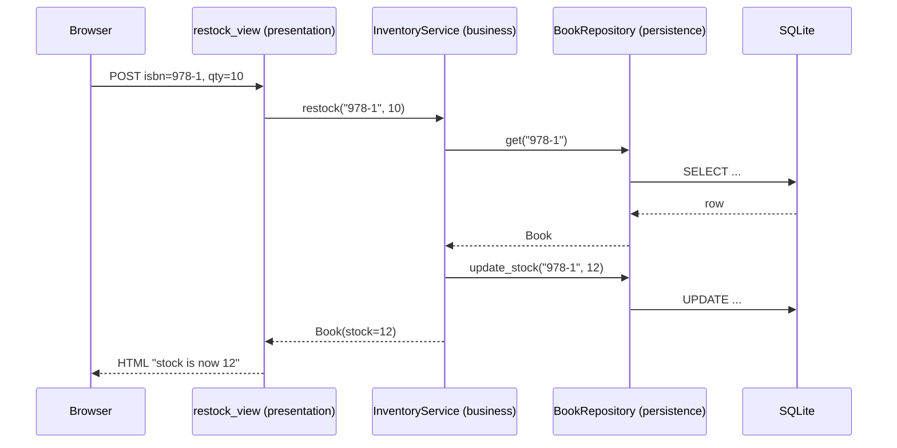
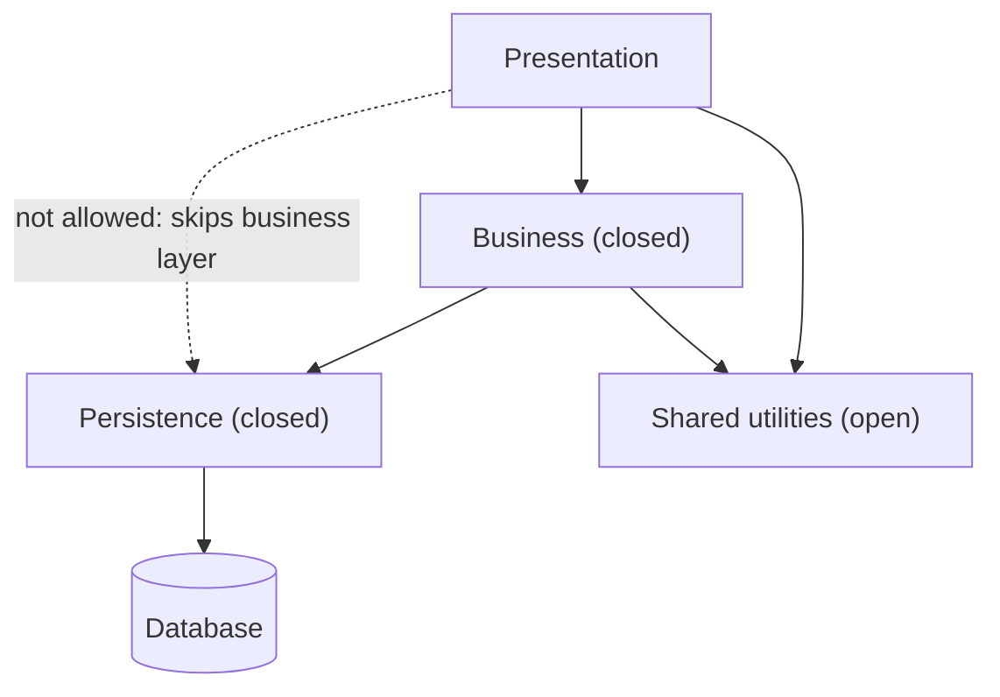

# Layered (N-Tier) Architecture

## Introduction

The **layered architecture** is the style most developers meet first, often without being told its name. You create a `controllers` folder, a `services` folder and a `repositories` folder, and you have a layered architecture.

Each layer has one technical responsibility, and each layer only talks to the layer directly below it:

- **Presentation layer:** handles HTTP requests, forms, JSON and HTML. It knows how to talk to users.
- **Business (service) layer:** holds the rules. "A restock must be between 1 and 500 copies." It knows nothing about HTTP or SQL.
- **Persistence (data access) layer:** reads and writes data. It knows SQL or the ORM.
- **Database:** stores the data.

Think of a restaurant. The waiter (presentation) takes your order and never cooks. The chef (business) decides how to cook it and never visits your table. The pantry staff (persistence) fetch ingredients and never talk to customers. Everyone can be replaced or retrained without retraining the others, as long as the hand-offs stay the same.

The style is so common that Microsoft lists N-tier as "a traditional architecture for enterprise applications" in its [Architecture styles guide](https://learn.microsoft.com/en-us/azure/architecture/guide/architecture-styles/n-tier). Spring Boot apps (`@Controller`, `@Service`, `@Repository`), ASP.NET MVC apps and many Django and Flask projects follow it.

## Layers vs Tiers

People often say "layered" and "n-tier" as if they were the same. They are related, but not identical.

- A **layer** is a *logical* grouping of code. Three layers can run in one process.
- A **tier** is a *physical* deployment unit, such as a separate server. A "three-tier" app might run the browser, an app server and a database server on different machines.



Here, three logical layers live inside one tier. You could split the business layer into its own tier, but every split adds a network hop, so do it only for a reason such as security zoning or independent scaling.

## The Problem: Everything in One Function

Before we apply layers, look at the code that layers are meant to fix. Pageturner's back-office has a "restock a book" page. The first version put everything in the request handler.

```python
import sqlite3

conn = sqlite3.connect(":memory:")
conn.execute("CREATE TABLE books (isbn TEXT PRIMARY KEY, title TEXT, stock INTEGER)")
conn.execute("INSERT INTO books VALUES ('978-1', 'Refactoring', 2)")


def handle_restock_request(form: dict) -> str:
    """One function does HTTP parsing, business rules, SQL and HTML."""
    isbn = form.get("isbn", "").strip()
    try:
        qty = int(form.get("qty", "0"))
    except ValueError:
        return "<p class='error'>Quantity must be a number</p>"
    row = conn.execute("SELECT title, stock FROM books WHERE isbn = ?", (isbn,)).fetchone()
    if row is None:
        return "<p class='error'>Unknown book</p>"
    if qty <= 0 or qty > 500:
        return "<p class='error'>Quantity must be 1-500</p>"
    new_stock = row[1] + qty
    conn.execute("UPDATE books SET stock = ? WHERE isbn = ?", (new_stock, isbn))
    conn.commit()
    return f"<p>{row[0]}: stock is now {new_stock}</p>"


print(handle_restock_request({"isbn": "978-1", "qty": "10"}))
print(handle_restock_request({"isbn": "978-1", "qty": "900"}))
```

Output:

```text
<p>Refactoring: stock is now 12</p>
<p class='error'>Quantity must be 1-500</p>
```

It works. But look at what is tangled together:

- **Testing the 500-copy rule** requires a database and HTML parsing.
- **A new mobile app** that needs JSON instead of HTML must copy the business rules.
- **Moving from SQLite to PostgreSQL** means editing the same function that renders HTML.
- **Two developers** editing "the validation" and "the page layout" will collide in the same function.

## The Solution: Three Layers

Now split the code by responsibility. Each layer gets its own class or function, and the layers are wired together in one place at startup (the *composition root*, covered in [Dependency Injection](../1-arch-design-principles/10-arch-dependency-injection.mdx)).

```python
import sqlite3
from dataclasses import dataclass
from typing import Protocol


# ---------- Persistence layer: knows SQL, knows nothing about HTTP ----------
@dataclass
class Book:
    isbn: str
    title: str
    stock: int


class BookRepository:
    def __init__(self, conn: sqlite3.Connection) -> None:
        self.conn = conn

    def get(self, isbn: str) -> Book | None:
        row = self.conn.execute(
            "SELECT isbn, title, stock FROM books WHERE isbn = ?", (isbn,)
        ).fetchone()
        return Book(*row) if row else None

    def update_stock(self, isbn: str, stock: int) -> None:
        self.conn.execute("UPDATE books SET stock = ? WHERE isbn = ?", (stock, isbn))
        self.conn.commit()


# ---------- Business (service) layer: rules, no SQL, no HTML ----------
class BookStore(Protocol):
    """What the service layer needs from persistence. BookRepository fits it."""

    def get(self, isbn: str) -> Book | None: ...
    def update_stock(self, isbn: str, stock: int) -> None: ...


class RestockError(Exception):
    pass


class InventoryService:
    MAX_RESTOCK = 500

    def __init__(self, books: BookStore) -> None:
        self.books = books

    def restock(self, isbn: str, qty: int) -> Book:
        book = self.books.get(isbn)
        if book is None:
            raise RestockError("Unknown book")
        if not 1 <= qty <= self.MAX_RESTOCK:
            raise RestockError(f"Quantity must be 1-{self.MAX_RESTOCK}")
        book.stock += qty
        self.books.update_stock(book.isbn, book.stock)
        return book


# ---------- Presentation layer: parses input, renders output ----------
def restock_view(form: dict, service: InventoryService) -> str:
    try:
        qty = int(form.get("qty", "0"))
        book = service.restock(form.get("isbn", "").strip(), qty)
    except ValueError:
        return "<p class='error'>Quantity must be a number</p>"
    except RestockError as exc:
        return f"<p class='error'>{exc}</p>"
    return f"<p>{book.title}: stock is now {book.stock}</p>"


# ---------- Composition root: wires the layers together ----------
if __name__ == "__main__":
    conn = sqlite3.connect(":memory:")
    conn.execute("CREATE TABLE books (isbn TEXT PRIMARY KEY, title TEXT, stock INTEGER)")
    conn.execute("INSERT INTO books VALUES ('978-1', 'Refactoring', 2)")

    service = InventoryService(BookRepository(conn))
    print(restock_view({"isbn": "978-1", "qty": "10"}, service))
    print(restock_view({"isbn": "978-1", "qty": "900"}, service))
    print(restock_view({"isbn": "999", "qty": "1"}, service))
```

Output:

```text
<p>Refactoring: stock is now 12</p>
<p class='error'>Quantity must be 1-500</p>
<p class='error'>Unknown book</p>
```

Three things changed:

1. **Each layer has one reason to change.** HTML changes touch `restock_view`. Rule changes touch `InventoryService`. Database changes touch `BookRepository`. This is the [Single Responsibility Principle](../1-arch-design-principles/1-arch-single-responsibility.mdx) at the system level.
2. **The service depends on a `Protocol`, not on SQLite.** `BookStore` describes what the business layer needs. This small use of [Dependency Inversion](../1-arch-design-principles/5-arch-dependency-inversion.mdx) makes the next step possible.
3. **The business rules are now testable in isolation.**

```python
import unittest

from p1_after import Book, InventoryService, RestockError


class FakeBookRepository:
    """In-memory stand-in for the persistence layer."""

    def __init__(self, books: list[Book]) -> None:
        self.data = {b.isbn: b for b in books}

    def get(self, isbn: str) -> Book | None:
        return self.data.get(isbn)

    def update_stock(self, isbn: str, stock: int) -> None:
        self.data[isbn].stock = stock


class InventoryServiceTest(unittest.TestCase):
    def test_restock_adds_quantity(self) -> None:
        repo = FakeBookRepository([Book("1", "DDD", 3)])
        book = InventoryService(repo).restock("1", 7)
        self.assertEqual(book.stock, 10)

    def test_rejects_huge_restock(self) -> None:
        repo = FakeBookRepository([Book("1", "DDD", 3)])
        with self.assertRaises(RestockError):
            InventoryService(repo).restock("1", 501)


if __name__ == "__main__":
    unittest.main(verbosity=2)
```

Output:

```text
test_rejects_huge_restock (__main__.InventoryServiceTest.test_rejects_huge_restock) ... ok
test_restock_adds_quantity (__main__.InventoryServiceTest.test_restock_adds_quantity) ... ok

----------------------------------------------------------------------
Ran 2 tests in 0.000s

OK
```

(Save the layered code as `p1_after.py` next to the test file to run it.)

### How a request flows



## Closed and Open Layers

A **closed** layer must not be skipped. A request has to pass through it. An **open** layer may be skipped.

- If the business layer is **closed**, the presentation layer may never call the persistence layer directly. That keeps all rules in one place.
- Sometimes teams add a shared **services** or **utilities** layer (logging, date helpers) and mark it **open**, so any layer may call it without passing through the layers above.

Richards and Ford call the benefit of closed layers **layers of isolation**: a change in one layer (say, swapping the ORM) does not ripple into layers that are not adjacent to it.



## Enforcing Layer Rules Automatically

Layer rules decay quickly if only a wiki page enforces them. One late-night bug fix imports the repository into the view, and nobody notices. In Python you can enforce layers with [Import Linter](https://import-linter.readthedocs.io/), a static analysis tool that checks imports against contracts. (Java teams use ArchUnit for the same job. See [Fitness Functions](../13-arch-documenting-and-evolving/3-arch-fitness-functions.mdx).)

Suppose the back-office is a package `backoffice` with modules `presentation`, `service` and `persistence`. Add this to `pyproject.toml`:

```toml
[tool.importlinter]
root_package = "backoffice"

[[tool.importlinter.contracts]]
name = "Layered architecture"
type = "layers"
layers = [
    "backoffice.presentation",
    "backoffice.service",
    "backoffice.persistence",
]

[[tool.importlinter.contracts]]
name = "Presentation may not skip the service layer"
type = "forbidden"
source_modules = ["backoffice.presentation"]
forbidden_modules = ["backoffice.persistence"]
allow_indirect_imports = true
```

- The **`layers`** contract lists layers from highest to lowest. A lower layer may never import a higher one.
- The `layers` contract alone still lets the top layer import *any* lower layer, so the second, **`forbidden`** contract makes the business layer closed. `allow_indirect_imports = true` permits the indirect path presentation, then service, then persistence, which is exactly the path we want.

```bash
pip install import-linter
lint-imports --no-logo
```

Example output, after someone adds `from backoffice import persistence` to `presentation.py`:

```text
Layered architecture KEPT
Presentation may not skip the service layer BROKEN

Contracts: 1 kept, 1 broken.

----------------
Broken contracts
----------------

Presentation may not skip the service layer
-------------------------------------------

backoffice.presentation is not allowed to import backoffice.persistence:

-   backoffice.presentation -> backoffice.persistence (l.2)
```

`lint-imports` exits with a non-zero status when a contract is broken, so you can run it in CI next to your tests. Output format and options can change between releases. Check the [Import Linter docs](https://import-linter.readthedocs.io/) for the version you install.

## Strengths and Weaknesses

| Quality attribute | Rating | Why |
| --- | --- | --- |
| Simplicity | High | Everyone knows it. New hires find their way fast. |
| Cost | Low | One deployable, one database, cheap to host. |
| Testability | Medium | Business rules can be tested in isolation if layers depend on abstractions. |
| Changeability for features | Low-medium | A new feature usually touches every layer. |
| Scalability | Low-medium | You scale the whole app at once. |
| Deployability | Low | Any change redeploys everything. |
| Fault tolerance | Low | A memory leak in one area takes down the whole process. |

### The architecture sinkhole anti-pattern

Richards and Ford describe the **architecture sinkhole**: requests that pass through layers without any layer doing real work. The controller calls `service.get_book(isbn)`, which calls `repo.get(isbn)`, which runs a query. The service layer adds nothing.

A few pass-through calls are normal. Their rough rule of thumb is that if most of your requests are sinkholes (they suggest about 80 percent as a warning sign), the closed-layer rule is costing you more than it gives. Options:

- make some layers open for simple reads
- move to a style where simple reads can be simple, such as [Vertical Slice Architecture](../7-arch-clean-architecture/3-arch-vertical-slice.mdx) or [CQRS](../9-arch-distributed-systems/3-arch-cqrs.mdx)

## Real-World Scenario

Pageturner's operations team needs an **internal back-office**: staff restock books, edit descriptions, issue refunds and export sales reports. About 40 employees use it. Changes arrive every few weeks. There are two developers on it.

**The solution:** a classic three-layer app in one deployable unit:

- `presentation`: server-rendered pages (Django, Flask or FastAPI with templates)
- `service`: `InventoryService`, `RefundService`, `ReportService`
- `persistence`: repositories on top of PostgreSQL
- Import Linter contracts in CI to keep the layers honest

### Why this approach

- The domain is mostly **CRUD with a few rules**. Layers organize that kind of code very well.
- Two developers and 40 users do not need independent deployment or elastic scaling.
- Every framework the team might pick has a layered convention, so there is no learning curve.
- Separating the business layer means the refund rules can be tested without a browser or a database.

### When to use it, and when not to

Use layered architecture when:

- the app is CRUD-heavy, small to medium sized, and built by one team
- you are migrating an existing layered app (Azure notes that N-tier is a natural fit for lift-and-shift migrations)
- you need something new developers understand on day one

Avoid it, or evolve away from it, when:

- the domain is rich and features cut across all layers, so every change touches every folder
- many teams work on the same code base and need clear *business* boundaries (look at a [modular monolith](./3-arch-modular-monolith.mdx))
- parts of the system need very different scaling or release cadence

### Alternatives and trade-offs

| Approach | Pros | Cons | Best for |
| --- | --- | --- | --- |
| Layered (technical partitioning) | Familiar, simple, framework-friendly | Features spread across layers, sinkholes | CRUD apps, back-offices |
| [Hexagonal / Clean](../7-arch-clean-architecture/0-arch-hexagonal.mdx) | Domain at the center, infrastructure swappable | More interfaces and indirection | Rich domains with many integrations |
| [Vertical slices](../7-arch-clean-architecture/3-arch-vertical-slice.mdx) | One folder per feature, little ceremony | Shared rules can get duplicated | Feature-heavy apps, CQRS-style reads |
| [Modular monolith](./3-arch-modular-monolith.mdx) with layers inside modules | Domain boundaries plus familiar layers | More structure to maintain | Growing products and teams |

## Common Mistakes

1. **Business rules leaking into the presentation layer.** Validation like "quantity must be 1 to 500" ends up in a view or a JavaScript form, and the API skips it. Keep the authoritative rule in the business layer. The UI can repeat it for user convenience.
2. **Anemic service layer plus fat repositories.** Rules hide in SQL queries or ORM hooks. Then the service layer becomes a sinkhole and the rules are hard to test.
3. **Upward dependencies.** The repository imports a view helper "just for formatting". Now the bottom layer depends on the top one, and the layers are fake. Use an Import Linter contract to catch this.
4. **Leaking persistence types.** Returning ORM objects with lazy-loading behavior all the way to templates couples the presentation layer to the database. Return plain data classes or DTOs.
5. **Turning every layer into a tier.** Putting the business layer on separate servers "for scalability" adds network latency and failure modes. Split tiers only for a concrete need.
6. **Treating layers as the whole architecture.** Layers say nothing about business boundaries. A big layered app with no domain modules becomes a [big ball of mud](../5-arch-modern-patterns/7-arch-anti-patterns.mdx) just as easily as an unlayered one.

## Summary

- Layered architecture groups code by **technical role**: presentation, business, persistence, database.
- **Layers** are logical, **tiers** are physical. You can have three layers in one tier.
- **Closed layers** give layers of isolation. **Open layers** may be skipped, usually for shared utilities.
- Enforce the rules with tools such as Import Linter in CI, not just with documentation.
- Watch for the **sinkhole anti-pattern** and for features that touch every layer. Those are signs to move toward modules or vertical slices.
- Layered architecture is a great default for small CRUD-heavy apps, and a poor fit for large, rich domains built by many teams.

## Further Learning

**Exercises**

1. Add a JSON endpoint `restock_api(payload: dict, service: InventoryService) -> dict` to the layered example. Which layers did you change? Which did you not have to touch?
2. Replace `BookRepository` with an in-memory repository at startup and run the app without SQLite. What does that tell you about the dependency direction?
3. Create a small package with the three layers and the `pyproject.toml` above. Add an upward import and confirm that `lint-imports` fails.
4. Look at a project you know. Estimate what fraction of service-layer methods are pure pass-throughs. Is it a sinkhole?

**Related pages**

- [Architectural Styles Overview](./0-arch-styles-overview.mdx)
- [Separation of Concerns](../1-arch-design-principles/9-arch-separation-of-concerns.mdx)
- [Repository Pattern](../5-arch-modern-patterns/1-arch-repository-pattern.mdx)
- [Comparing Hexagonal, Onion, Clean and Vertical Slice](../7-arch-clean-architecture/7-arch-comparing-layered-styles.mdx)

**Sources**

- [Azure Architecture Center: N-tier architecture style](https://learn.microsoft.com/en-us/azure/architecture/guide/architecture-styles/n-tier)
- [Martin Fowler: PresentationDomainDataLayering](https://martinfowler.com/bliki/PresentationDomainDataLayering.html)
- Mark Richards and Neal Ford, *Fundamentals of Software Architecture* (O'Reilly), chapter on the layered style
- [Import Linter documentation](https://import-linter.readthedocs.io/)
