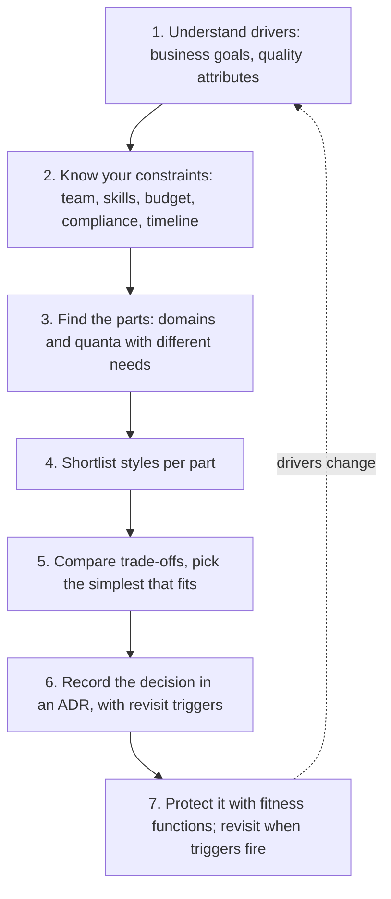
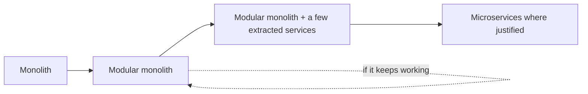

# Choosing an Architectural Style

## Introduction

You have now seen the major architectural styles: [layered](./1-arch-layered.mdx), [monolithic](./2-arch-monolith.mdx), [modular monolith](./3-arch-modular-monolith.mdx), [microservices](./4-arch-microservices.mdx), [event-driven](./5-arch-event-driven.mdx), [serverless](./6-arch-serverless.mdx), [microkernel](./7-arch-microkernel.mdx), [space-based](./8-arch-space-based.mdx) and [pipes and filters](./9-arch-pipes-and-filters.mdx). This page is about the harder question: **which one should you use?**

The honest answer is "it depends". This page turns "it depends" into a repeatable process. Richards and Ford's first law of software architecture says that everything in software architecture is a trade-off. Choosing a style means choosing **which trade-offs you accept**, for **this** system, **this** team and **this** moment.

The analogy: choosing a vehicle. A bicycle, a family car, a delivery van and a cargo ship are all "good". Which one is best depends on what you carry, how far, how often, on what budget, and who is driving. Nobody buys a cargo ship to commute, however impressive its capacity.

## The Process at a Glance



### Step 1: Understand the drivers

Start from the business, not from technology. Ask:

- What must this system achieve in the next 12 to 24 months?
- Which **quality attributes** matter most? Pick the **top three**, not ten. See [Quality Attributes and Non-Functional Requirements](../0-arch-fundamentals/3-arch-quality-attributes.mdx).
- What does failure look like? Losing an order? Being slow for a minute? Showing a stale price?

Common drivers and the styles that tend to support them:

| If your top driver is... | Styles that tend to help | Styles that tend to hurt |
| --- | --- | --- |
| Time to market, small budget | Monolith, modular monolith, layered | Microservices, space-based |
| Independent deployment by many teams | Microservices, event-driven | Layered monolith |
| Elasticity under bursty load | Serverless, space-based, event-driven | Layered, single-instance monolith |
| Strong consistency | Monolith, modular monolith | Microservices, event-driven, space-based |
| Extensibility by customers or partners | Microkernel | Monolith without extension points |
| Processing streams or batches of data | Pipes and filters, event-driven | Layered request/response |
| Fault isolation | Microservices, event-driven | Single-process monolith |

### Step 2: Know your constraints

Constraints often decide more than drivers do:

- **Team size and structure.** [Conway's Law](../0-arch-fundamentals/9-arch-conways-law.mdx) applies whether you like it or not. One team rarely benefits from ten services. Ten teams in one code base need strong module boundaries.
- **Skills and operational maturity.** Do you have automated deployment, monitoring and tracing? Fowler's [MicroservicePrerequisites](https://martinfowler.com/bliki/MicroservicePrerequisites.html) is a useful checklist before going distributed.
- **Budget and cost model.** Always-on capacity vs pay-per-use, and the cost of people's time.
- **Compliance and security.** Some data may have to be isolated in its own deployment.
- **Existing systems.** Most architecture work is evolution, not greenfield.

### Step 3: Find the parts with different needs

Not every part of a system needs the same style. Look for **architecture quanta** with different characteristics. In Pageturner:

- the store core needs consistency and fast development
- image processing needs bursty, CPU-heavy scaling
- the flash-sale component needs extreme elasticity for minutes at a time
- partner promotions need extensibility

Each part can use a different style. This is normal and healthy. Writing it down as a table keeps the reasoning visible:

| Part | Top drivers | Chosen style | Why not the obvious alternative |
| --- | --- | --- | --- |
| Store core | Time to market, consistency, low cost | Modular monolith | Microservices would add distributed transactions for no named benefit |
| Cover thumbnails | Burst elasticity, isolation from checkout | Serverless pipeline | Worker containers would sit idle most of the day |
| Flash sale | Extreme elasticity, no overselling | Partitioned in-memory reservations plus a waiting room | Full space-based platform is too costly for a few events a year |
| Partner promotions | Extensibility, partner release cadence | Microkernel plugins | Hard-coded rules force a core release per partner |
| Publisher feeds | Reuse across 30 formats, transparency | Pipes and filters | One import script per publisher duplicates logic |

The "why not" column matters as much as the choice. It shows that alternatives were considered and records the reasoning for the next person.

### Step 4 and 5: Shortlist and compare

For each part, shortlist two or three styles and compare them against the drivers and constraints. Prefer **the simplest style that meets the drivers**. Complexity is a cost you pay every day. Extra capability you do not need is not free.

## A Small Scoring Helper

A scoring matrix does not make the decision for you, but it makes assumptions **explicit** and **discussable**. The script below encodes rough, illustrative ratings (they are not measurements; argue with them) and adds penalties for constraints such as team size.

```python
from dataclasses import dataclass

# Illustrative 1-5 ratings, loosely following the trade-offs discussed in this section.
# They are a starting point for discussion, not measurements. Adjust them for your context.
RATINGS: dict[str, dict[str, int]] = {
    "layered":           {"simplicity": 5, "cost": 5, "deployability": 1, "elasticity": 1, "fault_tolerance": 1, "evolvability": 2, "consistency": 5},
    "modular monolith":  {"simplicity": 4, "cost": 5, "deployability": 2, "elasticity": 2, "fault_tolerance": 2, "evolvability": 4, "consistency": 5},
    "microkernel":       {"simplicity": 4, "cost": 4, "deployability": 3, "elasticity": 1, "fault_tolerance": 2, "evolvability": 4, "consistency": 4},
    "pipes and filters": {"simplicity": 4, "cost": 4, "deployability": 2, "elasticity": 2, "fault_tolerance": 2, "evolvability": 3, "consistency": 3},
    "event-driven":      {"simplicity": 2, "cost": 3, "deployability": 4, "elasticity": 4, "fault_tolerance": 4, "evolvability": 4, "consistency": 2},
    "microservices":     {"simplicity": 1, "cost": 1, "deployability": 5, "elasticity": 5, "fault_tolerance": 4, "evolvability": 5, "consistency": 2},
    "serverless":        {"simplicity": 3, "cost": 4, "deployability": 4, "elasticity": 5, "fault_tolerance": 4, "evolvability": 3, "consistency": 2},
    "space-based":       {"simplicity": 1, "cost": 1, "deployability": 3, "elasticity": 5, "fault_tolerance": 3, "evolvability": 3, "consistency": 2},
}
DISTRIBUTED = {"event-driven", "microservices", "serverless", "space-based"}


@dataclass
class Context:
    drivers: dict[str, int]  # characteristic -> weight (3 = top priority)
    developers: int
    has_platform_team: bool


def score(style: str, ctx: Context) -> tuple[int, list[str]]:
    total = sum(RATINGS[style][c] * w for c, w in ctx.drivers.items())
    notes = []
    if style in DISTRIBUTED and ctx.developers < 15:
        total -= 10
        notes.append("small team pays the distributed-systems premium")
    if style == "microservices" and not ctx.has_platform_team:
        total -= 5
        notes.append("no platform team for many pipelines and services")
    return total, notes


def rank(ctx: Context) -> None:
    results = sorted(((*score(s, ctx), s) for s in RATINGS), reverse=True)
    for total, notes, style in results[:4]:
        print(f"{style:>17}: {total:>3}  {'; '.join(notes)}".rstrip())


print("Pageturner today: 8 developers, ship fast, keep it cheap, checkout must be consistent")
rank(Context({"simplicity": 3, "cost": 3, "consistency": 2, "evolvability": 2}, 8, False))

print("\nFlash-sale component: survive a 50x burst for 10 minutes")
rank(Context({"elasticity": 3, "fault_tolerance": 2, "cost": 1}, 40, True))

print("\nSame flash sale, but overselling the last copies is unacceptable")
rank(Context({"elasticity": 3, "fault_tolerance": 2, "cost": 1, "consistency": 3}, 40, True))
```

Output:

```text
Pageturner today: 8 developers, ship fast, keep it cheap, checkout must be consistent
 modular monolith:  45
          layered:  44
      microkernel:  40
pipes and filters:  36

Flash-sale component: survive a 50x burst for 10 minutes
       serverless:  27
    microservices:  24
     event-driven:  23
      space-based:  22

Same flash sale, but overselling the last copies is unacceptable
       serverless:  33
 modular monolith:  30
    microservices:  30
     event-driven:  29
```

How to read this:

- For the **core store**, the modular monolith and layered styles win clearly. That matches the reasoning on the [Monolith](./2-arch-monolith.mdx) and [Modular Monolith](./3-arch-modular-monolith.mdx) pages.
- For the **flash sale**, the ranking is close. That is a signal to dig deeper, not to pick the top number.
- Adding **consistency** as a driver moves the modular monolith up. The scoring cannot see that the real issue is "do not oversell hot items", which needs a specific design (partitioning by key, atomic reservations, or a waiting room) whichever style you pick. See [Space-Based Architecture](./8-arch-space-based.mdx).

The value of the exercise is the conversation: "Why did you rate microservices 5 for evolvability? Is that true for **our** team?" Write down the agreed numbers and the reasons, then use them as input to the decision record.

:::caution
Weighted scoring can create false precision. A difference of 2 or 3 points means nothing. Use it to structure a discussion and to catch obvious mismatches, never as the final answer.
:::

:::tip
Run the scoring with two or three people independently first, then compare. Where your ratings differ, you have found an assumption worth discussing before you commit to a style.
:::

## Step 6: Record the Decision

Write an [Architecture Decision Record](../13-arch-documenting-and-evolving/0-arch-decision-records.mdx) for every style choice. Include **revisit triggers**, the conditions under which you would reconsider:

```text
# ADR-007: Use a modular monolith for the Pageturner store core

Status: Accepted (2026-03-02)

Context
- 8 developers in 2 teams; product-market fit still being validated.
- Top drivers: time to market, low cost, consistent checkout.
- No dedicated platform team; one ops engineer.

Decision
- One deployable modular monolith (catalog, cart, ordering, payments, accounts).
- Module boundaries enforced by Import Linter in CI; one DB schema per module.
- Side effects (email, analytics) via in-process events, outbox-ready.
- Thumbnails as a separate serverless function (bursty, CPU-heavy).

Consequences
- + One pipeline, local transactions, simple debugging.
- - All modules release together; one runtime and language.

Revisit when
- More than 4 teams regularly block each other's releases, OR
- One module needs scaling or availability the others do not, OR
- A compliance requirement demands isolating a module (likely payments).
```

## Step 7: Protect and Revisit

A style choice decays unless it is protected:

- **Fitness functions** check the architecture automatically: import contracts, dependency cycle checks, latency budgets, deployment frequency. See [Fitness Functions and Evolutionary Architecture](../13-arch-documenting-and-evolving/3-arch-fitness-functions.mdx).
- **Revisit triggers** in the ADR tell you when to reopen the decision. Review them every quarter or two.
- **Evolution paths** should be planned. The most common path for successful products:



Many products stay at the modular monolith or "modular monolith plus a few services" stage for years, and that is a success, not a failure to "finish" the migration.

## Cheat Sheet: One Line per Style

| Style | Choose it when | Avoid it when |
| --- | --- | --- |
| [Layered](./1-arch-layered.mdx) | Small, CRUD-heavy app, one team | Rich domain, many teams, features cut across all layers |
| [Monolith](./2-arch-monolith.mdx) | New product, small team, consistency matters | Many teams block each other's releases |
| [Modular monolith](./3-arch-modular-monolith.mdx) | Growing product, several teams, known domains | Parts need different stacks, scaling or isolation |
| [Microservices](./4-arch-microservices.mdx) | Many teams, divergent scaling and release needs, mature platform | Small team, unclear boundaries, weak operations |
| [Event-driven](./5-arch-event-driven.mdx) | Fan-out reactions, buffering spikes, integrating many systems | Caller needs an immediate answer; simple transactional flow |
| [Serverless](./6-arch-serverless.mdx) | Spiky, event-triggered, short tasks; minimal ops | Steady high load, long-running work, strict latency |
| [Microkernel](./7-arch-microkernel.mdx) | Stable core with many customer or partner variations | Variation points unknown; extensions need own scaling |
| [Space-based](./8-arch-space-based.mdx) | Extreme bursts on data that fits in memory | Moderate load; strong consistency on large data |
| [Pipes and filters](./9-arch-pipes-and-filters.mdx) | Ordered processing of streams or batches | Interactive request/response; tightly coupled steps |

## Signals That It Is Time to Change Style

Styles should evolve with the system. These signals, measured rather than felt, suggest it is time to reopen the decision:

| Signal | What it may mean | Possible move |
| --- | --- | --- |
| Most features touch every layer | Technical partitioning no longer fits | Layered to modular monolith or vertical slices |
| Rising cross-module imports and cycles | Boundaries are eroding | Enforce modules with tooling; redraw boundaries |
| Teams queue behind one release train even after speeding it up | Organizational scaling limit | Extract the modules of the most blocked teams |
| One module dominates the infrastructure bill | Divergent scaling needs | Extract it, or move its heavy work to workers or functions |
| Services that are always deployed together | Distributed monolith | Merge them back, or fix the shared database or contract |
| On-call load dominated by inter-service failures | Too much distribution for the team | Consolidate services, prefer events over synchronous chains |

Merging services back together is a legitimate move, just as extracting them is. The goal is fit, not a direction.

## Questions for a Style Review

When someone proposes a style, these questions surface most problems quickly. They work well in an [architecture review](../13-arch-documenting-and-evolving/4-arch-reviews.mdx):

1. Which **named driver** does this style serve better than the simpler alternative?
2. What is the **team structure**, and does each deployable unit have one clear owning team?
3. Where does **data** live, and which operations need strong consistency?
4. What happens when the **slowest or least reliable component** fails? Walk through it.
5. What do we need in place to **operate** it (deployment, monitoring, tracing, on-call), and do we have it?
6. How will we **know** the style is working? Which fitness functions or metrics will tell us?
7. What are the **revisit triggers**, and what would the next evolution step be?

If a proposal cannot answer the first question, it is probably solving a problem you do not have.

## Real-World Scenario

Pageturner's leadership wants to launch **Pageturner Audio**, an audiobook service. The proposal from an enthusiastic architect: "fifteen microservices on Kubernetes with Kafka, from day one". You are asked to review it.

**Gathering the facts:**

- Team: one new team of 7 developers, plus shared ops.
- Drivers: launch in 5 months, validate demand cheaply, reuse existing accounts and payments.
- Workload: catalog browsing and purchase are light; **audio transcoding** of uploaded books is CPU-heavy and bursty; **streaming** is served by a CDN from object storage.
- Constraints: payments already exist in the main platform with compliance controls.

**The recommendation:**

1. Build Audio as a **new module** in the existing modular monolith (catalog, library and playback progress), reusing accounts and payments through their public APIs.
2. Run **transcoding as a pipes-and-filters pipeline** of serverless functions or queue workers: validate, transcode, chapterize, package, publish to object storage.
3. Serve audio from object storage through a **CDN**, not through application servers.
4. Publish `AudiobookPurchased` and `ListeningProgressUpdated` **events** for analytics and recommendations.
5. Record the decision in an ADR with revisit triggers: separate team ownership, independent scaling needs or release contention would justify extracting Audio as a service later.

### Why this approach

- It matches the **team size** (one team), the **timeline** (5 months) and the main driver (**validate cheaply**).
- It applies the right style to each **part**: monolith module for business logic, pipeline for transcoding, CDN for delivery, events for side effects.
- It **reuses** proven compliance-sensitive components instead of rebuilding them.
- It keeps the **door open**: the module boundary and events make a later extraction straightforward.

### When this approach would be wrong

- If Audio were run by a separate company unit with its own teams, release cycle and tech stack, a separate service from the start could be justified.
- If the monolith were already suffering from release contention, adding another team to it might make things worse.

### Alternatives and trade-offs

| Approach | Pros | Cons | Best for |
| --- | --- | --- | --- |
| New module in the modular monolith plus a pipeline | Fast, cheap, reuses accounts and payments | Shares release train with the store | Small team validating a product |
| Separate Audio service (one service) | Independent releases and scaling | Integration and ops cost from day one | Separate team or unit |
| Fifteen microservices on Kubernetes | Maximum independence | Huge cost for 7 developers; boundaries are guesses | Not this situation |
| Fully serverless Audio product | Scale to zero, little ops | Provider coupling; harder local dev; mixed fit for business logic | Teams already strong in serverless |

## Common Mistakes

1. **Resume-driven architecture.** Choosing a style because it is popular or looks good on a CV. Tie every choice to a named driver.
2. **Copying big tech.** Their constraints (thousands of engineers, global scale) are not yours. Their published architectures are also usually the result of years of evolution.
3. **One style for everything.** Forcing image processing into a layered app, or a simple admin tool into microservices. Different parts can use different styles.
4. **Ignoring the team.** A style that does not match your team structure and skills will fail, however good it is on paper.
5. **Optimizing for imagined scale.** Design for the next one or two orders of magnitude, not the next five. Keep the code modular so you can evolve.
6. **Deciding once and never again.** Without revisit triggers, a reasonable early choice turns into an obstacle later.
7. **Treating the decision as purely technical.** Cost, hiring, compliance and time to market are architectural inputs too.

## Summary

- Choosing a style is choosing **trade-offs**. Start from **business drivers** and the **top three quality attributes**.
- **Constraints** (team, skills, budget, compliance, existing systems) often decide more than drivers.
- Split the system into **parts with different needs**, and pick the **simplest style that fits** each part.
- Use scoring matrices to make assumptions explicit, not to replace judgment.
- **Record** decisions in ADRs with **revisit triggers**, and **protect** them with fitness functions.
- For most teams, a **modular monolith** with events and a few specialized components is a strong default, evolving toward services only for concrete reasons.

## Further Learning

**Exercises**

1. Run the scoring helper for a system you know. Change the ratings to reflect your team's real experience. Does the ranking change?
2. Write an ADR for the Pageturner Audio decision, including at least three revisit triggers.
3. Pick a well-known product (an online game, a ride-sharing app, a banking app) and identify three parts that would benefit from different styles.
4. Take the "fifteen microservices" proposal and list what the team would need to have in place (people, tooling, practices) before it could be a good idea.

**Related pages**

- [Architectural Styles Overview](./0-arch-styles-overview.mdx)
- [Thinking in Trade-offs](../0-arch-fundamentals/4-arch-trade-offs.mdx)
- [Architecture Decision Records](../13-arch-documenting-and-evolving/0-arch-decision-records.mdx)
- [Comparing Hexagonal, Onion, Clean and Vertical Slice](../7-arch-clean-architecture/7-arch-comparing-layered-styles.mdx) (styles for the inside of a deployable)
- [Capstone: Designing a Ride-Sharing System](../14-arch-case-studies/8-arch-capstone.mdx)

**Sources**

- Mark Richards and Neal Ford, *Fundamentals of Software Architecture* (O'Reilly)
- [Azure Architecture Center: Architecture styles](https://learn.microsoft.com/en-us/azure/architecture/guide/architecture-styles/)
- [Martin Fowler: MonolithFirst](https://martinfowler.com/bliki/MonolithFirst.html) and [MicroservicePrerequisites](https://martinfowler.com/bliki/MicroservicePrerequisites.html)
- [ADR GitHub organization: adr.github.io](https://adr.github.io/)
- Matthew Skelton and Manuel Pais, *Team Topologies* (IT Revolution)
