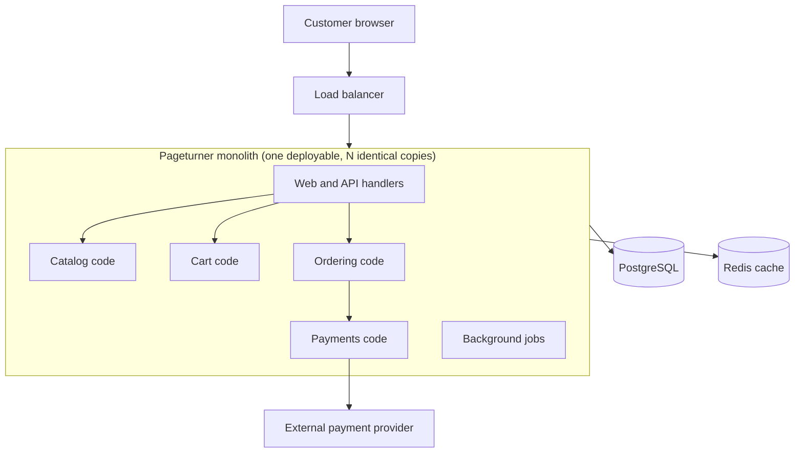
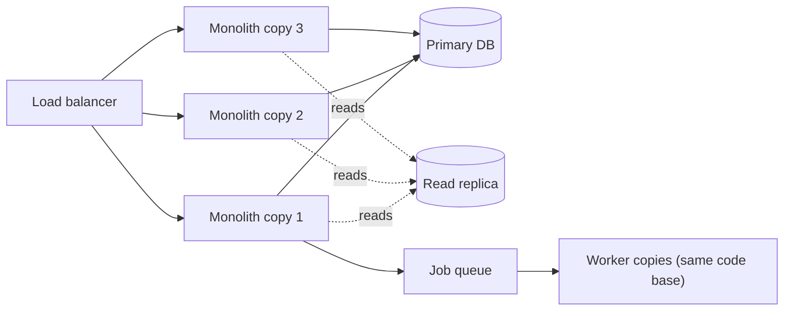

# Monolithic Architecture

## Introduction

A **monolith** is an application that is built and deployed as **one unit**. All of its features (catalog, cart, checkout, admin) live in one code base, compile into one artifact, and run in one process (or several identical copies of that process). It usually talks to one main database.

"Monolith" is sometimes used as an insult. It should not be. Many successful products run on monoliths, and the [microservices.io pattern page for the monolithic architecture](https://microservices.io/patterns/monolithic.html) lists real benefits: it is simple to develop, test and deploy, and simple to scale horizontally by running copies behind a load balancer. Basecamp's David Heinemeier Hansson wrote [The Majestic Monolith](https://signalvnoise.com/svn3/the-majestic-monolith/) (2016) to defend the style for small teams, and Shopify has written publicly about running one of the largest Ruby on Rails monoliths and making it modular rather than breaking it up ([Under Deconstruction: The State of Shopify's Monolith](https://shopify.engineering/shopify-monolith)).

An analogy: a monolith is a single, large house. Everyone in the family shares the kitchen, the plumbing and the front door. It is cheap to build and easy to move around in. When the family grows to fifty people, you either organize the house very carefully or you start bumping into each other in the hallway.

This page covers what a monolith gives you, how it goes wrong, and what to do about it.

## What Counts as a Monolith?

Sam Newman, in *Monolith to Microservices*, distinguishes several kinds of monolith. The difference matters, because they have very different problems.

| Kind | Description | Main risk |
| --- | --- | --- |
| Single-process monolith | All code in one process, one deployable | Tangled code as it grows |
| Modular monolith | One deployable, but split into well-bounded modules | Boundaries erode without enforcement |
| Distributed monolith | Several services that must be deployed together | All the costs of distribution, none of the independence |
| Third-party black box | Vendor software you cannot change (an ERP, a CRM) | You integrate around it |

This page is about the first kind. The [Modular Monolith](./3-arch-modular-monolith.mdx) page covers the second. The distributed monolith is an anti-pattern you will see on the [Microservices](./4-arch-microservices.mdx) page.



## Strength 1: Local Transactions

The most underrated feature of a monolith is the **database transaction**. When placing an order touches stock, orders and loyalty points, a monolith can change all three atomically. Either everything happens or nothing does.

```python
import sqlite3


def setup() -> sqlite3.Connection:
    conn = sqlite3.connect(":memory:")
    conn.executescript(
        """
        CREATE TABLE books  (isbn TEXT PRIMARY KEY, title TEXT,
                             stock INTEGER CHECK (stock >= 0));
        CREATE TABLE orders (id INTEGER PRIMARY KEY, isbn TEXT, qty INTEGER);
        CREATE TABLE loyalty (customer TEXT PRIMARY KEY, points INTEGER);
        INSERT INTO books VALUES ('978-1', 'The Pragmatic Programmer', 3);
        INSERT INTO loyalty VALUES ('ana', 0);
        """
    )
    return conn


def place_order(conn: sqlite3.Connection, customer: str, isbn: str, qty: int) -> str:
    """Catalog, ordering and loyalty change together in ONE local transaction."""
    try:
        with conn:  # commits on success, rolls back on any exception
            conn.execute("UPDATE books SET stock = stock - ? WHERE isbn = ?", (qty, isbn))
            cur = conn.execute("INSERT INTO orders (isbn, qty) VALUES (?, ?)", (isbn, qty))
            conn.execute(
                "UPDATE loyalty SET points = points + ? WHERE customer = ?",
                (qty * 10, customer),
            )
        return f"order {cur.lastrowid} placed"
    except sqlite3.IntegrityError as exc:
        return f"rejected: {exc}"


def snapshot(conn: sqlite3.Connection) -> str:
    stock = conn.execute("SELECT stock FROM books").fetchone()[0]
    orders = conn.execute("SELECT COUNT(*) FROM orders").fetchone()[0]
    points = conn.execute("SELECT points FROM loyalty").fetchone()[0]
    return f"stock={stock} orders={orders} points={points}"


if __name__ == "__main__":
    db = setup()
    print(place_order(db, "ana", "978-1", 2), "|", snapshot(db))
    print(place_order(db, "ana", "978-1", 5), "|", snapshot(db))
```

Output:

```text
order 1 placed | stock=1 orders=1 points=20
rejected: CHECK constraint failed: stock >= 0 | stock=1 orders=1 points=20
```

The second order tries to buy 5 copies when only 1 is left. The stock update fails the `CHECK` constraint, and `with conn:` rolls back the whole transaction. No order row is created and no loyalty points are given.

Now imagine catalog, ordering and loyalty as three separate services with three databases. You can no longer use one transaction. You need a [Saga](../9-arch-distributed-systems/5-arch-saga.mdx) with compensating actions, a [Transactional Outbox](../9-arch-distributed-systems/6-arch-outbox.mdx) to publish events reliably, and [idempotent](../9-arch-distributed-systems/7-arch-idempotency.mdx) handlers. Each of those is a good pattern, and each one is extra code you do not need in a monolith.

## Strength 2: Simplicity Everywhere Else

| Concern | In a monolith | In a distributed system |
| --- | --- | --- |
| Calling another feature | Function call, nanoseconds, cannot "time out" | Network call: latency, retries, timeouts, partial failure |
| Refactoring across features | IDE rename, one commit | Coordinated API changes across services and teams |
| Debugging | One stack trace, one log stream | Distributed tracing across services |
| Local development | Run one app and one database | Run many services, or mock them |
| Deployment | One pipeline, one artifact | Many pipelines, version compatibility |
| End-to-end tests | Start one app | Start or stub many services |

Martin Fowler calls the extra cost of running many services the [Microservice Premium](https://martinfowler.com/bliki/MicroservicePremium.html). A monolith does not pay it.

## Strength 3: It Scales Further Than People Think

"Monoliths don't scale" is a myth in most cases. A monolith scales in three main ways:

1. **Vertical scaling:** a bigger machine. Simple, and often enough for a long time.
2. **Horizontal scaling:** run many identical copies behind a load balancer. This works if the app is **stateless**, meaning sessions live in a cookie, [Redis](/docs/middleware/redis) or the database, not in process memory.
3. **Offloading:** move heavy work to background workers reading from a queue, and serve reads from caches and read replicas.



The limit you hit is usually **not** CPU. It is one of these:

- the single database becomes the bottleneck (see [Replication and Sharding](../11-arch-data-architecture/3-arch-replication-and-sharding.mdx))
- one feature needs far more resources than the others, and you pay to scale everything
- too many developers change the same code base, and coordination slows everyone down

The last one is the most common reason organizations leave a monolith, and it is a people problem as much as a technical one. See [Conway's Law and Team Topologies](../0-arch-fundamentals/9-arch-conways-law.mdx).

## How Monoliths Go Wrong: The Big Ball of Mud

A monolith does not fail because it is one deployable. It fails because, without boundaries, every part of the code slowly starts to depend on every other part. Brian Foote and Joseph Yoder named this the **Big Ball of Mud** in 1997, and it is covered in [Common Anti-Patterns](../5-arch-modern-patterns/7-arch-anti-patterns.mdx).

Symptoms you can observe:

- A change in checkout breaks the admin reports.
- Tests take 40 minutes because everything needs everything.
- Nobody can say who owns the `utils` package.
- Merge conflicts are a daily event.

### Measure it before you argue about it

Instead of debating "is our monolith a mess?", measure the dependencies between areas. This short script uses Python's built-in `ast` module to count imports from one top-level package area to another:

```python
"""Count imports between top-level areas of a Python monolith.

Usage: python3 deps.py path/to/src/bookstore
"""
import ast
import sys
from collections import Counter
from pathlib import Path


def area_of(module: str, root: str) -> str | None:
    parts = module.split(".")
    return parts[1] if len(parts) > 1 and parts[0] == root else None


def cross_area_imports(pkg_dir: Path) -> Counter[tuple[str, str]]:
    root = pkg_dir.name
    edges: Counter[tuple[str, str]] = Counter()
    for path in pkg_dir.rglob("*.py"):
        rel = path.relative_to(pkg_dir.parent).with_suffix("")
        source_area = area_of(".".join(rel.parts), root)
        tree = ast.parse(path.read_text(), filename=str(path))
        for node in ast.walk(tree):
            if isinstance(node, ast.ImportFrom) and node.module:
                targets = [node.module]
            elif isinstance(node, ast.Import):
                targets = [alias.name for alias in node.names]
            else:
                continue
            for target in targets:
                target_area = area_of(target, root)
                if source_area and target_area and target_area != source_area:
                    edges[(source_area, target_area)] += 1
    return edges


if __name__ == "__main__":
    for (src, dst), count in sorted(cross_area_imports(Path(sys.argv[1])).items()):
        print(f"{src:>10} -> {dst:<10} {count} import(s)")
```

Example output, run against a small `bookstore` package:

```text
   catalog -> ordering   1 import(s)
  ordering -> catalog    2 import(s)
  payments -> catalog    1 import(s)
  payments -> ordering   1 import(s)
```

`catalog -> ordering` and `ordering -> catalog` together form a **cycle**. Cycles are the clearest sign that two areas are not really separate. If you ever want to extract one of them as a service, you will have to break that cycle first. Run the script on your own code base every month and watch the trend. Tools such as Import Linter (used on the [Layered](./1-arch-layered.mdx) and [Modular Monolith](./3-arch-modular-monolith.mdx) pages) can turn this measurement into a rule.

## Deploying a Monolith Safely

A common complaint is "we can't deploy the checkout fix because the half-finished search feature is in the same artifact". That is a real cost of one deployable, but two habits remove most of it.

**1. Deploy often, in small changes.** A monolith deployed ten times a day with small diffs is less risky than one deployed monthly with huge diffs. Rolling or blue-green deployments (see [Designing for Deployability](../12-arch-quality-and-operations/6-arch-deployability.mdx)) let you replace copies one at a time without downtime.

**2. Separate *deploy* from *release* with feature flags.** Unfinished code ships to production switched off, and you turn it on for a small percentage of users when ready. A minimal, dependency-free version looks like this:

```python
import os
import zlib


def flag_enabled(name: str, user_id: str) -> bool:
    """Read FLAG_<NAME>=<percent> from the environment and bucket users stably."""
    percent = int(os.environ.get(f"FLAG_{name.upper()}", "0"))
    bucket = zlib.crc32(f"{name}:{user_id}".encode()) % 100
    return bucket < percent


def checkout_page(user_id: str) -> str:
    if flag_enabled("new_checkout", user_id):
        return f"{user_id}: new one-page checkout"
    return f"{user_id}: classic checkout"


if __name__ == "__main__":
    os.environ["FLAG_NEW_CHECKOUT"] = "30"  # roll out to about 30% of users
    for user in ["ana", "ben", "chen", "dev", "eli", "fay"]:
        print(checkout_page(user))
```

Output:

```text
ana: classic checkout
ben: classic checkout
chen: new one-page checkout
dev: classic checkout
eli: new one-page checkout
fay: classic checkout
```

Hashing the user id gives each user a stable bucket, so the same customer always sees the same checkout while the rollout percentage stays fixed. In production you would usually use a flag service or library with an admin UI, audit log and instant kill switch, rather than environment variables. And remove flags once a feature is fully released, or they become technical debt of their own.

With these two habits, "we must split the monolith so teams can deploy independently" often turns into "we must deploy the monolith more often", which is much cheaper.

## Real-World Scenario

Pageturner is a new online bookstore. It has **four developers**, a launch date in four months, and an investor who wants to see whether people actually buy books there. Requirements will change weekly once real customers arrive.

**The solution:** one Django (or Rails, Spring Boot, Laravel) monolith:

- one repository, one CI pipeline, one container image
- PostgreSQL for data, Redis for sessions and caching
- background jobs (emails, thumbnails) in a worker process built from the **same** code base
- two or more identical app copies behind a load balancer for availability
- folders organized by business area (`catalog/`, `cart/`, `ordering/`) from day one, so a later move to a [modular monolith](./3-arch-modular-monolith.mdx) is cheap

### Why this approach

- **Speed of learning is everything.** Martin Fowler's [MonolithFirst](https://martinfowler.com/bliki/MonolithFirst.html) argues that early on you do not know whether the product will succeed or where the right boundaries are. A monolith keeps refactoring cheap while you find out.
- **Four developers can coordinate by talking.** They do not need the independent deployment that microservices buy.
- **Checkout needs consistency.** Stock, orders and payments in one database transaction remove a whole class of bugs.
- **Operations stay small.** One app to monitor and one deploy to roll back.

### When to use it, and when not to

Use a monolith when:

- the team is small (one or two teams)
- the domain is still being discovered
- strong consistency across features matters
- you have limited operations or platform experience

Consider other styles when:

- several teams block each other on every release
- one part of the system has radically different scaling, availability or security needs (for example, a payment component under stricter compliance rules)
- parts of the system need a different technology (a GPU-heavy recommendation model in a Ruby app, for example)

### Alternatives and trade-offs

| Approach | Pros | Cons | Best for |
| --- | --- | --- | --- |
| Single-process monolith | Fastest to build, simplest to run, local transactions | Decays without discipline, scales as one unit | New products, small teams |
| [Modular monolith](./3-arch-modular-monolith.mdx) | Monolith benefits plus enforced boundaries | Needs tooling and discipline | Products expected to grow |
| [Service-based](./0-arch-styles-overview.mdx) (a few coarse services) | Some independent deployment, still simple data | Shared database couples services | Mid-size systems, gradual migration |
| [Microservices](./4-arch-microservices.mdx) | Independent deploy and scaling per team | High operational and data complexity | Many teams, proven boundaries |

### The counter-argument, fairly stated

Not everyone agrees with "monolith first". Stefan Tilkov's article [Don't start with a monolith](https://martinfowler.com/articles/dont-start-monolith.html) (published on Fowler's site) argues that if you already know the domain well, for example because you are replacing an existing system, it can be easier to design separate parts from the start than to cut a monolith apart later, since monoliths tend to grow hidden coupling. Fowler himself notes that the evidence on both sides is mostly anecdotal. The practical middle ground many teams choose is a monolith with **strong internal modules**, which keeps both options open.

A widely discussed 2023 case pointed the other way: a team at Amazon Prime Video reported moving an audio/video monitoring tool from a distributed design built on AWS Step Functions and Lambda to a single process, and said this cut that tool's infrastructure cost dramatically ([DevClass coverage](https://devclass.com/2023/05/05/reduce-costs-by-90-by-moving-from-microservices-to-monolith-amazon-internal-case-study-raises-eyebrows/)). It is one workload with a specific profile (heavy data passing between steps), not proof that monoliths always win. The lesson is to match the style to the workload.

## Common Mistakes

1. **Organizing by technical layer only.** A monolith with `models/`, `views/` and `services/` and no business areas is hard to modularize later. Group by business area early, and use layers inside each area.
2. **Keeping state in process memory.** In-memory sessions or caches stop you from running two copies. Keep app processes stateless.
3. **One giant shared `utils` or `common` package.** It becomes a dumping ground that everything depends on. Keep shared code small and boring.
4. **Letting every feature read every table.** Even inside one database, treat tables as owned by one area. Others go through that area's code.
5. **Blaming the monolith for problems the monolith did not cause.** Slow builds, flaky tests and unclear ownership will follow you into microservices unless you fix them.
6. **Splitting too early.** Extracting services before boundaries are stable produces chatty services that change in lockstep. See [Strangler Fig Migration](../9-arch-distributed-systems/11-arch-strangler-fig.mdx) for doing it gradually when the time comes.

## Summary

- A monolith is **one deployable unit**, usually with one database. It is a legitimate, often excellent, choice.
- Its main strengths are **local transactions, simple operations, easy refactoring and easy debugging**.
- Monoliths scale vertically, horizontally (stateless copies) and by offloading work to workers, caches and replicas.
- The real danger is the **big ball of mud**: coupling without boundaries. Measure dependencies, watch for cycles and enforce boundaries.
- Most teams should start with a monolith that is organized by business area, and move to a modular monolith or services when there is a clear reason.

## Further Learning

**Exercises**

1. Change `place_order` so that loyalty points fail for a customer who does not exist (raise an error if the `UPDATE` affects zero rows). Confirm that the stock and order changes are rolled back.
2. Run the dependency counter on an open-source Python project such as a Django app you know. Which areas form cycles?
3. List three pieces of state that a typical web app keeps in memory. Where would you move each one so you can run several copies?
4. Write a one-paragraph [Architecture Decision Record](../13-arch-documenting-and-evolving/0-arch-decision-records.mdx) for choosing a monolith for Pageturner, including the conditions under which you would revisit it.

**Related pages**

- [Modular Monolith](./3-arch-modular-monolith.mdx)
- [Microservices Architecture](./4-arch-microservices.mdx)
- [Case Study: Breaking Up a Monolith](../14-arch-case-studies/7-arch-case-monolith-to-microservices.mdx)
- [Technical Debt](../0-arch-fundamentals/8-arch-technical-debt.mdx)

**Sources**

- [microservices.io: Monolithic architecture pattern](https://microservices.io/patterns/monolithic.html)
- [Martin Fowler: MonolithFirst](https://martinfowler.com/bliki/MonolithFirst.html) and [MicroservicePremium](https://martinfowler.com/bliki/MicroservicePremium.html)
- [Stefan Tilkov: Don't start with a monolith](https://martinfowler.com/articles/dont-start-monolith.html)
- [DHH: The Majestic Monolith](https://signalvnoise.com/svn3/the-majestic-monolith/)
- Sam Newman, *Monolith to Microservices* (O'Reilly)
