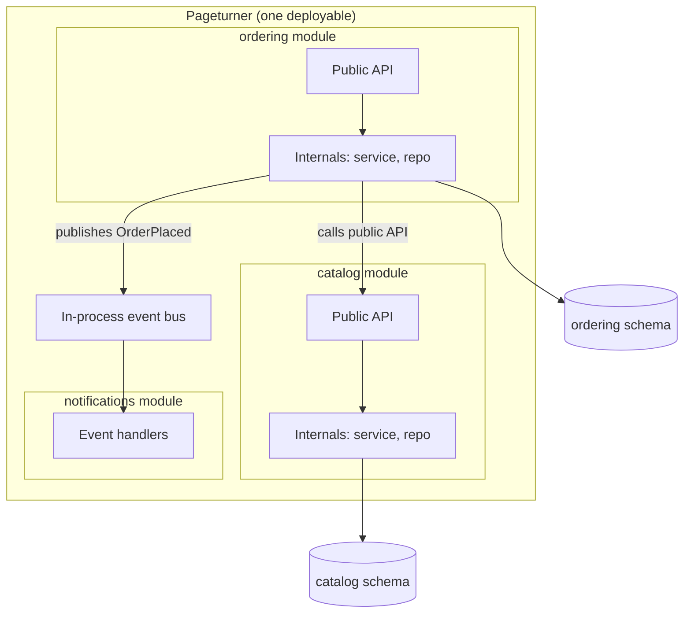
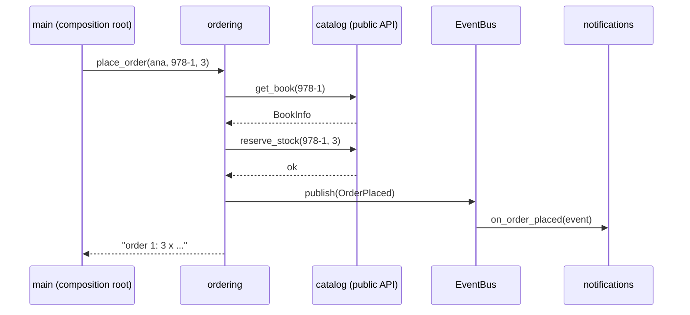

# Modular Monolith

## Introduction

A **modular monolith** is a monolith whose code is split into **modules organized around business capabilities**, with **strict rules** about how modules may depend on each other. It is still deployed as one unit, but internally it behaves much like a set of services that talk through function calls instead of the network.

Each module:

- represents one business capability, such as catalog, ordering, payments or notifications
- exposes a small **public API** and hides everything else
- owns its **data** (its own tables or database schema)
- talks to other modules only through their public APIs or through **events**

The analogy: a plain monolith is a big open-plan office where anyone can walk to any desk and grab any file. A modular monolith is the same building divided into departments. Each department has a front desk (its public API) and a locked filing room (its internals and data). You can still walk down the hall to ask a question, which is much faster than mailing a letter to another building (a microservice call), but you cannot rummage through someone else's files.

The style has become a mainstream recommendation. Martin Fowler's [MonolithFirst](https://martinfowler.com/bliki/MonolithFirst.html) suggests designing a monolith carefully with modularity in mind so it can be split later if needed, Shopify chose to modularize its huge Rails monolith rather than split it ([Deconstructing the Monolith](https://shopify.engineering/deconstructing-monolith-designing-software-maximizes-developer-productivity), 2019), and the Spring team ships [Spring Modulith](https://spring.io/projects/spring-modulith) specifically to support this style in Java.

## Modules vs Layers

A layered app partitions code by **technical role**. A modular monolith partitions it by **business capability** first, and may use layers *inside* each module.



Rules you can read off the diagram:

- `ordering` calls `catalog` **only** through the catalog's public API.
- `notifications` does not call `ordering` at all. It reacts to an event.
- Each module has its own schema. No module reads another module's tables.

## The Problem: A Monolith Without Boundaries

Pageturner's ordering code needed a "margin report", so a developer did the quick thing and imported the catalog's internal record type:

```python
# ordering/reports.py  (the "before" version)
from bookstore.catalog.internal.store import BOOKS  # reaching into catalog internals


def margin_report() -> list[tuple[str, int]]:
    return [(b.title, b.price_cents - b.supplier_cost_cents) for b in BOOKS.values()]
```

This compiles and works. It also means:

- the catalog team can no longer rename `supplier_cost_cents` or change how books are stored without breaking ordering
- confidential supplier costs now flow into a module that should never see them
- if the catalog is ever extracted into a service, this line becomes a network call over a data structure that was never designed as an API

Multiply this by hundreds of shortcuts and you get the [big ball of mud](./2-arch-monolith.mdx).

## The Solution: Public APIs, Private Internals, Events

Here is a small but complete modular monolith in Python. The package layout:

```text
src/bookstore/
    shared/events.py           # tiny shared kernel: event types and bus
    catalog/__init__.py        # catalog PUBLIC API
    catalog/internal/store.py  # catalog private data and logic
    ordering/__init__.py       # ordering PUBLIC API
    ordering/internal/repo.py  # ordering private data
    notifications/__init__.py  # reacts to events
    main.py                    # composition root
```

### A tiny shared kernel: events

```python
from collections import defaultdict
from collections.abc import Callable
from dataclasses import dataclass


@dataclass(frozen=True)
class OrderPlaced:
    order_id: int
    customer_email: str
    isbn: str
    qty: int


Handler = Callable[[object], None]


class EventBus:
    """In-process publish/subscribe. Swap for a broker later if a module moves out."""

    def __init__(self) -> None:
        self._handlers: dict[type, list[Handler]] = defaultdict(list)

    def subscribe(self, event_type: type, handler: Handler) -> None:
        self._handlers[event_type].append(handler)

    def publish(self, event: object) -> None:
        for handler in self._handlers[type(event)]:
            handler(event)
```

Keep `shared` very small. Event definitions and a bus are fine. Business logic is not.

### The catalog module's public API

```python
"""Public API of the catalog module. Everything else in catalog/ is private."""
from dataclasses import dataclass

from bookstore.catalog.internal.store import BOOKS


@dataclass(frozen=True)
class BookInfo:
    isbn: str
    title: str
    price_cents: int


class OutOfStock(Exception):
    pass


def get_book(isbn: str) -> BookInfo | None:
    rec = BOOKS.get(isbn)
    return BookInfo(rec.isbn, rec.title, rec.price_cents) if rec else None


def reserve_stock(isbn: str, qty: int) -> None:
    rec = BOOKS[isbn]
    if rec.stock < qty:
        raise OutOfStock(f"only {rec.stock} left of {rec.title}")
    rec.stock -= qty


__all__ = ["BookInfo", "OutOfStock", "get_book", "reserve_stock"]
```

The public API returns a `BookInfo` data class, not the internal `BookRecord`. The confidential `supplier_cost_cents` field never leaves the module. If the margin report is a real need, the catalog team adds a deliberate API for it, and can decide who is allowed to call it.

### The ordering module

```python
"""Public API of the ordering module."""
from bookstore import catalog
from bookstore.ordering.internal.repo import ORDERS, next_id
from bookstore.shared.events import EventBus, OrderPlaced


class OrderingService:
    def __init__(self, bus: EventBus) -> None:
        self.bus = bus

    def place_order(self, email: str, isbn: str, qty: int) -> str:
        book = catalog.get_book(isbn)  # public API call, not catalog internals
        if book is None:
            return "unknown book"
        try:
            catalog.reserve_stock(isbn, qty)
        except catalog.OutOfStock as exc:
            return f"rejected: {exc}"
        order_id = next_id()
        ORDERS[order_id] = {"isbn": isbn, "qty": qty, "total": book.price_cents * qty}
        self.bus.publish(OrderPlaced(order_id, email, isbn, qty))
        return f"order {order_id}: {qty} x {book.title} = ${book.price_cents * qty / 100:.2f}"


__all__ = ["OrderingService"]
```

### The notifications module

```python
"""Notifications module: reacts to events, owns no other module's data."""
from bookstore.shared.events import EventBus, OrderPlaced


def on_order_placed(event: object) -> None:
    assert isinstance(event, OrderPlaced)
    print(f"[notifications] email to {event.customer_email}: order {event.order_id} confirmed")


def register(bus: EventBus) -> None:
    bus.subscribe(OrderPlaced, on_order_placed)
```

### The composition root

```python
"""Composition root: the only place that knows about every module."""
from bookstore import notifications
from bookstore.ordering import OrderingService
from bookstore.shared.events import EventBus

bus = EventBus()
notifications.register(bus)
ordering = OrderingService(bus)

print(ordering.place_order("ana@example.com", "978-1", 3))
print(ordering.place_order("ben@example.com", "978-1", 3))
```

Run it from the folder that contains `src`:

```bash
PYTHONPATH=src python3 -m bookstore.main
```

Output:

```text
[notifications] email to ana@example.com: order 1 confirmed
order 1: 3 x Domain-Driven Design = $164.97
rejected: only 1 left of Domain-Driven Design
```

Notice the two kinds of communication:

- **Synchronous API call** (`catalog.reserve_stock`) when ordering needs an answer *now* and the order must fail if stock is short.
- **Event** (`OrderPlaced`) for side effects that ordering should not care about. Adding SMS notifications, loyalty points or analytics means adding a subscriber, without touching ordering.



:::note
The in-process bus here runs handlers synchronously inside the same call. If the email handler raises an exception, the order call fails too. Real systems often record events in a table within the same transaction and process them afterwards (the [Transactional Outbox](../9-arch-distributed-systems/6-arch-outbox.mdx) idea), which also makes a later move to a real broker easier.
:::

## Enforcing the Boundaries

Python's leading underscore and `__all__` are conventions, not walls. Anyone can still type `from bookstore.catalog.internal.store import BOOKS`. Boundaries that are not checked automatically erode. Use a tool.

### Python: Import Linter

[Import Linter](https://import-linter.readthedocs.io/) checks imports against contracts. The `protected` contract says "only these importers may import this package", and `acyclic_siblings` forbids dependency cycles between the top-level modules:

```toml
[tool.importlinter]
root_package = "bookstore"

[[tool.importlinter.contracts]]
name = "Catalog internals are private"
type = "protected"
protected_modules = ["bookstore.catalog.internal"]
allowed_importers = ["bookstore.catalog"]

[[tool.importlinter.contracts]]
name = "Ordering internals are private"
type = "protected"
protected_modules = ["bookstore.ordering.internal"]
allowed_importers = ["bookstore.ordering"]

[[tool.importlinter.contracts]]
name = "No dependency cycles between modules"
type = "acyclic_siblings"
ancestors = ["bookstore"]
```

```bash
pip install import-linter
PYTHONPATH=src lint-imports --no-logo
```

With the "before" shortcut added to ordering, the check fails:

```text
Catalog internals are private BROKEN
Ordering internals are private KEPT
No dependency cycles between modules KEPT

Contracts: 2 kept, 1 broken.

----------------
Broken contracts
----------------

Catalog internals are private
-----------------------------

Illegal imports of protected package bookstore.catalog.internal:

- bookstore.ordering -> bookstore.catalog.internal.store (l.3)
```

The `protected` and `acyclic_siblings` contract types are relatively recent additions (this output is from Import Linter 2.15). If your version does not have them, a `forbidden` contract per module achieves the same result. Check the docs for your version.

### Java: Spring Modulith

In Spring Boot, [Spring Modulith](https://docs.spring.io/spring-modulith/reference/fundamentals.html) treats each direct sub-package of the main application package as a module, and treats sub-packages of a module (such as `order.internal`) as internal. One test verifies the rules, including "no cycles between modules":

```java
import org.junit.jupiter.api.Test;
import org.springframework.modulith.core.ApplicationModules;

class ModularityTests {

    @Test
    void verifiesModularStructure() {
        // Fails the build if a module uses another module's internals or modules form a cycle
        ApplicationModules.of(Application.class).verify();
    }
}
```

Spring Modulith also helps with event publication between modules and can generate module documentation. Its APIs evolve between major versions, so check the reference docs for your version.

### Ruby: Packwerk

Shopify built and open-sourced [Packwerk](https://shopify.engineering/enforcing-modularity-rails-apps-packwerk) to enforce package boundaries in Rails monoliths. A 2024 [retrospective](https://railsatscale.com/2024-01-26-a-packwerk-retrospective/) on the Rails at Scale blog is an honest read about what worked and what did not. A key lesson is that tools only help if the module boundaries match the real domain.

## Data Ownership Inside One Database

Modules should own their data even when they share a database server. Common options, from weakest to strongest:

| Option | How | Trade-off |
| --- | --- | --- |
| Table naming convention | `catalog_books`, `ordering_orders` | Easy, but nothing stops cross-module joins |
| Schema per module | `catalog.books`, `ordering.orders`, separate DB users with grants | Database enforces ownership; cross-module joins become explicit |
| Database per module | Separate databases on one server | Strongest isolation; no cross-module transactions |

Schema per module is a good default. It also makes later extraction of a module into a service much easier, because its data is already separate. The deeper trade-offs are covered in [Database per Service vs Shared Database](../11-arch-data-architecture/0-arch-database-per-service.mdx).

:::tip
You give up some convenience: no SQL joins across modules. A report that needs data from three modules either calls three public APIs, or reads from a dedicated reporting model that is fed by events. That friction is the point. It makes coupling visible.
:::

## Real-World Scenario

Pageturner has grown. There are now **25 developers in four teams**: Catalog and Search, Checkout, Customer Accounts, and Marketing. The original monolith works, but merge conflicts are constant, a Marketing change broke checkout twice last quarter, and nobody wants to touch `utils.py`. Someone proposes "let's move to microservices".

**The solution:** turn the monolith into a modular monolith first.

1. Run [Event Storming](../8-arch-domain-driven-design/7-arch-event-storming.mdx) workshops to find business boundaries. Align modules with [bounded contexts](../8-arch-domain-driven-design/2-arch-bounded-contexts.mdx) and with team ownership.
2. Create one top-level package per module, each with a public API and an `internal` package.
3. Add Import Linter contracts in CI, initially with `ignore_imports` entries for existing violations, and burn the list down sprint by sprint.
4. Move each module's tables into its own schema.
5. Replace direct calls for side effects (emails, loyalty, analytics) with events.
6. Record the decision and its revisit criteria in an [ADR](../13-arch-documenting-and-evolving/0-arch-decision-records.mdx).

### Why this approach

- The pain is **coupling and ownership**, not scaling or deployment. Modules fix coupling and ownership directly.
- It keeps **local transactions**, one deployment pipeline and one place to debug.
- It is **reversible and incremental**. Each step is valuable on its own.
- It prepares for extraction. If, a year later, Search needs its own scaling and release cycle, it already has a clean API, its own schema and event-based integration. Extracting it becomes a planned move, not a rescue mission.

### When to use it, and when not to

Use a modular monolith when:

- you have a few teams (roughly two to ten) working on one product
- business boundaries are known or can be discovered
- you want team ownership without the cost of distributed systems

It may not be enough when:

- modules need **different technology stacks** or runtimes
- modules have **very different scaling or availability needs**, and scaling the whole app is too costly
- teams need to **deploy many times a day independently**, and a shared pipeline is the bottleneck even after you invest in it
- **regulatory isolation** requires a component (such as card payments) to run separately

In those cases, extract the specific modules that need it, using the [Strangler Fig](../9-arch-distributed-systems/11-arch-strangler-fig.mdx) approach.

### Alternatives and trade-offs

| Approach | Pros | Cons | Best for |
| --- | --- | --- | --- |
| Plain monolith | Simplest | Coupling grows unchecked | Small teams, early products |
| Modular monolith | Clear ownership, local transactions, one deploy | One runtime and stack, shared failure domain | Most growing products |
| Service-based (a few coarse services) | Some independent deploys | Often still share a database | Gradual migrations |
| [Microservices](./4-arch-microservices.mdx) | Independent deploy, scale and tech per service | Network, data consistency and operational costs | Many teams, divergent needs |

## Common Mistakes

1. **Modules by technical layer.** A `database` module and an `api` module are layers, not modules. Modules should map to business capabilities.
2. **A fat shared kernel.** If `shared` grows business logic, every module depends on it and you are back to a ball of mud. Keep it to event types, IDs and small utilities.
3. **Leaking internal types.** Returning ORM entities from a public API exposes internals. Return small data classes owned by the API.
4. **Cross-module database joins.** They create hidden coupling that no import checker can see. Enforce schema ownership with database permissions.
5. **Chatty synchronous calls between modules.** If ordering calls catalog twenty times per request, the boundary is probably in the wrong place. Reconsider the boundary, or keep a local copy of the data, updated by events.
6. **Enforcement as an afterthought.** Add the boundary checks to CI on day one, even if they start with a list of ignored legacy violations.

## Summary

- A modular monolith is **one deployable unit** split into **business modules** with public APIs, private internals and owned data.
- Modules communicate by **public API calls** when they need an answer and by **events** for side effects.
- Boundaries must be **enforced by tools**: Import Linter in Python, Spring Modulith (or ArchUnit) in Java, Packwerk in Ruby.
- Data ownership inside one database is best done with a **schema per module**.
- For most growing products, a modular monolith gives the main organizational benefits of microservices at a fraction of the cost, and it makes later extraction much easier.

## Further Learning

**Exercises**

1. Add a `loyalty` module that subscribes to `OrderPlaced` and awards 10 points per book. You should not need to change `ordering` at all. Did you?
2. Implement the margin report properly: add a function to the catalog public API that returns margins, and decide who may call it.
3. Add an import from `catalog` to `ordering` (for example, to show "recently ordered" on a book page). Run `lint-imports`. What does the cycle check report, and how would you redesign it with an event instead?
4. Sketch a schema-per-module plan for Pageturner's database, including which database user each module connects with.

**Related pages**

- [Monolithic Architecture](./2-arch-monolith.mdx)
- [Microservices Architecture](./4-arch-microservices.mdx)
- [Coupling and Cohesion](../0-arch-fundamentals/5-arch-coupling-and-cohesion.mdx)
- [Structuring a Codebase](../7-arch-clean-architecture/6-arch-structuring-a-codebase.mdx)
- [Case Study: Breaking Up a Monolith](../14-arch-case-studies/7-arch-case-monolith-to-microservices.mdx)

**Sources**

- [Martin Fowler: MonolithFirst](https://martinfowler.com/bliki/MonolithFirst.html)
- [Shopify Engineering: Deconstructing the Monolith](https://shopify.engineering/deconstructing-monolith-designing-software-maximizes-developer-productivity) and [Under Deconstruction: The State of Shopify's Monolith](https://shopify.engineering/shopify-monolith)
- [Spring Modulith reference documentation](https://docs.spring.io/spring-modulith/reference/fundamentals.html)
- [Import Linter documentation](https://import-linter.readthedocs.io/)
