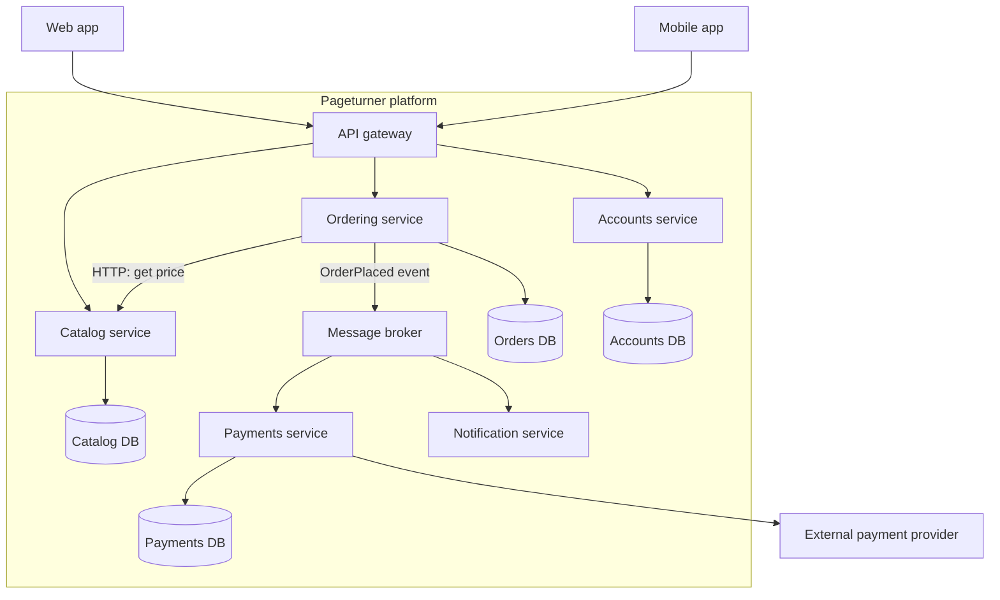
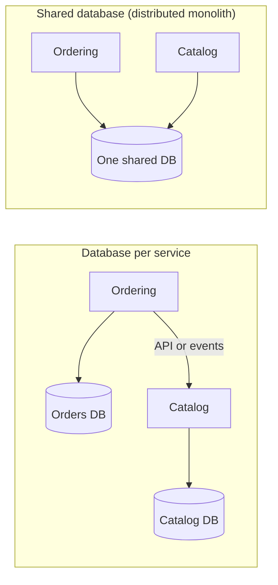

# Microservices Architecture

## Introduction

**Microservices** structure an application as a set of small services, each of which:

- implements one **business capability** (catalog, ordering, payments)
- runs in its **own process** and is **deployed independently**
- **owns its data**, which no other service reads or writes directly
- talks to other services over the network, through APIs or messages
- is owned by **one team**

The term took off with James Lewis and Martin Fowler's 2014 article [Microservices](https://martinfowler.com/articles/microservices.html), which describes nine common characteristics, including "organized around business capabilities", "smart endpoints and dumb pipes", "decentralized data management" and "design for failure". Chris Richardson's [microservices.io](https://microservices.io/patterns/microservices.html) catalogs the patterns that go with the style.

The analogy: a [modular monolith](./3-arch-modular-monolith.mdx) is one building divided into departments. Microservices are a **campus of separate buildings**. Each building has its own staff, its own opening hours and its own storage room. One building can be renovated without closing the others. But every question between departments now means walking across campus, possibly in the rain, and sometimes the other building is closed.

The key benefit of microservices is **organizational**: many teams can change, deploy and scale their parts independently. The key cost is **distribution**: everything that used to be a function call is now a network call that can be slow, fail or arrive twice.

## What a Microservices System Looks Like



The supporting pieces you will almost always need:

- an [API gateway](../10-arch-integration-and-apis/4-arch-api-gateway.mdx) so clients do not call twenty services directly
- a **message broker** such as [RabbitMQ](/docs/middleware/rabbitmq) or Kafka for asynchronous communication
- [service discovery and load balancing](../9-arch-distributed-systems/10-arch-service-discovery.mdx), often provided by [Kubernetes](/docs/devops/kubernetes)
- centralized logs, metrics and distributed tracing (see [Designing for Observability](../12-arch-quality-and-operations/3-arch-observability.mdx))
- one CI/CD pipeline per service

## From Function Call to Network Call

In the modular monolith, ordering called `catalog.get_book(isbn)`. In microservices, that becomes an HTTP request. The example below runs a tiny catalog service and an ordering client in one script, using only the standard library, so you can see exactly what changes.

```python
import json
import threading
import urllib.error
import urllib.request
from http.server import BaseHTTPRequestHandler, ThreadingHTTPServer

# ----------------------------- catalog service -----------------------------
CATALOG_DB = {"978-1": {"isbn": "978-1", "title": "Building Microservices", "price_cents": 4999}}


class CatalogHandler(BaseHTTPRequestHandler):
    def do_GET(self) -> None:
        isbn = self.path.removeprefix("/books/")
        book = CATALOG_DB.get(isbn)
        body = json.dumps(book or {"error": "not found"}).encode()
        self.send_response(200 if book else 404)
        self.send_header("Content-Type", "application/json")
        self.send_header("Content-Length", str(len(body)))
        self.end_headers()
        self.wfile.write(body)

    def log_message(self, *args: object) -> None:  # keep the demo output quiet
        pass


def start_catalog() -> ThreadingHTTPServer:
    server = ThreadingHTTPServer(("127.0.0.1", 0), CatalogHandler)  # 0 = any free port
    threading.Thread(target=server.serve_forever, daemon=True).start()
    return server


# ----------------------------- ordering service ----------------------------
class CatalogClient:
    """Ordering's only view of catalog: an HTTP API with a timeout."""

    def __init__(self, base_url: str, timeout_s: float = 0.5) -> None:
        self.base_url = base_url
        self.timeout_s = timeout_s

    def get_book(self, isbn: str) -> dict | None:
        url = f"{self.base_url}/books/{isbn}"
        try:
            with urllib.request.urlopen(url, timeout=self.timeout_s) as resp:
                return json.load(resp)
        except urllib.error.HTTPError as exc:
            if exc.code == 404:
                return None
            raise


def quote_order(catalog: CatalogClient, isbn: str, qty: int) -> str:
    try:
        book = catalog.get_book(isbn)
    except (urllib.error.URLError, TimeoutError) as exc:
        # The network is not reliable: decide what the business wants here.
        return f"catalog unavailable ({type(exc).__name__}); please retry shortly"
    if book is None:
        return "unknown book"
    return f"{qty} x {book['title']} = ${book['price_cents'] * qty / 100:.2f}"


if __name__ == "__main__":
    server = start_catalog()
    host, port = server.server_address[:2]
    client = CatalogClient(f"http://{host}:{port}")

    print(quote_order(client, "978-1", 2))
    print(quote_order(client, "000-0", 1))

    server.shutdown()
    server.server_close()  # simulate the catalog service going down
    print(quote_order(client, "978-1", 2))
```

Output:

```text
2 x Building Microservices = $99.98
unknown book
catalog unavailable (URLError); please retry shortly
```

What the network forced us to add, compared with a function call:

- **A timeout.** Without one, a slow catalog makes ordering slow too, and eventually exhausts its threads.
- **Error handling for "the other side is down".** The third call shows it. The business has to decide what happens: fail, retry, use a cached price, or queue the order.
- **Serialization.** Data crosses the boundary as JSON. Field names are now a public contract that both teams must evolve carefully (see [API Versioning and Evolution](../10-arch-integration-and-apis/6-arch-api-versioning.mdx)).

In production you would add retries with backoff, a [circuit breaker](../9-arch-distributed-systems/8-arch-circuit-breaker.mdx), authentication between services, and tracing headers. Each of these is a good pattern, and each is code you did not need in a monolith.

## The Arithmetic of Synchronous Chains

When one user request has to pass synchronously through several services, their availabilities multiply. If each service is up 99.9 percent of the time and failures are independent:

```python
MINUTES_PER_MONTH = 30 * 24 * 60


def chain_availability(per_service: float, services_in_chain: int) -> float:
    """Every service must be up for the request to succeed (independent failures)."""
    return per_service**services_in_chain


for n in (1, 3, 5, 10):
    a = chain_availability(0.999, n)
    downtime = (1 - a) * MINUTES_PER_MONTH
    print(f"{n:>2} services at 99.9% each -> {a:.4%} overall, ~{downtime:.0f} min/month down")
```

Output:

```text
 1 services at 99.9% each -> 99.9000% overall, ~43 min/month down
 3 services at 99.9% each -> 99.7003% overall, ~129 min/month down
 5 services at 99.9% each -> 99.5010% overall, ~216 min/month down
10 services at 99.9% each -> 99.0045% overall, ~430 min/month down
```

This is a simplified model, but the lesson holds: **long synchronous call chains erode availability and add latency**. That is why microservice designs prefer:

- asynchronous events for anything that does not need an immediate answer
- local copies of data that other services own, kept up to date by events (event-carried state transfer, see [Event-Driven Architecture](./5-arch-event-driven.mdx))
- graceful degradation, such as showing a book page without recommendations when the recommendation service is down

## Data: Each Service Owns Its Own

"Database per service" is the constraint that makes microservices independent, and the one that teams most often break.



With a shared database, a schema change by the catalog team can break ordering, both services must be deployed together, and you have built a **distributed monolith**: the costs of distribution without the independence.

Owning data separately has its own costs:

- **No cross-service transactions.** Placing an order that reserves stock and charges a card becomes a [Saga](../9-arch-distributed-systems/5-arch-saga.mdx) with compensating steps.
- **No cross-service joins.** "Orders with book titles" needs [API composition or CQRS](../9-arch-distributed-systems/3-arch-cqrs.mdx).
- **Eventual consistency.** Different services may briefly disagree. See [Consistency Models](../9-arch-distributed-systems/2-arch-consistency-models.mdx).

More on this trade-off in [Database per Service vs Shared Database](../11-arch-data-architecture/0-arch-database-per-service.mdx).

## Keeping Services Independent: Contracts

Independent deployment only works if one team's release does not silently break another team's service. In a monolith the compiler and the test suite catch a renamed field. Between services, nothing does unless you add it.

**Consumer-driven contract testing** flips the usual direction: each *consumer* states which parts of the provider's API it relies on, and the *provider* checks those expectations in its own CI before every deploy. Tools such as Pact implement this properly. The idea fits in a few lines:

```python
# The ordering team publishes what it relies on from catalog's GET /books/{isbn}.
ORDERING_EXPECTS = {"isbn": str, "title": str, "price_cents": int}


def check_contract(sample_response: dict, expected: dict[str, type]) -> list[str]:
    problems = []
    for field, field_type in expected.items():
        if field not in sample_response:
            problems.append(f"missing field '{field}'")
        elif not isinstance(sample_response[field], field_type):
            problems.append(f"'{field}' should be {field_type.__name__}")
    return problems  # extra fields are fine: consumers must ignore what they don't use


# Catalog's CI runs the check against its real handler output before deploying.
current = {"isbn": "978-1", "title": "Building Microservices", "price_cents": 4999}
proposed = {"isbn": "978-1", "title": "Building Microservices", "price": {"amount": "49.99"}}

print("current :", check_contract(current, ORDERING_EXPECTS) or "contract kept")
print("proposed:", check_contract(proposed, ORDERING_EXPECTS) or "contract kept")
```

Output:

```text
current : contract kept
proposed: ["missing field 'price_cents'"]
```

The catalog team wanted to restructure prices. The contract check tells them, before deployment, that ordering would break. They can add the new `price` field *alongside* `price_cents`, let ordering migrate, and remove the old field later. This "expand, then contract" approach is covered in [API Versioning and Evolution](../10-arch-integration-and-apis/6-arch-api-versioning.mdx) and in [Designing for Testability](../12-arch-quality-and-operations/5-arch-testability.mdx).

## How Big Is "Micro"?

There is no correct line count. Useful guides:

- **One team should own a service end to end**, and one team can own several services. Team Topologies calls these *stream-aligned teams*.
- **Align services with [bounded contexts](../8-arch-domain-driven-design/2-arch-bounded-contexts.mdx)**, not with database tables or CRUD entities. A `BookService`, `AuthorService` and `PriceService` that must always change together are one service split three ways.
- **Changes should usually stay inside one service.** If most features require coordinated releases of three services, the boundaries are wrong.

## Prerequisites

Martin Fowler's [MicroservicePrerequisites](https://martinfowler.com/bliki/MicroservicePrerequisites.html) lists three capabilities you should have *before* adopting microservices:

1. **Rapid provisioning**: you can get a new server or environment in hours, not weeks.
2. **Basic monitoring**: you can detect problems across many services quickly.
3. **Rapid application deployment**: each service can be deployed (and rolled back) quickly through an automated pipeline.

To those, most teams today add: distributed tracing, contract testing between services, a platform team or managed platform, and on-call ownership per team.

## Strengths and Weaknesses

Based on the forces listed by [microservices.io](https://microservices.io/patterns/microservices.html) and the [Azure microservices style guide](https://learn.microsoft.com/en-us/azure/architecture/guide/architecture-styles/microservices):

| Strengths | Weaknesses |
| --- | --- |
| Teams develop, test and deploy independently | Distributed operations are harder to build, debug and test |
| Each service can scale on its own | Network calls add latency and partial failures |
| Faults can be isolated (one service down, others keep working) | Data consistency needs sagas and eventual consistency |
| Each service can pick a suitable technology | Many pipelines, dashboards and on-call rotations |
| Small code bases are easier to understand | Design-time coupling can force lockstep changes across services |

## Real-World Scenario

Pageturner is now a large company: **120 engineers in 14 teams**. The modular monolith from the previous page served it well, but three concrete problems appeared:

- **Search** needs to scale to many times the capacity of the rest of the site during sales, and runs on a different technology (a search engine plus a Python ranking model).
- **Payments** falls under stricter compliance requirements. Auditors want it isolated, with a separate deployment and restricted access.
- The single deployment pipeline is a bottleneck. Even after speeding it up, 14 teams queue behind each other, and a bug in one module blocks everyone's release.

**The solution:** extract services where the reasons are concrete, not everywhere.

1. Extract **Search** first. It already has a clean module API and its own schema. Feed it with `BookUpdated` events from catalog.
2. Extract **Payments** into a separate service with its own database and restricted network access.
3. Keep the rest (catalog, cart, ordering, accounts) in the modular monolith for now. Extract further modules only when a team hits a concrete limit.
4. Put an API gateway in front, so clients do not notice the change.
5. Use the [Strangler Fig](../9-arch-distributed-systems/11-arch-strangler-fig.mdx) approach: route traffic to the new service gradually, with the old path as a fallback.

### Why this approach

- Each extraction solves a **named problem**: scaling and tech stack for Search, compliance for Payments, release contention for the teams.
- The remaining monolith keeps local transactions for checkout, the most consistency-sensitive flow.
- It avoids a risky "big bang" rewrite.

### When to use microservices, and when not to

Use them when:

- many teams must deploy independently and frequently
- parts of the system have clearly different scaling, availability, security or technology needs
- you have the platform maturity: automated provisioning, deployment, monitoring and tracing
- the domain boundaries are understood well enough to draw service lines that will not move every month

Avoid them when:

- you are a small team or an early-stage product (see [Monolithic Architecture](./2-arch-monolith.mdx))
- the main motivation is "it looks good on a CV" or "big companies do it"
- you need strong consistency across most operations
- you lack the operational basics above

### Alternatives and trade-offs

| Approach | Pros | Cons | Best for |
| --- | --- | --- | --- |
| [Modular monolith](./3-arch-modular-monolith.mdx) | Clear boundaries, local transactions, one deploy | Shared runtime and release | Most products up to several teams |
| Modular monolith plus a few services | Extract only where needed | Two operational models to run | Large products with a few special parts |
| Service-based (coarse services, shared DB) | Fewer, bigger services, simpler data | DB coupling limits independence | Gradual migrations |
| Fine-grained microservices | Maximum team and scaling independence | Highest operational and consistency cost | Very large organizations |
| [Serverless](./6-arch-serverless.mdx) | No servers, scale to zero | Vendor coupling, limits, cold starts | Event-driven, spiky workloads |

There are well-known stories in both directions. Segment published [Goodbye Microservices](https://www.twilio.com/en-us/blog/developers/best-practices/goodbye-microservices) (2018), describing how they consolidated many per-destination services back into one service because the operational overhead outweighed the benefits. Many large companies, on the other hand, credit microservices with letting hundreds of teams ship independently. The difference is usually context: team size, domain, and platform maturity.

## Common Mistakes

1. **The distributed monolith.** Services that share a database, share a deployment schedule or must be released together. You pay for distribution and get none of the independence.
2. **Splitting by entity instead of capability.** `BookService`, `PriceService` and `StockService` that always change together. Split by business capability instead.
3. **Chatty synchronous chains.** One page view calls eight services in sequence. Use events, local read models and API composition at the gateway.
4. **Ignoring observability.** Without correlation IDs and tracing, a failure in a chain of services is very hard to diagnose.
5. **Too many services for the team.** A team of six running thirty services spends its time on plumbing. A rough guide is to have fewer services than developers, and often far fewer.
6. **Starting with microservices before knowing the domain.** Wrong boundaries are much more expensive to fix across services than inside a monolith. See [MonolithFirst](https://martinfowler.com/bliki/MonolithFirst.html).
7. **Shared libraries with business logic.** A shared "domain" library that every service must upgrade together is coupling in disguise.

## Summary

- Microservices are **independently deployable services organized around business capabilities**, each owning its data and owned by one team.
- The main benefit is **organizational scaling**: independent deployment, scaling and technology choices per team.
- The main cost is **distribution**: network failures, latency, eventual consistency, sagas and heavy operational needs.
- **Database per service** is the constraint that makes services independent. Sharing a database creates a distributed monolith.
- Have the **prerequisites** (fast provisioning, monitoring, automated deployment) before you start.
- Most teams should start with a modular monolith and **extract services for concrete reasons**.

## Further Learning

**Exercises**

1. Add a simple retry with exponential backoff to `CatalogClient.get_book`, limited to three attempts. When would retrying make things worse?
2. Give ordering a local cache of book prices that is used when the catalog is down. What business risk does that introduce, and how would you limit it?
3. Draw the Pageturner checkout flow (reserve stock, charge card, confirm order) as a saga across three services. What are the compensating actions?
4. Use the availability script to compare a design with five synchronous hops against one with two synchronous hops and three asynchronous events.

**Related pages**

- [Event-Driven Architecture](./5-arch-event-driven.mdx)
- [Distributed Systems Fundamentals](../9-arch-distributed-systems/0-arch-distributed-fundamentals.mdx)
- [Synchronous vs Asynchronous Communication](../10-arch-integration-and-apis/0-arch-communication-styles.mdx)
- [Conway's Law and Team Topologies](../0-arch-fundamentals/9-arch-conways-law.mdx)
- [Case Study: Breaking Up a Monolith](../14-arch-case-studies/7-arch-case-monolith-to-microservices.mdx)

**Sources**

- [James Lewis and Martin Fowler: Microservices](https://martinfowler.com/articles/microservices.html) (2014)
- [Chris Richardson: Microservice Architecture pattern](https://microservices.io/patterns/microservices.html)
- [Martin Fowler: MicroservicePrerequisites](https://martinfowler.com/bliki/MicroservicePrerequisites.html) and [MicroservicePremium](https://martinfowler.com/bliki/MicroservicePremium.html)
- [Azure Architecture Center: Microservices architecture style](https://learn.microsoft.com/en-us/azure/architecture/guide/architecture-styles/microservices)
- Sam Newman, *Building Microservices*, 2nd edition (O'Reilly)
