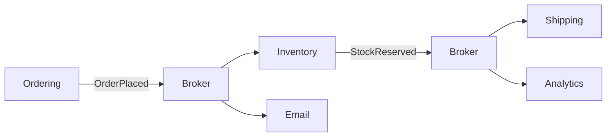
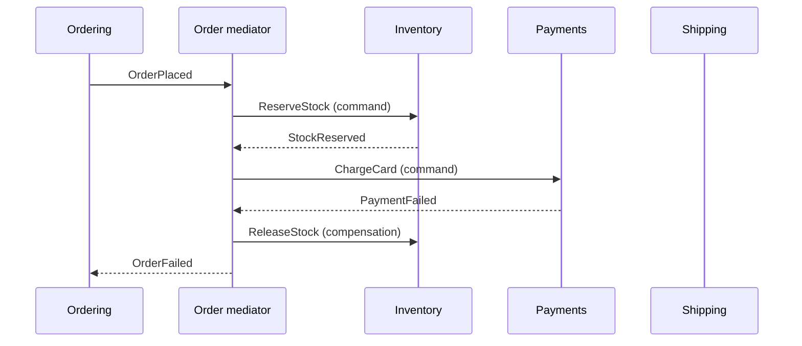

# Event-Driven Architecture

## Introduction

In an **event-driven architecture (EDA)**, components communicate by producing and reacting to **events**: records of something that has already happened, such as `OrderPlaced`, `PaymentCaptured` or `BookPriceChanged`.

- A **producer** publishes an event and moves on. It does not know who, if anyone, is listening.
- A **broker** (an event bus, message broker or log such as RabbitMQ or Kafka) stores and delivers events.
- **Consumers** subscribe to the events they care about and react in their own time.

The analogy is a newspaper. The newsroom publishes the morning edition without knowing who will read it. Readers subscribe to the sections they want. A new reader can subscribe tomorrow, and the newsroom changes nothing. Compare that with phoning each person who might care: you would need a list, you would wait for each person to answer, and you would be stuck when someone does not pick up.

The [Azure Architecture Center](https://learn.microsoft.com/en-us/azure/architecture/guide/architecture-styles/event-driven) describes EDA as producers and consumers decoupled through event channels, a good fit for near real-time processing and high volumes, with challenges around guaranteed delivery, ordering and eventual consistency. You have already seen events *inside* a process on the [Modular Monolith](./3-arch-modular-monolith.mdx) page and the [Observer pattern](../4-arch-behavioral-patterns/1-arch-observer.mdx) page. EDA as an architectural style means events are the main way that **separately deployed** components work together.

## Events, Commands and Queries

These three kinds of message look similar on the wire but mean very different things.

| Kind | Tense | Example | Sender expects | Receivers |
| --- | --- | --- | --- | --- |
| Event | Past: "this happened" | `OrderPlaced` | Nothing | Zero, one or many |
| Command | Imperative: "do this" | `ReserveStock` | That it gets done (and maybe a reply) | Exactly one owner |
| Query | Question: "tell me" | `GetBookPrice` | An answer, now | Exactly one owner |

Getting this right matters. An event named `SendWelcomeEmail` is really a command in disguise. Martin Fowler calls this a "passive-aggressive command": the producer still depends on a specific consumer doing a specific thing, so the decoupling is an illusion.

## Four Things People Mean by "Event-Driven"

Martin Fowler's article [What do you mean by "Event-Driven"?](https://martinfowler.com/articles/201701-event-driven.html) separates four patterns that are often lumped together:

1. **Event notification:** a small event says "order A-7 was placed". Consumers call back for details if they need them. Low coupling, but the overall flow becomes hard to see.
2. **Event-carried state transfer:** the event carries the data consumers need (title, price, quantity), so they can keep a local copy and never call back. More resilience and less latency, at the cost of replicated data.
3. **[Event sourcing](../9-arch-distributed-systems/4-arch-event-sourcing.mdx):** the events *are* the source of truth. State is rebuilt by replaying them.
4. **[CQRS](../9-arch-distributed-systems/3-arch-cqrs.mdx):** separate models for writes and reads. Often used with events, but does not require them.

This page is mostly about the first two: events as the integration style between components.

## Topology 1: Broker (Choreography)

In the **broker topology** there is no central coordinator. Each component reacts to events and may publish new events. The workflow emerges from the chain of reactions, like dancers who each know their own steps. This is often called **choreography**.



The example below simulates a broker with `asyncio` queues. Each subscriber gets its own queue, just as each consumer group gets its own queue bound to an exchange in RabbitMQ. It also simulates **at-least-once delivery**, where the same event can arrive twice.

```python
import asyncio
import uuid
from collections import defaultdict
from dataclasses import dataclass, field


@dataclass(frozen=True)
class Event:
    type: str
    data: dict
    event_id: str = field(default_factory=lambda: uuid.uuid4().hex[:8])


class Broker:
    """Each subscriber gets its own queue, like a queue bound to a topic exchange."""

    def __init__(self) -> None:
        self.queues: dict[str, list[asyncio.Queue[Event]]] = defaultdict(list)

    def subscribe(self, event_type: str) -> asyncio.Queue[Event]:
        q: asyncio.Queue[Event] = asyncio.Queue()
        self.queues[event_type].append(q)
        return q

    async def publish(self, event: Event) -> None:
        for q in self.queues[event.type]:
            await q.put(event)


async def inventory_consumer(q: asyncio.Queue[Event], broker: Broker) -> None:
    seen: set[str] = set()  # idempotency: remember processed event ids
    while True:
        event = await q.get()
        if event.event_id in seen:
            print(f"  inventory: duplicate {event.event_id} ignored")
        else:
            seen.add(event.event_id)
            print(f"  inventory: reserved {event.data['qty']} x {event.data['isbn']}")
            await broker.publish(Event("StockReserved", {"order_id": event.data["order_id"]}))
        q.task_done()


async def email_consumer(q: asyncio.Queue[Event]) -> None:
    while True:
        event = await q.get()
        await asyncio.sleep(0.01)  # a slow consumer does not slow down the others
        print(f"  email: confirmation sent for {event.data['order_id']}")
        q.task_done()


async def shipping_consumer(q: asyncio.Queue[Event]) -> None:
    while True:
        event = await q.get()
        print(f"  shipping: label created for {event.data['order_id']}")
        q.task_done()


async def main() -> None:
    broker = Broker()
    inv_q = broker.subscribe("OrderPlaced")
    mail_q = broker.subscribe("OrderPlaced")
    ship_q = broker.subscribe("StockReserved")
    workers = [
        asyncio.create_task(inventory_consumer(inv_q, broker)),
        asyncio.create_task(email_consumer(mail_q)),
        asyncio.create_task(shipping_consumer(ship_q)),
    ]

    placed = Event("OrderPlaced", {"order_id": "A-7", "isbn": "978-1", "qty": 1}, "evt-001")
    print("ordering: publish OrderPlaced and return to the customer immediately")
    await broker.publish(placed)
    await broker.publish(placed)  # at-least-once delivery: the same event arrives twice

    for q in (inv_q, mail_q, ship_q):
        await q.join()
    for w in workers:
        w.cancel()


asyncio.run(main())
```

Output:

```text
ordering: publish OrderPlaced and return to the customer immediately
  inventory: reserved 1 x 978-1
  inventory: duplicate evt-001 ignored
  shipping: label created for A-7
  email: confirmation sent for A-7
  email: confirmation sent for A-7
```

What this shows:

- **Ordering returns immediately.** It does not wait for inventory, email or shipping.
- **Consumers work at their own pace.** The slow email consumer does not delay shipping.
- **Shipping is triggered by inventory, not by ordering.** Nobody wrote the full workflow down in one place.
- **Duplicates happen.** Inventory is **idempotent**: it remembers event IDs and ignores the repeat. Email is *not* idempotent, so the customer gets two confirmations. In a real system, track processed IDs in a durable store (see [Idempotency](../9-arch-distributed-systems/7-arch-idempotency.mdx)).

Most production brokers guarantee **at-least-once** delivery, because guaranteeing exactly-once delivery across a network is very hard. Some platforms offer exactly-once processing within their own boundaries, with conditions. Read the delivery guarantees in your broker's documentation, and design consumers to be idempotent anyway.

## Topology 2: Mediator (Orchestration)

In the **mediator topology**, a central component (an orchestrator, workflow engine or process manager) receives the initiating event and tells each component what to do, step by step. This is **orchestration**: a conductor leads the orchestra.



The mediator owns the workflow and the error handling, including **compensating actions** when a later step fails:

```python
from collections.abc import Callable
from dataclasses import dataclass


@dataclass
class Step:
    name: str
    action: Callable[[dict], None]
    compensate: Callable[[dict], None]


def reserve_stock(o: dict) -> None:
    print(f"  reserve {o['qty']} x {o['isbn']}")


def release_stock(o: dict) -> None:
    print(f"  release {o['qty']} x {o['isbn']}")


def charge_card(o: dict) -> None:
    if o["card"] == "declined":
        raise RuntimeError("card declined")
    print(f"  charge ${o['total']:.2f}")


def refund_card(o: dict) -> None:
    print(f"  refund ${o['total']:.2f}")


def create_shipment(o: dict) -> None:
    print(f"  ship order {o['id']}")


class OrderMediator:
    """Orchestrates the workflow centrally and knows how to undo finished steps."""

    steps = [
        Step("reserve stock", reserve_stock, release_stock),
        Step("charge card", charge_card, refund_card),
        Step("create shipment", create_shipment, lambda o: None),
    ]

    def run(self, order: dict) -> str:
        done: list[Step] = []
        for step in self.steps:
            try:
                step.action(order)
                done.append(step)
            except Exception as exc:
                print(f"  '{step.name}' failed: {exc}; compensating")
                for finished in reversed(done):
                    finished.compensate(order)
                return f"order {order['id']} FAILED"
        return f"order {order['id']} COMPLETED"


mediator = OrderMediator()
print(mediator.run({"id": "A-8", "isbn": "978-1", "qty": 1, "total": 49.99, "card": "ok"}))
print(mediator.run({"id": "A-9", "isbn": "978-1", "qty": 2, "total": 99.98, "card": "declined"}))
```

Output:

```text
  reserve 1 x 978-1
  charge $49.99
  ship order A-8
order A-8 COMPLETED
  reserve 2 x 978-1
  'charge card' failed: card declined; compensating
  release 2 x 978-1
order A-9 FAILED
```

In production the mediator is often a workflow engine (for example Temporal, AWS Step Functions, Azure Durable Functions or Camunda) that persists the workflow's state, so it survives crashes and can wait hours or days for a step. This is the orchestrated version of the [Saga pattern](../9-arch-distributed-systems/5-arch-saga.mdx).

### Choreography vs orchestration

| Aspect | Broker (choreography) | Mediator (orchestration) |
| --- | --- | --- |
| Where the workflow lives | Spread across consumers | In one place |
| Adding a new reaction | Just subscribe | Change the mediator |
| Error handling and compensation | Each consumer handles its own; hard to see overall | Central and explicit |
| Coupling | Very low | Components coupled to the mediator |
| Visibility of a running process | Needs tracing and event logs | Mediator shows state |
| Best for | Simple fan-out, independent reactions | Multi-step business processes with failure paths |

Many systems use both: choreography for loose side effects (emails, analytics), orchestration for the core business process (checkout, refunds).

## Hard Parts You Must Design For

- **Eventual consistency.** After `OrderPlaced`, there is a window where the order exists but stock is not yet reserved. UIs and business rules must tolerate this. See [Consistency Models](../9-arch-distributed-systems/2-arch-consistency-models.mdx).
- **Ordering.** Events can arrive out of order across partitions or retries. Kafka guarantees order within a partition, so key events by the entity (for example, by order ID) when order matters.
- **Publishing reliably.** "Save to the database, then publish" can crash in between. Use the [Transactional Outbox](../9-arch-distributed-systems/6-arch-outbox.mdx) or [Change Data Capture](../11-arch-data-architecture/5-arch-change-data-capture.mdx).
- **Poison messages.** An event that always fails will be retried forever unless you move it to a **dead-letter queue** after a few attempts.
- **Schema evolution.** Events are a public contract. Add fields, do not rename or remove them casually, and consider a schema registry. See [Schema Evolution and Data Migrations](../11-arch-data-architecture/7-arch-data-migrations.mdx).
- **Observability.** Put a correlation ID on every event so you can trace one order through all consumers.

## Real-World Scenario

Pageturner's checkout currently calls six things synchronously after payment: inventory, email, loyalty points, analytics, the recommendation engine and the warehouse system. Checkout takes several seconds, and whenever the recommendation engine is slow, customers cannot buy books. Marketing also wants to add an SMS notification and a "first purchase" coupon, and each addition means another change to checkout.

**The solution:**

1. Checkout keeps exactly one synchronous step that must succeed before saying "thank you": charging the card and reserving stock, orchestrated as a short saga.
2. Checkout then publishes a rich `OrderPlaced` event (event-carried state transfer: order ID, customer ID, items, totals) via a transactional outbox.
3. Email, loyalty, analytics, recommendations, SMS and coupons each **subscribe** with their own queue and process independently. Each is idempotent on the event ID.
4. Failed messages go to a dead-letter queue with an alert.
5. Every event carries a correlation ID, and tracing shows the whole fan-out.

### Why this approach

- **Checkout latency** drops to the steps that must be synchronous.
- **Failure isolation:** a slow recommendation engine no longer blocks purchases. Its queue grows and it catches up later.
- **Extensibility:** marketing's new features are new subscribers, with no checkout change and no checkout redeploy.
- **Mixed topology:** orchestration where failure handling matters (payment), choreography where reactions are independent (side effects).

### When to use event-driven architecture, and when not to

Use it when:

- several components need to react to the same business facts
- you need to absorb spikes (the broker buffers work)
- producers should not be slowed or broken by consumers
- you integrate many systems that change at different speeds
- you process streams of data in near real time (IoT, clickstreams, logs)

Avoid it, or limit it, when:

- the caller needs an immediate answer (use a request/response API)
- the workflow is a simple, strongly consistent transaction inside one service (a plain database transaction is simpler)
- the team lacks the tooling to trace and debug asynchronous flows
- you have one producer and one consumer that will always be deployed together. A function call or a direct API is clearer.

### Alternatives and trade-offs

| Approach | Pros | Cons | Best for |
| --- | --- | --- | --- |
| Synchronous API calls | Simple, immediate answers, easy to debug | Temporal coupling, cascading failures | Queries and must-succeed steps |
| Event notification | Very loose coupling | Callbacks for data; flow hard to see | Simple reactions |
| Event-carried state transfer | Consumers independent of producer availability | Duplicated data, eventual consistency | Read-heavy consumers |
| Orchestration (mediator) | Explicit workflow and compensation | Central component to build and run | Business processes |
| Event sourcing | Full audit history, replay | Significant complexity | Audit-heavy domains |

For a deeper look at brokers, queues, pub/sub and streams, see [Messaging Patterns: Queues, Pub/Sub and Streams](../10-arch-integration-and-apis/5-arch-messaging-patterns.mdx) and the site's [RabbitMQ tutorial](/docs/middleware/rabbitmq).

## Common Mistakes

1. **Commands disguised as events.** `SendInvoiceEmail` published as an event. If the producer needs something done, send a command to the owner.
2. **Non-idempotent consumers.** At-least-once delivery means duplicates will happen. Customers will get double emails or double refunds.
3. **Thin events everywhere.** If every consumer calls back to the producer for details, you have synchronous coupling again, plus a broker.
4. **No dead-letter handling.** One malformed event blocks a queue or loops forever.
5. **Events as a hidden database.** Consumers depending on every field of every event make it impossible to evolve the producer. Publish deliberate, documented events.
6. **Invisible workflows.** Long choreographed chains that nobody can explain. If you need a diagram to understand a business process, consider making it an orchestrated workflow.
7. **Using EDA where a function call would do.** Events between two classes in the same module add indirection without benefit.

## Summary

- In EDA, producers publish **facts that happened**, a broker delivers them, and consumers react independently.
- Distinguish **events** (past tense, many receivers) from **commands** (imperative, one owner) and **queries**.
- The **broker topology** (choreography) maximizes decoupling. The **mediator topology** (orchestration) makes workflows and compensation explicit. Real systems mix both.
- Plan for **at-least-once delivery, idempotent consumers, ordering, reliable publishing, dead-letter queues, schema evolution and tracing**.
- Use events for fan-out, buffering and integration, and keep synchronous calls for steps that need an immediate answer.

## Further Learning

**Exercises**

1. Make the email consumer in the broker example idempotent. Then add a `loyalty` consumer without changing the ordering code.
2. Add a "max attempts" counter to the broker: if a consumer raises an exception three times for the same event, move the event to a `dead_letter` list.
3. Extend the mediator with a "create shipment" failure, and check that both the payment and the stock reservation are compensated in reverse order.
4. For Pageturner, list five events with their payloads. Mark which are notifications and which carry state, and justify each choice.

**Related pages**

- [Observer Pattern](../4-arch-behavioral-patterns/1-arch-observer.mdx)
- [Domain Events](../8-arch-domain-driven-design/5-arch-domain-events.mdx)
- [Saga Pattern](../9-arch-distributed-systems/5-arch-saga.mdx)
- [Serverless Architecture](./6-arch-serverless.mdx)
- [Case Study: Notification System](../14-arch-case-studies/3-arch-case-notifications.mdx)

**Sources**

- [Martin Fowler: What do you mean by "Event-Driven"?](https://martinfowler.com/articles/201701-event-driven.html)
- [Azure Architecture Center: Event-driven architecture style](https://learn.microsoft.com/en-us/azure/architecture/guide/architecture-styles/event-driven)
- [microservices.io: Saga pattern](https://microservices.io/patterns/data/saga.html)
- Mark Richards and Neal Ford, *Fundamentals of Software Architecture* (O'Reilly), chapter on event-driven architecture
