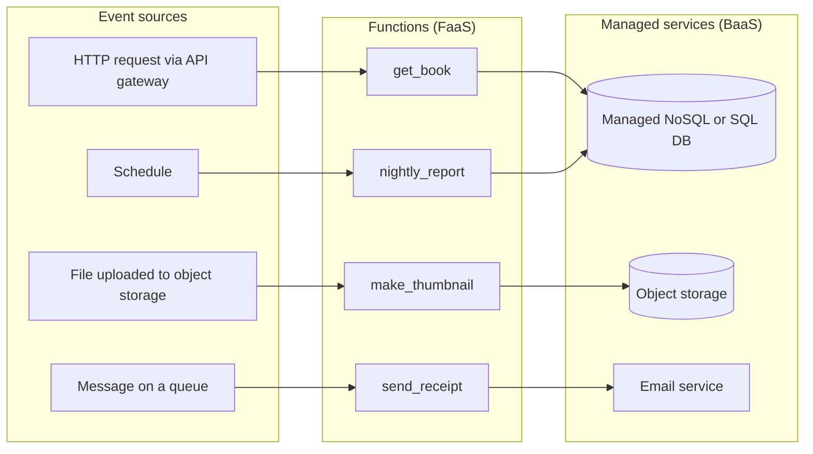
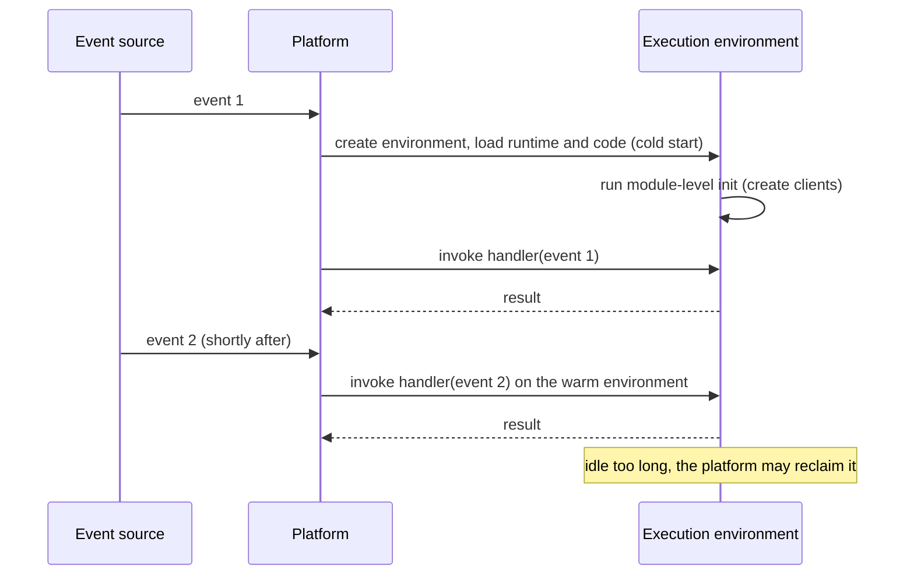

# Serverless Architecture

## Introduction

**Serverless** does not mean there are no servers. It means **you do not manage them**. You give the cloud provider code or configuration, and the provider runs it, scales it (including down to zero) and bills you for what you actually use.

Martin Fowler's site has a long, careful article by Mike Roberts, [Serverless Architectures](https://martinfowler.com/articles/serverless.html), that splits the idea in two:

- **FaaS (Functions as a Service):** you write small functions that run in short-lived, provider-managed environments when an event arrives. AWS Lambda, Azure Functions and Google Cloud Run functions are examples.
- **BaaS (Backend as a Service):** you use fully managed services instead of writing and running your own: managed authentication, databases, queues, object storage, email.

A serverless *architecture* combines the two: business logic in functions, glued together by managed services and events.

The analogy is a taxi versus your own car. With a car you pay for it every month whether you drive or not, and you handle insurance and repairs. With a taxi you pay per trip, someone else maintains the vehicle, and on a busy night a hundred taxis can appear. But you cannot customize the seats, the price per trip is higher, and sometimes you wait a moment for a cab to arrive. That wait is the **cold start**.

## How a Serverless System Is Shaped

Serverless systems are almost always **event-driven**. Functions run because something happened: an HTTP request, a file upload, a message on a queue, a database change or a schedule.



Each function:

- is **stateless** between invocations. Anything that must persist goes to a managed store.
- scales **per event**. A thousand uploads can mean many function instances running in parallel.
- has **limits** on run time, memory and payload size set by the platform.

## The Execution Model and Cold Starts

When an event arrives and no warm instance is available, the platform creates a new **execution environment**: it starts a lightweight VM or container, loads the runtime, loads your code and runs your module-level initialization. Then it calls your handler. That extra setup time is the **cold start**. Later events can reuse the warm environment and skip the setup.



Practical consequences:

- Create expensive objects (SDK clients, database connection pools, loaded models) **outside** the handler, so warm invocations reuse them.
- Keep deployment packages small and imports lean, which shortens cold starts.
- Platforms offer mitigations: AWS Lambda has provisioned concurrency and SnapStart (for some runtimes), Azure Functions has premium and "always ready" options, Google Cloud Run supports minimum instances. These reduce cold starts but you pay for the kept-warm capacity, which removes part of the scale-to-zero benefit.

## Example: A Testable Lambda Function

Pageturner lets publishers upload book covers. Each upload should produce a thumbnail. Here is a Python AWS Lambda function for that, written so the business logic does not depend on AWS at all. The handler is a thin adapter, which is the [Hexagonal Architecture](../7-arch-clean-architecture/0-arch-hexagonal.mdx) idea applied to functions.

```python
import json
import urllib.parse
from typing import Protocol

# Module-level code runs once per execution environment (the "init" phase).
# Globals then survive across invocations while the environment stays warm.
invocations = 0


class Storage(Protocol):
    def read(self, bucket: str, key: str) -> bytes: ...
    def write(self, bucket: str, key: str, data: bytes) -> None: ...


class S3Storage:
    """Real adapter. boto3 is available in the AWS Lambda Python runtime."""

    def __init__(self) -> None:
        import boto3  # imported lazily so the module also runs locally without boto3

        self.s3 = boto3.client("s3")

    def read(self, bucket: str, key: str) -> bytes:
        return self.s3.get_object(Bucket=bucket, Key=key)["Body"].read()

    def write(self, bucket: str, key: str, data: bytes) -> None:
        self.s3.put_object(Bucket=bucket, Key=key, Body=data)


# ---- pure business logic: no AWS types, easy to unit test ----
def make_thumbnail(image: bytes) -> bytes:
    return image[:16]  # stand-in for real resizing with an image library


def thumbnail_key(key: str) -> str:
    name = key.removeprefix("uploads/")
    return f"thumbnails/{name}"


def process(storage: Storage, bucket: str, key: str) -> str:
    out_key = thumbnail_key(key)
    storage.write(bucket, out_key, make_thumbnail(storage.read(bucket, key)))
    return out_key


# ---- thin adapter: translate the platform event into a business call ----
_storage: Storage | None = None


def handler(event: dict, context: object, storage: Storage | None = None) -> dict:
    global invocations, _storage
    invocations += 1
    if storage is None:
        _storage = _storage or S3Storage()  # create the client once, reuse while warm
        storage = _storage
    written = []
    for record in event["Records"]:
        bucket = record["s3"]["bucket"]["name"]
        key = urllib.parse.unquote_plus(record["s3"]["object"]["key"])  # keys arrive URL-encoded
        written.append(process(storage, bucket, key))
    return {"thumbnails": written, "invocation_in_this_environment": invocations}


if __name__ == "__main__":

    class FakeStorage:
        def __init__(self) -> None:
            self.objects = {("covers", "uploads/clean code.jpg"): b"\xff\xd8" + b"x" * 100}

        def read(self, bucket: str, key: str) -> bytes:
            return self.objects[(bucket, key)]

        def write(self, bucket: str, key: str, data: bytes) -> None:
            self.objects[(bucket, key)] = data

    sample_event = {
        "Records": [
            {"s3": {"bucket": {"name": "covers"}, "object": {"key": "uploads/clean+code.jpg"}}}
        ]
    }
    fake = FakeStorage()
    print(json.dumps(handler(sample_event, None, storage=fake)))
    print(json.dumps(handler(sample_event, None, storage=fake)))
    print(sorted(k for _, k in fake.objects))
```

Running the file locally uses the fake storage, so no AWS account is needed:

```bash
python3 handler.py
```

Output:

```text
{"thumbnails": ["thumbnails/clean code.jpg"], "invocation_in_this_environment": 1}
{"thumbnails": ["thumbnails/clean code.jpg"], "invocation_in_this_environment": 2}
['thumbnails/clean code.jpg', 'uploads/clean code.jpg']
```

Things to notice:

- **`invocations` reaches 2.** Module-level state survives between invocations in a warm environment. That is useful for caching clients, but **never** rely on it for business state: a different environment may handle the next event, and the platform may reclaim any environment at any time.
- **The S3 key arrives URL-encoded** (`clean+code.jpg`). The handler decodes it. Small platform details like this are a good reason to keep a thin, well-tested adapter.
- **Output goes to a different prefix** (`thumbnails/`) than the trigger (`uploads/`). If a function writes into the same location that triggers it, it can trigger itself in an endless, expensive loop.
- **The function is idempotent.** Processing the same upload twice writes the same thumbnail again. Event sources often deliver at least once, so this matters.

### Deploying it with AWS SAM

Infrastructure for serverless apps is usually declared as code. This [AWS SAM](https://docs.aws.amazon.com/serverless-application-model/) template creates a bucket and a function triggered by uploads under `uploads/`:

```yaml
AWSTemplateFormatVersion: "2010-09-09"
Transform: AWS::Serverless-2016-10-31
Description: Pageturner cover thumbnails

Resources:
  CoversBucket:
    Type: AWS::S3::Bucket
    Properties:
      BucketName: !Sub "${AWS::StackName}-covers-${AWS::AccountId}"

  ThumbnailFunction:
    Type: AWS::Serverless::Function
    Properties:
      Runtime: python3.13
      Handler: handler.handler
      CodeUri: src/
      MemorySize: 1024
      Timeout: 60
      Policies:
        - S3CrudPolicy:
            BucketName: !Sub "${AWS::StackName}-covers-${AWS::AccountId}"  # name, not !Ref, avoids a circular dependency
      Events:
        CoverUploaded:
          Type: S3
          Properties:
            Bucket: !Ref CoversBucket
            Events: s3:ObjectCreated:*
            Filter:
              S3Key:
                Rules:
                  - Name: prefix
                    Value: uploads/
```

A few details are worth knowing:

- The S3 event source in SAM requires the bucket to be defined in the **same template**.
- The policy refers to the bucket **by name** instead of `!Ref`, because referencing the bucket from the function's policy while the bucket references the function's trigger creates a circular dependency.
- S3 bucket names must be globally unique and lowercase, so use a lowercase stack name.

You would deploy it with `sam build` and `sam deploy --guided`. Check the [SAM documentation](https://docs.aws.amazon.com/serverless-application-model/) for current syntax and the [Lambda runtimes page](https://docs.aws.amazon.com/lambda/latest/dg/lambda-runtimes.html) for supported Python versions. The same design works on Azure Functions (Blob trigger) or Google Cloud Run functions (Cloud Storage trigger) with a different thin adapter. More hands-on material lives in the site's cloud tutorials.

## Limits You Design Around

Every FaaS platform has limits. For AWS Lambda, the [quotas page](https://docs.aws.amazon.com/lambda/latest/dg/gettingstarted-limits.html) currently lists, among others:

| Limit | AWS Lambda (as documented at the time of writing) |
| --- | --- |
| Maximum run time per invocation | 15 minutes (longer for some Lambda Managed Instances invocation types) |
| Memory | 128 MB to 10,240 MB; CPU scales with memory |
| Synchronous request and response payload | 6 MB each |
| Asynchronous event payload | 1 MB |
| Default concurrent executions per Region | 1,000 (can be raised) |

These numbers change. Treat the table as an example of the kinds of limits that exist and check the official page before you design around a specific value. Azure Functions and Google Cloud Run functions have their own, different limits per hosting plan.

The platforms are also evolving quickly. Recent additions on AWS include **Lambda durable functions** (announced December 2025), which checkpoint progress so a multi-step workflow can pause and resume for long periods, and **Lambda Managed Instances**, which run functions on EC2 capacity in your account for steady, high-volume workloads. Google renamed Cloud Functions to **Cloud Run functions** in 2024. Check current docs before choosing.

## Cost Model

Serverless pricing is typically **per request plus per unit of compute time** (for example, GB-seconds), often with a free tier. Prices change and vary by region, so always check the provider's pricing page.

The shape of the cost curve is what matters architecturally:

- **Spiky or low traffic:** serverless is usually cheap, because idle time costs nothing.
- **Steady, high traffic:** paying per invocation can cost more than a few always-on containers or VMs running at high utilization.
- **Hidden costs:** API gateway requests, logs, data transfer, and managed services can exceed the function bill itself.

Model your expected traffic before committing. See [Cost-Aware Architecture](../12-arch-quality-and-operations/7-arch-cost-awareness.mdx).

## Real-World Scenario

Pageturner wants three new capabilities:

1. **Cover thumbnails** when publishers upload images. Uploads are rare most days and arrive in large batches when a publisher syncs its catalog.
2. **A nightly sales report** emailed to managers.
3. **Webhook receiver** for a shipping partner that posts tracking updates at unpredictable times.

The core store remains a [modular monolith](./3-arch-modular-monolith.mdx) on containers.

**The solution:** use functions for all three, triggered by events (upload, schedule, HTTP), with the business logic in plain Python modules and thin handlers. Each function writes results to managed storage or publishes an event the monolith consumes.

### Why this approach

- **Workload shape:** all three are bursty or periodic. Scale-to-zero means near-zero cost when idle, and automatic fan-out when a publisher uploads a thousand covers.
- **Isolation:** image processing is CPU-heavy. Running it outside the monolith means a large batch cannot slow down checkout.
- **Little operations work:** no servers or queues of workers to size and patch.
- **Clear boundaries:** each function does one thing and talks to the core app through events or storage, not through shared code.

### When to use serverless, and when not to

Use it when:

- workloads are event-driven, spiky, periodic or unpredictable
- tasks are short and stateless, or can be split into short steps
- the team wants to minimize infrastructure operations
- you are building glue between managed services (webhooks, file processing, scheduled jobs)

Be careful, or choose something else, when:

- you have steady, high-throughput traffic where always-on compute is cheaper
- you need very low, consistent latency and cannot tolerate occasional cold starts
- work runs longer than the platform's limits and cannot be checkpointed
- you need specialized hardware or long-lived connections that the platform does not support
- portability across clouds is a hard requirement. Functions tend to be coupled to the provider's triggers, IAM model and managed services.

### Alternatives and trade-offs

| Approach | Pros | Cons | Best for |
| --- | --- | --- | --- |
| FaaS functions | Scale to zero, per-use billing, no servers | Cold starts, limits, provider coupling, harder local testing | Event handlers, glue, spiky jobs |
| Serverless containers (for example Cloud Run, Azure Container Apps, AWS Fargate) | Any language or binary, fewer limits, still managed | Less fine-grained events, some baseline cost if kept warm | Web apps and APIs with variable traffic |
| Worker processes on a queue | Full control, predictable cost | You run and scale the workers | Steady background processing |
| Kubernetes | Maximum flexibility and portability | Highest operational burden | Large platforms with a platform team |

## Common Mistakes

1. **Lambda pinball.** Dozens of tiny functions calling each other synchronously, so one request bounces through many cold starts and many failure points. Group related logic, and connect functions with events or a workflow service, not chains of synchronous calls.
2. **Business logic inside the handler.** Code tied to the event format and SDK is hard to test and impossible to move. Keep handlers thin.
3. **Relying on in-memory state.** Module-level variables are a cache, not a database.
4. **Recursive triggers.** A function writing to the location that triggers it. Use separate prefixes or buckets.
5. **Unbounded concurrency hitting a database.** A thousand function instances can open a thousand database connections. Use connection pooling proxies, reserved concurrency limits or a queue in front.
6. **Ignoring the whole bill.** Function compute is often the smaller part. Watch gateway, logging and data-transfer costs.
7. **No local test path.** If the only way to test is to deploy, feedback is slow. Unit-test the core logic, and use emulators or a dev stack for integration tests.

## Summary

- Serverless means the provider manages servers and scaling. It combines **FaaS** (your functions) and **BaaS** (managed services).
- Serverless systems are **event-driven**, functions are **stateless**, and each invocation has **limits** on time, memory and payload.
- **Cold starts** happen when a new execution environment is created. Initialize expensive objects outside the handler and use platform mitigations when needed.
- Keep handlers **thin** and business logic **platform-independent** for testability and portability.
- Serverless shines for **spiky, event-driven and periodic** work. For steady high load, very low latency or long-running work, compare against containers or VMs.

## Further Learning

**Exercises**

1. Add a check to `process` that skips objects that already have a thumbnail. Why does this matter if the event source delivers at least once?
2. Write a unit test for `thumbnail_key` and `process` using `FakeStorage`. How many lines of AWS-specific code remain untested?
3. Estimate the monthly cost of the thumbnail function for 50,000 uploads, using your provider's current pricing page. Then estimate the cost of a small always-on container doing the same work.
4. Redesign the nightly report as a workflow of three steps (query, render, email) that could each be retried independently.

**Related pages**

- [Event-Driven Architecture](./5-arch-event-driven.mdx)
- [Pipes and Filters Architecture](./9-arch-pipes-and-filters.mdx)
- [Webhooks and Callbacks](../10-arch-integration-and-apis/7-arch-webhooks.mdx)
- [Designing for Scalability](../12-arch-quality-and-operations/0-arch-scalability.mdx)

**Sources**

- [Mike Roberts: Serverless Architectures](https://martinfowler.com/articles/serverless.html) (martinfowler.com)
- [AWS Lambda quotas](https://docs.aws.amazon.com/lambda/latest/dg/gettingstarted-limits.html) and [Lambda runtimes](https://docs.aws.amazon.com/lambda/latest/dg/lambda-runtimes.html)
- [AWS SAM documentation](https://docs.aws.amazon.com/serverless-application-model/)
- [Google Cloud blog: Cloud Functions is now Cloud Run functions](https://cloud.google.com/blog/products/serverless/google-cloud-functions-is-now-cloud-run-functions)
