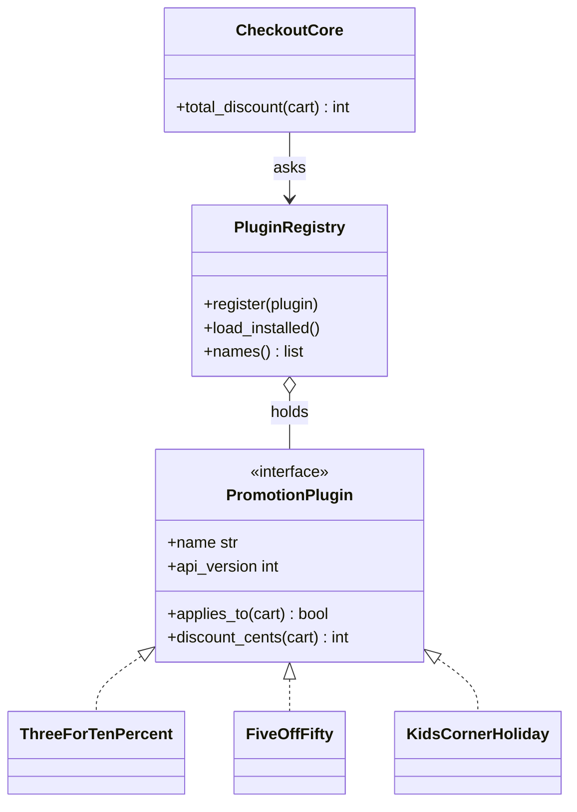
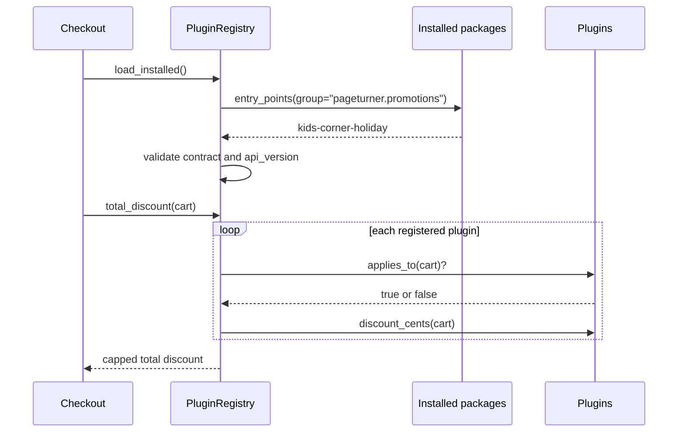

# Microkernel (Plugin) Architecture

## Introduction

The **microkernel architecture**, also called the **plugin architecture**, splits a system into two kinds of parts:

- a **core system** that holds the minimal, stable functionality needed to run
- **plug-in components** that add features, rules or integrations, and can be added or removed without changing the core

The core defines a **contract** (an interface) and a **registry** that knows which plugins are installed. Plugins implement the contract. The core calls them at well-defined extension points.

You use this style every day:

- **Code editors:** VS Code is a fairly small editor core, and most language support, linters and themes are extensions that run in a separate extension host process.
- **Build and test tools:** pytest's hook system is built on [pluggy](https://pluggy.readthedocs.io/), and most pytest features you install (coverage, parallel runs) are plugins. Jenkins and Gradle are heavily plugin-based too.
- **Browsers:** extensions add features without forking the browser.
- **Business products:** tax engines, insurance claim systems and e-commerce platforms that need customer-specific rules.

The analogy is a power strip. The strip (core) defines the socket shape (contract) and supplies power. You plug in whatever devices you need. A new device does not require rewiring the strip, and unplugging one does not affect the others, as long as everyone respects the socket shape.

The name comes from operating systems, where a microkernel keeps only the essentials in the kernel and runs drivers and services outside it. As an application style it is described in Richards and Ford's *Fundamentals of Software Architecture*.

## The Structure



Three design decisions define any microkernel:

1. **The contract:** what a plugin must provide and what the core gives it. This is the most important and hardest-to-change part.
2. **Registration and discovery:** how the core learns which plugins exist: explicit registration, configuration files, scanning a folder, or package metadata.
3. **Isolation:** whether plugins run in the core's process (fast, simple, but a bad plugin can crash the host) or in a separate process or sandbox (safer, but slower and more complex).

## The Problem: Customer Rules in the Core

Pageturner now sells its store software to partner bookshops. Each partner wants its own promotions. The first version put every rule into checkout:

```python
def apply_promotions(store: str, subtotal_cents: int, items: int) -> int:
    """Every partner store's custom rule lives in the core checkout code."""
    discount = 0
    if store == "corner-books":
        if items >= 3:
            discount += subtotal_cents // 10  # 10% off 3+ books
    elif store == "campus-reads":
        discount += 500 if subtotal_cents >= 5000 else 0  # $5 off $50+
    elif store == "kids-corner":
        if items >= 2:
            discount += 300
        if subtotal_cents >= 8000:
            discount += 700
    # ... 40 more stores, each change needs a core release and a full regression test
    return subtotal_cents - discount


print(apply_promotions("corner-books", 6000, 3))
print(apply_promotions("campus-reads", 6000, 3))
```

Output:

```text
5400
5500
```

With 40 partners, this function becomes hundreds of lines. Every new promotion is a change to the core checkout, which means a core release, a full regression test, and a risk of breaking every other store. The partner who wants a holiday promotion by Friday waits for the next core release.

## The Solution: A Core, a Contract and Plugins

The core defines a `Protocol` for promotions, a registry, and global rules (a discount can never exceed the subtotal). Built-in promotions ship with the core. Additional promotions are discovered from **installed Python packages** through [entry points](https://packaging.python.org/en/latest/specifications/entry-points/), the standard packaging mechanism that tools like pytest also use.

```python
from dataclasses import dataclass
from importlib.metadata import entry_points
from typing import Protocol, runtime_checkable

PLUGIN_GROUP = "pageturner.promotions"
CORE_API_VERSION = 1


@dataclass(frozen=True)
class Cart:
    store: str
    subtotal_cents: int
    items: int


@runtime_checkable
class PromotionPlugin(Protocol):
    """The contract every plugin must satisfy. The core depends only on this."""

    name: str
    api_version: int

    def applies_to(self, cart: Cart) -> bool: ...
    def discount_cents(self, cart: Cart) -> int: ...


class PluginRegistry:
    def __init__(self) -> None:
        self._plugins: dict[str, PromotionPlugin] = {}

    def register(self, plugin: object) -> None:
        if not isinstance(plugin, PromotionPlugin):
            raise TypeError(f"{plugin!r} does not implement PromotionPlugin")
        if plugin.api_version != CORE_API_VERSION:
            raise ValueError(f"{plugin.name}: needs API v{plugin.api_version}, core is v{CORE_API_VERSION}")
        self._plugins[plugin.name] = plugin

    def load_installed(self) -> None:
        """Discover plugins that other packages declare under our entry point group."""
        for ep in entry_points(group=PLUGIN_GROUP):
            try:
                self.register(ep.load()())
            except Exception as exc:  # a broken plugin must not take down checkout
                print(f"skipping plugin {ep.name}: {exc}")

    def names(self) -> list[str]:
        return sorted(self._plugins)

    def total_discount(self, cart: Cart) -> int:
        discount = 0
        for plugin in self._plugins.values():
            if plugin.applies_to(cart):
                try:
                    discount += plugin.discount_cents(cart)
                except Exception as exc:
                    print(f"plugin {plugin.name} failed, ignored: {exc}")
        return min(discount, cart.subtotal_cents)  # the core enforces global rules


# ---- built-in plugins ship with the core ----
class ThreeForTenPercent:
    name = "corner-books-3-books"
    api_version = 1

    def applies_to(self, cart: Cart) -> bool:
        return cart.store == "corner-books" and cart.items >= 3

    def discount_cents(self, cart: Cart) -> int:
        return cart.subtotal_cents // 10


class FiveOffFifty:
    name = "campus-reads-5-off-50"
    api_version = 1

    def applies_to(self, cart: Cart) -> bool:
        return cart.store == "campus-reads" and cart.subtotal_cents >= 5000

    def discount_cents(self, cart: Cart) -> int:
        return 500


if __name__ == "__main__":
    registry = PluginRegistry()
    registry.register(ThreeForTenPercent())
    registry.register(FiveOffFifty())
    registry.load_installed()
    print("plugins:", registry.names())

    for cart in [Cart("corner-books", 6000, 3), Cart("campus-reads", 6000, 3),
                 Cart("kids-corner", 9000, 2)]:
        print(f"{cart.store:>13}: pays {cart.subtotal_cents - registry.total_discount(cart)}")
```

Running the core alone:

```bash
python3 checkout_core.py
```

Output:

```text
plugins: ['campus-reads-5-off-50', 'corner-books-3-books']
 corner-books: pays 5400
 campus-reads: pays 5500
  kids-corner: pays 9000
```

### A plugin in its own package

The Kids Corner promotion lives in a **separate package** that the partner's developers can own and release on their own schedule:

```python
from checkout_core import Cart


class KidsCornerHoliday:
    name = "kids-corner-holiday"
    api_version = 1

    def applies_to(self, cart: Cart) -> bool:
        return cart.store == "kids-corner"

    def discount_cents(self, cart: Cart) -> int:
        return (300 if cart.items >= 2 else 0) + (700 if cart.subtotal_cents >= 8000 else 0)
```

Its `pyproject.toml` declares the plugin under the core's entry point group:

```toml
[project]
name = "pageturner-holiday-promo"
version = "0.1.0"
requires-python = ">=3.12"

[project.entry-points."pageturner.promotions"]
kids-corner-holiday = "holiday_promo:KidsCornerHoliday"

[build-system]
requires = ["setuptools>=68"]
build-backend = "setuptools.build_meta"
```

Install the plugin package and run the core again. The core code does not change:

```bash
pip install ./holiday-promo-plugin
python3 checkout_core.py
```

Output:

```text
plugins: ['campus-reads-5-off-50', 'corner-books-3-books', 'kids-corner-holiday']
 corner-books: pays 5400
 campus-reads: pays 5500
  kids-corner: pays 8000
```

What the core still controls:

- **The contract and its version.** `api_version` lets the core reject plugins written for an incompatible contract instead of failing at runtime in strange ways.
- **Validation at registration.** `isinstance` against a `runtime_checkable` `Protocol` checks that the required attributes exist. It does not check signatures, so tests for each plugin still matter.
- **Fault containment.** A plugin that fails to load or raises an exception is skipped, and checkout keeps working.
- **Global invariants.** The total discount is capped at the subtotal, whatever the plugins return.



## Using a Plugin Framework: pluggy

For larger systems, a framework saves you from re-inventing hook calling, ordering and validation. [pluggy](https://pluggy.readthedocs.io/) is the plugin system extracted from pytest. You declare **hook specifications** in the core, and plugins provide **hook implementations**:

```python
import pluggy

hookspec = pluggy.HookspecMarker("pageturner")
hookimpl = pluggy.HookimplMarker("pageturner")


class PromotionSpec:
    @hookspec
    def discount_cents(self, store: str, subtotal_cents: int, items: int) -> int:
        """Return a discount in cents for this cart, or 0."""


class StudentDiscount:
    @hookimpl
    def discount_cents(self, store: str, subtotal_cents: int, items: int) -> int:
        return 500 if store == "campus-reads" and subtotal_cents >= 5000 else 0


class BulkDiscount:
    @hookimpl
    def discount_cents(self, store: str, subtotal_cents: int, items: int) -> int:
        return subtotal_cents // 10 if items >= 3 else 0


pm = pluggy.PluginManager("pageturner")
pm.add_hookspecs(PromotionSpec)
pm.register(StudentDiscount())
pm.register(BulkDiscount())
# pm.load_setuptools_entrypoints("pageturner") would also load installed plugin packages

results = pm.hook.discount_cents(store="campus-reads", subtotal_cents=6000, items=3)
print("each plugin returned:", results)
print("total discount:", sum(results))
```

```bash
pip install pluggy
python3 promotions_pluggy.py
```

Output:

```text
each plugin returned: [600, 500]
total discount: 1100
```

pluggy calls all implementations and returns a list of results. By default, plugins registered later are called first, which is why the bulk discount appears first. It also supports ordering hints, "first result wins" hooks, wrappers around other hooks, and loading plugins from entry points with `load_setuptools_entrypoints`. See the pluggy docs for the version you install (this example was run with pluggy 1.6.0).

In Java, the standard `java.util.ServiceLoader` plays a similar role, and OSGi offers a full module and plugin system with lifecycle management.

## Strengths and Weaknesses

| Quality attribute | Effect | Why |
| --- | --- | --- |
| Extensibility | Strong | New features arrive as plugins without core changes |
| Customization per customer | Strong | Install only the plugins a customer needs |
| Core stability and testability | Good | The core is small and changes rarely |
| Deployability | Good for plugins | Plugins can ship on their own schedule |
| Scalability | Limited | Usually one process, scaled as a whole |
| Fault tolerance | Depends | In-process plugins can crash or slow the host |
| Contract evolution | Hard | Changing the plugin contract can break every plugin |

## Real-World Scenario

Pageturner's partner program has grown to 40 independent bookstores running the Pageturner store software. Each partner has its own promotions, and a few need custom tax or shipping rules for their region. Partners want changes quickly. The core team wants a stable, well-tested checkout.

**The solution:** turn promotions, tax rules and shipping calculators into **plugin extension points**:

1. Define three small, versioned contracts: `PromotionPlugin`, `TaxRule` and `ShippingCalculator`.
2. Ship common plugins with the core. Put partner-specific plugins in separate packages, owned and tested separately.
3. Discover plugins through entry points, and enable them per partner through configuration.
4. Keep global invariants (discount caps, rounding, audit logging) in the core.
5. Run a **plugin conformance test suite** in CI that every plugin package must pass.

### Why this approach

- The variation is **concentrated in a few well-understood extension points**, which is exactly what plugins are good at.
- The core checkout changes rarely and stays reliable.
- Partners get faster turnaround because plugin releases do not wait for core releases.
- Each partner's deployment includes only its own plugins, which keeps behavior easy to reason about.

### When to use it, and when not to

Use a microkernel when:

- the product has a **stable core** and **many variations** at a few known points
- third parties or customers need to extend the system
- you are building a tool, IDE, editor, build system or rules engine
- you need to enable or disable features per customer or per installation

Avoid it when:

- you do not know yet where the variation will be. Designing extension points for imagined needs is [YAGNI](../1-arch-design-principles/6-arch-dry-kiss-yagni.mdx). A few `if` statements are fine until a pattern emerges.
- plugins would need deep access to everything in the core, so the contract would be the whole system
- you need independent scaling of the extensions (look at services instead)
- you cannot trust plugin code but cannot afford process isolation or sandboxing

### Alternatives and trade-offs

| Approach | Pros | Cons | Best for |
| --- | --- | --- | --- |
| Hard-coded `if` / `elif` rules | Simplest, all in one place | Core changes for every variation | A handful of stable rules |
| [Strategy pattern](../4-arch-behavioral-patterns/0-arch-strategy.mdx) inside the app | Clean code, no packaging work | Still one release for all variations | Variations owned by the core team |
| Microkernel with in-process plugins | Independent plugin releases, fast calls | Bad plugins can affect the host | Tools, products with partner extensions |
| Out-of-process plugins (separate process, webhooks) | Strong isolation, any language | Slower, more operational work | Untrusted third-party extensions |
| Rules engine or configuration DSL | Non-developers can change rules | Another language to learn and test | Business-user-managed rules |

A microkernel is a system-level use of patterns you already know: [Strategy](../4-arch-behavioral-patterns/0-arch-strategy.mdx) for interchangeable behavior, [Template Method](../4-arch-behavioral-patterns/4-arch-template-method.mdx) for hooks in a fixed algorithm, and [Chain of Responsibility](../4-arch-behavioral-patterns/5-arch-chain-of-responsibility.mdx) for running plugins in sequence.

## Common Mistakes

1. **A contract that is too large.** If plugins can reach any part of the core, every core change can break them. Expose a narrow, documented API.
2. **No contract versioning.** Without a version, an old plugin fails at runtime in confusing ways. Version the contract and check it at load time.
3. **Plugins depending on each other.** Plugin A importing plugin B recreates coupling. Plugins should depend only on the core contract.
4. **Unbounded trust.** In-process plugins run with full permissions. Only load plugins you trust, or isolate them.
5. **Swallowing errors silently.** Skipping a broken plugin is right, but log and alert on it, or you will lose a partner's promotion without noticing.
6. **Plugin explosion.** Hundreds of tiny plugins with overlapping behavior are hard to reason about. Review and retire plugins regularly.
7. **Premature extension points.** Adding hooks "in case someone needs them" makes the core complex and the contract hard to change later.

## Summary

- A microkernel has a **small, stable core** and **plug-in components** that implement a **contract** at defined extension points.
- The key decisions are the **contract**, **discovery and registration**, and **isolation**.
- In Python, use `typing.Protocol` for the contract, **entry points** for discovery, and consider **pluggy** for hook management. Java has `ServiceLoader` and OSGi.
- The style shines for tools and products with many customer-specific variations, and is a poor fit when variation points are unknown or extensions need independent scaling.
- Keep contracts narrow and versioned, contain plugin failures, and enforce global invariants in the core.

## Further Learning

**Exercises**

1. Add a `max_discount_percent` setting to the core and enforce it in `total_discount`, whatever the plugins return. Why does that belong in the core?
2. Write a plugin with `api_version = 2` and confirm that the core rejects it with a clear message.
3. Add a `priority` attribute to the contract so that plugins run in a defined order. What new problems does ordering create?
4. Convert the core example to use pluggy, including `load_setuptools_entrypoints`. Compare the amount of code.

**Related pages**

- [Strategy Pattern](../4-arch-behavioral-patterns/0-arch-strategy.mdx)
- [Open/Closed Principle](../1-arch-design-principles/2-arch-open-closed.mdx)
- [Dependency Inversion Principle](../1-arch-design-principles/5-arch-dependency-inversion.mdx)
- [Choosing an Architectural Style](./10-arch-choosing-a-style.mdx)

**Sources**

- [pluggy documentation](https://pluggy.readthedocs.io/)
- [Python Packaging User Guide: Entry points specification](https://packaging.python.org/en/latest/specifications/entry-points/)
- [Python docs: importlib.metadata](https://docs.python.org/3/library/importlib.metadata.html)
- Mark Richards and Neal Ford, *Fundamentals of Software Architecture* (O'Reilly), chapter on microkernel architecture
