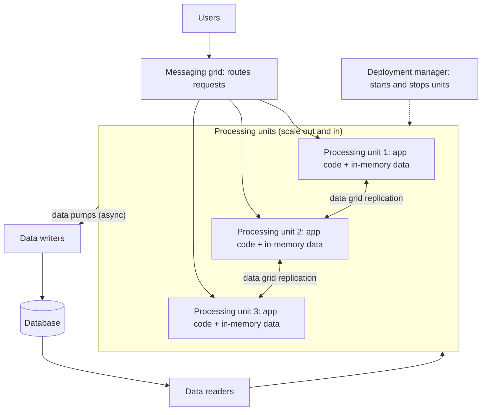
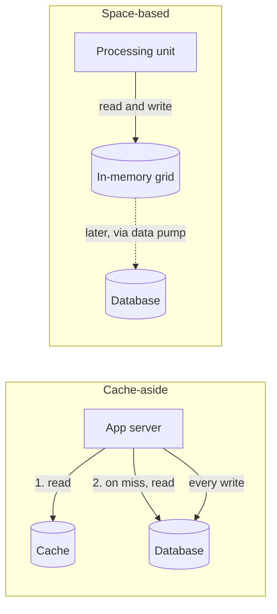

# Space-Based Architecture

## Introduction

Most web applications eventually hit the same wall: you can add more web servers easily, but they all talk to **one database**, and under extreme load the database becomes the bottleneck. Caches help with reads, but writes still converge on that single point.

**Space-based architecture** removes the database from the request path. Instead of reading and writing a central database on every request, the application runs as many **processing units**, each holding the data it needs **in memory**. The processing units keep their in-memory copies in sync through an **in-memory data grid**, and changes are written to the database **asynchronously**, in the background.

The name comes from **tuple spaces**, a concept from parallel computing (the Linda coordination language) where processes share data through a common associative memory "space". Commercial and open-source data grids such as GigaSpaces, Hazelcast, Apache Ignite and Oracle Coherence implement the ideas this style relies on. Mark Richards describes the style in *Software Architecture Patterns* and, with Neal Ford, in *Fundamentals of Software Architecture*.

An analogy: a stadium on concert night. If every ticket check required phoning the central box office, the queue would reach the parking lot. Instead, each gate has its own list of valid tickets, the gates radio each other when a ticket is used, and the box office's ledger is updated after the rush. It is fast and scales with the number of gates, but the gates must coordinate carefully, or the same ticket might get through two gates at once.

This is a **specialist style**. Most systems never need it. But knowing it helps you understand data grids, high-concurrency designs, and why "just add servers" stops working.

## The Components



Following Richards and Ford's description:

- **Processing unit:** a deployable unit containing application logic plus an in-memory data grid with the data the logic needs. You run many of them. Some designs use one kind of processing unit for the whole app; others split by function.
- **Virtualized middleware:** the infrastructure that coordinates processing units:
  - **Messaging grid:** receives requests and routes them to an available processing unit.
  - **Data grid:** replicates data changes between processing units, usually asynchronously.
  - **Processing grid (optional):** orchestrates a request that needs several kinds of processing unit.
  - **Deployment manager:** starts and stops processing units as load changes.
- **Data pumps:** send data changes from processing units to the database asynchronously, usually through messaging.
- **Data writers:** receive pumped changes and write them to the database.
- **Data readers:** load data from the database into processing units when needed, for example when the first units start or after a full restart.

The key property: **no database call on the request path**. Reads and writes hit memory. The database becomes a durable backup and a source for reporting.

## Simulating the Core Idea

The script below simulates two processing units selling tickets for a concert with **one seat left**. Each unit has an in-memory cache, replicates changes to its peer, and sends changes to the database through a data pump. Then it shows the classic problem of this style, and one common fix.

```python
import zlib
from collections import deque
from dataclasses import dataclass, field


@dataclass
class Database:
    """The system of record. Written asynchronously, never on the request path."""

    tickets_sold: dict[str, int] = field(default_factory=dict)

    def apply(self, concert: str, qty: int) -> None:
        self.tickets_sold[concert] = self.tickets_sold.get(concert, 0) + qty


class DataPump:
    """Queues changes and drains them to the database later (asynchronously)."""

    def __init__(self, db: Database) -> None:
        self.db = db
        self.pending: deque[tuple[str, int]] = deque()

    def send(self, concert: str, qty: int) -> None:
        self.pending.append((concert, qty))

    def drain(self) -> None:
        while self.pending:
            self.db.apply(*self.pending.popleft())


class ProcessingUnit:
    def __init__(self, name: str, seats: dict[str, int], pump: DataPump) -> None:
        self.name = name
        self.cache = dict(seats)  # in-memory copy of the data the unit needs
        self.pump = pump
        self.outbox: list[tuple[str, int]] = []  # changes to replicate to peers

    def buy(self, concert: str, qty: int) -> str:
        left = self.cache[concert]
        if left < qty:
            return f"{self.name}: SOLD OUT for {concert}"
        self.cache[concert] = left - qty  # no database call on the hot path
        self.outbox.append((concert, self.cache[concert]))
        self.pump.send(concert, qty)
        return f"{self.name}: sold {qty}, {self.cache[concert]} left"


def replicate(units: list[ProcessingUnit]) -> None:
    """Data grid: copy each unit's changes to its peers (last writer wins)."""
    for source in units:
        for concert, value in source.outbox:
            for peer in units:
                if peer is not source:
                    peer.cache[concert] = value
        source.outbox.clear()


def run(routing: str) -> None:
    db = Database()
    pump = DataPump(db)
    units = [ProcessingUnit(f"PU-{i}", {"jazz-night": 1}, pump) for i in (1, 2)]

    def route(concert: str, request_no: int) -> ProcessingUnit:
        if routing == "round-robin":
            return units[request_no % len(units)]
        return units[zlib.crc32(concert.encode()) % len(units)]  # partition by key

    print(f"--- {routing} routing ---")
    # Two customers click "buy" for the last seat at the same moment,
    # before replication between the units has happened.
    for request_no in (0, 1):
        print(route("jazz-night", request_no).buy("jazz-night", 1))
    replicate(units)
    pump.drain()
    print("database says sold:", db.tickets_sold["jazz-night"], "of 1 seat")


run("round-robin")
run("partitioned")
```

Output:

```text
--- round-robin routing ---
PU-1: sold 1, 0 left
PU-2: sold 1, 0 left
database says sold: 2 of 1 seat
--- partitioned routing ---
PU-2: sold 1, 0 left
PU-2: SOLD OUT for jazz-night
database says sold: 1 of 1 seat
```

### What went wrong in the first run: data collisions

With **round-robin routing**, both requests reached different units before replication ran. Each unit saw "1 seat left" in its own memory and sold it. Replication then copied "0 left" around, so the caches look consistent afterwards, but two tickets were sold for one seat.

Richards and Ford call this a **data collision**: the same data updated in two units before replication catches up. How often it happens depends on the replication latency, the number of units, and how often the same item is updated. For hot items like the last seats of a popular concert, it is very likely.

### The fix in the second run: partition by key

With **partitioned routing**, every request for `jazz-night` goes to the same unit, chosen by hashing the key. That unit is the single owner of the concert's seat count, so it can serialize updates for it. Data grids use the same idea: data is split into partitions, each partition has a primary owner (with backups on other nodes), and per-key operations run on the owner. Hazelcast's entry processors and GigaSpaces' partitioned spaces work along these lines. Check your product's documentation for its exact consistency guarantees.

Partitioning trades some flexibility for correctness: a very popular key creates a **hot partition** that one unit must handle alone.

## Elastic Scaling

The other half of the style is elasticity. The deployment manager adds processing units when load rises and removes them when it falls. New units get their data from a running peer through the data grid. Only when no unit is running does a data reader load from the database.

```python
import math

DATABASE = {"jazz-night": 120, "rock-fest": 5000}  # system of record
CAPACITY_PER_UNIT = 2_000  # requests/second one processing unit can handle (assumed)


class Unit:
    def __init__(self, name: str, cache: dict[str, int], source: str) -> None:
        self.name, self.cache = name, dict(cache)
        print(f"  start {name}: cache loaded from {source}")


class DeploymentManager:
    """Starts and stops processing units as load changes."""

    def __init__(self) -> None:
        self.units: list[Unit] = []

    def scale_to(self, load_rps: int) -> None:
        wanted = max(1, math.ceil(load_rps / CAPACITY_PER_UNIT))
        print(f"load {load_rps:>6} rps -> {wanted} unit(s)")
        while len(self.units) < wanted:
            if self.units:  # copy state from a running peer through the data grid
                peer = self.units[0]
                self.units.append(Unit(f"PU-{len(self.units) + 1}", peer.cache, f"peer {peer.name}"))
            else:  # nothing running: a data reader loads from the database
                self.units.append(Unit("PU-1", DATABASE, "database (data reader)"))
        while len(self.units) > wanted:
            print(f"  stop {self.units.pop().name}")


manager = DeploymentManager()
for load in (500, 7_000, 9_500, 1_200):
    manager.scale_to(load)
```

Output:

```text
load    500 rps -> 1 unit(s)
  start PU-1: cache loaded from database (data reader)
load   7000 rps -> 4 unit(s)
  start PU-2: cache loaded from peer PU-1
  start PU-3: cache loaded from peer PU-1
  start PU-4: cache loaded from peer PU-1
load   9500 rps -> 5 unit(s)
  start PU-5: cache loaded from peer PU-1
load   1200 rps -> 1 unit(s)
  stop PU-5
  stop PU-4
  stop PU-3
  stop PU-2
```

The capacity number in the script is an assumption for the demo, not a benchmark. In practice you measure what one unit can handle under realistic load.

Because the database is off the hot path, adding units actually adds capacity. In a traditional design, adding web servers eventually just adds more pressure on the database.

## How Is This Different from "Add a Cache"?

A common first reaction is "isn't this just a cache?" Not quite. With a typical **cache-aside** design (see [Caching Strategies](../11-arch-data-architecture/2-arch-caching-strategies.mdx)), the database remains the system of record on the request path:



| Question | Cache-aside | Space-based |
| --- | --- | --- |
| Where do writes go first? | The database | Memory in the processing unit |
| What happens if the cache is lost? | Slower, but correct: reload from the database | Possible data loss unless the grid keeps backups |
| What limits write throughput? | The database primary | Grid replication and partitioning |
| Complexity | Low to medium | High |

In other words, a cache speeds up reads in front of a database. Space-based architecture makes memory the primary working store and pushes the database into the background. That is why it can absorb write bursts, and also why it needs much more care around durability and consistency.

## Strengths and Weaknesses

| Quality attribute | Effect | Why |
| --- | --- | --- |
| Elasticity | Very strong | Units start and stop with load; no central DB bottleneck |
| Performance | Very strong | Reads and writes hit memory |
| Scalability | Strong | Limited by grid replication and memory, not one database |
| Simplicity | Weak | Replication, collisions, partitioning, async persistence |
| Data consistency | Weak to medium | Asynchronous replication and persistence; collisions possible |
| Testability | Weak | Realistic load and failure tests are hard and expensive |
| Cost | Weak | Lots of memory, specialized products, specialized skills |
| Data volume | Limited | Hot data must fit in memory across the grid |

Persistence is asynchronous, so a crash between an in-memory update and the data pump's write could lose data unless the grid keeps backup copies or the pump uses durable messaging. Production data grids provide backups and write-behind persistence options, which you must configure deliberately.

## Real-World Scenario

Pageturner partners with a large publisher to sell **signed first editions** of a famous author's new book: 20,000 copies, going on sale at a fixed time. Marketing expects a huge burst of buyers in the first minutes, then almost nothing. The normal store, a modular monolith on PostgreSQL, handles everyday traffic well, but a load test shows the database locking up long before the expected peak.

**The solution:** build the **flash-sale component** with space-based ideas, and leave the rest of the store alone:

1. A small number of processing units, each holding the flash-sale inventory and reservations in an in-memory data grid.
2. Requests are **partitioned by product** (or by inventory block) so that each unit owns a slice of stock and there are no collisions on the same copies.
3. The deployment manager (often the platform's autoscaler) adds units before the sale starts and removes them afterwards.
4. A data pump writes reservations to the main database through a queue, and the normal order pipeline picks them up.
5. The grid keeps backup copies, so a unit failure does not lose reservations.

### Why this approach

- The problem is **extreme, short-lived concurrency** on a small amount of data, which is exactly the profile this style targets.
- In-memory processing removes the database bottleneck for the few minutes that matter.
- Elasticity keeps costs down outside the sale window.
- Scope is limited: one component uses the complex style, everything else stays simple.

### When to use it, and when not to

Use space-based ideas when:

- load is **very high and highly variable** (ticket sales, auctions, flash sales, online bidding, some trading and gaming workloads)
- the working set of data is **small enough to fit in memory** across the grid
- the database is the proven bottleneck, and caching and read replicas are not enough

Avoid it when:

- load is moderate or predictable. A standard design with caching, read replicas and a well-tuned database is far simpler.
- you need **strong consistency** on every write across large data sets (for example, core banking ledgers)
- the data set is huge and cannot be held in memory economically
- the team lacks experience with data grids. Operational mistakes here are costly.

### Alternatives and trade-offs

| Approach | Pros | Cons | Best for |
| --- | --- | --- | --- |
| Monolith or services plus cache and read replicas | Simple, well understood | Writes still hit one primary database | Most systems |
| Queue-based load leveling | Smooths spikes, protects the DB | Users wait; results are asynchronous | Spiky writes that can be delayed |
| Sharded database | Scales writes horizontally | Resharding and cross-shard queries are hard | Large data with high write volume |
| Space-based (data grid) | Extreme throughput and elasticity | Complexity, cost, collisions, async persistence | Short, extreme bursts on small data |
| Virtual waiting room | Very simple, protects everything | Users wait in line | Ticket drops and launches |

For many flash sales, a **virtual waiting room** plus queue-based load leveling is the simpler answer. Space-based architecture is worth it when you cannot make users wait. See [Bulkheads, Rate Limiting and Backpressure](../9-arch-distributed-systems/9-arch-bulkhead-and-rate-limiting.mdx) and [Caching Strategies](../11-arch-data-architecture/2-arch-caching-strategies.mdx) for the simpler options.

## Common Mistakes

1. **Using it because it sounds scalable.** The complexity is real. Prove the database bottleneck first.
2. **Ignoring data collisions.** Round-robin routing across replicated caches will oversell hot items. Partition by key or use grid-side atomic operations.
3. **Treating the database as optional.** You still need durable persistence, backups and reporting. Configure write-behind and backups carefully.
4. **Putting too much data in memory.** Memory is expensive, and large grids take longer to replicate and recover.
5. **Hot partitions.** One very popular key can overload its owner. Split hot items (for example, into inventory blocks) across partitions.
6. **Skipping failure testing.** Kill units during a load test and verify that no reservations are lost or duplicated.

## Summary

- Space-based architecture removes the **central database from the request path** by running many **processing units** with **in-memory data**, synchronized by a **data grid**.
- **Data pumps** and **data writers** persist changes asynchronously; **data readers** load data when units start cold.
- It offers **extreme elasticity and performance** for **bursty, high-concurrency** workloads on data that fits in memory.
- Its costs are **complexity, consistency risks (data collisions), memory cost and hard testing**.
- Partition data by key to avoid collisions, keep backups in the grid, and use the style only for the components that truly need it.

## Further Learning

**Exercises**

1. Change the simulation to three units and 10 seats, and send 15 purchase requests with round-robin routing and replication after every 3 requests. How many tickets are oversold?
2. Add a backup copy to each partition in the partitioned version: when the owner unit "crashes", promote the backup. What could still be lost?
3. Design the inventory-block approach: split 20,000 copies into 40 blocks of 500 and route by block. How does a unit handle a buyer when its block runs out?
4. Compare the flash-sale design with a virtual waiting room. Write a short [ADR](../13-arch-documenting-and-evolving/0-arch-decision-records.mdx) choosing one.

**Related pages**

- [Designing for Scalability](../12-arch-quality-and-operations/0-arch-scalability.mdx)
- [Replication and Sharding](../11-arch-data-architecture/3-arch-replication-and-sharding.mdx)
- [CAP and PACELC](../9-arch-distributed-systems/1-arch-cap-and-pacelc.mdx)
- [Choosing an Architectural Style](./10-arch-choosing-a-style.mdx)

**Sources**

- Mark Richards, *Software Architecture Patterns* (O'Reilly report), chapter on space-based architecture
- Mark Richards and Neal Ford, *Fundamentals of Software Architecture* (O'Reilly), chapter on space-based architecture
- [GigaSpaces documentation: Space-Based Architecture](https://docs.gigaspaces.com/overview/space-based-architecture.html)
- [Hazelcast documentation: Entry Processor](https://docs.hazelcast.com/imdg/4.2/computing/entry-processor) (older version; check the current docs for your release)
- [Wikipedia: Space-based architecture](https://en.wikipedia.org/wiki/Space-based_architecture)
