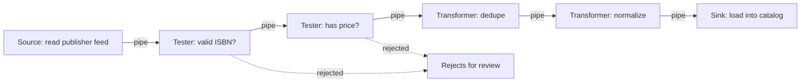

# Pipes and Filters Architecture

## Introduction

In the **pipes and filters** style, processing is broken into a chain of independent steps:

- a **filter** does one job on the data it receives: parse, validate, transform, enrich, aggregate
- a **pipe** carries the output of one filter to the input of the next, and does nothing else
- a **source** (producer) starts the stream, and a **sink** (consumer) ends it

Filters do not know about each other. Each one only knows its input and output format. So you can reorder them, reuse them in other pipelines, test them alone and, in distributed versions, scale them independently.

If you have ever typed a Unix command with `|`, you have used this style. Doug McIlroy's idea of connecting small programs with pipes became part of Unix in the early 1970s, and it remains one of the most successful architectural ideas in computing.

The analogy is a car wash. Each station does one thing: pre-soak, scrub, rinse, wax, dry. The conveyor belt (the pipe) moves the car from station to station. You can add a tire-shine station without retraining the scrubbers, and you can put two drying stations side by side if drying is the slowest step.

Richards and Ford describe four kinds of filter: **producers** (sources), **transformers** (change the data), **testers** (check the data and pass it on or drop it) and **consumers** (sinks). The [Azure Pipes and Filters pattern](https://learn.microsoft.com/en-us/azure/architecture/patterns/pipes-and-filters) describes the distributed, cloud version.

## The Shape



## The Classic Example: Unix Pipelines

Pageturner receives a nightly CSV feed from a publisher. Before writing any code, a developer wants to know which ISBNs appear more than once:

```bash
tail -n +2 feed.csv | cut -d, -f1 | sort | uniq -c | sort -rn
```

Output:

```text
      2 9780134757599
      1 not-an-isbn
      1 9781617294549
      1 9781492043454
      1 9780321125217
```

Five small programs, none of which knows about CSV feeds or bookstores, combine into a useful tool. Each reads text on standard input and writes text on standard output. That **uniform interface** is what makes them composable.

The feed used in the examples on this page is:

```text
isbn,title,price,currency
9780134757599,Refactoring,47.99,USD
9780134757599,Refactoring,47.99,USD
9781492043454,Fundamentals of Software Architecture,59.99,USD
not-an-isbn,Broken Row,10.00,USD
9780321125217,Domain-Driven Design,64.99,usd
9781617294549,Microservices Patterns,,USD
```

## The Problem: One Tangled Import Function

The first version of the import job did everything in one loop:

```python
import csv


def import_feed(path: str) -> list[dict]:
    """Parse, validate, normalize, dedupe and convert in one tangled loop."""
    books, seen = [], set()
    with open(path, newline="") as f:
        for row in csv.DictReader(f):
            if len(row["isbn"]) != 13 or not row["isbn"].isdigit():
                continue
            if not row["price"]:
                continue
            if row["isbn"] in seen:
                continue
            seen.add(row["isbn"])
            books.append({
                "isbn": row["isbn"],
                "title": row["title"].strip(),
                "price_cents": round(float(row["price"]) * 100),
                "currency": row["currency"].upper(),
            })
    return books


for book in import_feed("feed.csv"):
    print(book)
```

Output:

```text
{'isbn': '9780134757599', 'title': 'Refactoring', 'price_cents': 4799, 'currency': 'USD'}
{'isbn': '9781492043454', 'title': 'Fundamentals of Software Architecture', 'price_cents': 5999, 'currency': 'USD'}
{'isbn': '9780321125217', 'title': 'Domain-Driven Design', 'price_cents': 6499, 'currency': 'USD'}
```

It works, but:

- **Rejected rows vanish silently.** Nobody can tell the publisher which rows were bad and why.
- **Steps cannot be reused.** A second publisher sends JSON. Its import job will copy the validation and normalization code.
- **Steps cannot be tested alone.** To test deduplication you need a CSV file on disk.
- **Steps cannot be reordered or added** without editing the whole loop. Adding "enrich with cover image URL" means more nesting.

## The Solution: Generator Filters

Python generators are a natural fit for pipes and filters. Each filter is a function that takes an iterable of records and yields records. The pipe is just "pass this generator to the next function".

```python
import csv
from collections.abc import Callable, Iterable, Iterator
from functools import reduce

Record = dict[str, str | int]
Filter = Callable[[Iterable[Record]], Iterator[Record]]
rejected: list[tuple[str, Record]] = []  # a side channel for bad records


# ---- source (producer) ----
def read_csv(path: str) -> Iterator[Record]:
    with open(path, newline="") as f:
        yield from csv.DictReader(f)


# ---- filters: each takes a stream and yields a stream ----
def valid_isbn(records: Iterable[Record]) -> Iterator[Record]:
    for r in records:
        isbn = str(r["isbn"])
        if len(isbn) == 13 and isbn.isdigit():
            yield r
        else:
            rejected.append(("bad isbn", r))


def has_price(records: Iterable[Record]) -> Iterator[Record]:
    for r in records:
        if r["price"]:
            yield r
        else:
            rejected.append(("missing price", r))


def dedupe(records: Iterable[Record]) -> Iterator[Record]:
    seen: set[str] = set()
    for r in records:
        if r["isbn"] not in seen:
            seen.add(str(r["isbn"]))
            yield r


def normalize(records: Iterable[Record]) -> Iterator[Record]:
    for r in records:
        yield {
            "isbn": r["isbn"],
            "title": str(r["title"]).strip(),
            "price_cents": round(float(r["price"]) * 100),
            "currency": str(r["currency"]).upper(),
        }


# ---- pipe: connect filters in order ----
def pipeline(source: Iterable[Record], *filters: Filter) -> Iterator[Record]:
    return reduce(lambda stream, f: f(stream), filters, iter(source))


if __name__ == "__main__":
    books = pipeline(read_csv("feed.csv"), valid_isbn, has_price, dedupe, normalize)
    for book in books:  # sink (consumer): here it just prints
        print(book)
    for reason, record in rejected:
        print("rejected:", reason, record["isbn"])
```

Output:

```text
{'isbn': '9780134757599', 'title': 'Refactoring', 'price_cents': 4799, 'currency': 'USD'}
{'isbn': '9781492043454', 'title': 'Fundamentals of Software Architecture', 'price_cents': 5999, 'currency': 'USD'}
{'isbn': '9780321125217', 'title': 'Domain-Driven Design', 'price_cents': 6499, 'currency': 'USD'}
rejected: bad isbn not-an-isbn
rejected: missing price 9781617294549
```

Same result, different structure:

- **Each filter is small and testable**: `list(dedupe([{"isbn": "1"}, {"isbn": "1"}]))` is a one-line test.
- **The second publisher's JSON job** writes one new source, `read_json`, and reuses every other filter.
- **Reordering** is a change to one line: the arguments to `pipeline`.
- **Rejected records** go to a side channel with a reason, so they can be reported back.

### Pipelines stream

Generators are lazy. Each record flows through the whole pipeline before the next one is read, so memory use stays flat even for a feed with millions of rows. This tiny demo makes the interleaving visible:

```python
from collections.abc import Iterable, Iterator


def source() -> Iterator[int]:
    for n in range(1, 4):
        print(f"source  -> {n}")
        yield n


def double(xs: Iterable[int]) -> Iterator[int]:
    for x in xs:
        print(f"double  -> {x * 2}")
        yield x * 2


def sink(xs: Iterable[int]) -> None:
    for x in xs:
        print(f"sink    <- {x}")


sink(double(source()))
```

Output:

```text
source  -> 1
double  -> 2
sink    <- 2
source  -> 2
double  -> 4
sink    <- 4
source  -> 3
double  -> 6
sink    <- 6
```

Not every filter can stream. A filter that sorts, or that computes a total over everything, must see all of its input before it can emit anything. Those **blocking filters** limit how much of the pipeline can run concurrently and how much memory it needs. The Unix `sort` in the earlier pipeline is one.

The functional ideas behind this (higher-order functions, composition, immutability) are covered in more depth in [Functional Patterns](../5-arch-modern-patterns/5-arch-functional-patterns.mdx).

## Distributed Pipelines: Queues as Pipes

When filters need to scale independently or run on different hardware, the pipes become **message queues** and each filter becomes a separate worker, container or serverless function. The Azure pattern uses exactly this example: an image pipeline with content moderation, resizing, watermarking and publishing, connected by queues.


This adds new concerns, all listed in the [Azure pattern](https://learn.microsoft.com/en-us/azure/architecture/patterns/pipes-and-filters):

- **Reliability:** pipes must not lose messages. Use durable queues.
- **Idempotency and duplicates:** a filter can crash after doing its work but before acknowledging the message, so the next attempt repeats the work. Filters must be idempotent, and downstream filters should tolerate or remove duplicates.
- **Large payloads:** do not push images through the queue. Store the image and pass a reference (the **claim check** pattern).
- **Context:** each filter must receive enough context in the message to do its work, without calling back into earlier stages.
- **Error handling:** decide per filter whether a failure stops the item, retries it, or sends it to a dead-letter queue.

At this point the pipeline overlaps with [event-driven architecture](./5-arch-event-driven.mdx) and [serverless](./6-arch-serverless.mdx). The difference is intent: a pipes-and-filters pipeline is a **fixed, ordered sequence** of processing steps for one item, while event-driven systems usually fan out to independent reactions.

## Where You Have Already Met This Style

- **Unix shells:** `|` between commands.
- **Compilers:** lexer, parser, semantic analysis, optimization and code generation passes.
- **Web middleware stacks:** each middleware handles a request and passes it on. (When a middleware can stop the request, it is closer to [Chain of Responsibility](../4-arch-behavioral-patterns/5-arch-chain-of-responsibility.mdx).)
- **Data and ML pipelines:** ETL jobs, scikit-learn's `Pipeline` of transformers and an estimator, Apache Beam and similar stream processors.
- **Media processing:** audio and video frameworks such as GStreamer are built from connected elements.
- **Integration frameworks:** Spring Integration and Apache Camel implement pipes and filters from the *Enterprise Integration Patterns* book.

## Real-World Scenario

Pageturner imports catalog data from **30 publishers**. Each sends a nightly feed in CSV, JSON or XML. All feeds need the same checks (valid ISBN, price present, no duplicates), the same normalization (currency, title cleanup) and the same enrichment (cover URL, category mapping), then a load into the catalog. Publishers keep asking "why didn't my new titles appear?"

**The solution:** a pipes-and-filters import pipeline:

1. One **source** per feed format (`read_csv`, `read_json`, `read_xml`) that yields the same record shape.
2. A shared chain of **tester** and **transformer** filters, each in its own module with unit tests.
3. A **rejects** side channel that records the reason for every dropped row and produces a report per publisher.
4. A **sink** that upserts into the catalog through the catalog module's public API, idempotently by ISBN.
5. It runs in one process as a scheduled job. If a step becomes a bottleneck later (for example, cover image downloads), that one filter can move behind a queue with more workers.

### Why this approach

- The processing is naturally a **sequence of independent steps**, which is the shape this style fits.
- **Reuse:** 30 publishers share one set of filters; only sources differ.
- **Transparency:** per-filter reject counts answer "why didn't my title appear?"
- **Evolvability:** new requirements, such as "flag explicit content", are new filters inserted in one place.

### When to use it, and when not to

Use pipes and filters when:

- processing is a series of steps, each with a clear input and output
- steps can be reused, reordered or added over time
- you process streams or batches of similar items (records, files, images, events)
- some steps have different scaling needs (in the distributed form)

Avoid it, or keep it in-process, when:

- the work is **interactive request/response**: a user waiting for an answer should not wait for a multi-queue pipeline
- steps are **tightly coupled** and must run in one transaction
- each step needs a lot of shared **context or state**, so passing it along becomes heavy
- the "pipeline" is really a branching business process with decisions and compensation. A workflow engine or an [orchestrated saga](../9-arch-distributed-systems/5-arch-saga.mdx) fits better.

### Alternatives and trade-offs

| Approach | Pros | Cons | Best for |
| --- | --- | --- | --- |
| One monolithic function | Simple to start | Hard to test, reuse or extend | Tiny one-off scripts |
| In-process filters (generators) | Composable, testable, streaming, cheap | One machine, one failure domain | Most batch imports and ETL |
| Queue-based distributed filters | Independent scaling, isolation | Duplicates, idempotency, more operations | Heavy media or data processing |
| Workflow orchestrator (for example Airflow, Step Functions) | Retries, scheduling, visibility | Another platform to run | Multi-step jobs with dependencies |
| Stream processing framework | Windowing, state, huge scale | Steep learning curve | Continuous high-volume streams |

## Common Mistakes

1. **Filters that know about each other.** A filter that checks "did the previous filter run?" breaks reordering. Each filter should depend only on its input format.
2. **Inconsistent record shapes.** If every filter emits a slightly different dictionary, filters cannot be reordered. Define the record shape (a `TypedDict` or data class) and stick to it.
3. **Silently dropping data.** Tester filters should record why an item was dropped.
4. **Hidden shared state.** Filters that write to a shared global (like a cache of seen IDs used by several filters) create coupling. Keep state inside the filter that needs it. The `rejected` list in the example is an explicit, read-only side channel for reporting; in production, prefer passing a reporter object in.
5. **Distributing too early.** Turning every filter into a separate service adds queues, retries and duplicates. Start in-process, and distribute only the filters that need it.
6. **Non-idempotent sinks.** Re-running a failed nightly job should not create duplicate books. Upsert by a natural key.

## Summary

- **Pipes and filters** breaks processing into independent **filters** connected by **pipes**, from a **source** to a **sink**.
- Filters are small, testable, reusable and reorderable, because each only knows its input and output format.
- In Python, **generators** make in-process pipelines simple and memory-efficient. **Blocking** filters (sort, aggregate) limit streaming.
- The distributed version uses **queues as pipes**, which adds idempotency, duplicate handling, claim checks and error handling.
- Use it for sequences of processing steps on streams or batches. Avoid it for interactive request/response or tightly coupled transactional work.

## Further Learning

**Exercises**

1. Add an `enrich_cover_url` filter that adds `cover_url` built from the ISBN. Insert it into the pipeline without changing any other filter.
2. Write `read_json` for a second publisher and reuse the rest of the pipeline unchanged.
3. Replace the global `rejected` list with a `Rejects` object passed into the tester filters. Which design is easier to test?
4. Sketch the queue-based version of the import job. Which filter would you distribute first, and how would you make the sink idempotent?

**Related pages**

- [Functional Patterns: Pipelines, Higher-Order Functions and Immutability](../5-arch-modern-patterns/5-arch-functional-patterns.mdx)
- [Chain of Responsibility Pattern](../4-arch-behavioral-patterns/5-arch-chain-of-responsibility.mdx)
- [Messaging Patterns: Queues, Pub/Sub and Streams](../10-arch-integration-and-apis/5-arch-messaging-patterns.mdx)
- [Search and Analytics Architecture](../11-arch-data-architecture/6-arch-search-and-analytics.mdx)

**Sources**

- [Azure Architecture Center: Pipes and Filters pattern](https://learn.microsoft.com/en-us/azure/architecture/patterns/pipes-and-filters)
- [Enterprise Integration Patterns: Pipes and Filters](https://www.enterpriseintegrationpatterns.com/patterns/messaging/PipesAndFilters.html)
- Mark Richards and Neal Ford, *Fundamentals of Software Architecture* (O'Reilly), chapter on pipeline architecture
- [Python docs: Generator expressions and generators](https://docs.python.org/3/howto/functional.html#generators)
