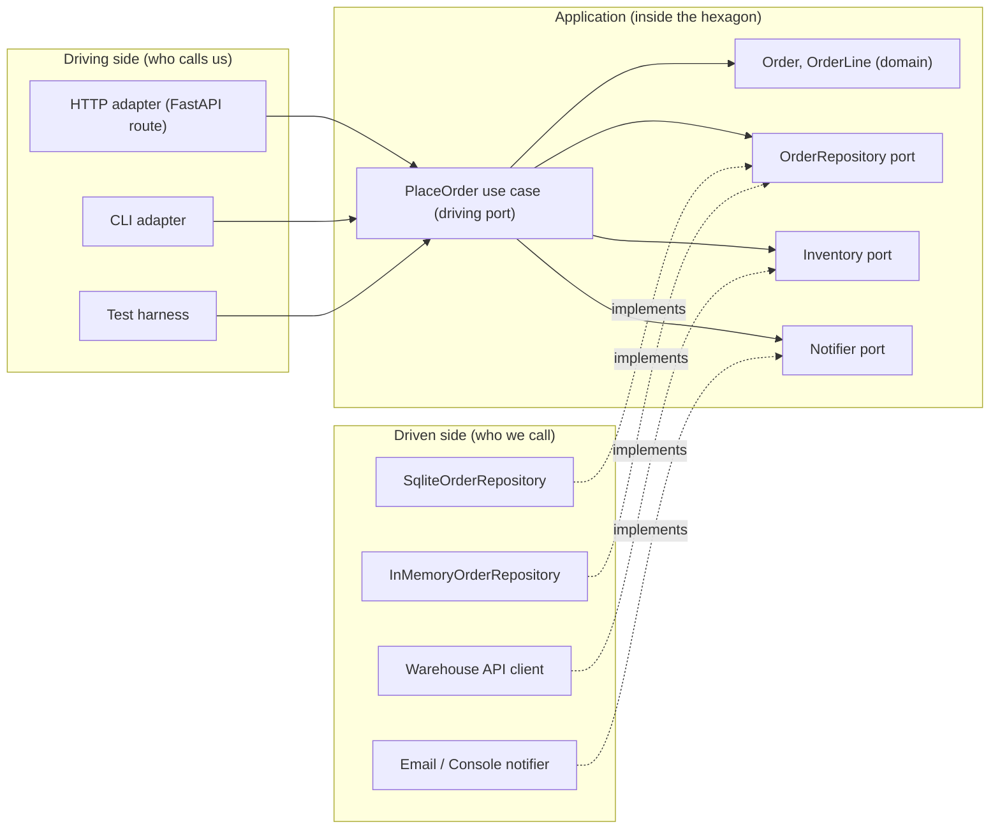
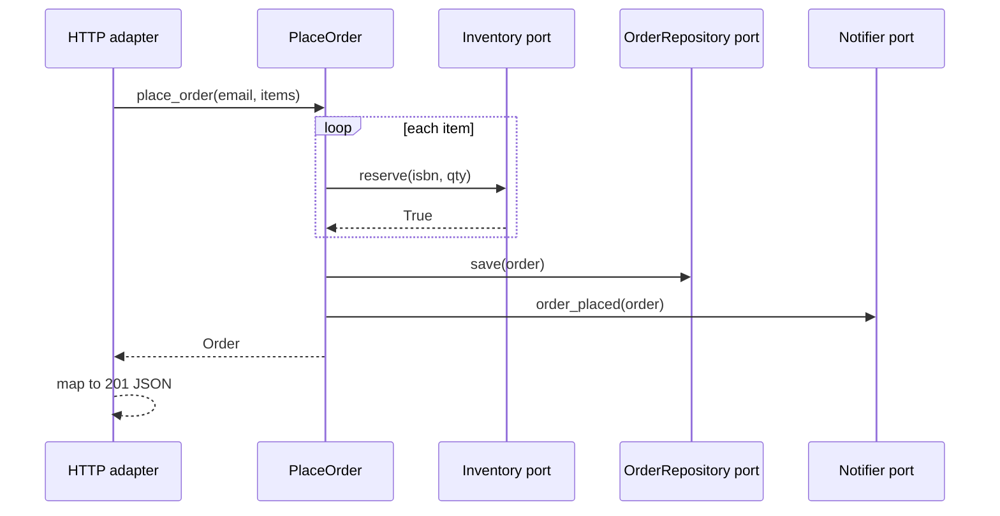

# Hexagonal Architecture (Ports and Adapters)

## Introduction

Most applications start the same way. A web handler reads a request, runs some SQL, does a calculation, sends an email, and returns JSON, all in one function. That is fine for a weekend project. A year later, though, it hurts in three ways:

- You cannot test the business rules without a database and a mail server.
- Changing the web framework or the database means touching the business logic.
- A second way of driving the app, such as a CLI, a message consumer or a scheduled job, means copying that logic.

**Hexagonal Architecture**, also called **Ports and Adapters**, fixes this by drawing one firm line: the **inside** of the application (business logic) and the **outside** world (UI, database, email, other services, tests). The inside talks to the outside only through **ports**, which are interfaces that the inside owns. Each piece of technology plugs into a port through an **adapter**.

Think of a laptop. Its USB-C ports are defined by the laptop's design, not by any particular device. A charger, a monitor or a keyboard each connect through the port, sometimes via a small adapter dongle. You can swap the monitor without opening up the laptop. Ports and adapters give your business logic the same property.

Alistair Cockburn described the pattern in his article [Hexagonal Architecture](https://alistair.cockburn.us/hexagonal-architecture/) (first written in 2005). His stated goal was to let an application be driven equally by users, programs, automated tests or batch scripts, and to be developed and tested in isolation from its eventual run-time devices and databases. In 2024 he and Juan Manuel Garrido de Paz published a book-length treatment, *Hexagonal Architecture Explained*.

:::note Why a hexagon?
The number six means nothing. Cockburn chose a hexagon so the drawing has room for several ports on its edges, and to break away from the habit of drawing layers as a top-to-bottom stack. The important asymmetry is **inside versus outside**, not top versus bottom.
:::

## The Vocabulary

| Term | Meaning | Bookstore example |
| --- | --- | --- |
| Application (the hexagon) | The business logic and use cases, with no knowledge of technology | "Place an order" rules |
| Port | An interface owned by the application that describes a purposeful conversation | `OrderRepository`, `Notifier`, `PlaceOrder` |
| Adapter | Code that converts between a specific technology and a port | `SqliteOrderRepository`, `ConsoleNotifier`, a FastAPI route |
| Driving (primary) side | Actors that start a conversation with the app | Web UI, CLI, tests, message consumer |
| Driven (secondary) side | Actors the app starts a conversation with | Database, email service, payment gateway |
| Configurator / composition root | The startup code that picks which adapters to plug into which ports | `main.py` |

Two kinds of ports exist:

- **Driving ports** (also called primary or inbound ports) are the operations the application **offers**: "place an order", "cancel an order". Driving adapters call them.
- **Driven ports** (also called secondary or outbound ports) are what the application **needs**: "save an order", "send a notification". Driven adapters implement them.



Notice the arrows. Driving adapters point **into** the hexagon because they call it. Driven adapters also point **into** the hexagon, because they implement interfaces the hexagon defines. Nothing inside points out. That is the [Dependency Inversion Principle](../1-arch-design-principles/5-arch-dependency-inversion.mdx) applied at the scale of a whole application.

## The Problem: Logic Welded to Technology

Here is an online bookstore's "place order" endpoint, written the quick way.

```python
# before.py: everything in one handler
import smtplib
import sqlite3
import uuid
from decimal import Decimal
from email.message import EmailMessage

DB_PATH = "bookstore.db"

def place_order_handler(request_json: dict) -> dict:
    conn = sqlite3.connect(DB_PATH)
    order_id = uuid.uuid4().hex[:8]
    total = Decimal("0")
    for item in request_json["items"]:
        row = conn.execute("SELECT stock FROM books WHERE isbn = ?", (item["isbn"],)).fetchone()
        if row is None or row[0] < item["qty"]:
            return {"error": f"out of stock: {item['isbn']}"}, 409
        conn.execute("UPDATE books SET stock = stock - ? WHERE isbn = ?", (item["qty"], item["isbn"]))
        total += Decimal(item["price"]) * item["qty"]
    conn.execute("INSERT INTO orders VALUES (?, ?, ?)", (order_id, request_json["email"], str(total)))
    conn.commit()

    msg = EmailMessage()
    msg["To"] = request_json["email"]
    msg["Subject"] = f"Order {order_id} confirmed"
    msg.set_content(f"Total: ${total}")
    with smtplib.SMTP("smtp.internal", 25) as smtp:
        smtp.send_message(msg)

    return {"order_id": order_id, "total": str(total)}, 201
```

What hurts:

- The pricing and stock rules sit between SQL statements and SMTP calls. To test "an out-of-stock book rejects the order", you need a real database with a `books` table and must avoid sending email.
- The function speaks HTTP (`request_json`, status codes). A nightly batch import of B2B orders cannot reuse it.
- Switching from SQLite to PostgreSQL, or from SMTP to an email API, means editing the business logic.

## The Solution, Step by Step

### Step 1: The domain, free of technology

Start with plain Python objects that know nothing about databases or HTTP.

```python
# hex.py (part 1): domain
from __future__ import annotations

import uuid
from dataclasses import dataclass, field
from decimal import Decimal
from typing import Protocol


@dataclass(frozen=True)
class OrderLine:
    isbn: str
    quantity: int
    unit_price: Decimal


@dataclass
class Order:
    order_id: str
    customer_email: str
    lines: list[OrderLine] = field(default_factory=list)

    @property
    def total(self) -> Decimal:
        return sum((l.unit_price * l.quantity for l in self.lines), Decimal("0"))


class OutOfStock(Exception):
    pass
```

### Step 2: Driven ports, owned by the application

The application now states what it needs, in its own words. `typing.Protocol` lets adapters satisfy the port by shape, without inheriting from it.

```python
# hex.py (part 2): driven ports
class OrderRepository(Protocol):
    def save(self, order: Order) -> None: ...
    def get(self, order_id: str) -> Order | None: ...


class Inventory(Protocol):
    def reserve(self, isbn: str, quantity: int) -> bool: ...


class Notifier(Protocol):
    def order_placed(self, order: Order) -> None: ...
```

Good port names describe the **conversation from the application's point of view**: `Notifier.order_placed`, not `SmtpClient.send_message`. If a port's method names mention a technology, the technology has leaked inside.

### Step 3: The driving port, a use case

```python
# hex.py (part 3): driving port / use case
class PlaceOrder:
    def __init__(self, orders: OrderRepository, inventory: Inventory, notifier: Notifier) -> None:
        self._orders = orders
        self._inventory = inventory
        self._notifier = notifier

    def __call__(self, customer_email: str, items: dict[str, tuple[int, Decimal]]) -> Order:
        order = Order(order_id=uuid.uuid4().hex[:8], customer_email=customer_email)
        for isbn, (qty, price) in items.items():
            if not self._inventory.reserve(isbn, qty):
                raise OutOfStock(isbn)
            order.lines.append(OrderLine(isbn, qty, price))
        self._orders.save(order)
        self._notifier.order_placed(order)
        return order
```

`PlaceOrder` receives its collaborators through the constructor ([Dependency Injection](../1-arch-design-principles/10-arch-dependency-injection.mdx)). It has no imports from `sqlite3`, `smtplib` or any web framework.

:::tip
A driving port can be an explicit interface (common in Java and C#) or simply the public methods of the use case class (common in Python). Both are fine. What matters is that driving adapters depend on the application, never the other way around.
:::

### Step 4: Driven adapters, one per technology

```python
# hex.py (part 4): driven adapters
import sqlite3


class InMemoryOrderRepository:
    def __init__(self) -> None:
        self._data: dict[str, Order] = {}

    def save(self, order: Order) -> None:
        self._data[order.order_id] = order

    def get(self, order_id: str) -> Order | None:
        return self._data.get(order_id)


class SqliteOrderRepository:
    def __init__(self, conn: sqlite3.Connection) -> None:
        self._conn = conn
        conn.execute("CREATE TABLE IF NOT EXISTS orders (id TEXT PRIMARY KEY, email TEXT)")
        conn.execute(
            "CREATE TABLE IF NOT EXISTS order_lines "
            "(order_id TEXT, isbn TEXT, qty INTEGER, price TEXT)"
        )

    def save(self, order: Order) -> None:
        with self._conn:
            self._conn.execute("INSERT INTO orders VALUES (?, ?)", (order.order_id, order.customer_email))
            self._conn.executemany(
                "INSERT INTO order_lines VALUES (?, ?, ?, ?)",
                [(order.order_id, l.isbn, l.quantity, str(l.unit_price)) for l in order.lines],
            )

    def get(self, order_id: str) -> Order | None:
        row = self._conn.execute("SELECT id, email FROM orders WHERE id = ?", (order_id,)).fetchone()
        if row is None:
            return None
        lines = [
            OrderLine(isbn, qty, Decimal(price))
            for isbn, qty, price in self._conn.execute(
                "SELECT isbn, qty, price FROM order_lines WHERE order_id = ?", (order_id,)
            )
        ]
        return Order(row[0], row[1], lines)


class DictInventory:
    def __init__(self, stock: dict[str, int]) -> None:
        self._stock = dict(stock)

    def reserve(self, isbn: str, quantity: int) -> bool:
        if self._stock.get(isbn, 0) < quantity:
            return False
        self._stock[isbn] -= quantity
        return True


class ConsoleNotifier:
    def order_placed(self, order: Order) -> None:
        print(f"[email to {order.customer_email}] Order {order.order_id} confirmed, total ${order.total}")


class RecordingNotifier:
    """Test double: remembers what it was asked to send."""
    def __init__(self) -> None:
        self.sent: list[str] = []

    def order_placed(self, order: Order) -> None:
        self.sent.append(order.order_id)
```

The SQL now lives in exactly one class. The translation between rows and `Order` objects is the adapter's job, which is why it is called an adapter (compare the [Adapter pattern](../3-arch-structural-patterns/0-arch-adapter.mdx), which is the same idea at the class level).

### Step 5: The configurator wires it together

Some code must know about both the inside and the outside. Keep it in one place at startup, often called the **composition root**.

```python
# main.py: the configurator
import sqlite3
from decimal import Decimal

from hex import ConsoleNotifier, DictInventory, PlaceOrder, SqliteOrderRepository

conn = sqlite3.connect(":memory:")
place_order = PlaceOrder(
    orders=SqliteOrderRepository(conn),
    inventory=DictInventory({"978-0134757599": 5}),
    notifier=ConsoleNotifier(),
)

order = place_order("ana@example.com", {"978-0134757599": (2, Decimal("39.99"))})
print("Saved:", SqliteOrderRepository(conn).get(order.order_id) is not None)
```

Example output (the order ID is random):

```text
[email to ana@example.com] Order 33cc6de4 confirmed, total $79.98
Saved: True
```

### Step 6: Several driving adapters for the same use case

A test is a driving adapter too. It drives the hexagon with in-memory driven adapters, so it runs in milliseconds:

```python
# test_place_order.py
from decimal import Decimal

import pytest

from hex import DictInventory, InMemoryOrderRepository, OutOfStock, PlaceOrder, RecordingNotifier


def make_use_case(stock: dict[str, int]):
    repo, notifier = InMemoryOrderRepository(), RecordingNotifier()
    return PlaceOrder(repo, DictInventory(stock), notifier), repo, notifier


def test_places_order_and_notifies():
    place_order, repo, notifier = make_use_case({"111": 3})
    order = place_order("bo@example.com", {"111": (2, Decimal("10.00"))})
    assert order.total == Decimal("20.00")
    assert repo.get(order.order_id) is order
    assert notifier.sent == [order.order_id]


def test_rejects_out_of_stock_without_notifying():
    place_order, repo, notifier = make_use_case({"111": 1})
    with pytest.raises(OutOfStock):
        place_order("bo@example.com", {"111": (2, Decimal("10.00"))})
    assert notifier.sent == []
```

Example output of `pytest -q`:

```text
..                                                                       [100%]
2 passed in 0.01s
```

An HTTP adapter is just as thin. With FastAPI (install with `pip install fastapi uvicorn`), the route translates JSON to a use case call and the exception to a status code:

```python
# web.py: an HTTP driving adapter
from decimal import Decimal

from fastapi import FastAPI, HTTPException
from pydantic import BaseModel

from hex import OutOfStock, PlaceOrder
from wiring import build_place_order  # the configurator for production adapters

app = FastAPI()
place_order: PlaceOrder = build_place_order()


class Item(BaseModel):
    isbn: str
    qty: int
    price: Decimal


class OrderRequest(BaseModel):
    email: str
    items: list[Item]


@app.post("/orders", status_code=201)
def create_order(body: OrderRequest) -> dict[str, str]:
    try:
        order = place_order(body.email, {i.isbn: (i.qty, i.price) for i in body.items})
    except OutOfStock as exc:
        raise HTTPException(status_code=409, detail=f"out of stock: {exc}")
    return {"order_id": order.order_id, "total": str(order.total)}
```

A nightly B2B import can call the same `place_order` from a CSV reader. The business rules exist once.



## Where You Have Already Seen This

- **Spring and Java projects** frequently use package names such as `adapter.in.web`, `adapter.out.persistence` and `application.port.in` / `application.port.out`. Tom Hombergs' book *Get Your Hands Dirty on Clean Architecture* popularized this layout.
- **Python's [Cosmic Python](https://www.cosmicpython.com/)** (*Architecture Patterns with Python* by Harry Percival and Bob Gregory) builds a ports-and-adapters style app with repositories, a service layer and a unit of work, and it is free to read online.
- **Test doubles** are the oldest example. Every time you passed a fake repository into a service in a test, you used a driven port with a test adapter.
- The .NET guide [Common web application architectures](https://learn.microsoft.com/en-us/dotnet/architecture/modern-web-apps-azure/common-web-application-architectures) treats hexagonal, ports-and-adapters, onion and clean architecture as names for the same core idea, which is a useful sign of how close they are.

## Real-World Scenario

**Situation.** Your team runs the order service of an online bookstore. Today it uses a PostgreSQL database and sends email through an internal SMTP relay. Two changes are coming in the next quarter: marketing wants confirmation messages sent through a third-party email API, and a wholesale partner will submit orders by dropping CSV files on an SFTP server every night. The CI suite already takes 12 minutes because every test talks to a real database.

**Solution.**

1. Extract the order rules into `PlaceOrder` and the domain classes, with the three driven ports shown above.
2. Wrap the existing SQL in `PostgresOrderRepository` and the SMTP code in `SmtpNotifier`. Behavior does not change yet.
3. Rewrite the slow business-rule tests to use `InMemoryOrderRepository` and `RecordingNotifier`. Keep a small set of adapter integration tests that hit a real PostgreSQL in a container.
4. Add `EmailApiNotifier` as a new adapter. Switch it on in the configurator, possibly behind a feature flag.
5. Add a `CsvOrderImporter` driving adapter that reads each CSV row and calls `place_order`.

**Why this approach.** Both upcoming changes are pure "outside" changes: a new driven technology and a new driving channel. Ports and adapters makes each one a new class plus one line in the configurator, with no edits to the business rules. It also attacks the slow test suite directly.

**When to use it.**

- The business logic is worth protecting: pricing, eligibility, workflows and rules that change for business reasons.
- You have, or clearly expect, more than one driving channel or more than one implementation of a driven dependency (including test doubles).
- You want fast unit tests of business rules without containers.

**When not to use it.**

- CRUD screens where the "logic" is mostly mapping a form to a table. The ports would be pass-through interfaces.
- Short-lived scripts, prototypes and spikes.
- Teams that have not yet felt the pain. Adding ports for a dependency that will never change is speculative generality (see [DRY, KISS and YAGNI](../1-arch-design-principles/6-arch-dry-kiss-yagni.mdx)).

**Alternatives and trade-offs.**

| Approach | Pros | Cons | Best for |
| --- | --- | --- | --- |
| Logic in handlers (transaction script) | Fastest to write, easy to read top to bottom | Hard to test, logic duplicated across channels | Small CRUD apps, prototypes |
| Classic [layered architecture](../6-arch-architectural-styles/1-arch-layered.mdx) | Familiar, simple folder rules | Business layer usually depends on the data layer | Teams wanting light structure |
| Hexagonal (ports and adapters) | Testable core, swappable technology, many entry points | More files and interfaces, mapping code at the edges | Rich business rules, several channels |
| [Vertical slices](./3-arch-vertical-slice.mdx) | Each feature self-contained, little ceremony | Less protection of shared domain rules | Feature-heavy apps with thin logic |

## Common Mistakes

1. **Ports shaped like the technology.** A port with methods such as `execute_sql` or `send_smtp` is not a port, just an indirection. Name methods after what the application needs.
2. **Leaking ORM models inside.** If your domain classes are SQLAlchemy or Django models, the database is inside the hexagon. Either accept that trade-off knowingly or map to plain domain objects in the adapter.
3. **One port per table.** Ports should follow conversations (orders, inventory, notifications), not your schema.
4. **Business rules in adapters.** "Free shipping over $50" in the HTTP route means the CSV importer will not apply it. Adapters translate; they do not decide.
5. **Interfaces for everything.** You do not need a port for the standard library's `datetime` or for pure helper functions. Add a port when you want to substitute the dependency, usually for testing or a real alternative.
6. **Configurator logic spread everywhere.** If adapters are created deep inside the code, swapping them is hard again. Build them once at startup.

:::caution
Hexagonal architecture does not tell you how to structure the inside. It says nothing about entities, use cases or layers within the hexagon. [Onion](./1-arch-onion.mdx) and [Clean Architecture](./2-arch-clean-architecture.mdx) add that guidance.
:::

## Summary

- Hexagonal architecture separates the **inside** (business logic) from the **outside** (UI, databases, external services, tests).
- **Ports** are interfaces owned by the application. **Driving** ports are what it offers; **driven** ports are what it needs.
- **Adapters** translate between a technology and a port. You can have many adapters per port, including test doubles.
- A **configurator** (composition root) chooses the adapters at startup.
- The payoff is fast tests, several entry points to the same logic, and technology swaps without touching the rules.
- The cost is more interfaces and mapping code. Skip it for simple CRUD and throwaway code.

## Exercises

1. Add a `CsvOrderImporter` driving adapter that reads lines like `email,isbn,qty,price` and calls `place_order`. Print one result line per order and report out-of-stock rows without stopping.
2. Replace `DictInventory` with a `HttpInventory` adapter stub that would call a warehouse API. Write it so the use case and tests do not change at all.
3. The use case generates IDs with `uuid4`, which makes outputs non-deterministic. Introduce an `IdGenerator` driven port and a fixed-sequence test adapter. Was it worth it? Argue both sides.
4. Look at a project you work on. List its driving and driven actors, and identify one place where a technology concern has leaked into business logic.

Continue with [Onion Architecture](./1-arch-onion.mdx), which adds layers inside the hexagon, and see [Designing for Testability](../12-arch-quality-and-operations/5-arch-testability.mdx) for how this style shapes a test suite.
