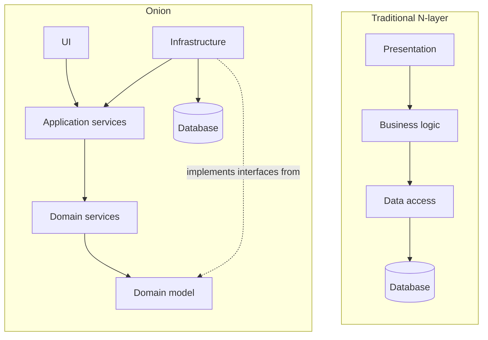
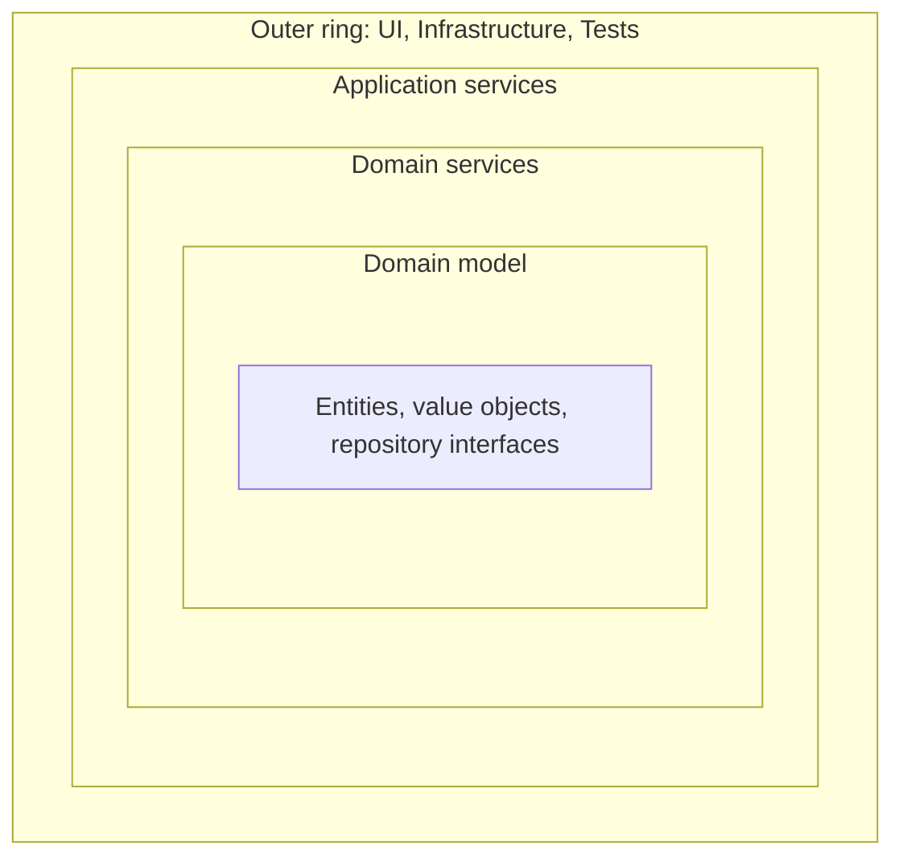

# Onion Architecture

## Introduction

[Hexagonal Architecture](./0-arch-hexagonal.mdx) draws a single line between the inside of an application and the outside world. It deliberately says nothing about how to organize the inside. Once the inside grows to hundreds of classes, teams start asking: where do the business rules go, where does orchestration go, and what may depend on what?

**Onion Architecture** answers that question with concentric layers. Jeffrey Palermo introduced the name in a [2008 blog series](https://jeffreypalermo.com/2008/07/the-onion-architecture-part-1/) and credited Cockburn's hexagonal architecture as an influence. His central rule is short: **all coupling is toward the center**. Code in a layer may depend on layers closer to the center, never on layers further out.

Picture a real onion. You can peel away the outer layers (UI, database, external services) and the core is still whole. In a traditional layered application the opposite happens: the database sits at the bottom of the stack, and everything above it, including the business logic, rests on it. Remove the database and the business logic falls over.

## Traditional Layers vs the Onion

In the classic three-layer design, the UI depends on the business logic layer, which depends on the data access layer. That means the most important code, the business rules, depends on the most volatile code, the persistence details.



The key differences:

| Aspect | Traditional layers | Onion |
| --- | --- | --- |
| What is at the center or bottom | The database | The domain model |
| Business logic depends on | Data access code | Nothing outside the core |
| Where repository interfaces live | Data access layer | Core (domain model or the layer just around it) |
| Infrastructure position | Bottom of the stack | Outermost ring, next to the UI |
| Testing business rules | Usually needs a database | Plain unit tests |

The trick that turns the stack inside out is the [Dependency Inversion Principle](../1-arch-design-principles/5-arch-dependency-inversion.mdx). The core declares an interface such as `BookCatalog`; infrastructure implements it; at runtime an implementation is injected.

## The Layers

Palermo's original description has a domain model at the center, a variable number of service layers around it, and an outer ring containing UI, infrastructure and tests. Most teams today use these four rings:



1. **Domain model** (center). Entities and value objects with their state and behavior. Repository and gateway interfaces are often declared here or in the next ring. It depends on nothing else in the application.
2. **Domain services**. Business rules that involve several entities and do not belong naturally to any one of them, such as "price this cart for this customer". See [Domain Services and Application Services](../8-arch-domain-driven-design/6-arch-domain-services.mdx).
3. **Application services**. One method per use case. They load objects through interfaces, call domain logic, and return results. They orchestrate; they do not decide business rules.
4. **Outer ring**. The UI (web, CLI), infrastructure (database, file storage, email, message brokers) and tests. These change most often, so they sit furthest from the center.

:::note
Palermo noted that the number of rings is not fixed. A small service might merge domain services into the domain model. What is fixed is the direction of dependencies.
:::

## The Problem: Business Logic on Top of the Database

Here is a bookstore's quote calculation in a traditional layered design. The business layer imports the data layer directly.

```python
# before/business.py
from decimal import Decimal

from before import data_access  # business layer -> data layer


def quote(customer_id: str, isbns: dict[str, int]) -> Decimal:
    customer_row = data_access.fetch_customer(customer_id)   # returns a DB row dict
    subtotal = Decimal("0")
    for isbn, qty in isbns.items():
        book_row = data_access.fetch_book(isbn)
        subtotal += Decimal(book_row["price"]) * qty
    if customer_row["tier"] == "gold":
        subtotal = (subtotal * Decimal("0.9")).quantize(Decimal("0.01"))
    if subtotal < 50:
        subtotal += Decimal("4.99")
    return subtotal
```

It reads fine, but:

- Every test of the gold discount needs `data_access` to work, which means a database or monkeypatching module globals.
- Rules work with raw row dictionaries (`customer_row["tier"]`), so a column rename breaks business code.
- Nothing stops someone adding SQL to the business layer, because it already depends on data access.

## Building the Onion in Python

The finished project looks like this. Each ring is a package.

```text
src/bookstore/
    domain/              # ring 1: entities, value objects, interfaces
        model.py
    domain_services/     # ring 2
        pricing.py
    application/         # ring 3
        checkout.py
    infrastructure/      # outer ring
        memory.py
    ui/                  # outer ring
        cli.py
    main.py              # composition root
```

### Ring 1: the domain model

```python
# src/bookstore/domain/model.py
from __future__ import annotations

from dataclasses import dataclass, field
from decimal import Decimal
from enum import Enum
from typing import Protocol


class Tier(Enum):
    REGULAR = "regular"
    GOLD = "gold"


@dataclass(frozen=True)
class Money:
    amount: Decimal

    def __add__(self, other: Money) -> Money:
        return Money(self.amount + other.amount)

    def percent_off(self, pct: int) -> Money:
        return Money((self.amount * (100 - pct) / 100).quantize(Decimal("0.01")))


@dataclass
class Customer:
    customer_id: str
    tier: Tier


@dataclass(frozen=True)
class Book:
    isbn: str
    title: str
    price: Money


@dataclass
class Cart:
    customer: Customer
    items: list[tuple[Book, int]] = field(default_factory=list)

    def add(self, book: Book, qty: int = 1) -> None:
        if qty <= 0:
            raise ValueError("quantity must be positive")
        self.items.append((book, qty))

    def subtotal(self) -> Money:
        total = Money(Decimal("0"))
        for book, qty in self.items:
            total = total + Money(book.price.amount * qty)
        return total


# Interfaces the core needs; implemented in infrastructure.
class BookCatalog(Protocol):
    def by_isbn(self, isbn: str) -> Book: ...


class CustomerRepository(Protocol):
    def get(self, customer_id: str) -> Customer: ...
```

`Cart.add` protects its own invariant (no zero or negative quantities). Rules that belong to one object live on that object. This is the "rich domain model" Palermo had in mind, as opposed to data bags with all logic in services.

### Ring 2: a domain service

Pricing needs the cart **and** the customer's tier **and** the shipping rule. It does not belong to `Cart` or `Customer` alone, so it becomes a domain service.

```python
# src/bookstore/domain_services/pricing.py
from decimal import Decimal

from bookstore.domain.model import Cart, Money, Tier


class PricingService:
    """Domain logic that does not belong to a single entity."""

    def total(self, cart: Cart) -> Money:
        subtotal = cart.subtotal()
        if cart.customer.tier is Tier.GOLD:
            subtotal = subtotal.percent_off(10)
        if subtotal.amount >= Decimal("50"):
            return subtotal  # free shipping
        return subtotal + Money(Decimal("4.99"))
```

### Ring 3: an application service

```python
# src/bookstore/application/checkout.py
from dataclasses import dataclass

from bookstore.domain.model import BookCatalog, Cart, CustomerRepository
from bookstore.domain_services.pricing import PricingService


@dataclass(frozen=True)
class QuoteResult:
    customer_id: str
    lines: int
    total: str


class CheckoutService:
    """Application service: orchestrates one use case, owns no business rules."""

    def __init__(self, catalog: BookCatalog, customers: CustomerRepository,
                 pricing: PricingService) -> None:
        self._catalog = catalog
        self._customers = customers
        self._pricing = pricing

    def quote(self, customer_id: str, isbns: dict[str, int]) -> QuoteResult:
        cart = Cart(self._customers.get(customer_id))
        for isbn, qty in isbns.items():
            cart.add(self._catalog.by_isbn(isbn), qty)
        total = self._pricing.total(cart)
        return QuoteResult(customer_id, len(cart.items), str(total.amount))
```

`QuoteResult` is a simple output object. Callers in the UI never receive the `Cart` entity, so they cannot accidentally change it.

### Outer ring: infrastructure, UI and the composition root

```python
# src/bookstore/infrastructure/memory.py
from decimal import Decimal

from bookstore.domain.model import Book, Customer, Money, Tier


class InMemoryCatalog:
    def __init__(self) -> None:
        self._books = {
            "111": Book("111", "Domain-Driven Design", Money(Decimal("54.00"))),
            "222": Book("222", "Refactoring", Money(Decimal("22.50"))),
        }

    def by_isbn(self, isbn: str) -> Book:
        return self._books[isbn]


class InMemoryCustomers:
    def get(self, customer_id: str) -> Customer:
        tier = Tier.GOLD if customer_id.startswith("g-") else Tier.REGULAR
        return Customer(customer_id, tier)
```

```python
# src/bookstore/ui/cli.py
from bookstore.application.checkout import CheckoutService


def run(service: CheckoutService) -> None:
    print(service.quote("c-42", {"222": 1}))
    print(service.quote("g-7", {"111": 1, "222": 1}))
```

```python
# src/bookstore/main.py
from bookstore.application.checkout import CheckoutService
from bookstore.domain_services.pricing import PricingService
from bookstore.infrastructure.memory import InMemoryCatalog, InMemoryCustomers
from bookstore.ui import cli

# Composition root: the only module that knows every layer.
service = CheckoutService(InMemoryCatalog(), InMemoryCustomers(), PricingService())
cli.run(service)
```

Run it from the project root:

```bash
PYTHONPATH=src python3 -m bookstore.main
```

Output:

```text
QuoteResult(customer_id='c-42', lines=1, total='27.49')
QuoteResult(customer_id='g-7', lines=2, total='68.85')
```

The regular customer pays 22.50 plus 4.99 shipping. The gold customer gets 10% off 76.50, which is 68.85, and free shipping because the total is over 50.

## Enforcing the Rings Automatically

Layer rules written only in a wiki get broken within weeks. In Python, [Import Linter](https://import-linter.readthedocs.io/) can check them in CI. Its `layers` contract lists layers from highest (outermost) to lowest (innermost). A higher layer may import a lower one, but not the reverse. A `|` between modules on one line makes them **independent** siblings that cannot import each other.

```toml
# pyproject.toml
[tool.importlinter]
root_package = "bookstore"

[[tool.importlinter.contracts]]
name = "Onion layers: dependencies point to the center"
type = "layers"
layers = [
    "bookstore.main",
    "bookstore.ui | bookstore.infrastructure",
    "bookstore.application",
    "bookstore.domain_services",
    "bookstore.domain",
]
```

```bash
pip install import-linter
PYTHONPATH=src lint-imports --no-logo
```

Example output (import-linter 2.15):

```text
Analyzed 12 files, 9 dependencies.
----------------------------------

Onion layers: dependencies point to the center KEPT

Contracts: 1 kept, 0 broken.
```

Now suppose someone takes a shortcut and imports the in-memory catalog inside the pricing service. The check fails and names the exact line:

```text
----------------
Broken contracts
----------------

Onion layers: dependencies point to the center
----------------------------------------------

bookstore.domain_services is not allowed to import bookstore.infrastructure:

- bookstore.domain_services.pricing -> bookstore.infrastructure.memory (l.4)
```

Java teams get the same protection from [ArchUnit](https://www.archunit.org/), which includes layered and onion architecture rule builders, and .NET teams often use project references so that the core project simply cannot reference infrastructure. See [Fitness Functions and Evolutionary Architecture](../13-arch-documenting-and-evolving/3-arch-fitness-functions.mdx) for more on automated architecture checks.

:::tip Why `ui` and `infrastructure` are independent
Making them siblings with `|` stops controllers from reaching straight into database code. Only `main.py`, the composition root, may know both, which is why it sits on its own top layer.
:::

## Where You Have Already Seen This

- Microsoft's [eShopOnWeb](https://github.com/dotnet-architecture/eShopOnWeb) reference app and its accompanying guide show an "ApplicationCore" project at the center, with Infrastructure and Web projects depending on it. The guide explicitly says this style has been called hexagonal, ports-and-adapters, onion and clean architecture.
- Many Spring Boot codebases have `domain`, `application` and `infrastructure` packages with JPA repositories implementing interfaces from `domain`.
- In Python, *Architecture Patterns with Python* ([cosmicpython.com](https://www.cosmicpython.com/)) arrives at a very similar shape: a domain model, a service layer and adapters.

## Real-World Scenario

**Situation.** Your bookstore's pricing rules have become the most-changed code in the system. Marketing adds a new promotion every few weeks: tier discounts, bundle deals, free shipping thresholds that vary by country. Each change currently requires editing a 600-line `business.py` that calls SQL helpers directly, and the pricing tests need a seeded database. Two bugs last month came from a column rename in `books` that broke pricing.

**Solution.**

1. Create `domain/model.py` with `Book`, `Customer`, `Cart` and a `Money` value object. Move invariants such as "quantity must be positive" onto the entities.
2. Extract `PricingService` into `domain_services/`. Give it pure inputs (a `Cart`) and pure outputs (`Money`).
3. Declare `BookCatalog` and `CustomerRepository` interfaces in the core and implement them in `infrastructure/` using the existing SQL.
4. Keep `CheckoutService` thin. It loads, calls pricing and returns a result object.
5. Add the Import Linter contract to CI so the rings stay intact.

**Why this approach.** The volatile part is the business rules, and they need to be tested hundreds of times as promotions change. Pure domain code with no I/O is the cheapest possible thing to test. Inverting the database dependency also means a column rename touches one infrastructure class, not the pricing logic.

**When to use it.**

- Long-lived business applications with meaningful rules, which is exactly the audience Palermo described. He explicitly said it is not appropriate for small websites.
- Teams that already lean toward object-oriented domain models and want a clear home for domain services versus application services.

**When not to use it.**

- Simple CRUD or reporting apps where the "domain" is a set of tables. Rings of pass-through code add cost with no benefit.
- Very small services where one module of logic plus one adapter is enough.
- Data pipelines and scripts whose shape is input, transform, output. [Pipes and filters](../6-arch-architectural-styles/9-arch-pipes-and-filters.mdx) fits better.

**Alternatives and trade-offs.**

| Approach | Pros | Cons | Best for |
| --- | --- | --- | --- |
| Traditional N-layer | Simple mental model, familiar | Business logic depends on data access | CRUD-heavy apps |
| Hexagonal | Clear inside/outside line, many adapters | No guidance on inner structure | Apps with many integrations |
| Onion | Explicit inner rings, domain-first | More packages and mapping, can feel heavy | Rich, long-lived domains |
| [Clean Architecture](./2-arch-clean-architecture.mdx) | Adds explicit use case and boundary data rules | Most ceremony of the three | Large teams wanting strict rules |
| [Vertical slices](./3-arch-vertical-slice.mdx) | Feature-focused, little ceremony | Shared rules can be duplicated | Many independent features |

## Common Mistakes

1. **Anemic domain model.** Entities with only fields and all logic in services. You get the rings' cost without the benefit. Put behavior that belongs to one entity on that entity.
2. **Business rules in application services.** If `CheckoutService` contains `if tier == GOLD`, the rule cannot be reused by other use cases. Push it into the domain.
3. **Core importing framework types.** A `Book` that inherits from an ORM base class ties the center to the database library. If you accept that trade-off for speed, document it in an [ADR](../13-arch-documenting-and-evolving/0-arch-decision-records.mdx).
4. **Infrastructure depending on infrastructure everywhere.** An email adapter calling the repository adapter directly bypasses the application. Go through the application service instead.
5. **Rules that exist only in people's heads.** Enforce them with Import Linter, ArchUnit or project references.
6. **Too many rings.** Four rings is plenty. If a ring contains only interfaces that mirror the ring next to it, merge them.

## Summary

- Onion architecture puts the **domain model at the center** and **infrastructure at the edge**, with all coupling pointing inward.
- Typical rings: domain model, domain services, application services, and an outer ring of UI, infrastructure and tests.
- Interfaces for persistence and external services are declared in the core and implemented in infrastructure.
- A composition root wires implementations to interfaces at startup.
- Tools such as Import Linter (Python) and ArchUnit (Java) turn the layer rules into automated checks.
- It shines for complex, long-lived domains and is overkill for simple CRUD.

## Exercises

1. Add a `BundleDiscount` rule ("buy 3 books, cheapest is free") to the domain. Decide whether it belongs on `Cart` or in `PricingService`, and justify the choice.
2. Write a `SqliteCatalog` in `infrastructure/` and switch to it in `main.py` without changing any other module. Run the Import Linter contract afterwards.
3. Change the contract so `ui` and `infrastructure` are not independent (use `:` instead of `|`). What does that allow, and why might it be a bad idea?
4. Take the "before" `business.py` and list every change needed to test the gold discount without a database. Compare that with the onion version.

Next, see how [Clean Architecture](./2-arch-clean-architecture.mdx) builds on the same idea with explicit use cases and boundary rules, and how [Entities and Value Objects](../8-arch-domain-driven-design/3-arch-entities-and-value-objects.mdx) shape the center of the onion.
