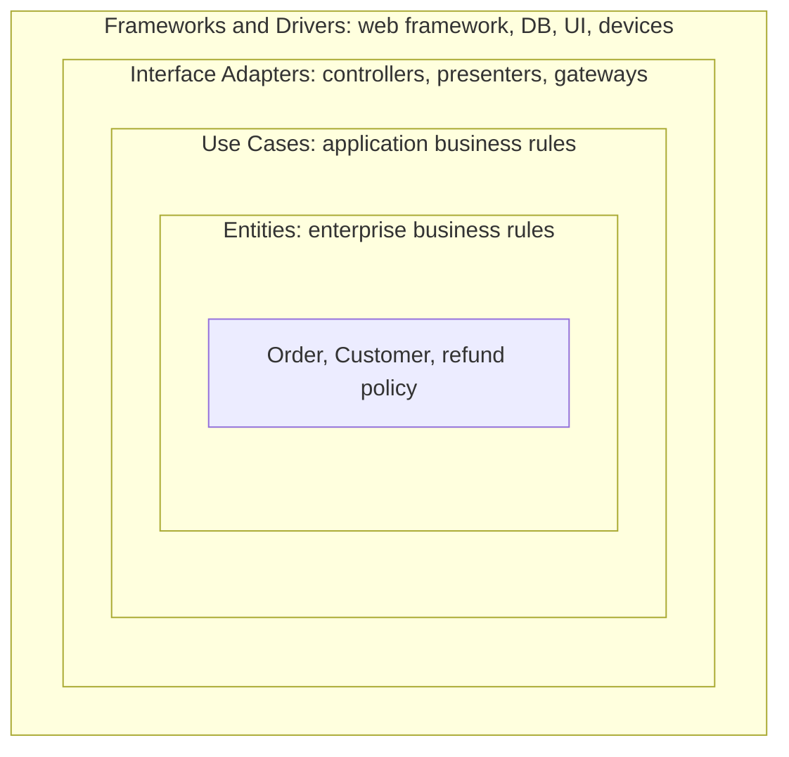
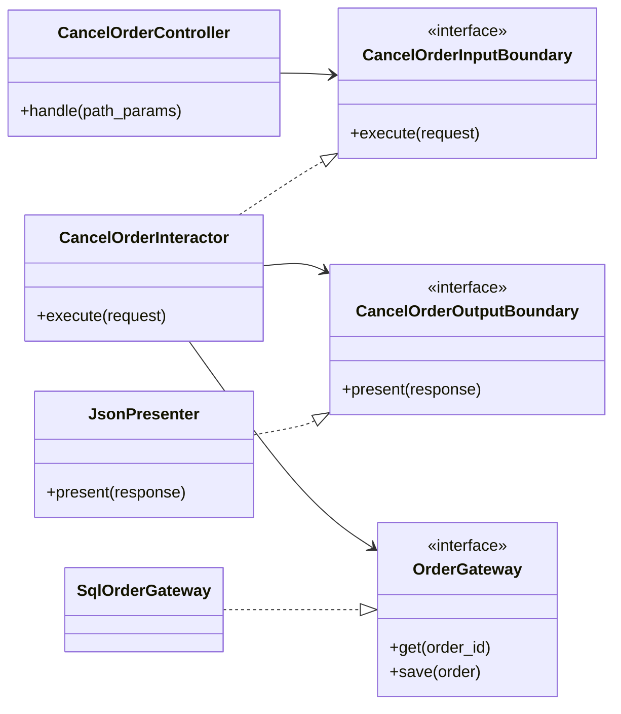
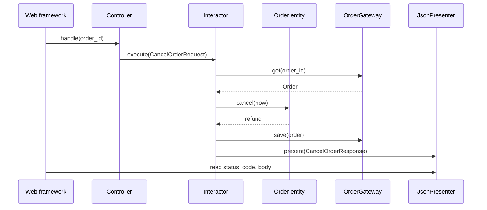

# Clean Architecture

## Introduction

In August 2012 Robert C. Martin ("Uncle Bob") published a short blog post, [The Clean Architecture](https://blog.cleancoder.com/uncle-bob/2012/08/13/the-clean-architecture.html). He observed that several architectures of the time, including [Hexagonal](./0-arch-hexagonal.mdx), [Onion](./1-arch-onion.mdx), his own "Screaming Architecture", DCI and Ivar Jacobson's Boundary-Control-Entity, shared one goal: **separation of concerns by dividing software into layers, with business rules independent of frameworks, UI, databases and external agencies**. He combined them into a single diagram of concentric circles and one rule. In 2017 he expanded the idea into the book *Clean Architecture: A Craftsman's Guide to Software Structure and Design*.

The analogy is a country's constitution versus its everyday regulations. The constitution (your core business rules) changes rarely and must not depend on any particular agency's forms. Regulations and forms (web pages, SQL schemas, JSON formats) change all the time and must conform to the constitution, never the other way around.

What Clean Architecture adds to hexagonal and onion is mostly **precision about the inner layers and about what crosses a boundary**:

- an explicit split between enterprise rules (**entities**) and application rules (**use cases**),
- the rule that only simple data structures cross boundaries,
- a recipe for flow of control going outward while dependencies still point inward.

## The Dependency Rule

> "This rule says that source code dependencies can only point inwards."
> (Robert C. Martin, *The Clean Architecture*, 2012)

He adds that nothing in an inner circle can know anything at all about something in an outer circle, including names of functions, classes or variables declared there. Data formats from outer circles, such as a framework's request object, must not be used by inner circles either.



| Circle | Contains | Changes when | Bookstore example |
| --- | --- | --- | --- |
| Entities | Business rules that would exist even without software, reusable across applications | The business itself changes | `Order.cancel` refund policy |
| Use cases | Application-specific workflows that orchestrate entities | A feature of this app changes | `CancelOrderInteractor` |
| Interface adapters | Conversion between use case formats and external formats (MVC lives here) | The API or UI format changes | `CancelOrderController`, `JsonPresenter`, SQL gateway |
| Frameworks and drivers | Framework glue, database, web server, UI toolkit | You upgrade or swap a tool | FastAPI, PostgreSQL driver |

Martin notes that the four circles are schematic. You may have more or fewer, as long as the Dependency Rule holds.

## Crossing Boundaries: Control Out, Dependencies In

A use case must eventually show a result to the user, so control flows **outward** from the use case to a presenter. But the use case may not import the presenter. The solution is the [Dependency Inversion Principle](../1-arch-design-principles/5-arch-dependency-inversion.mdx): the use case circle declares an **output boundary** interface (his diagram calls it the *Use Case Output Port*), and the presenter in the adapters circle implements it.



Every arrow that crosses into the use case circle points toward it. The interactor depends only on interfaces it owns.

### What may cross a boundary

Martin's rule for data is that only **simple, isolated data structures** cross boundaries: plain structs, data transfer objects, function arguments. Do not pass entities out to the UI, and do not pass database rows or framework request objects in. In Python, frozen dataclasses make good request and response models.

## The Problem: Framework-Shaped Business Logic

```python
# before.py: a typical framework-first view
from datetime import datetime, timedelta, timezone
from decimal import Decimal

from fastapi import FastAPI, HTTPException
from sqlalchemy import select
from sqlalchemy.orm import Session

from myapp.db import engine
from myapp.models import OrderRow  # SQLAlchemy model

app = FastAPI()

@app.post("/orders/{order_id}/cancel")
def cancel_order(order_id: str) -> dict[str, str]:
    with Session(engine) as session:
        row = session.scalars(select(OrderRow).where(OrderRow.id == order_id)).first()
        if row is None:
            raise HTTPException(404, "not found")
        if row.status != "placed":
            raise HTTPException(409, f"cannot cancel an order that is {row.status}")
        row.status = "cancelled"
        age = datetime.now(timezone.utc) - row.placed_at
        refund = row.total if age <= timedelta(hours=24) else row.total * Decimal("0.90")
        session.commit()
        return {"order_id": order_id, "refund": str(refund)}
```

The refund policy (full refund within 24 hours, otherwise a 10% restocking fee) is a real business rule. Here it is:

- tangled with HTTP status codes and SQLAlchemy sessions,
- untestable without a database and the system clock,
- unreachable from the back-office tool, which needs to cancel orders in bulk and print a report.

## Building It the Clean Way

### Entities

```python
# clean.py (part 1): entities
from __future__ import annotations

import json
from abc import ABC, abstractmethod
from dataclasses import dataclass
from datetime import datetime, timedelta
from decimal import Decimal
from enum import Enum


class OrderStatus(Enum):
    PLACED = "placed"
    SHIPPED = "shipped"
    CANCELLED = "cancelled"


@dataclass
class Order:
    order_id: str
    total: Decimal
    status: OrderStatus
    placed_at: datetime

    def cancel(self, now: datetime) -> Decimal:
        """Cancel the order and return the refund amount."""
        if self.status is not OrderStatus.PLACED:
            raise ValueError(f"cannot cancel an order that is {self.status.value}")
        self.status = OrderStatus.CANCELLED
        if now - self.placed_at <= timedelta(hours=24):
            return self.total
        return (self.total * Decimal("0.90")).quantize(Decimal("0.01"))  # 10% restocking fee
```

The refund policy lives on the entity. Notice that `now` is a parameter. Entities do not read the system clock; that would be a hidden dependency on the outside world.

### Use case, boundaries and models

```python
# clean.py (part 2): use case layer
@dataclass(frozen=True)
class CancelOrderRequest:
    order_id: str


@dataclass(frozen=True)
class CancelOrderResponse:
    order_id: str
    refund: Decimal | None
    error: str | None = None


class OrderGateway(ABC):
    @abstractmethod
    def get(self, order_id: str) -> Order | None: ...

    @abstractmethod
    def save(self, order: Order) -> None: ...


class Clock(ABC):
    @abstractmethod
    def now(self) -> datetime: ...


class CancelOrderOutputBoundary(ABC):
    @abstractmethod
    def present(self, response: CancelOrderResponse) -> None: ...


class CancelOrderInputBoundary(ABC):
    @abstractmethod
    def execute(self, request: CancelOrderRequest) -> None: ...


class CancelOrderInteractor(CancelOrderInputBoundary):
    def __init__(self, orders: OrderGateway, clock: Clock,
                 presenter: CancelOrderOutputBoundary) -> None:
        self._orders = orders
        self._clock = clock
        self._presenter = presenter

    def execute(self, request: CancelOrderRequest) -> None:
        order = self._orders.get(request.order_id)
        if order is None:
            self._presenter.present(CancelOrderResponse(request.order_id, None, "not found"))
            return
        try:
            refund = order.cancel(self._clock.now())
        except ValueError as exc:
            self._presenter.present(CancelOrderResponse(order.order_id, None, str(exc)))
            return
        self._orders.save(order)
        self._presenter.present(CancelOrderResponse(order.order_id, refund))
```

This example uses `abc.ABC` rather than `Protocol` on purpose. The boundaries are explicit, named contracts that the use case circle publishes, and making implementers inherit from them documents that relationship in code.

### Interface adapters

```python
# clean.py (part 3): interface adapters
class JsonPresenter(CancelOrderOutputBoundary):
    def __init__(self) -> None:
        self.status_code = 500
        self.body = ""

    def present(self, response: CancelOrderResponse) -> None:
        if response.error == "not found":
            self.status_code, payload = 404, {"error": response.error}
        elif response.error:
            self.status_code, payload = 409, {"error": response.error}
        else:
            self.status_code, payload = 200, {"order_id": response.order_id,
                                              "refund": str(response.refund)}
        self.body = json.dumps(payload)


class TextPresenter(CancelOrderOutputBoundary):
    def __init__(self) -> None:
        self.lines: list[str] = []

    def present(self, response: CancelOrderResponse) -> None:
        if response.error:
            self.lines.append(f"Order {response.order_id}: FAILED ({response.error})")
        else:
            self.lines.append(f"Order {response.order_id}: cancelled, refund ${response.refund:,.2f}")


class CancelOrderController:
    """Converts an incoming web request into a request model."""
    def __init__(self, use_case: CancelOrderInputBoundary) -> None:
        self._use_case = use_case

    def handle(self, path_params: dict[str, str]) -> None:
        self._use_case.execute(CancelOrderRequest(order_id=path_params["order_id"]))
```

HTTP status codes live in the presenter, not in the use case. The use case only reports "not found" or "cannot cancel"; it is the web adapter's job to decide that means 404 or 409.

### Frameworks and drivers

In a real system this circle holds the FastAPI app and the SQLAlchemy gateway. To keep the example runnable, in-memory stand-ins play those roles:

```python
# clean.py (part 4): frameworks and drivers (stand-ins)
class InMemoryOrders(OrderGateway):
    def __init__(self, orders: list[Order]) -> None:
        self._orders = {o.order_id: o for o in orders}

    def get(self, order_id: str) -> Order | None:
        return self._orders.get(order_id)

    def save(self, order: Order) -> None:
        self._orders[order.order_id] = order


class FixedClock(Clock):
    def __init__(self, at: datetime) -> None:
        self._at = at

    def now(self) -> datetime:
        return self._at
```

### Wiring two channels to one use case

```python
# main.py
from datetime import datetime, timezone
from decimal import Decimal

from clean import (CancelOrderController, CancelOrderInteractor, CancelOrderRequest, FixedClock,
                   InMemoryOrders, JsonPresenter, Order, OrderStatus, TextPresenter)

now = datetime(2026, 10, 11, 12, 0, tzinfo=timezone.utc)
orders = InMemoryOrders([
    Order("A1", Decimal("40.00"), OrderStatus.PLACED, datetime(2026, 10, 11, 9, 0, tzinfo=timezone.utc)),
    Order("B2", Decimal("80.00"), OrderStatus.PLACED, datetime(2026, 10, 8, 9, 0, tzinfo=timezone.utc)),
    Order("C3", Decimal("25.00"), OrderStatus.SHIPPED, datetime(2026, 10, 1, 9, 0, tzinfo=timezone.utc)),
])
clock = FixedClock(now)

# Web channel: controller -> interactor -> JSON presenter
json_presenter = JsonPresenter()
controller = CancelOrderController(CancelOrderInteractor(orders, clock, json_presenter))
for order_id in ["A1", "C3", "ZZ"]:
    controller.handle({"order_id": order_id})
    print(json_presenter.status_code, json_presenter.body)

# Back-office channel: same interactor class, different presenter
text_presenter = TextPresenter()
interactor = CancelOrderInteractor(orders, clock, text_presenter)
interactor.execute(CancelOrderRequest("B2"))
print("\n".join(text_presenter.lines))
```

Output:

```text
200 {"order_id": "A1", "refund": "40.00"}
409 {"error": "cannot cancel an order that is shipped"}
404 {"error": "not found"}
Order B2: cancelled, refund $72.00
```

Order A1 was placed 3 hours ago and gets a full refund. Order B2 is 3 days old and gets 90% back.



## A Pragmatic Variant: Return Instead of Present

The presenter-based output boundary is faithful to the book, but many teams find it awkward in request/response web apps, because the controller has to read the result back out of the presenter. A common simplification is for the use case to **return** the response model:

```python
def execute(self, request: CancelOrderRequest) -> CancelOrderResponse:
    ...
    return CancelOrderResponse(order.order_id, refund)
```

The Dependency Rule still holds: the response model belongs to the use case circle, and the controller converts it to HTTP. You lose the ability for the use case to push several updates to a UI over time, which matters for desktop and streaming UIs but rarely for REST endpoints. Choose consciously and apply it consistently.

## Screaming Architecture: Folders That Say What the App Does

In [Screaming Architecture](https://blog.cleancoder.com/uncle-bob/2011/09/30/Screaming-Architecture.html) (2011), Martin argued that the top-level structure should tell you what the system is for, like a building blueprint tells you it is a library or a house, rather than which framework it uses. Compare:

```text
# Framework-first: says "this is a web app"
app/
    controllers/
    models/
    views/
    services/

# Clean, use-case-first: says "this is a bookstore"
bookstore/
    entities/
        order.py
    use_cases/
        cancel_order.py
        place_order.py
    adapters/
        web/
        persistence/
    main.py
```

[Structuring a Codebase](./6-arch-structuring-a-codebase.mdx) explores this further, including feature-first layouts.

## Real-World Scenario

**Situation.** A bookstore's order service has a REST API for the website, a back-office console for customer support, and a nightly job that cancels unpaid orders. All three cancel orders, and all three implemented the refund rule separately. Last quarter finance changed the restocking fee from 15% to 10%; the API was updated, the nightly job was not, and customers were under-refunded for three weeks.

**Solution.** Move the refund policy into the `Order` entity, create a single `CancelOrderInteractor`, and give each channel its own controller and presenter: JSON for the API, text rows for the console, and a CSV summary for the nightly job. Inject a `Clock` so the "24 hours" rule can be tested at the boundary (23:59 and 24:01) with no sleeping or time mocking.

**Why this approach.** The failure was a business rule duplicated across delivery mechanisms. Clean Architecture's whole point is that use cases and entities do not know or care which delivery mechanism called them, so the rule exists once. Presenters handle the very different output formats.

**When to use it.**

- Several delivery mechanisms share the same business operations.
- Business rules are valuable, change often, and must be tested thoroughly.
- Large teams need clear, enforceable rules about where code goes.

**When not to use it.**

- CRUD apps where use cases would just forward to a repository. You would write four classes per endpoint for no gain.
- Prototypes, internal tools and small services with a single caller.
- When the team is not bought in. Half-applied Clean Architecture, with some use cases importing the ORM, gives you the ceremony without the guarantees.

:::caution Ceremony is a real cost
A faithful implementation gives each use case a request model, a response model, an input boundary, an output boundary, an interactor, a controller and a presenter. For dozens of trivial operations that is a lot of code to read and change. Many teams apply the full pattern only to complex use cases and let simple reads go straight from controller to a query service. That is a reasonable trade-off; write it down in an [Architecture Decision Record](../13-arch-documenting-and-evolving/0-arch-decision-records.mdx).
:::

**Alternatives and trade-offs.**

| Approach | Pros | Cons | Best for |
| --- | --- | --- | --- |
| Framework-first (e.g. Django apps, Rails MVC) | Very fast to build, huge ecosystem | Business rules coupled to the framework | CRUD-heavy products, startups finding fit |
| Hexagonal | Simple inside/outside rule | Little guidance inside | Integration-heavy services |
| Onion | Clear domain-centric rings | Less explicit about boundary data | Rich domain models |
| Clean Architecture | Most explicit rules, very testable | Most files and mapping code | Complex rules with several channels |
| [Vertical slices](./3-arch-vertical-slice.mdx) | Little ceremony per feature | Needs discipline to avoid duplication | Many independent features |

## Common Mistakes

1. **Passing entities to the UI.** Returning the `Order` entity from a use case lets the web layer mutate it or depend on its internals. Return a response model.
2. **Framework types in use cases.** `def execute(self, request: fastapi.Request)` breaks the Dependency Rule immediately. Convert in the controller.
3. **Reading the clock, environment or random numbers inside entities.** Pass them in or inject a port such as `Clock`.
4. **One giant "service" use case.** `OrderService` with 30 methods is a God object. One interactor per use case keeps changes local.
5. **Mirroring every class in every layer.** `OrderEntity`, `OrderModel`, `OrderDto`, `OrderViewModel` with identical fields everywhere suggests the app is CRUD and does not need this much separation.
6. **Treating the circles as folders only.** Folder names do not enforce anything. Use import rules, as shown on the [Onion Architecture](./1-arch-onion.mdx) page.

## Summary

- Clean Architecture unifies hexagonal, onion and similar styles under one **Dependency Rule**: source dependencies point inward only.
- Circles: **entities** (enterprise rules), **use cases** (application rules), **interface adapters** (controllers, presenters, gateways), **frameworks and drivers**.
- Control can flow outward through **output boundaries** implemented by outer-circle presenters.
- Only **simple data structures** cross boundaries; never entities outward or framework objects inward.
- It is excellent for complex, multi-channel business logic and heavy for simple CRUD. Apply it selectively.

## Exercises

1. Write unit tests for `CancelOrderInteractor` that check the refund at exactly 24 hours and at 24 hours plus one second, using `FixedClock` and a recording presenter.
2. Convert the interactor to the "return a response model" variant. Which classes disappear? What, if anything, did you lose?
3. Add a `CsvPresenter` for the nightly job that writes `order_id,refund` rows to a `io.StringIO`. Do not change the interactor.
4. Draw the four circles for a project you know and place ten of its classes into them. Which ones break the Dependency Rule?

Continue with [Vertical Slice Architecture](./3-arch-vertical-slice.mdx), which takes a different approach to the same problems, and compare all four styles in [Comparing Hexagonal, Onion, Clean and Vertical Slice](./7-arch-comparing-layered-styles.mdx).
