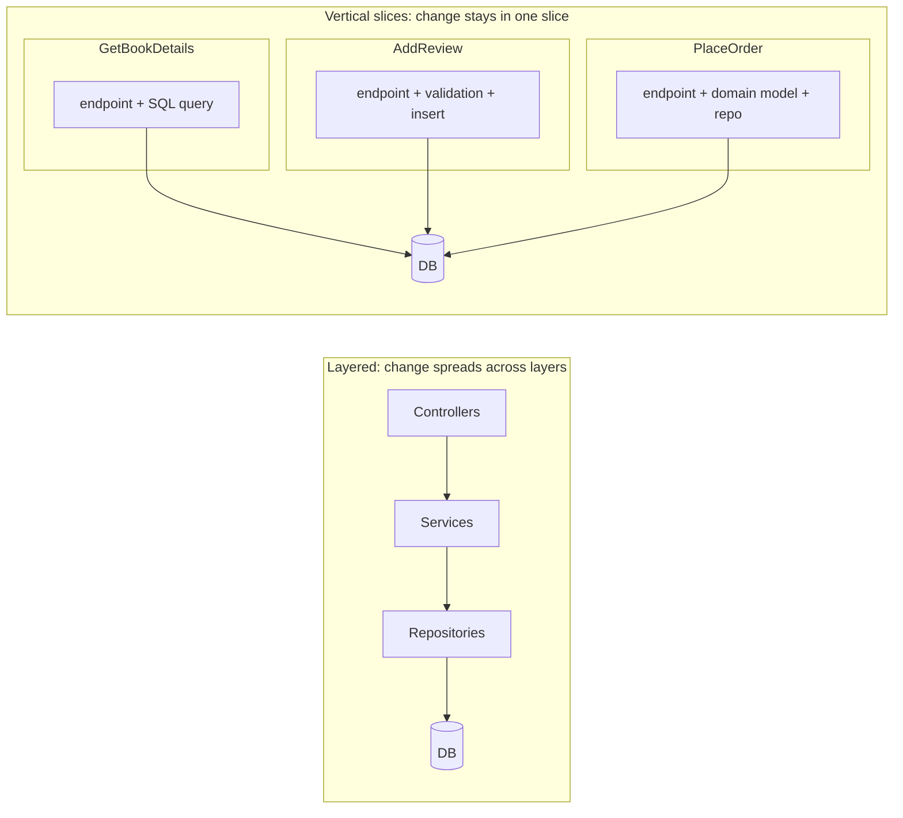
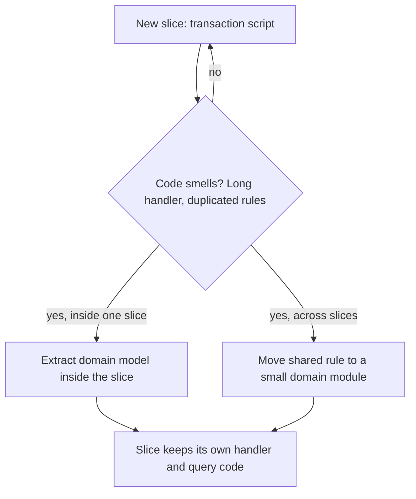

# Vertical Slice Architecture

## Introduction

Ask a developer on a layered codebase to "add a review feature to the book page" and watch what happens. They open the controllers folder and add an endpoint. Then the services folder for a `ReviewService`. Then repositories for a `ReviewRepository`, then DTOs, then mappers, then the matching test folders. One feature, six or more folders, and most of the new files are a few lines that pass data to the next layer.

**Vertical Slice Architecture** flips the organizing axis. Instead of grouping code by technical layer (all controllers together, all repositories together), you group it by **request** or **feature**. Each slice contains everything one operation needs, from the HTTP endpoint down to the data access, and slices share as little as possible.

Jimmy Bogard, who created the .NET libraries AutoMapper and MediatR, named and described the approach in his 2018 post [Vertical Slice Architecture](https://www.jimmybogard.com/vertical-slice-architecture/). His team had moved from onion architecture to CQRS and then to slices. His guiding principle:

> "Minimize coupling between slices, and maximize coupling in a slice."

A restaurant kitchen is a good analogy. A layered kitchen would have one station that chops everything, one that cooks everything and one that plates everything; every dish passes through all three. A slice-based kitchen has a pastry section, a grill section and a salad section. Each owns its dishes end to end and shares only the basics such as the walk-in fridge.

## Layers vs Slices



The core observation is about **the axis of change**. Most change requests arrive as features: "add reviews", "let customers cancel orders". In a layered codebase a feature cuts across every layer, so each change touches many files and risks breaking shared abstractions. In a sliced codebase a feature usually means **adding** a slice, not **modifying** shared code.

| Question | Layered | Vertical slices |
| --- | --- | --- |
| Primary grouping | Technical role | Feature or request |
| A new feature touches | Every layer | Mostly one new slice |
| Shared abstractions | Many (generic repositories, base services) | Few (database connection, auth, a few domain types) |
| Each slice's internal design | Same for every feature | Chosen per slice |
| Risk | Changes to shared layers ripple widely | Duplication between slices |

## Each Slice Chooses Its Own Design

Bogard's second key idea is that slices do not all need the same internal architecture. A simple read can be a single SQL query that returns a DTO. A complex command can use a rich domain model and a repository. Start every slice simple (a transaction script), and refactor toward richer patterns when code smells appear.

This pairs naturally with [CQRS](../9-arch-distributed-systems/3-arch-cqrs.mdx): queries (GET) and commands (POST, PUT, DELETE) are separate slices from the start, so each can be optimized for its own job.

## The Problem: One Feature, Six Folders

Here is the layered version of the "book details with review summary" feature. Each file is short, but understanding one request means reading all of them.

```python
# controllers/book_controller.py
def get_book(isbn: str) -> dict:
    return book_mapper.to_json(book_service.get_book_with_reviews(isbn))

# services/book_service.py
def get_book_with_reviews(isbn: str) -> BookWithReviewsDto:
    book = book_repository.get(isbn)
    reviews = review_repository.list_for_book(isbn)
    return BookWithReviewsDto.from_entities(book, reviews)

# repositories/review_repository.py
def list_for_book(isbn: str) -> list[Review]:
    return [Review(**row) for row in db.execute("SELECT * FROM reviews WHERE isbn = ?", (isbn,))]

# dtos/book_dtos.py, mappers/book_mapper.py, repositories/book_repository.py ...
```

Problems:

- Loading every review to compute an average is wasteful; a single SQL `AVG` would do. But the generic repository API does not offer it, so the service works around it.
- `ReviewRepository.list_for_book` is now shared by three other features, so optimizing it is risky.
- A new team member has to read six files to learn what one endpoint does.

## Building Slices in Python

The project layout puts each feature in its own module. Shared code is limited to the database connection.

```text
bookstore/
    db.py                       # shared: connection and schema
    features/
        get_book_details.py     # query slice
        add_review.py           # command slice
        place_order/            # a complex slice can be a package
            __init__.py
            handler.py
            model.py
    web.py                      # thin routing to slices
```

### Shared infrastructure, kept minimal

```python
# bookstore/db.py
import sqlite3


def connect(path: str = ":memory:") -> sqlite3.Connection:
    conn = sqlite3.connect(path)
    conn.row_factory = sqlite3.Row
    conn.executescript("""
        CREATE TABLE IF NOT EXISTS books (isbn TEXT PRIMARY KEY, title TEXT, price TEXT);
        CREATE TABLE IF NOT EXISTS reviews (isbn TEXT, customer TEXT, stars INTEGER, body TEXT);
    """)
    return conn
```

### A query slice: just SQL and a result type

```python
# bookstore/features/get_book_details.py
"""Slice: GET /books/{isbn}. A read-only query, so plain SQL is enough."""
import sqlite3
from dataclasses import dataclass


@dataclass(frozen=True)
class BookDetails:
    isbn: str
    title: str
    price: str
    review_count: int
    average_stars: float | None


def handle(conn: sqlite3.Connection, isbn: str) -> BookDetails | None:
    row = conn.execute(
        """
        SELECT b.isbn, b.title, b.price,
               COUNT(r.stars) AS review_count,
               ROUND(AVG(r.stars), 1) AS average_stars
        FROM books b LEFT JOIN reviews r ON r.isbn = b.isbn
        WHERE b.isbn = ?
        GROUP BY b.isbn
        """,
        (isbn,),
    ).fetchone()
    return BookDetails(**dict(row)) if row else None
```

No repository, no service, no mapper. The query is shaped exactly for this screen. If this page later needs caching, you add it here without affecting anyone else.

### A command slice: validation and rules

```python
# bookstore/features/add_review.py
"""Slice: POST /books/{isbn}/reviews. A command with real rules."""
import sqlite3
from dataclasses import dataclass


@dataclass(frozen=True)
class AddReview:
    isbn: str
    customer: str
    stars: int
    body: str


class ReviewRejected(Exception):
    pass


BANNED_WORDS = {"spoiler"}


def validate(cmd: AddReview) -> list[str]:
    errors = []
    if not 1 <= cmd.stars <= 5:
        errors.append("stars must be between 1 and 5")
    if len(cmd.body.strip()) < 10:
        errors.append("review must be at least 10 characters")
    if BANNED_WORDS & set(cmd.body.lower().split()):
        errors.append("review contains a banned word")
    return errors


def handle(conn: sqlite3.Connection, cmd: AddReview) -> None:
    if errors := validate(cmd):
        raise ReviewRejected("; ".join(errors))
    with conn:
        if conn.execute("SELECT 1 FROM books WHERE isbn = ?", (cmd.isbn,)).fetchone() is None:
            raise ReviewRejected("unknown book")
        already = conn.execute(
            "SELECT 1 FROM reviews WHERE isbn = ? AND customer = ?", (cmd.isbn, cmd.customer)
        ).fetchone()
        if already:
            raise ReviewRejected("customer already reviewed this book")
        conn.execute(
            "INSERT INTO reviews VALUES (?, ?, ?, ?)",
            (cmd.isbn, cmd.customer, cmd.stars, cmd.body),
        )
```

### Using the slices

```python
# demo.py
from bookstore.db import connect
from bookstore.features import add_review, get_book_details

conn = connect()
conn.execute("INSERT INTO books VALUES ('111', 'Refactoring', '22.50')")

add_review.handle(conn, add_review.AddReview("111", "ana", 5, "Changed how I write code."))
add_review.handle(conn, add_review.AddReview("111", "bo", 4, "Dense but very practical."))

for bad in [
    add_review.AddReview("111", "ana", 3, "Second opinion from me."),
    add_review.AddReview("111", "cy", 9, "meh"),
]:
    try:
        add_review.handle(conn, bad)
    except add_review.ReviewRejected as exc:
        print("Rejected:", exc)

print(get_book_details.handle(conn, "111"))
```

Output:

```text
Rejected: customer already reviewed this book
Rejected: stars must be between 1 and 5; review must be at least 10 characters
BookDetails(isbn='111', title='Refactoring', price='22.50', review_count=2, average_stars=4.5)
```

### Thin routing

The web layer only maps HTTP to slices. With FastAPI, a dependency opens one SQLite connection per request:

```python
# bookstore/web.py
import sqlite3
from collections.abc import Iterator
from typing import Annotated

from fastapi import Depends, FastAPI, HTTPException

from bookstore.db import connect
from bookstore.features import add_review, get_book_details

app = FastAPI()


def get_conn() -> Iterator[sqlite3.Connection]:
    conn = connect("bookstore.db")  # one connection per request
    try:
        yield conn
    finally:
        conn.close()


Conn = Annotated[sqlite3.Connection, Depends(get_conn)]


@app.get("/books/{isbn}")
def book_details(isbn: str, conn: Conn) -> get_book_details.BookDetails:
    details = get_book_details.handle(conn, isbn)
    if details is None:
        raise HTTPException(404, "book not found")
    return details


@app.post("/books/{isbn}/reviews", status_code=201)
def post_review(isbn: str, customer: str, stars: int, body: str, conn: Conn) -> dict[str, str]:
    try:
        add_review.handle(conn, add_review.AddReview(isbn, customer, stars, body))
    except add_review.ReviewRejected as exc:
        raise HTTPException(422, str(exc))
    return {"status": "created"}
```

As the number of slices grows, many teams move each route into its slice module using FastAPI's `APIRouter`, so the slice really does own everything from endpoint to SQL.

### Testing a slice

Slices are usually tested **through their handler with a real (often in-memory) database**, rather than with mocks for every layer. Here SQLite's `:memory:` mode makes that fast.

```python
# test_add_review.py
import pytest

from bookstore.db import connect
from bookstore.features import add_review


@pytest.fixture
def conn():
    c = connect()
    c.execute("INSERT INTO books VALUES ('111', 'Refactoring', '22.50')")
    return c


def test_rejects_duplicate_review(conn):
    cmd = add_review.AddReview("111", "ana", 5, "Changed how I write code.")
    add_review.handle(conn, cmd)
    with pytest.raises(add_review.ReviewRejected, match="already reviewed"):
        add_review.handle(conn, cmd)


def test_validation_collects_all_errors():
    errors = add_review.validate(add_review.AddReview("111", "cy", 0, "spoiler"))
    assert errors == [
        "stars must be between 1 and 5",
        "review must be at least 10 characters",
        "review contains a banned word",
    ]
```

Example output of `pytest -q`:

```text
..                                                                       [100%]
2 passed in 0.01s
```

:::note
In production you would test against the same database engine you deploy (for example PostgreSQL in a container) because SQL dialects differ. The point is that slice tests exercise the real query, which is where most of the slice's risk lives.
:::

## Growing a Slice When It Gets Complex

Suppose `place_order` grows rules for stock reservation, coupons and loyalty points. Bogard's advice is to refactor **within the slice** as smells appear: extract a domain model, push rules into it, maybe introduce a repository for that aggregate. When two slices genuinely need the same rule, move that rule into a small shared domain module.



This is why Bogard notes that the approach assumes the team **understands code smells and refactoring**. Without that skill, slices can turn into dozens of copy-pasted transaction scripts.

## Where You Have Already Seen This

- **.NET**: MediatR request handlers, one per request, are the classic slice implementation. Note that MediatR moved to a dual open-source/commercial license in 2025, so check the current terms on its official site before adopting it. Minimal APIs with one file per endpoint are another common form.
- **Django apps** are partly vertical: each app has its own models, views and URLs, though usually per business area rather than per request.
- **Feature folders** in frontend projects (`features/cart/`, `features/checkout/`) apply the same idea to UI code. See [Frontend Architecture Patterns](./5-arch-frontend-architecture.mdx).
- **Serverless functions** are slices by construction: each function handles one trigger end to end.

## Real-World Scenario

**Situation.** A bookstore's internal admin backend has about 80 endpoints: reports, CSV exports, bulk price edits, review moderation, inventory adjustments. It was built with a strict layered architecture. Most endpoints are simple, yet every change touches five layers, and the generic `BaseRepository` has become so overloaded with optional parameters that nobody dares modify it. Developers spend more time on plumbing than on features, and reporting queries are slow because they go through entity-based repositories.

**Solution.** Migrate gradually to vertical slices:

1. New endpoints are written as slices only.
2. Reporting endpoints are rewritten first as query slices with hand-tuned SQL, since they gain the most.
3. Command endpoints are migrated when they next change.
4. Shared code is kept to a short list: database session, authentication, audit logging, and a handful of domain types such as `Money`.
5. A lint rule forbids importing one slice module from another (for example with an Import Linter **independence** contract over `bookstore.features`).

**Why this approach.** The admin backend has many small, mostly independent features with thin business logic. The pain is in the ceremony of layers, not in tangled domain rules. Slices remove ceremony and let each report optimize its own query.

**When to use it.**

- Many features that are mostly independent of each other.
- Read-heavy apps where queries benefit from being shaped per screen.
- Teams comfortable with refactoring and with judging when to extract shared code.

**When not to use it.**

- A small, rich domain with many cross-cutting invariants (pricing engines, accounting ledgers). Rules would be duplicated across slices. A domain-centric style such as [Onion](./1-arch-onion.mdx) protects them better.
- Teams new to refactoring, who may never pull duplicated logic back together.
- Very small apps where both layers and slices are overkill.

**Alternatives and trade-offs.**

| Approach | Pros | Cons | Best for |
| --- | --- | --- | --- |
| Layered | Familiar, consistent structure | Features spread across layers | Small or uniform CRUD apps |
| Clean / Onion | Domain rules protected and reusable | Ceremony for every feature | Rich, shared business rules |
| Vertical slices | Fast to add features, per-slice optimization | Risk of duplication, needs refactoring skill | Many independent features, read-heavy apps |
| Slices with a shared domain core | Best of both for mixed apps | Requires judgment about what is shared | Most medium-to-large business apps |

The last row is common in practice: slices for the application layer, with a small domain model shared by slices that need it. [Comparing Hexagonal, Onion, Clean and Vertical Slice](./7-arch-comparing-layered-styles.mdx) discusses combining them.

## Common Mistakes

1. **Slices importing each other.** If `add_review` calls into `get_book_details`, you have rebuilt coupling. Share through a small common module, or accept a bit of duplication.
2. **Rebuilding layers inside every slice.** A slice with its own controller, service, repository and mapper for a 10-line operation misses the point. Start simple.
3. **Never extracting shared rules.** If the same discount rule appears in four slices, it is a domain concept. Move it.
4. **A giant `shared/` folder.** When everything ends up in `shared/`, you have a layered architecture with extra steps. Keep shared code small and deliberate.
5. **Inconsistent cross-cutting concerns.** Authentication, logging and transactions should be applied uniformly, for example with middleware or a decorator around all handlers, not re-implemented per slice.

## Summary

- Vertical slice architecture groups code **by feature or request**, not by technical layer.
- The rule: **minimize coupling between slices, maximize coupling within a slice**.
- Each slice picks its own internal design, from a single SQL query to a rich domain model.
- Adding a feature usually means adding code, not modifying shared abstractions.
- It works best for many independent features and requires refactoring discipline to manage duplication.

## Exercises

1. Add a `list_top_rated_books` query slice that returns the five books with the highest average stars and at least two reviews. Write one test for it.
2. Add a `delete_review` command slice that only allows a customer to delete their own review. Where should the ownership rule live?
3. Write an Import Linter `independence` contract that stops modules in `bookstore.features` from importing each other, and verify it fails if `add_review` imports `get_book_details`.
4. Pick a feature in a layered project you know. Count the files it touches. Sketch what the same feature would look like as one slice.

Next, look at UI-side separation in [MVC, MVP and MVVM](./4-arch-mvc-mvp-mvvm.mdx), or at how folders and modules express architecture in [Structuring a Codebase](./6-arch-structuring-a-codebase.mdx).
