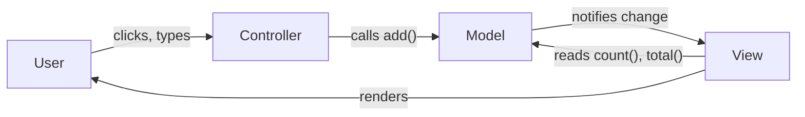
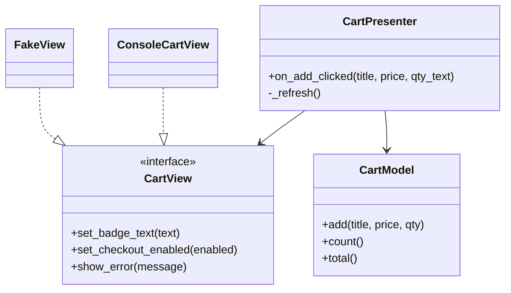
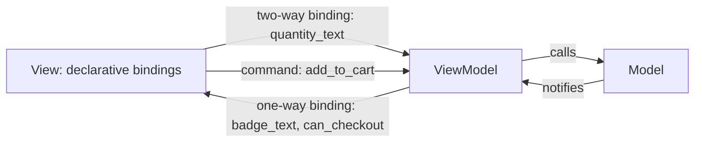

# MVC, MVP and MVVM

## Introduction

Every user interface mixes three kinds of code:

- **Data and rules**: the cart, its items, "quantity must be positive".
- **Presentation logic**: "show `1 item`, not `1 items`", "disable Checkout when the cart is empty".
- **Widgets**: labels, buttons, text boxes and the toolkit that draws them.

When all three live in one file, such as a 2,000-line Android `Activity` or a React component that fetches, validates and renders, the UI becomes hard to test and painful to change. **MVC**, **MVP** and **MVVM** are three families of patterns for separating them. Martin Fowler calls the shared underlying idea [Separated Presentation](https://martinfowler.com/eaaDev/uiArchs.html): keep the domain code independent of the presentation code, so the domain works without the UI and can support several presentations.

The patterns differ mainly in two questions:

1. **Who handles user input?**
2. **Who decides what the view shows, and how does the view find out?**

A restaurant analogy: the kitchen is the **model**. In **MVC** the diner (view) can look straight into an open kitchen to see what is ready, while the waiter (controller) takes orders. In **MVP** the kitchen is closed; the waiter (presenter) tells the diner exactly what to put on the table. In **MVVM** the waiter hands the diner a live menu board (view model) that updates itself, and the diner just reads it.

:::note Scope of this page
These are **presentation** patterns: they organize the UI part of an application. They are not whole-system architectures. In [Clean Architecture](./2-arch-clean-architecture.mdx), all of them live in the interface adapters circle, and the "model" they talk to is often a use case or application service rather than the database.
:::

## A Shared Model

All three examples use the same model: a shopping cart that notifies listeners when it changes (the [Observer pattern](../4-arch-behavioral-patterns/1-arch-observer.mdx)).

```python
# model.py
from collections.abc import Callable
from decimal import Decimal


class CartModel:
    """The Model: data and business rules, no UI knowledge."""

    def __init__(self) -> None:
        self._items: dict[str, tuple[Decimal, int]] = {}
        self._listeners: list[Callable[[], None]] = []

    def subscribe(self, listener: Callable[[], None]) -> None:
        self._listeners.append(listener)

    def add(self, title: str, price: Decimal, qty: int = 1) -> None:
        if qty <= 0:
            raise ValueError("quantity must be positive")
        _, current = self._items.get(title, (price, 0))
        self._items[title] = (price, current + qty)
        for listener in self._listeners:
            listener()

    def count(self) -> int:
        return sum(q for _, q in self._items.values())

    def total(self) -> Decimal:
        return sum((p * q for p, q in self._items.values()), Decimal("0"))
```

The examples print to the console instead of drawing widgets, so you can run them anywhere. In a real app the "view" classes would wrap a GUI toolkit or a template.

## MVC: Model-View-Controller

MVC was created by Trygve Reenskaug at Xerox PARC in the late 1970s for Smalltalk. In classic MVC:

- The **model** holds data and rules and notifies observers when it changes.
- The **view** observes the model and renders it.
- The **controller** receives user input and calls the model. It does not update the view directly; the view refreshes because the model notified it.



```python
# mvc.py
from decimal import Decimal

from model import CartModel


class CartBadgeView:
    """View: observes the model and renders it."""
    def __init__(self, model: CartModel) -> None:
        self._model = model
        model.subscribe(self.render)

    def render(self) -> None:
        print(f"[badge] {self._model.count()} items | ${self._model.total()}")


class CartController:
    """Controller: turns user input into model operations."""
    def __init__(self, model: CartModel) -> None:
        self._model = model

    def on_add_clicked(self, title: str, price: str, qty_text: str) -> None:
        try:
            self._model.add(title, Decimal(price), int(qty_text))
        except ValueError as exc:
            print(f"[error] {exc}")


model = CartModel()
CartBadgeView(model)
controller = CartController(model)
controller.on_add_clicked("Refactoring", "22.50", "1")
controller.on_add_clicked("Clean Code", "30.00", "2")
controller.on_add_clicked("Clean Code", "30.00", "abc")
```

Output:

```text
[badge] 1 items | $22.50
[badge] 3 items | $82.50
[error] invalid literal for int() with base 10: 'abc'
```

Look at the output closely. "1 items" is a presentation bug, and the error message is Python's raw exception text. To fix either, you must put logic in the **view**, and the view is the hardest part to unit test because it is tied to widgets. That limitation is what MVP and MVVM set out to fix.

### Web MVC is a different animal

On the server side, frameworks such as Ruby on Rails, ASP.NET Core MVC, Spring MVC and Laravel use "MVC" for a request/response flow: a router picks a **controller** action, which loads **models** and renders a **view** template. There is no long-lived view observing the model. Django even calls its version MTV (model, template, view); its FAQ explains that a Django "view" decides **which** data is shown, the template decides **how**, and the framework itself plays the controller role. Same letters, different mechanics.

## MVP: Model-View-Presenter

MVP appeared in the 1990s (Fowler traces it to IBM and Taligent, later popularized by the Dolphin Smalltalk developers). The **presenter** takes over both input handling and presentation logic. The view becomes a thin interface.

Fowler later split MVP into two variants:

- **Passive View**: the view has no logic at all. The presenter sets every value on the view.
- **Supervising Controller**: the view handles simple data binding itself, and the presenter handles complex cases.

The example below is Passive View, because it makes testing easiest.



```python
# mvp.py
from decimal import Decimal
from typing import Protocol

from model import CartModel


class CartView(Protocol):
    """Passive view: only dumb setters, no logic."""
    def set_badge_text(self, text: str) -> None: ...
    def set_checkout_enabled(self, enabled: bool) -> None: ...
    def show_error(self, message: str) -> None: ...


class CartPresenter:
    def __init__(self, model: CartModel, view: CartView) -> None:
        self._model = model
        self._view = view
        self._refresh()

    def on_add_clicked(self, title: str, price: str, qty_text: str) -> None:
        if not qty_text.isdigit():
            self._view.show_error("Please enter a whole number")
            return
        try:
            self._model.add(title, Decimal(price), int(qty_text))
        except ValueError as exc:
            self._view.show_error(str(exc).capitalize())
            return
        self._refresh()

    def _refresh(self) -> None:
        count = self._model.count()
        noun = "item" if count == 1 else "items"
        self._view.set_badge_text(f"{count} {noun} | ${self._model.total():.2f}")
        self._view.set_checkout_enabled(count > 0)


class ConsoleCartView:
    def set_badge_text(self, text: str) -> None:
        print(f"[badge] {text}")

    def set_checkout_enabled(self, enabled: bool) -> None:
        print(f"[checkout button] {'enabled' if enabled else 'disabled'}")

    def show_error(self, message: str) -> None:
        print(f"[error] {message}")


if __name__ == "__main__":
    presenter = CartPresenter(CartModel(), ConsoleCartView())
    presenter.on_add_clicked("Refactoring", "22.50", "1")
    presenter.on_add_clicked("Clean Code", "30.00", "0")
```

Output:

```text
[badge] 0 items | $0.00
[checkout button] disabled
[badge] 1 item | $22.50
[checkout button] enabled
[error] Quantity must be positive
```

The presentation bugs from the MVC version are fixed, and every rule is in the presenter. Because the view is an interface, a test can use a fake view with no GUI toolkit at all:

```python
# test_mvp.py
from model import CartModel
from mvp import CartPresenter


class FakeView:
    def __init__(self) -> None:
        self.badge = ""
        self.checkout_enabled: bool | None = None
        self.errors: list[str] = []

    def set_badge_text(self, text: str) -> None:
        self.badge = text

    def set_checkout_enabled(self, enabled: bool) -> None:
        self.checkout_enabled = enabled

    def show_error(self, message: str) -> None:
        self.errors.append(message)


def test_empty_cart_disables_checkout():
    view = FakeView()
    CartPresenter(CartModel(), view)
    assert view.badge == "0 items | $0.00"
    assert view.checkout_enabled is False


def test_singular_item_and_bad_quantity():
    view = FakeView()
    presenter = CartPresenter(CartModel(), view)
    presenter.on_add_clicked("Refactoring", "22.50", "1")
    presenter.on_add_clicked("Refactoring", "22.50", "two")
    assert view.badge == "1 item | $22.50"
    assert view.errors == ["Please enter a whole number"]
```

Example output of `pytest -q`:

```text
..                                                                       [100%]
2 passed in 0.00s
```

The cost: the presenter must push **every** change to the view by hand. On a screen with 40 fields, that is a lot of `set_...` calls.

## MVVM: Model-View-ViewModel

MVVM was announced by John Gossman of Microsoft in 2005 for WPF, building on what Fowler calls the Presentation Model. The **view model** exposes the screen's state as **bindable properties** and its actions as **commands**. A data-binding mechanism keeps the view in sync automatically. The view model never references widgets; it does not even know a view exists.



Python has no built-in UI data binding, so this example includes a tiny `Observable` to play the framework's role.

```python
# mvvm.py
from collections.abc import Callable
from decimal import Decimal

from model import CartModel


class Observable[T]:
    """A tiny stand-in for a framework's bindable property."""
    def __init__(self, value: T) -> None:
        self._value = value
        self._subscribers: list[Callable[[T], None]] = []

    @property
    def value(self) -> T:
        return self._value

    @value.setter
    def value(self, new: T) -> None:
        if new != self._value:
            self._value = new
            for fn in self._subscribers:
                fn(new)

    def bind(self, fn: Callable[[T], None]) -> None:
        self._subscribers.append(fn)
        fn(self._value)


class CartViewModel:
    """Exposes state and commands shaped for the view. Knows nothing about widgets."""
    def __init__(self, model: CartModel) -> None:
        self._model = model
        self.quantity_text = Observable("1")           # two-way bound to an input box
        self.badge_text = Observable("")               # one-way bound to a label
        self.can_checkout = Observable(False)          # bound to a button's enabled state
        self.error = Observable("")
        model.subscribe(self._sync)
        self._sync()

    def add_to_cart(self, title: str, price: str) -> None:   # a "command"
        if not self.quantity_text.value.isdigit() or int(self.quantity_text.value) == 0:
            self.error.value = "Quantity must be a positive whole number"
            return
        self.error.value = ""
        self._model.add(title, Decimal(price), int(self.quantity_text.value))

    def _sync(self) -> None:
        count = self._model.count()
        self.badge_text.value = f"{count} {'item' if count == 1 else 'items'} | ${self._model.total():.2f}"
        self.can_checkout.value = count > 0


# The "view": in a real app this is declarative bindings in XAML, SwiftUI, Compose or a template.
vm = CartViewModel(CartModel())
vm.badge_text.bind(lambda t: print(f"[label] {t}"))
vm.can_checkout.bind(lambda ok: print(f"[button] checkout {'enabled' if ok else 'disabled'}"))
vm.error.bind(lambda e: e and print(f"[error] {e}"))

vm.quantity_text.value = "2"        # user types in the box
vm.add_to_cart("Clean Code", "30.00")
vm.quantity_text.value = "x"
vm.add_to_cart("Clean Code", "30.00")
```

Output:

```text
[label] 0 items | $0.00
[button] checkout disabled
[label] 2 items | $60.00
[button] checkout enabled
[error] Quantity must be a positive whole number
```

Testing a view model is even simpler than testing a presenter: set properties, call commands, assert on properties. No fake view needed.

:::caution MVVM can be overkill
Gossman himself later noted that MVVM can be overkill for simple UIs. Data binding also makes flow harder to trace: when a label shows the wrong value, you have to find which binding, converter or property change caused it. Fowler makes the same point about observer-based synchronization in general.
:::

## Side by Side

| Aspect | MVC (classic) | MVP (Passive View) | MVVM |
| --- | --- | --- | --- |
| Handles input | Controller | View forwards to presenter | View binds to view model commands |
| Presentation logic | Often leaks into view | Presenter | View model |
| How the view updates | Observes the model | Presenter calls view setters | Data binding |
| Does the logic know the view? | Controller may | Yes, through an interface | No |
| Unit testing | Hard for view logic | Easy with a fake view | Easy, no view needed |
| Boilerplate | Low | Many setter calls | Binding setup; needs framework support |
| Typical home | Smalltalk, server-side web frameworks | WinForms, GWT, older Android | WPF, .NET MAUI, SwiftUI, Jetpack Compose, Vue, Knockout |

## Where You Have Already Seen These

- **Server-side web MVC**: Rails, ASP.NET Core MVC, Spring MVC, Laravel. Django describes itself as MTV.
- **MVP**: GWT applications and many pre-Jetpack Android apps used presenters with view interfaces to make Activities testable.
- **MVVM**: WPF and .NET MAUI with XAML bindings; Android's Jetpack `ViewModel` holding UI state for Compose (Android's [guide to app architecture](https://developer.android.com/topic/architecture) describes the ViewModel as a UI state holder with unidirectional data flow); SwiftUI views observing model objects; Vue's reactive component state, which plays the view model role.
- **Unidirectional data flow** (Redux, Elm, The Composable Architecture) is a newer cousin: state flows down, events flow up, and a single place decides how state changes. See [Frontend Architecture Patterns](./5-arch-frontend-architecture.mdx).

## Real-World Scenario

**Situation.** Your bookstore has a mobile app with a checkout screen built as one large UI class. It validates addresses, formats prices in the user's currency, shows or hides the gift-wrap option, and enables the Pay button only when everything is valid. Bugs keep slipping through because the only tests are slow UI tests on emulators, and the team wants to add a tablet layout that shows the same data in two columns.

**Solution.** Move all state and presentation logic into a `CheckoutViewModel` exposing properties such as `formatted_total`, `gift_wrap_visible`, `pay_enabled` and `address_errors`, plus commands such as `apply_coupon` and `pay`. The phone and tablet layouts are two **views** that bind to the same view model. The view model calls use cases (for example `PlaceOrder`) rather than talking to the network directly.

**Why this approach.** The platform (like Jetpack Compose or SwiftUI) already provides reactive state and binding, so MVVM's main cost, binding infrastructure, is free. The view model can be unit tested in milliseconds. Two layouts sharing one view model is exactly the "multiple presentations" benefit of separated presentation.

**When to use which.**

- **MVVM** when your UI framework has good binding or reactive state (most modern mobile and desktop frameworks, Vue, Angular).
- **MVP** when the framework has no binding and you need testable presentation logic, or in legacy code where introducing binding is impractical.
- **Server-side MVC** for classic request/response web apps with server-rendered pages.

**When not to use them.**

- Tiny screens or prototypes: a settings page with two toggles does not need a separate presenter or view model.
- When the framework already provides the separation in its own idiom (for example React components with hooks). Forcing a "ViewModel" class on top fights the framework.

**Alternatives and trade-offs.**

| Approach | Pros | Cons | Best for |
| --- | --- | --- | --- |
| Everything in the view | Fast to write | Untestable, hard to change | Throwaway prototypes |
| MVC (server-side) | Simple, well-supported by frameworks | Little guidance for rich client UIs | Server-rendered web apps |
| MVP | Highly testable, no binding needed | Verbose view interfaces | Frameworks without binding, legacy UIs |
| MVVM | Testable, low glue code with binding | Binding can be hard to debug | Modern reactive UI frameworks |
| Unidirectional (Redux-style) | Predictable state changes, time-travel debugging | More boilerplate for small apps | Complex shared client state |

## Common Mistakes

1. **Massive view controller / massive view model.** Moving all code from the view into one huge presenter or view model just relocates the mess. Split by screen section, and delegate business rules to the model or use cases.
2. **View model referencing widgets.** A view model that imports a button class or a `Context` cannot be tested without the UI toolkit. Expose plain data only.
3. **Business rules in presenters or view models.** "Gold members get free gift wrap" belongs in the domain, not in `gift_wrap_visible`. The view model should ask the model.
4. **Confusing web MVC with GUI MVC.** Advice written for one often does not apply to the other.
5. **Two-way binding everywhere.** It is convenient for form inputs but makes data flow hard to follow elsewhere. Prefer one-way bindings for display.

## Summary

- MVC, MVP and MVVM all apply **separated presentation**: keep domain logic independent of the UI.
- **MVC**: controller handles input, view observes the model. Classic GUI MVC and server-side web MVC differ a lot.
- **MVP**: the presenter handles input and pushes everything to a passive view interface, which makes it highly testable.
- **MVVM**: the view model exposes bindable state and commands; data binding updates the view. It suits modern reactive frameworks.
- Choose based on your framework's binding support and how much presentation logic needs testing.

## Exercises

1. Write two pytest tests for `CartViewModel`: one for the "item" versus "items" wording and one checking that `can_checkout` becomes `True` after adding a book.
2. Add a "Remove" action to all three versions. Which version needed the most changes, and why?
3. Change the MVP example to a Supervising Controller: let the view format the badge itself from `count` and `total`. What became harder to test?
4. For a UI framework you use, identify which pattern it encourages and where business logic currently lives in your project.

Continue with [Frontend Architecture Patterns](./5-arch-frontend-architecture.mdx) for component-based and unidirectional approaches, and see [Separation of Concerns](../1-arch-design-principles/9-arch-separation-of-concerns.mdx) for the principle behind all of these patterns.
