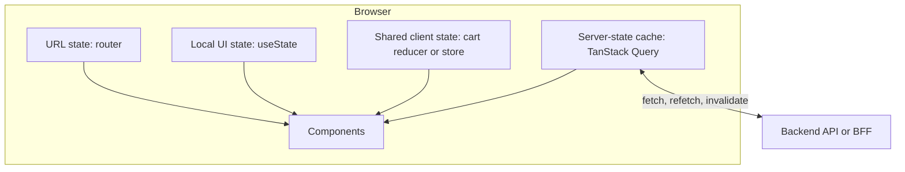
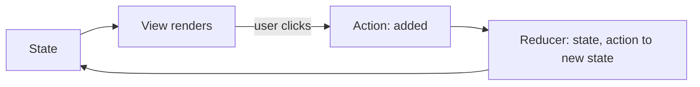
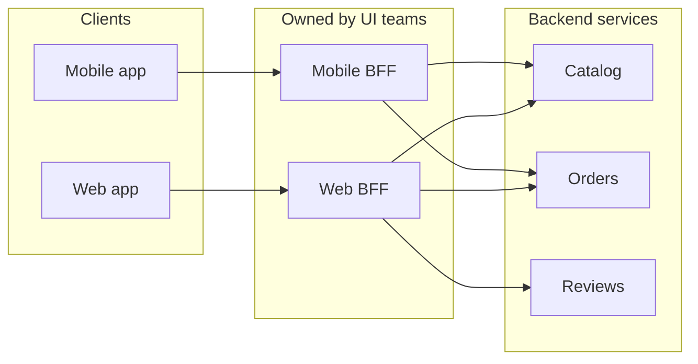

# Frontend Architecture Patterns

## Introduction

Frontend code used to be "a few scripts on top of server-rendered pages". Today a web or mobile client can be the largest codebase in a company, with its own routing, caching, state management, build pipeline and deployment. It needs architecture just as much as the backend does, and many of the same principles apply: separation of concerns, dependency direction, cohesion and coupling.

This page covers the patterns that matter most for modern frontends:

1. **Component design**: splitting UI into presentational pieces and logic.
2. **State architecture**: knowing which kind of state you have and where it should live.
3. **Unidirectional data flow**: making state changes predictable.
4. **Code organization**: feature folders and Feature-Sliced Design.
5. **Rendering strategies**: client, server, static, islands and server components.
6. **Scaling across teams**: micro-frontends and Backend for Frontend.

Examples use **TypeScript with React 19**, because React is the most widely used component framework and TypeScript's types make the boundaries between pieces visible. The ideas transfer to Vue, Svelte, Angular and mobile frameworks.

Think of a frontend like a theater production. Components are the actors and props, state is the script and the current scene, and the rendering strategy is whether the set is built in advance (static), assembled each night (server rendering) or improvised on stage (client rendering). A good production decides these things deliberately rather than discovering them during the show.

## 1. Components: Separate What It Looks Like from How It Works

A component that fetches data, manages a cart and renders markup is the frontend equivalent of the "fat controller". In 2015 Dan Abramov popularized splitting components into **presentational** (how things look) and **container** (how things work) components. After React Hooks arrived, he added a note to that article saying he no longer recommends splitting components that way as a rule, because **custom hooks** can hold the logic instead. The underlying idea, separating logic from markup, is still sound; the mechanism changed.

### A presentational component

```tsx
// src/features/search/BookList.tsx
import type { Book } from "./api.js";

type BookListProps = {
  books: Book[];
  onAddToCart: (book: Book) => void;
};

// Presentational: props in, JSX out. No fetching, no global state.
export function BookList({ books, onAddToCart }: BookListProps) {
  if (books.length === 0) return <p>No books found.</p>;
  return (
    <ul>
      {books.map((b) => (
        <li key={b.isbn}>
          {b.title} by {b.author}, ${b.price.toFixed(2)}{" "}
          <button onClick={() => onAddToCart(b)}>Add to cart</button>
        </li>
      ))}
    </ul>
  );
}
```

It is trivial to render in Storybook or a test with fake data, and it can be reused on a "recommended books" panel.

### Logic in a custom hook

```typescript
// src/features/search/api.ts
export type Book = { isbn: string; title: string; author: string; price: number };

export async function searchBooks(query: string, signal?: AbortSignal): Promise<Book[]> {
  const res = await fetch(`/api/books?q=${encodeURIComponent(query)}`, { signal });
  if (!res.ok) throw new Error(`Search failed: ${res.status}`);
  return res.json() as Promise<Book[]>;
}
```

```typescript
// src/features/search/useBookSearch.ts
import { useQuery } from "@tanstack/react-query";
import { searchBooks } from "./api.js";

// Server state: cached, deduplicated and refetched by TanStack Query.
export function useBookSearch(query: string) {
  return useQuery({
    queryKey: ["books", "search", query],
    queryFn: ({ signal }) => searchBooks(query, signal),
    enabled: query.trim().length >= 2,
    staleTime: 60_000,
  });
}
```

The `api.ts` module is a tiny **adapter** (in the [hexagonal](./0-arch-hexagonal.mdx) sense): it is the only place that knows the URL format. The hook is the only place that knows how search results are cached.

### Wiring it together

```tsx
// src/features/search/SearchPage.tsx
import { useState } from "react";
import { BookList } from "./BookList.js";
import { useBookSearch } from "./useBookSearch.js";
import { useCart } from "../cart/CartContext.js";

// Wires state to presentation. Logic lives in hooks; markup lives in BookList.
export function SearchPage() {
  const [query, setQuery] = useState("");          // local UI state
  const { data, isPending, error } = useBookSearch(query);  // server state
  const { dispatch } = useCart();                  // shared client state

  return (
    <section>
      <input value={query} onChange={(e) => setQuery(e.target.value)} placeholder="Search books" />
      {error && <p role="alert">{error.message}</p>}
      {query.length >= 2 && isPending && <p>Loading...</p>}
      {data && (
        <BookList
          books={data}
          onAddToCart={(b) => dispatch({ type: "added", item: { isbn: b.isbn, title: b.title, price: b.price } })}
        />
      )}
    </section>
  );
}
```

These files type-check with TypeScript in strict mode against React 19, `@tanstack/react-query` v5 and `@reduxjs/toolkit` v2. Package versions move quickly, so check the official docs for the current APIs.

## 2. State Architecture: Know What Kind of State You Have

Most frontend complexity comes from putting state in the wrong place. A useful first step is to classify every piece of state:

| Kind of state | Example | Where it usually belongs |
| --- | --- | --- |
| Local UI state | Is this dropdown open? Text in the search box | Component state (`useState`) |
| Shared client state | Cart contents, theme, logged-in user | Context with a reducer, or a store (Redux Toolkit, Zustand, Pinia) |
| Server state | Search results, book details, order history | A server-cache library (TanStack Query, SWR, RTK Query) |
| URL state | Current page, filters, selected tab | The router and query string |
| Form state | Field values, validation errors, dirty flags | A form library or local state |

The biggest shift of the last several years is treating **server state** separately. Data fetched from an API is really a **cache** of data owned by the server. It goes stale, needs refetching, deduplication and invalidation. TanStack Query's own documentation says it is not a replacement for client state management and can be used alongside it; once server data moves into such a cache, the remaining client state is usually small.



:::tip A quick test
Before adding something to a global store, ask: "Is this a copy of server data?" If yes, it belongs in the server-state cache. "Could this live in the URL?" If yes, users get shareable links and back-button support for free.
:::

## 3. Unidirectional Data Flow

Two-way data binding everywhere makes it hard to answer "why did this value change?". The Flux architecture (Facebook, 2014) and later Redux and Elm popularized **unidirectional data flow**:

1. The UI renders from the current **state**.
2. User interactions **dispatch actions** (plain objects describing what happened).
3. A pure **reducer** computes the next state from the current state and the action.
4. The UI re-renders.



The reducer is ordinary TypeScript with no React in it, so it is the most testable part of the UI:

```typescript
// src/features/cart/cartReducer.ts
export type CartItem = { isbn: string; title: string; price: number; qty: number };
export type CartState = { items: CartItem[]; coupon: string | null };

export type CartAction =
  | { type: "added"; item: Omit<CartItem, "qty"> }
  | { type: "removed"; isbn: string }
  | { type: "couponApplied"; code: string };

export const initialCart: CartState = { items: [], coupon: null };

// A pure function: (state, action) => new state. No fetches, no DOM, easy to test.
export function cartReducer(state: CartState, action: CartAction): CartState {
  switch (action.type) {
    case "added": {
      const existing = state.items.find((i) => i.isbn === action.item.isbn);
      const items = existing
        ? state.items.map((i) => (i.isbn === action.item.isbn ? { ...i, qty: i.qty + 1 } : i))
        : [...state.items, { ...action.item, qty: 1 }];
      return { ...state, items };
    }
    case "removed":
      return { ...state, items: state.items.filter((i) => i.isbn !== action.isbn) };
    case "couponApplied":
      return { ...state, coupon: action.code.toUpperCase() };
  }
}

// Derived data is computed, not stored.
export function cartTotal(state: CartState): number {
  const subtotal = state.items.reduce((sum, i) => sum + i.price * i.qty, 0);
  return state.coupon === "READMORE" ? Math.round(subtotal * 90) / 100 : subtotal;
}
```

You can replay a sequence of actions in a plain Node script:

```typescript
// src/demo.ts
import { cartReducer, cartTotal, initialCart, type CartAction } from "./features/cart/cartReducer.js";

const actions: CartAction[] = [
  { type: "added", item: { isbn: "111", title: "Refactoring", price: 22.5 } },
  { type: "added", item: { isbn: "222", title: "Clean Code", price: 30 } },
  { type: "added", item: { isbn: "111", title: "Refactoring", price: 22.5 } },
  { type: "couponApplied", code: "readmore" },
];

let state = initialCart;
for (const action of actions) {
  state = cartReducer(state, action);
  console.log(action.type.padEnd(14), "items:", state.items.length, "total:", cartTotal(state).toFixed(2));
}
```

Output (after compiling with `tsc` and running with Node):

```text
added          items: 1 total: 22.50
added          items: 2 total: 52.50
added          items: 2 total: 75.00
couponApplied  items: 2 total: 67.50
```

### Sharing the reducer with Context

For app-wide state of modest size, React's built-in `useReducer` plus Context is often enough. In React 19 you can render the context itself as the provider:

```tsx
// src/features/cart/CartContext.tsx
import { createContext, useContext, useReducer, type Dispatch, type ReactNode } from "react";
import { cartReducer, initialCart, type CartAction, type CartState } from "./cartReducer.js";

type CartContextValue = { state: CartState; dispatch: Dispatch<CartAction> };

const CartContext = createContext<CartContextValue | null>(null);

export function CartProvider({ children }: { children: ReactNode }) {
  const [state, dispatch] = useReducer(cartReducer, initialCart);
  return <CartContext value={{ state, dispatch }}>{children}</CartContext>;
}

export function useCart(): CartContextValue {
  const ctx = useContext(CartContext);
  if (ctx === null) throw new Error("useCart must be used inside <CartProvider>");
  return ctx;
}
```

### When to reach for a store

For larger apps with lots of shared client state, a dedicated store adds dev tools, middleware and performance optimizations. If you use Redux, its maintainers state clearly that new code should use **Redux Toolkit** (`@reduxjs/toolkit`) and that the legacy `createStore` API is obsolete ([Why Redux Toolkit is How To Use Redux Today](https://redux.js.org/introduction/why-rtk-is-redux-today)):

```typescript
// src/features/cart/cartSlice.ts
import { configureStore, createSlice, type PayloadAction } from "@reduxjs/toolkit";

type CartItem = { isbn: string; title: string; price: number; qty: number };

const cartSlice = createSlice({
  name: "cart",
  initialState: { items: [] as CartItem[] },
  reducers: {
    added(state, action: PayloadAction<Omit<CartItem, "qty">>) {
      const existing = state.items.find((i) => i.isbn === action.payload.isbn);
      if (existing) existing.qty += 1; // Immer turns this "mutation" into an immutable update
      else state.items.push({ ...action.payload, qty: 1 });
    },
    removed(state, action: PayloadAction<string>) {
      state.items = state.items.filter((i) => i.isbn !== action.payload);
    },
  },
});

export const { added, removed } = cartSlice.actions;
export const store = configureStore({ reducer: { cart: cartSlice.reducer } });
export type RootState = ReturnType<typeof store.getState>;
```

## 4. Organizing Frontend Code

### Feature folders

The frontend version of [vertical slices](./3-arch-vertical-slice.mdx) is grouping by feature rather than by file type:

```text
src/
  app/                 # app shell: routing, providers, global styles
  features/
    search/            # api.ts, useBookSearch.ts, BookList.tsx, SearchPage.tsx
    cart/              # cartReducer.ts, CartContext.tsx, CartPage.tsx
    checkout/
  shared/
    ui/                # Button, Modal, design-system components
    lib/               # formatting helpers, http client
```

Compare with `components/`, `hooks/`, `reducers/`, `services/` at the top level, where one feature is scattered across every folder.

### Feature-Sliced Design

[Feature-Sliced Design](https://feature-sliced.design/) (FSD) is a community methodology that formalizes this. Its current documentation (v2.1) defines standard **layers**, from top to bottom: `app`, `pages`, `widgets`, `features`, `entities` and `shared`, plus a deprecated `processes` layer. The key rule is that **a module may only import from layers strictly below it**, and slices on the same layer may not import each other. Each slice is split into **segments** such as `ui`, `api`, `model` and `lib`.

That is the [Dependency Rule](./2-arch-clean-architecture.mdx) applied to a frontend. Tools such as ESLint import-restriction rules or Steiger (the FSD linter) can enforce it.

## 5. Rendering Strategies

Where HTML is produced is an architectural decision with big effects on performance, SEO, cost and complexity.

| Strategy | How it works | Pros | Cons | Good for |
| --- | --- | --- | --- | --- |
| Client-side rendering (CSR, SPA) | Browser downloads JS, then renders | Rich interactivity, simple hosting | Slow first load, SEO needs care | Dashboards, logged-in apps |
| Server-side rendering (SSR) | Server renders HTML per request, then hydrates | Fast first paint, SEO | Server cost, hydration complexity | Product pages, personalized content |
| Static site generation (SSG) | HTML built at deploy time | Very fast, cheap CDN hosting | Rebuild to update content | Docs, blogs, marketing pages |
| Islands | Static or server HTML with small independently hydrated widgets | Little JavaScript shipped | Interactive parts must be isolated | Content sites with some interactivity |
| React Server Components | Components run on the server (or at build time) and send results, not code, to the client | Less client JS, direct data access | New mental model, needs framework support | Data-heavy React apps |

**Islands architecture** was described by Jason Miller in a [2020 article](https://jasonformat.com/islands-architecture/), who credits the term "component islands" to Katie Sylor-Miller. Frameworks such as Astro are built around it.

**React Server Components** are stable as of React 19. A module marked with `'use client'` defines a client boundary. Note that `'use server'` is **not** for components; it marks Server Functions that the client can call ([React docs](https://react.dev/reference/rsc/server-components)). In practice you use RSC through a framework such as Next.js.

:::note This very site
Compile N Run is built with Docusaurus, which generates static HTML for every page and hydrates it with React for interactivity. That is SSG plus client hydration, a good fit for documentation that changes on deploy rather than per request.
:::

## 6. Scaling Across Teams

### Micro-frontends

When many teams work on one large frontend, coordinating releases becomes the bottleneck. **Micro-frontends**, described by Cam Jackson in a [2019 article on martinfowler.com](https://martinfowler.com/articles/micro-frontends.html), are "independently deliverable frontend applications composed into a greater whole". Integration options include server-side composition, run-time integration with JavaScript (each micro-frontend exposes a mount function, which the article calls the default choice), Web Components and iframes. The article discourages build-time integration as a package, because it forces lockstep releases. Webpack's Module Federation is a popular modern mechanism for run-time loading.

The article also lists the downsides: duplicated dependencies increase payload size, local environments differ from production, and operational and governance complexity grows. This is the frontend equivalent of the [microservices](../6-arch-architectural-styles/4-arch-microservices.mdx) trade-off, and the same advice applies: start with a well-structured single app (a "modular monolith" frontend) and split only when team autonomy requires it.

### Backend for Frontend

A **Backend for Frontend** (BFF) is a server-side component owned by the UI team and shaped for one experience. It aggregates and reshapes calls to downstream services so the client stays simple. Sam Newman's [BFF pattern write-up](https://samnewman.io/patterns/architectural/bff/) covers when one BFF per experience makes sense. See [API Gateway and Backend for Frontend](../10-arch-integration-and-apis/4-arch-api-gateway.mdx).



## Real-World Scenario

**Situation.** The bookstore's React storefront has grown to about 200 components in a `components/` folder and one Redux store holding everything: search results, book details, the cart, the user profile and UI flags such as "is the filter panel open". Loading spinners are inconsistent, data goes stale after edits, and a single store file has 3,000 lines. Marketing also complains that product pages rank poorly in search engines.

**Solution.**

1. Move all API data into TanStack Query hooks (`useBookSearch`, `useBook`, `useOrderHistory`). Delete the corresponding Redux slices.
2. Keep only real client state in the store: the cart and a few preferences. Move filters and pagination into the URL.
3. Reorganize into `features/` folders (or adopt Feature-Sliced Design), with a lint rule against cross-feature imports.
4. Server-render or statically generate the product and category pages for SEO, keeping the logged-in account area as client-rendered.

**Why this approach.** Most of the store was a hand-written cache of server data, which is exactly what server-state libraries automate. Shrinking the store and organizing by feature reduces coupling. Rendering strategy is chosen per page type, based on its needs, rather than one choice for the whole app.

**When to use these patterns.**

- Any non-trivial frontend benefits from state classification and feature folders.
- Unidirectional flow with a reducer pays off when many components read and update the same state.
- SSR, SSG or islands matter when first-load speed and SEO matter.

**When not to.**

- A small internal tool does not need a global store, FSD layers or micro-frontends. `useState`, a couple of hooks and a flat folder are fine.
- Micro-frontends for a single team are almost always a net loss.

**Alternatives and trade-offs.**

| Approach | Pros | Cons | Best for |
| --- | --- | --- | --- |
| Single global store for everything | One place to look | Becomes a hand-written cache, large and coupled | Rarely the best choice today |
| Server-state cache plus small client store | Less code, consistent loading and refetching | Two libraries to learn | Most data-driven apps |
| Context with `useReducer` only | No dependencies | Re-render performance needs care at scale | Small to medium apps |
| Feature folders / FSD | High cohesion, enforceable boundaries | Learning curve, judgment about layers | Medium to large apps |
| Micro-frontends | Independent team deployments | Payload, consistency and ops overhead | Many teams on one product |

## Common Mistakes

1. **Copying server data into global client state.** It goes stale and duplicates what a server-state cache does. Fetch through a query hook instead.
2. **Storing derived data.** Keep `items` in state and compute `total`; do not store both and try to keep them in sync.
3. **Prop drilling to avoid "global state", or global state to avoid prop drilling.** Use composition and context for the former; keep stores small for the latter.
4. **Business rules in components.** "Gold members get free shipping" should come from the backend or a domain module, not from an `if` in JSX.
5. **One rendering strategy for every page.** Marketing pages and account dashboards have different needs.
6. **Adopting micro-frontends for technology variety.** The main reason to use them is team autonomy, not the chance to mix frameworks.

## Summary

- Separate **markup** (presentational components) from **logic** (custom hooks and modules), and keep API details in small adapter modules.
- Classify state as local, shared client, server, URL or form, and give each the right home. Treat server data as a cache.
- **Unidirectional data flow** with pure reducers makes changes predictable and testable. Use Redux Toolkit if you use Redux.
- Organize by **feature**; Feature-Sliced Design adds layer rules similar to Clean Architecture's Dependency Rule.
- Choose **CSR, SSR, SSG, islands or server components** per page type.
- **Micro-frontends** and **BFFs** address team scaling, at a real operational cost.

## Exercises

1. Write unit tests (with Vitest or Jest) for `cartReducer`: adding the same book twice, removing a book, and applying a coupon in lowercase.
2. Move the search query into the URL query string (`?q=refactoring`) so that results are shareable. What changes in `SearchPage`?
3. Take a frontend you know and fill in the state classification table for ten pieces of its state. Which ones are in the wrong place?
4. For three page types in the bookstore (home page, book details, order history), choose a rendering strategy and justify it.

Next, see how these ideas apply to the whole repository in [Structuring a Codebase](./6-arch-structuring-a-codebase.mdx), and compare UI patterns in [MVC, MVP and MVVM](./4-arch-mvc-mvp-mvvm.mdx).
