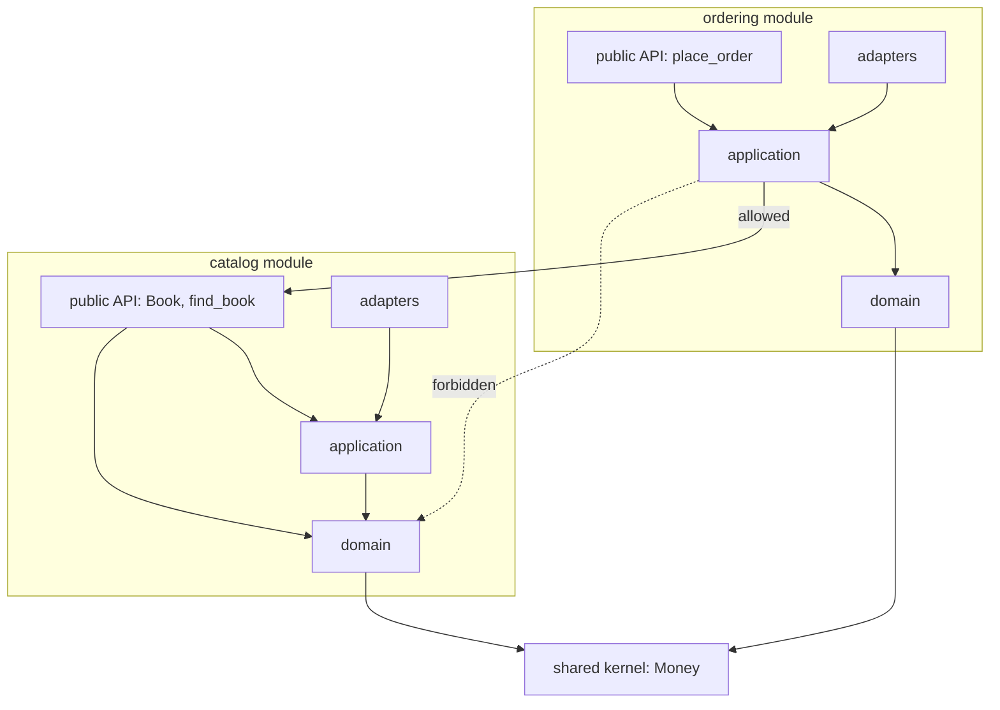

# Structuring a Codebase

## Introduction

Architecture diagrams are easy to draw and easy to ignore. The **folder and module structure** of your code is where architecture actually lives day to day. It decides:

- where a new developer looks to find "the code that handles refunds",
- how many files a typical change touches,
- whether one part of the system can reach into another's internals,
- whether a module could later be extracted into a separate service.

A codebase without a deliberate structure tends toward what Brian Foote and Joseph Yoder called the **Big Ball of Mud**: everything can call everything, and every change is risky. A good structure makes the intended architecture the **path of least resistance**, and ideally makes violations fail the build.

Think of a well-organized library. Books are grouped by subject so you can find them, each section has a front desk (its public interface), and you are not allowed into the back room where books are repaired. A codebase can work the same way.

This page brings together ideas from the rest of this section, including [Clean Architecture](./2-arch-clean-architecture.mdx) and [Vertical Slices](./3-arch-vertical-slice.mdx), and turns them into concrete project layouts and automated checks.

## Three Ways to Slice the Top Level

### Package by layer

```text
bookstore/
    controllers/
        book_controller.py
        order_controller.py
    services/
        book_service.py
        order_service.py
    repositories/
        book_repository.py
        order_repository.py
    models/
        book.py
        order.py
```

Grouping by technical role is familiar and works for small apps. As the app grows, every feature is spread across every folder. Nothing stops `order_service` from using `book_repository` directly, so modules couple freely. The top level tells you which framework you use, not what the system does.

### Package by feature

```text
bookstore/
    catalog/
        book.py
        search.py
        views.py
    ordering/
        order.py
        place_order.py
        views.py
    shipping/
        ...
```

Everything for one business capability lives together. This is high **cohesion** (see [Coupling and Cohesion](../0-arch-fundamentals/5-arch-coupling-and-cohesion.mdx)) and it "screams" the domain, as Robert C. Martin argued in [Screaming Architecture](https://blog.cleancoder.com/uncle-bob/2011/09/30/Screaming-Architecture.html). Its risk is that features still import each other's internals freely unless you add rules.

### Package by feature, layered inside (package by component)

```text
src/bookstore/
    catalog/
        __init__.py          # public API of the catalog module
        domain/
        application/
        adapters/
    ordering/
        __init__.py          # public API of the ordering module
        domain/
        application/
        adapters/
    shared/                  # small shared kernel: Money, ids, clock
```

The top level is organized by business capability, and each capability uses clean or onion layers internally. Other modules may only use a module's **public API**. Simon Brown describes a similar approach as "package by component" in his chapter of Martin's *Clean Architecture* book. This layout is the backbone of a [modular monolith](../6-arch-architectural-styles/3-arch-modular-monolith.mdx).



| Layout | Pros | Cons | Best for |
| --- | --- | --- | --- |
| By layer | Familiar, easy for tiny apps | Features scattered, free coupling between features | Small apps, early prototypes |
| By feature | High cohesion, domain is visible | Needs rules to stop cross-feature reach-ins | Most apps beyond a few thousand lines |
| By component (feature + inner layers + public API) | Strong boundaries, extractable modules | More structure to learn | Modular monoliths, larger teams |

## A Worked Example in Python

### The public API of a module

In Python, a package's `__init__.py` is a natural front desk. Export only what other modules should use, and list it in `__all__`:

```python
# src/bookstore/catalog/__init__.py
"""Public API of the catalog module. Other modules import only from here."""
from bookstore.catalog.application.queries import find_book
from bookstore.catalog.domain.book import Book

__all__ = ["Book", "find_book"]
```

```python
# src/bookstore/shared/money.py
from dataclasses import dataclass
from decimal import Decimal


@dataclass(frozen=True)
class Money:
    amount: Decimal
    currency: str = "USD"
```

```python
# src/bookstore/catalog/domain/book.py
from dataclasses import dataclass

from bookstore.shared.money import Money


@dataclass(frozen=True)
class Book:
    isbn: str
    title: str
    price: Money
```

```python
# src/bookstore/catalog/application/queries.py
from decimal import Decimal

from bookstore.catalog.domain.book import Book
from bookstore.shared.money import Money

_BOOKS = {"111": Book("111", "Refactoring", Money(Decimal("22.50")))}


def find_book(isbn: str) -> Book | None:
    return _BOOKS.get(isbn)
```

The ordering module uses the catalog only through that API:

```python
# src/bookstore/ordering/domain/order.py
from dataclasses import dataclass, field

from bookstore.shared.money import Money


@dataclass
class Order:
    customer: str
    lines: list[tuple[str, Money]] = field(default_factory=list)
```

```python
# src/bookstore/ordering/application/place_order.py
from bookstore import catalog  # the catalog's public API only
from bookstore.ordering.domain.order import Order


def place_order(customer: str, isbn: str) -> Order:
    book = catalog.find_book(isbn)
    if book is None:
        raise LookupError(f"unknown book {isbn}")
    return Order(customer, [(book.isbn, book.price)])
```

```python
# src/bookstore/ordering/adapters/cli.py
from bookstore.ordering.application.place_order import place_order

if __name__ == "__main__":
    print(place_order("ana", "111"))
```

```bash
PYTHONPATH=src python3 -m bookstore.ordering.adapters.cli
```

Output:

```text
Order(customer='ana', lines=[('111', Money(amount=Decimal('22.50'), currency='USD'))])
```

### The `src` layout

Notice the code lives under `src/`. The Python Packaging User Guide's [src layout vs flat layout](https://packaging.python.org/en/latest/discussions/src-layout-vs-flat-layout/) discussion explains why: with a flat layout, Python can import your package from the current directory instead of the installed copy, which hides packaging mistakes. The `src` layout forces tests to run against the installed package. The trade-off is that you must install the project (for example `pip install -e .`) or set `PYTHONPATH` before running it.

### Turning the rules into checks

Conventions alone erode. [Import Linter](https://import-linter.readthedocs.io/) can enforce all three rules from the diagram. This configuration was tested with import-linter 2.15:

```toml
# pyproject.toml
[project]
name = "bookstore"
version = "0.1.0"
requires-python = ">=3.12"

[build-system]
requires = ["setuptools>=69"]
build-backend = "setuptools.build_meta"

[tool.importlinter]
root_package = "bookstore"

[[tool.importlinter.contracts]]
name = "Inside each module: adapters -> application -> domain"
type = "layers"
containers = ["bookstore.catalog", "bookstore.ordering"]
layers = ["adapters", "application", "domain"]

[[tool.importlinter.contracts]]
name = "Ordering uses only the catalog's public API"
type = "forbidden"
source_modules = ["bookstore.ordering"]
forbidden_modules = [
    "bookstore.catalog.domain",
    "bookstore.catalog.application",
    "bookstore.catalog.adapters",
]
allow_indirect_imports = true  # going through bookstore.catalog is fine

[[tool.importlinter.contracts]]
name = "Shared kernel depends on no feature module"
type = "forbidden"
source_modules = ["bookstore.shared"]
forbidden_modules = ["bookstore.catalog", "bookstore.ordering"]
```

- The `layers` contract with `containers` applies the same inner layering to every listed module.
- The first `forbidden` contract blocks reach-ins. `allow_indirect_imports = true` is needed because importing the public `bookstore.catalog` package indirectly imports its internals, which is exactly what a facade does.
- The second `forbidden` contract keeps the shared kernel from depending on features.

```bash
PYTHONPATH=src lint-imports --no-logo
```

Example output:

```text
Analyzed 16 files, 10 dependencies.
-----------------------------------

Inside each module: adapters -> application -> domain KEPT
Ordering uses only the catalog's public API KEPT
Shared kernel depends on no feature module KEPT

Contracts: 3 kept, 0 broken.
```

If someone adds `from bookstore.catalog.domain.book import Book` to `place_order.py`, the check fails:

```text
Ordering uses only the catalog's public API
-------------------------------------------

bookstore.ordering is not allowed to import bookstore.catalog.domain:

-   bookstore.ordering.application.place_order -> bookstore.catalog.domain.book (l.2)
```

Run `lint-imports` in CI next to your tests. These checks are a simple form of [fitness function](../13-arch-documenting-and-evolving/3-arch-fitness-functions.mdx).

## Enforcing Boundaries in Other Languages

Each ecosystem has its own tools. Prefer language-level visibility where it exists, because the compiler enforces it for free.

| Language | Built-in mechanism | Common tools |
| --- | --- | --- |
| Python | Convention (`_private` names, `__all__`) | Import Linter |
| Java | Package-private visibility; JPMS `module-info.java` with `exports` | ArchUnit, Spring Modulith |
| Go | `internal/` directories: importable only from within the parent tree | `go vet`, custom analyzers |
| C# / .NET | `internal` access modifier, separate projects with explicit references | NetArchTest, ArchUnitNET |
| TypeScript | `exports` field in `package.json` for packages | ESLint `no-restricted-imports`, Nx module boundary rules, dependency-cruiser |

### Go: `internal` and `cmd`

The Go team's official [module layout guide](https://go.dev/doc/modules/layout) recommends putting server logic in `internal/` (which other modules cannot import) and each executable in its own folder under `cmd/`:

```text
bookstore/
    go.mod
    cmd/
        api-server/
            main.go
        import-worker/
            main.go
    internal/
        catalog/
        ordering/
        platform/
            postgres/
```

The guide does not prescribe a deeper structure. The widely-shared community repository `golang-standards/project-layout` is not an official Go standard, so treat it as one opinion among many.

### Java: ArchUnit

In Java, ArchUnit expresses the same rules as unit tests. Its user guide shows a layered architecture rule like this:

```java
import com.tngtech.archunit.junit.AnalyzeClasses;
import com.tngtech.archunit.junit.ArchTest;
import com.tngtech.archunit.lang.ArchRule;

import static com.tngtech.archunit.library.Architectures.layeredArchitecture;

@AnalyzeClasses(packages = "com.example.bookstore")
class ArchitectureTest {

    @ArchTest
    static final ArchRule layers = layeredArchitecture()
            .consideringAllDependencies()
            .layer("Adapters").definedBy("..adapters..")
            .layer("Application").definedBy("..application..")
            .layer("Domain").definedBy("..domain..")
            .whereLayer("Adapters").mayNotBeAccessedByAnyLayer()
            .whereLayer("Application").mayOnlyBeAccessedByLayers("Adapters")
            .whereLayer("Domain").mayOnlyBeAccessedByLayers("Application", "Adapters");
}
```

Check the [ArchUnit user guide](https://www.archunit.org/userguide/html/000_Index.html) for the current API, including its dedicated `onionArchitecture()` rule.

## Where Do Tests Go?

Two common choices:

```text
# Option A: separate tree mirroring the source
src/bookstore/catalog/...
tests/catalog/test_search.py

# Option B: tests next to the code they test
src/bookstore/catalog/search.py
src/bookstore/catalog/test_search.py
```

Python projects using the `src` layout usually choose option A, so tests are not shipped inside the package. Go puts `_test.go` files next to the code by convention. JavaScript and TypeScript projects often colocate `*.test.ts` files. Pick one convention per repository and stick with it. Keep **architecture tests** (Import Linter contracts, ArchUnit rules) in the same CI job as unit tests so they run on every change.

## Monorepo or Polyrepo?

Above the module level, you must decide how many repositories to use.

| Approach | Pros | Cons | Best for |
| --- | --- | --- | --- |
| Single repo, single app | Simplest tooling, atomic changes | Everything builds together | Most small and medium products |
| Monorepo (many apps and libraries) | Atomic cross-project changes, shared tooling, easy refactoring | Needs build tooling (Bazel, Nx, Turborepo, Pants) and CI that builds only what changed | Organizations sharing lots of code |
| Polyrepo (one repo per service or library) | Clear ownership, independent CI | Cross-repo changes are slow, version drift | Independent teams with stable interfaces |

Repository boundaries do not create good module boundaries on their own. A polyrepo of tightly coupled services is a "distributed monolith"; a monorepo with enforced module rules can be very clean. See [Conway's Law and Team Topologies](../0-arch-fundamentals/9-arch-conways-law.mdx) for how team structure shapes this choice.

## Real-World Scenario

**Situation.** Your bookstore backend is a Django-style project with folders `models/`, `views/`, `services/` and `utils/`, about 60,000 lines. The team has grown from 4 to 15 developers in three squads: Catalog, Ordering and Fulfillment. Merge conflicts are constant, `utils/` contains 140 unrelated helpers, and nobody can say which code Fulfillment owns. Leadership is asking whether to "move to microservices".

**Solution.**

1. Draw the business capabilities (Catalog, Ordering, Fulfillment, plus a small shared kernel) and map each existing file to one of them. Files that do not fit are a signal of unclear boundaries; discuss them, do not force them.
2. Create top-level packages per capability under `src/bookstore/`, each with `domain/`, `application/`, `adapters/` and a public API in `__init__.py`.
3. Move code in small pull requests, starting with the least-coupled capability.
4. Add Import Linter contracts, initially with `ignore_imports` entries for known violations, and remove an ignore each time a violation is fixed. The list of ignores becomes a visible backlog.
5. Assign each package to one squad, using a `CODEOWNERS` file if your Git host supports it.
6. Revisit the microservices question once the boundaries have held for a few months.

**Why this approach.** The problems are team coordination and unclear ownership, not runtime scaling. A modular structure with enforced boundaries solves those without the operational cost of distributed systems. If a module later needs independent deployment, its public API is already the seam to cut along. This matches the common advice to build a modular monolith first, discussed in [Modular Monolith](../6-arch-architectural-styles/3-arch-modular-monolith.mdx).

**When to use this structure.**

- Codebases with several business capabilities and more than one team.
- Systems that may later be split into services.

**When not to.**

- Small apps with one team and one capability. A flat package-by-feature layout is plenty.
- Libraries, where the structure should follow the public API users see, not internal business capabilities.

## Common Mistakes

1. **A `utils` or `common` dumping ground.** Generic folders attract unrelated code and become a dependency of everything. Put helpers in the module that uses them, and promote code to `shared/` only when two modules truly need the same concept.
2. **Structure without enforcement.** Folders are suggestions until a tool fails the build.
3. **Too many tiny modules too early.** Twenty modules with three files each create more boundaries than the team can maintain. Start coarse and split when a module gets too big.
4. **Public APIs that export everything.** If `__init__.py` re-exports every internal class, there is no boundary. Export the minimum.
5. **Mirroring the database schema.** Modules should follow business capabilities, not tables. One table may serve one module; others may need data from it only via that module's API.
6. **Treating repository layout as architecture.** Splitting into many repositories does not decouple code that is logically coupled.

## Summary

- Folder and module structure is where architecture becomes real.
- **Package by layer** is simple but scatters features. **Package by feature** improves cohesion. **Package by component** adds inner layers and a public API per module.
- Give each module a **public API** and keep internals private.
- Enforce boundaries automatically: Import Linter for Python, ArchUnit for Java, `internal/` for Go, project references for .NET, lint rules for TypeScript.
- Use the Python `src` layout to test against the installed package.
- Monorepo versus polyrepo is a separate decision; neither creates good module boundaries on its own.

## Exercises

1. Add a `fulfillment` module to the example that needs a book's title. Make it use the catalog's public API, add it to the `layers` contract containers, and run `lint-imports`.
2. Write a Python `independence` contract stating that `catalog`, `ordering` and `fulfillment` may not import each other at all. What would you need to change in `ordering` to satisfy it? Is that a better design?
3. Take a project you know and list its top-level folders. Does the structure scream the domain or the framework? Sketch a feature-first alternative.
4. Find the largest `utils` file in a codebase you work on. For five functions in it, decide which module should own them.

Finally, put all the styles side by side in [Comparing Hexagonal, Onion, Clean and Vertical Slice](./7-arch-comparing-layered-styles.mdx), and read [Bounded Contexts and Context Mapping](../8-arch-domain-driven-design/2-arch-bounded-contexts.mdx) for a principled way to find module boundaries.
