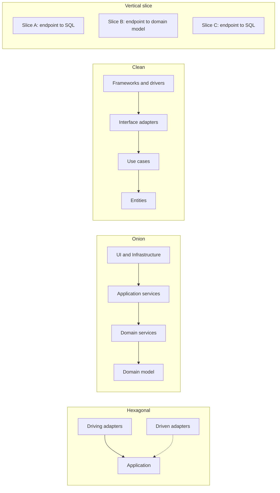
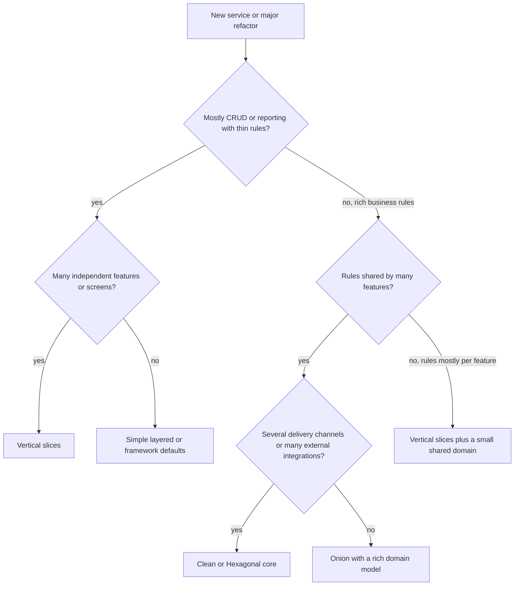
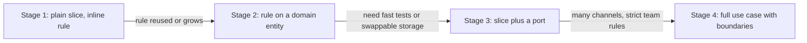

# Comparing Hexagonal, Onion, Clean and Vertical Slice

## Introduction

After reading about [Hexagonal](./0-arch-hexagonal.mdx), [Onion](./1-arch-onion.mdx), [Clean](./2-arch-clean-architecture.mdx) and [Vertical Slice](./3-arch-vertical-slice.mdx) architecture, many developers ask the same question: "Which one should I use?" Online debates often present them as rival camps. In practice:

- **Hexagonal, Onion and Clean are three descriptions of one family of ideas**, with different emphasis and vocabulary. Microsoft's .NET architecture guide says this directly: it treats hexagonal, ports-and-adapters, onion and clean architecture as names for the same approach ([Common web application architectures](https://learn.microsoft.com/en-us/dotnet/architecture/modern-web-apps-azure/common-web-application-architectures)).
- **Vertical Slice is a different axis**. It is about how you group code (by feature instead of by layer) and how much shared abstraction you allow. It can be combined with the other three.

A useful analogy is maps of the same city. A subway map, a street map and a tourist map all show the same city with different emphasis. Hexagonal, Onion and Clean are three maps of "keep business logic independent of technology". Vertical Slice is more like deciding to organize the city into self-contained neighborhoods rather than citywide zones for housing, shops and offices.

This page compares them directly, gives a decision guide, and shows how teams combine them.

## What They Share

All four styles want the same outcomes:

1. **Business logic that is easy to find and change.**
2. **Fast tests** for the logic that matters.
3. **Freedom from framework and database lock-in** where it matters.
4. **Changes that stay local.**

Hexagonal, Onion and Clean achieve this through one mechanism: **dependency inversion at the boundary of the core**. The core defines interfaces, the outside implements them, and dependencies point inward. Vertical Slice achieves "changes stay local" mainly by **grouping by feature and minimizing sharing between features**.

## Same Ideas, Different Words

| Concept | Hexagonal (Cockburn, 2005) | Onion (Palermo, 2008) | Clean (Martin, 2012) | Vertical Slice (Bogard, 2018) |
| --- | --- | --- | --- | --- |
| The protected center | The application (inside the hexagon) | Domain model plus service rings | Entities plus use cases | Each slice's handler, sometimes a shared domain |
| Business entities | Not specified | Domain model (center) | Entities | Per slice, or a small shared domain |
| Use cases / orchestration | Behind driving ports | Application services | Use case interactors | The slice handler itself |
| Interfaces to the outside | Driving and driven ports | Interfaces in the core rings | Input / output boundaries, gateways | Usually none; slices use infrastructure directly |
| Code that talks to technology | Adapters | Infrastructure (outer ring) | Interface adapters plus frameworks and drivers | Inside the slice |
| Wiring at startup | Configurator | Composition root (DI) | Main component | Framework DI and routing |
| Main dependency rule | Inside never depends on outside | All coupling toward the center | Source dependencies point inward | Minimize coupling between slices |
| Primary grouping | Inside vs outside | Concentric layers | Concentric layers | Feature or request |



## Where They Really Differ

### 1. How much they say about the inside

- **Hexagonal** says only "inside versus outside". It gives no guidance on organizing the inside.
- **Onion** adds rings inside: domain model, domain services, application services.
- **Clean** adds a firm split between enterprise rules (entities) and application rules (use cases), plus rules about what data crosses each boundary.
- **Vertical Slice** lets each slice choose, from a single SQL query to a rich domain model.

### 2. Amount of ceremony

For a simple feature like "show a book's details", the file count differs a lot.

```text
# Clean Architecture (faithful version)
entities/book.py
use_cases/get_book_details/request.py
use_cases/get_book_details/response.py
use_cases/get_book_details/input_boundary.py
use_cases/get_book_details/output_boundary.py
use_cases/get_book_details/interactor.py
use_cases/ports/book_gateway.py
adapters/web/get_book_details_controller.py
adapters/web/get_book_details_presenter.py
adapters/persistence/sql_book_gateway.py

# Hexagonal / Onion (typical pragmatic version)
domain/book.py
application/ports.py               # BookRepository protocol
application/get_book_details.py    # use case returning a DTO
adapters/web/books.py
adapters/persistence/sql_books.py

# Vertical Slice
features/get_book_details.py       # endpoint + SQL + result type
```

None of these is wrong. The question is whether the extra files buy you something for **this** feature. For a read-only screen, they rarely do. For a complicated refund policy shared by three channels, they often do.

### 3. Where shared business rules live

Layered styles give shared rules an obvious, protected home: the domain at the center. Vertical slices deliberately share little, which risks duplicating a rule across slices unless the team refactors shared rules into a domain module when they appear.

### 4. Testing style

- Hexagonal, Onion and Clean favor **unit tests of the core** with in-memory adapters, plus a smaller set of adapter integration tests.
- Vertical Slice favors **testing each slice through its handler** against a real database, since much of a slice's logic is in its query.

Both are valid. See [Designing for Testability](../12-arch-quality-and-operations/5-arch-testability.mdx).

## Summary Comparison

| Criterion | Hexagonal | Onion | Clean | Vertical Slice |
| --- | --- | --- | --- | --- |
| Main idea | Ports and adapters around the app | Domain-centric rings | Dependency Rule plus explicit use cases | Group by feature, minimize sharing |
| Guidance on inner structure | Low | Medium | High | Per slice |
| Ceremony per feature | Medium | Medium | High | Low |
| Protection of shared domain rules | Good | Strong | Strong | Depends on team discipline |
| Swapping technologies | Easy | Easy | Easy | Per slice, harder globally |
| Adding many independent features | Medium | Medium | Slower | Fast |
| Best fit | Integration-heavy apps, many channels | Rich, long-lived domains | Large teams, complex multi-channel rules | Feature-rich apps, read-heavy apps, admin backends |
| Main risk | Ports that mirror technology | Anemic domain, too many rings | Over-engineering CRUD | Duplicated rules, slices importing each other |

## A Decision Guide



A few honest notes about this chart:

- **Framework defaults are a legitimate choice.** A Django or Rails app that follows the framework's conventions is easy to hire for and fast to build. Many successful products never need more.
- **The choice can differ per module.** The ordering module may deserve a clean core while the admin reports are slices. See the scenario below.
- **You can move later.** Starting simple and refactoring toward a clean core when the rules get complex is often cheaper than starting with full ceremony. Write the decision down in an [Architecture Decision Record](../13-arch-documenting-and-evolving/0-arch-decision-records.mdx) so the reasoning survives.

## Combining Styles: Slices on Top of a Shared Domain

A very common real-world combination is **vertical slices for the application layer** and **a small shared domain at the bottom**. Each slice owns its endpoint, its orchestration and its queries; slices that need rich rules use shared domain types such as `Order` and `Money`. Infrastructure that several slices need, such as the database session, sits in a small shared module.

```text
src/bookstore/
    main.py                     # composition root and routing
    features/
        place_order.py          # uses domain.Order, infrastructure.db
        cancel_order.py         # uses domain.Order
        get_book_details.py     # plain SQL query
        sales_report.py         # plain SQL query
    domain/
        order.py                # shared business rules
        money.py
    infrastructure/
        db.py
```

The rules for this hybrid can be enforced too. This Import Linter configuration was tested with import-linter 2.15:

```toml
# pyproject.toml
[tool.importlinter]
root_package = "bookstore"

[[tool.importlinter.contracts]]
name = "Slices on top, shared domain at the bottom"
type = "layers"
layers = [
    "bookstore.main",
    "bookstore.features",
    "bookstore.infrastructure",
    "bookstore.domain",
]

[[tool.importlinter.contracts]]
name = "Slices do not import each other"
type = "independence"
modules = ["bookstore.features.*"]
```

```bash
PYTHONPATH=src lint-imports --no-logo
```

Example output:

```text
Slices on top, shared domain at the bottom KEPT
Slices do not import each other KEPT

Contracts: 2 kept, 0 broken.
```

If `cancel_order` imports something from `place_order`, the independence contract fails:

```text
bookstore.features.cancel_order is not allowed to import bookstore.features.place_order:

- bookstore.features.cancel_order -> bookstore.features.place_order (l.2)
```

Notice that this layering puts `infrastructure` above `domain`, so infrastructure can use domain types but the domain never imports infrastructure. That is the onion's dependency rule, applied only where it matters.

## Moving Between Styles as a System Grows

Architecture is not a one-time choice. The most common journey is from a simple slice to a protected core, one feature at a time, as rules get more complicated. Here is what that looks like for "cancel an order".

**Stage 1: a plain slice.** The handler loads a row, checks the status, computes the refund inline and saves. This is fine while the refund rule is one line and only one endpoint cancels orders.

**Stage 2: the rule moves into the shared domain.** When a second channel (say, a nightly job) also cancels orders, or the refund policy grows, move the rule onto a domain entity so it exists once.

**Stage 3: the slice gets a port, but only where it pays.** If you want fast tests without a database, give the slice a small `Protocol` for the one dependency you want to swap. You have now borrowed the hexagonal idea for this one feature, not for the whole codebase.

```python
# cancel_order.py: a slice that has grown a domain rule and one port
from dataclasses import dataclass
from datetime import datetime, timedelta, timezone
from decimal import Decimal
from typing import Protocol


# Stage 2: the rule moves out of the slice into the shared domain.
@dataclass
class Order:
    order_id: str
    total: Decimal
    status: str
    placed_at: datetime

    def cancel(self, now: datetime) -> Decimal:
        if self.status != "placed":
            raise ValueError(f"cannot cancel an order that is {self.status}")
        self.status = "cancelled"
        if now - self.placed_at <= timedelta(hours=24):
            return self.total
        return (self.total * Decimal("0.90")).quantize(Decimal("0.01"))


# Stage 3: the slice gets a port only for what it needs to swap in tests.
class Orders(Protocol):
    def get(self, order_id: str) -> Order | None: ...
    def save(self, order: Order) -> None: ...


def cancel_order(orders: Orders, order_id: str, now: datetime) -> Decimal:
    order = orders.get(order_id)
    if order is None:
        raise LookupError(order_id)
    refund = order.cancel(now)
    orders.save(order)
    return refund


class InMemoryOrders:
    def __init__(self, *orders: Order) -> None:
        self._data = {o.order_id: o for o in orders}

    def get(self, order_id: str) -> Order | None:
        return self._data.get(order_id)

    def save(self, order: Order) -> None:
        self._data[order.order_id] = order


now = datetime(2026, 10, 11, 12, 0, tzinfo=timezone.utc)
orders = InMemoryOrders(
    Order("A1", Decimal("40.00"), "placed", now - timedelta(hours=3)),
    Order("B2", Decimal("80.00"), "placed", now - timedelta(days=3)),
)
print("A1 refund:", cancel_order(orders, "A1", now))
print("B2 refund:", cancel_order(orders, "B2", now))
```

Output:

```text
A1 refund: 40.00
B2 refund: 72.00
```

In a real project the `Order` class would live in `domain/order.py` and `InMemoryOrders` in the tests; they are in one file here so you can run it.

**Stage 4: a full use case with boundaries, if needed.** If several channels need different output formats, or the team wants strict rules for every command, promote the slice to a [Clean Architecture](./2-arch-clean-architecture.mdx) interactor with request and response models.



The reverse journey also happens. A heavily layered app full of pass-through services can be simplified by collapsing layers into slices where the logic is thin. Both directions are normal; the mistake is never revisiting the choice.

## Questions for a Design Review

When a team proposes one of these styles, these questions surface whether it fits:

1. **Where does change come from?** Look at the last few months of tickets. Rule changes, integration changes and new features point to different styles.
2. **What would we swap, realistically?** If the honest answer is "nothing, ever", ports for that dependency are speculative. Tests may still justify them.
3. **How many delivery channels call the same rules?** One channel weakens the case for heavy boundaries; three or four strengthens it.
4. **How will we enforce the rules?** If there is no answer, the structure will erode.
5. **What does a new developer need to read to change one feature?** Count the files. If it is more than the feature's complexity justifies, the ceremony is too high.
6. **Who owns which part?** Team boundaries should match module boundaries, as [Conway's Law](../0-arch-fundamentals/9-arch-conways-law.mdx) predicts they eventually will.

## Real-World Scenario

**Situation.** An online bookstore company is rebuilding three systems this year and the architecture group must recommend a style for each:

1. **Ordering and pricing service.** Complex rules for discounts, loyalty tiers, taxes and refunds. Used by the website, mobile apps, a call-center tool and a nightly B2B import.
2. **Partner integration service.** Pulls stock levels from five publisher APIs and pushes shipments to three carriers. Little business logic, but integrations change often and must be tested without calling real partners.
3. **Back-office admin.** About 70 screens: reports, CSV exports, bulk edits, moderation queues. Mostly reads and simple writes.

**Recommendation.**

| System | Style | Reasoning |
| --- | --- | --- |
| Ordering and pricing | Clean or Onion core with a rich domain model | Valuable shared rules, four delivery channels, heavy testing needs |
| Partner integration | Hexagonal | The core is small; the value is in swappable, testable adapters per partner |
| Back-office admin | Vertical slices with a small shared domain | Many independent features, read-heavy, low rule complexity |

**Why this approach.** Each system's main source of change is different. Ordering changes because business rules change, so protect the rules. Integration changes because partners change, so isolate partners behind ports. Admin changes because new screens and reports are requested, so make adding features cheap. Choosing one style for all three would over-engineer the admin or under-protect the pricing rules.

**When not to follow this.** If the same five-person team owns all three systems, the cognitive cost of three styles may outweigh the benefit. In that case pick the hybrid (slices plus shared domain) everywhere and add ports only where integrations demand them.

**Alternatives and trade-offs.**

| Approach | Pros | Cons | Best for |
| --- | --- | --- | --- |
| One style everywhere | Consistency, easy onboarding | Wrong fit for some systems | Small organizations, one team |
| Style per system | Best fit for each problem | More to learn, inconsistent code reviews | Several teams with different problems |
| Hybrid (slices plus shared domain) | Balanced default, low ceremony | Requires judgment about what is shared | Most medium-sized business apps |
| Framework defaults | Fastest start, large talent pool | Logic coupled to the framework | Early-stage products, CRUD apps |

## Common Mistakes

1. **Treating the styles as rival religions.** Arguing "hexagonal versus clean" usually wastes time; they agree on the important rule.
2. **Picking a style from a template repository.** Starter templates are useful for learning but bring all the ceremony whether you need it or not. Start from your problem.
3. **Same ceremony for every feature.** Simple reads do not need seven classes. Many teams use a full use case for commands with rules and a direct query for reads, which is effectively a light form of [CQRS](../9-arch-distributed-systems/3-arch-cqrs.mdx).
4. **Rules written in a wiki only.** Whatever you choose, enforce the dependency rules with tooling, as shown above and in [Structuring a Codebase](./6-arch-structuring-a-codebase.mdx).
5. **Confusing these with deployment styles.** All four styles are about the inside of one deployable unit. They apply equally to a [monolith](../6-arch-architectural-styles/2-arch-monolith.mdx) or a single [microservice](../6-arch-architectural-styles/4-arch-microservices.mdx).
6. **Never revisiting the choice.** A CRUD app that grows complex rules should move toward a protected core; a heavily layered app full of pass-through code may be better as slices.

## Summary

- **Hexagonal, Onion and Clean** share one core idea: dependencies point toward the business logic, enforced through dependency inversion. They differ in vocabulary and in how much they prescribe about the inside.
- **Vertical Slice** changes the grouping axis to features and minimizes sharing between slices. It can be combined with a shared domain core.
- Choose by asking where change comes from: **business rules** (protect the core), **integrations** (ports and adapters), or **new features** (slices).
- Different modules or systems can reasonably use different styles.
- Enforce whichever rules you pick with automated checks, and record the decision in an ADR.

## Exercises

1. For a project you know, list the last ten changes. Classify each as a rule change, an integration change or a new feature. Which style does that history suggest?
2. Take the Clean Architecture `CancelOrderInteractor` from [Clean Architecture](./2-arch-clean-architecture.mdx) and rewrite it as a vertical slice that still uses the `Order` entity. What did you remove? What protection did you lose?
3. Write an ADR (context, decision, consequences) recommending a style for the bookstore's partner integration service.
4. Extend the hybrid Import Linter configuration so that `bookstore.domain` may not import anything from `sqlite3`. Hint: look at the `forbidden` contract and `include_external_packages`.

To find the boundaries that these styles protect, continue with the [Domain-Driven Design Introduction](../8-arch-domain-driven-design/0-arch-ddd-introduction.mdx), and see [Choosing an Architectural Style](../6-arch-architectural-styles/10-arch-choosing-a-style.mdx) for system-level choices.
