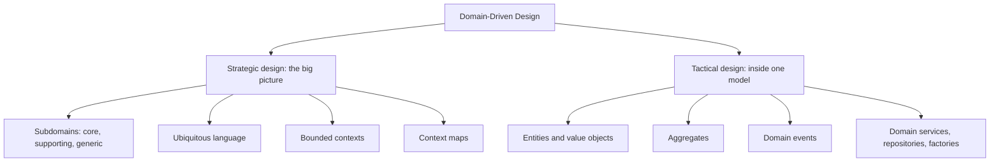
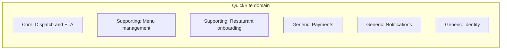
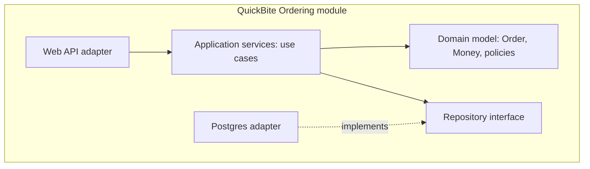
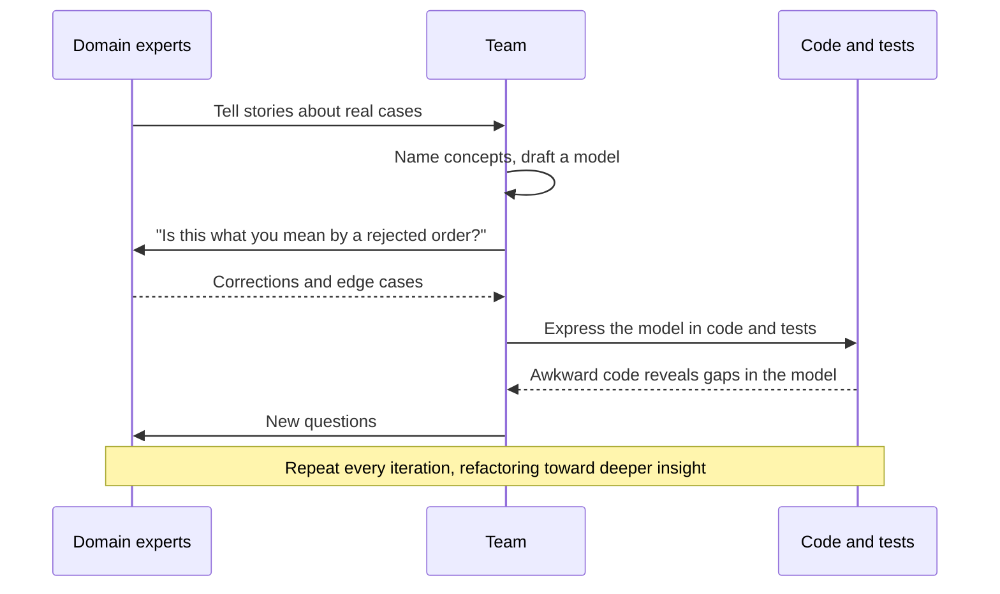

# Domain-Driven Design Introduction

## Introduction

Most software does not fail because the team picked the wrong database or framework. It fails because the code slowly stops matching the business. Developers call something an "order" that the business calls three different things. A rule like "a restaurant may pause new orders during a rush" is spread across a controller, a SQL trigger, and a cron job. Nobody can change it safely, because nobody can find it.

**Domain-Driven Design (DDD)** is an approach to software design that puts the **domain**, the business problem you are solving, at the center of the design. It was introduced by Eric Evans in his book *Domain-Driven Design: Tackling Complexity in the Heart of Software* (published 2003, copyright 2004). The core ideas are:

1. **Work closely with domain experts** and build a shared model of the problem together.
2. **Express that model directly in code**, using the same words the experts use.
3. **Split a large domain into smaller, consistent models** with clear boundaries, instead of forcing one giant model on everyone.
4. **Invest your best design effort where the business gets the most value**, and keep the rest simple.

An analogy: imagine translating a legal contract with a friend who speaks the other language. If you each use your own private words for "tenant", "lease" and "deposit", the translation drifts. If you first agree on a glossary and stick to it, the work goes faster and the mistakes become visible. DDD is that glossary, plus a way to organize the work around it.

:::info Where this page fits
This page is the overview. The rest of this section goes deeper into each idea: [Ubiquitous Language](./1-arch-ubiquitous-language.mdx), [Bounded Contexts](./2-arch-bounded-contexts.mdx), [Entities and Value Objects](./3-arch-entities-and-value-objects.mdx), [Aggregates](./4-arch-aggregates.mdx), [Domain Events](./5-arch-domain-events.mdx), [Domain and Application Services](./6-arch-domain-services.mdx), [Event Storming](./7-arch-event-storming.mdx), [Strategic vs Tactical DDD](./8-arch-strategic-vs-tactical-ddd.mdx) and [When Not to Use DDD](./9-arch-when-not-ddd.mdx).
:::

## The Problem DDD Solves

DDD is aimed at **complex business logic**. It is not about technical complexity like scaling to millions of requests; it is about rules, exceptions, workflows and vocabulary that are hard to get right.

Throughout this section we use one running example: **QuickBite**, a food delivery platform. Customers place orders, restaurants prepare them, couriers deliver them, and payments flow between all three. Here is how order placement often looks after a year of "just ship it":

```python
# before.py - business rules hidden in a procedural handler
from dataclasses import dataclass, field


@dataclass
class Order:
    id: str
    restaurant_id: str
    status: str = "new"
    items: list[dict] = field(default_factory=list)
    total_cents: int = 0


def handle_checkout(order: Order, restaurant: dict, promo_code: str | None) -> Order:
    if restaurant["paused"]:
        raise ValueError("closed")
    total = 0
    for item in order.items:
        total += item["price"] * item["qty"]
    if promo_code == "WELCOME10" and total > 2000:
        total = int(total * 0.9)
    if total < 1000:
        total += 299  # small order fee
    order.total_cents = total
    order.status = "submitted"
    return order


order = Order(id="o-1", restaurant_id="r-9",
              items=[{"price": 850, "qty": 1}, {"price": 400, "qty": 1}])
print(handle_checkout(order, {"paused": False}, None))
```

Output:

```text
Order(id='o-1', restaurant_id='r-9', status='submitted', items=[{'price': 850, 'qty': 1}, {'price': 400, 'qty': 1}], total_cents=1250)
```

This works, and for a small app it is fine. The problems show up as the business grows:

- **The rules have no names.** "Small order fee" exists only as a comment. Is it a fee, a surcharge, or a delivery charge? Finance and product may disagree.
- **Anyone can break the order.** Any code can set `order.status = "delivered"` or append an item after checkout.
- **Money is an `int`.** Nothing stops you adding cents to euros, or a negative price.
- **The same rule is copied.** The mobile app, the admin tool and a batch job each reimplement checkout slightly differently.

Martin Fowler calls the model above an [Anemic Domain Model](https://martinfowler.com/bliki/AnemicDomainModel.html): objects named after business nouns that hold data but no behavior, with all logic in procedural services.

## The Same Logic, Domain-Driven

Here is the same checkout written with DDD's tactical tools. Don't worry about every detail yet; each piece has its own page.

```python
# after.py - the model speaks the business language and protects its rules
from __future__ import annotations

from dataclasses import dataclass, field
from enum import Enum


@dataclass(frozen=True)
class Money:
    """Value object: compared by value, immutable."""
    cents: int
    currency: str = "USD"

    def __post_init__(self) -> None:
        if self.cents < 0:
            raise ValueError("Money cannot be negative")

    def __add__(self, other: Money) -> Money:
        if other.currency != self.currency:
            raise ValueError("Currency mismatch")
        return Money(self.cents + other.cents, self.currency)

    def times(self, n: int) -> Money:
        return Money(self.cents * n, self.currency)


SMALL_ORDER_THRESHOLD = Money(1000)
SMALL_ORDER_FEE = Money(299)


class OrderStatus(Enum):
    DRAFT = "draft"
    PLACED = "placed"


@dataclass(frozen=True)
class OrderLine:
    menu_item_id: str
    unit_price: Money
    quantity: int

    def subtotal(self) -> Money:
        return self.unit_price.times(self.quantity)


class RestaurantNotAcceptingOrders(Exception):
    pass


@dataclass
class Order:
    """Entity and aggregate root: has identity and guards its own rules."""
    id: str
    restaurant_id: str
    lines: list[OrderLine] = field(default_factory=list)
    status: OrderStatus = OrderStatus.DRAFT

    def add_line(self, line: OrderLine) -> None:
        if self.status is not OrderStatus.DRAFT:
            raise ValueError("Cannot change a placed order")
        self.lines.append(line)

    def food_total(self) -> Money:
        total = Money(0)
        for line in self.lines:
            total = total + line.subtotal()
        return total

    def small_order_fee(self) -> Money:
        return SMALL_ORDER_FEE if self.food_total().cents < SMALL_ORDER_THRESHOLD.cents else Money(0)

    def amount_due(self) -> Money:
        return self.food_total() + self.small_order_fee()

    def place(self, restaurant_accepting_orders: bool) -> None:
        if not restaurant_accepting_orders:
            raise RestaurantNotAcceptingOrders(self.restaurant_id)
        if not self.lines:
            raise ValueError("Cannot place an empty order")
        self.status = OrderStatus.PLACED


order = Order(id="o-1", restaurant_id="r-9")
order.add_line(OrderLine("burger", Money(850), 1))
order.add_line(OrderLine("fries", Money(400), 1))
order.place(restaurant_accepting_orders=True)
print(order.status.value, order.food_total(), order.small_order_fee(), order.amount_due())

try:
    order.add_line(OrderLine("shake", Money(500), 1))
except ValueError as err:
    print("Rejected:", err)
```

Output:

```text
placed Money(cents=1250, currency='USD') Money(cents=0, currency='USD') Money(cents=1250, currency='USD')
Rejected: Cannot change a placed order
```

What changed:

- **Names come from the business**: "small order fee", "place", "restaurant not accepting orders". A product manager can read `Order` and check the rules.
- **Rules live with the data they protect**: you cannot add a line to a placed order, because `Order` refuses.
- **`Money` is its own type**, so currency mistakes and negative amounts fail loudly.
- **The promo-code logic is gone from the order.** In DDD you would ask the business where promotions belong. Maybe they are a separate **Promotions** model. That is a strategic design question, covered in [Bounded Contexts](./2-arch-bounded-contexts.mdx).

The code is longer. That is the honest cost of DDD, and the reason it only pays off when the rules are complex enough to justify it.

## Strategic and Tactical DDD

DDD has two halves. Teams often learn only the second one, which is where most disappointment with DDD comes from.



| Half | Question it answers | Main tools | Who is involved |
| --- | --- | --- | --- |
| Strategic | What are the parts of our business, which matter most, and where are the boundaries? | Subdomains, ubiquitous language, bounded contexts, context maps, Event Storming | Domain experts, product, architects, team leads |
| Tactical | How do we model the rules inside one boundary so the code stays correct? | Entities, value objects, aggregates, domain events, services, repositories | Developers and domain experts |

The full comparison, including which to start with, is in [Strategic vs Tactical DDD](./8-arch-strategic-vs-tactical-ddd.mdx).

## Subdomains: Not Everything Deserves the Same Effort

A **domain** is the whole area your business works in, such as food delivery. It breaks down into **subdomains**. DDD classifies them by how much they matter to the business:

| Subdomain type | Meaning | QuickBite example | Typical approach |
| --- | --- | --- | --- |
| **Core** | What makes the business different and wins customers | Courier dispatch and delivery time prediction | Rich domain model, best people, custom code |
| **Supporting** | Needed and specific to you, but not a differentiator | Restaurant onboarding, menu management | Simple custom code, CRUD is often fine |
| **Generic** | Every company needs it, solved problems | Payments processing, email, identity and login | Buy or use an off-the-shelf service |

This classification is one of the most practical ideas in DDD. It tells you **where not to use DDD**: a menu editor that is basically forms over a table does not need aggregates and domain events. The DDD Crew's [Core Domain Charts](https://github.com/ddd-crew/core-domain-charts) plot subdomains on two axes, business differentiation and model complexity, to make these conversations concrete.



## The Building Blocks at a Glance

Each building block has a dedicated page. This table is a quick reference so the vocabulary is familiar when you meet it later.

| Building block | One-line definition | QuickBite example | Page |
| --- | --- | --- | --- |
| Ubiquitous language | Shared vocabulary used in talk, docs and code | "Order is **placed**, then **accepted** by the kitchen" | [Ubiquitous Language](./1-arch-ubiquitous-language.mdx) |
| Bounded context | A boundary inside which one model and language are consistent | Ordering, Kitchen, Delivery, Billing | [Bounded Contexts](./2-arch-bounded-contexts.mdx) |
| Entity | Object defined by identity that changes over time | `Order`, `Courier` | [Entities and Value Objects](./3-arch-entities-and-value-objects.mdx) |
| Value object | Immutable object defined by its values | `Money`, `Address`, `TimeWindow` | [Entities and Value Objects](./3-arch-entities-and-value-objects.mdx) |
| Aggregate | Cluster of objects changed together under one root that enforces invariants | `Order` with its `OrderLine`s | [Aggregates](./4-arch-aggregates.mdx) |
| Domain event | A fact that happened and that the business cares about | `OrderPlaced`, `CourierAssigned` | [Domain Events](./5-arch-domain-events.mdx) |
| Domain service | Domain logic that does not belong to one entity | Delivery fee calculation across zones | [Domain Services](./6-arch-domain-services.mdx) |
| Application service | Orchestrates a use case: load, call domain, save | `PlaceOrderHandler` | [Domain Services](./6-arch-domain-services.mdx) |
| Repository | Collection-like access to aggregates | `OrderRepository` | [Repository Pattern](../5-arch-modern-patterns/1-arch-repository-pattern.mdx) |

## How DDD Fits with Architecture Styles

DDD is not an architecture style. It says nothing about whether you deploy a monolith or microservices. It does combine naturally with styles that keep the domain model independent of infrastructure:

- [Hexagonal](../7-arch-clean-architecture/0-arch-hexagonal.mdx), [Onion](../7-arch-clean-architecture/1-arch-onion.mdx) and [Clean Architecture](../7-arch-clean-architecture/2-arch-clean-architecture.mdx) put the domain model at the center, with no imports of web frameworks or ORMs.
- A [Modular Monolith](../6-arch-architectural-styles/3-arch-modular-monolith.mdx) often uses bounded contexts as module boundaries.
- [Microservices](../6-arch-architectural-styles/4-arch-microservices.mdx) are frequently drawn along bounded contexts, as described on microservices.io's [Decompose by subdomain](https://microservices.io/patterns/decomposition/decompose-by-subdomain.html) pattern.



The arrows point inward: the domain model does not know about the web layer or the database. That independence is what lets you test business rules in milliseconds and talk about them with domain experts without SQL getting in the way.

## How DDD Work Actually Flows

DDD is not a one-time design phase. It is a loop of learning and refining that continues as long as the software lives. Evans calls the result of this loop a model that gets "deeper" over time as the team understands the business better.



A typical cycle for one feature looks like this:

1. **Explore**: talk through concrete examples with an expert. "A customer orders at 9:58 and the restaurant closes at 10. What happens?"
2. **Name**: agree on terms for what you discovered, such as "last order time", and add them to the glossary.
3. **Model**: decide which object owns the rule. Here, the restaurant's opening hours are a value object, and `Order.place` checks them.
4. **Code and test**: write tests whose names are business statements, then the code.
5. **Review with the expert**: walk through the tests. Experts are often surprisingly good at reading well-named tests.
6. **Refactor**: when a new rule doesn't fit the model cleanly, that is a signal to rethink the model, not to add another `if`.

:::tip Small, concrete examples beat abstract requirements
"Orders must respect business hours" hides the hard cases. "Order at 9:58, kitchen closes at 10, prep takes 15 minutes" exposes them. Techniques such as example mapping and [Event Storming](./7-arch-event-storming.mdx) are built around concrete examples for this reason.
:::

## Real-World Scenario

Your team builds QuickBite. The company has 40 engineers in six teams. Complaints are piling up: late deliveries, wrong fees, and every change to dispatch logic breaks the restaurant dashboard. Leadership asks whether "doing DDD" would help.

**What you do:**

1. **Run a Big Picture [Event Storming](./7-arch-event-storming.mdx) workshop** with operations, support, restaurant success and engineering. You map the flow from "Order Placed" to "Order Delivered" on a wall.
2. **Classify subdomains.** Everyone agrees dispatch and ETA prediction are why customers choose QuickBite. Payments are generic, handled by a payment provider. Menu management is supporting.
3. **Find the language clashes.** "Order" means a customer's basket in Ordering, a ticket in the kitchen, and a pickup job for couriers. These become separate **bounded contexts** with explicit translations between them.
4. **Apply tactical DDD only in the core.** The Dispatch team models `Delivery`, `Courier` and `DispatchPolicy` as rich aggregates with domain events. The Menu team keeps a simple CRUD service.
5. **Keep one deployable for now.** Bounded contexts become modules in a modular monolith. Teams can extract a service later if a context needs to scale or deploy independently.

**Why this approach fits:** QuickBite's pain is mostly confused language and tangled rules, which are exactly what DDD targets. The heaviest investment goes only where the business differentiates.

**When to use it / when not to:** DDD pays off when the domain is complex, the business logic changes often, domain experts are available, and the system will live for years. It is overkill for a CRUD admin tool, a short-lived prototype, or a data pipeline with little logic. See [When Not to Use DDD](./9-arch-when-not-ddd.mdx).

**Alternatives and trade-offs:**

| Approach | Pros | Cons | Best for |
| --- | --- | --- | --- |
| Full DDD (strategic and tactical) in the core domain | Code matches the business; rules are protected; clear boundaries between teams | Slower start; needs expert access; more classes | Complex, long-lived core domains |
| Strategic DDD only, simple code inside | Clear boundaries and language without heavy modeling | Rules may still scatter inside each context | Medium complexity, many teams |
| Transaction Script or CRUD | Fast, easy to understand | Rules duplicate and drift as complexity grows | Simple or supporting subdomains |
| Data-centric design (schema first) | Great for reporting and analytics | Behavior ends up in procedures and services | Reporting systems, data products |

## Common Mistakes

- **Starting with tactical patterns.** Adding `Entity`, `ValueObject` and `AggregateRoot` base classes without talking to domain experts gives you ceremony without insight. Start with language and boundaries.
- **Applying DDD everywhere.** Use it in the core domain. Supporting and generic subdomains usually deserve simpler code or a bought product.
- **No domain experts in the room.** DDD without the people who know the business is just object-oriented design with new names.
- **Confusing DDD with microservices.** Bounded contexts are a modeling boundary. They can live in one process. Splitting into services is a separate decision.
- **Treating the model as finished.** Evans stresses continuous learning. Expect to refactor the model as you discover better ways to express the domain.
- **Letting frameworks shape the model.** If your entities must extend an ORM base class and expose setters for every field, it is hard to protect invariants. Keep the domain layer plain.

## Summary

- DDD is a design approach that centers the **business domain**, built with domain experts and expressed directly in code.
- It targets **complex business logic**, not technical scale.
- **Strategic DDD** finds subdomains, a shared language, and bounded contexts. **Tactical DDD** models rules inside a context with entities, value objects, aggregates, events and services.
- Classify subdomains as **core, supporting or generic** and invest accordingly.
- DDD pairs well with hexagonal, clean and modular-monolith architectures, but it does not require microservices.
- The cost is more upfront thinking and code. Only pay it where the domain is complex enough.

## Further Learning

**Exercises:**

1. Pick an app you know, such as a library system, a gym booking app, or your company's product. List five subdomains and label each as core, supporting or generic. Explain your reasoning for the core one.
2. Take the `before.py` handler above and find three business rules hidden in it. Give each rule a name a business person would use.
3. Add a `remove_line` method to the domain-driven `Order` that refuses to remove lines once the order is placed. Write two quick checks that prove it works.
4. Read Fowler's [Anemic Domain Model](https://martinfowler.com/bliki/AnemicDomainModel.html) and find one class in a codebase you know that fits the description. What behavior could move into it?

**Next pages:**

- Start with the vocabulary: [Ubiquitous Language](./1-arch-ubiquitous-language.mdx)
- Then the boundaries: [Bounded Contexts and Context Mapping](./2-arch-bounded-contexts.mdx)
- For the foundations behind DDD's design style, see [Coupling and Cohesion](../0-arch-fundamentals/5-arch-coupling-and-cohesion.mdx) and [Managing Complexity](../0-arch-fundamentals/7-arch-complexity.mdx).

**Sources:** Eric Evans, [DDD Reference](https://www.domainlanguage.com/ddd/reference/) (CC BY 4.0); Martin Fowler, [Bounded Context](https://martinfowler.com/bliki/BoundedContext.html) and [Anemic Domain Model](https://martinfowler.com/bliki/AnemicDomainModel.html); the [DDD Crew](https://github.com/ddd-crew) community resources.
