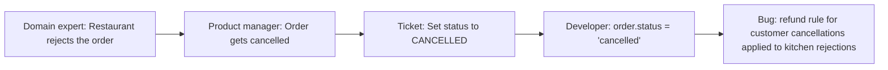
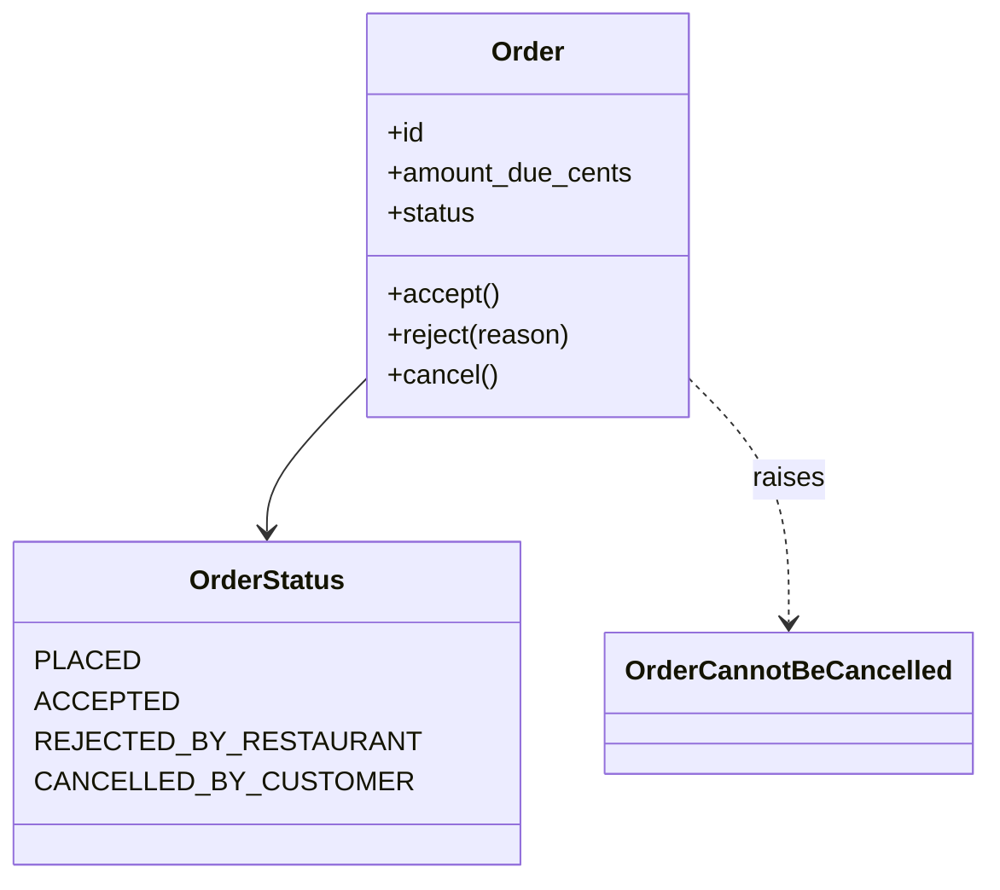

# Ubiquitous Language

## Introduction

Ask three people at a food delivery company what a "cancelled order" is and you may get three answers. Support says the customer cancelled it. The kitchen says the restaurant rejected it. Finance says it was refunded. When the code has one `status = "cancelled"` flag for all three, refunds go out for orders the kitchen already cooked, and nobody can say whose rule is wrong.

A **ubiquitous language** is a shared, precise vocabulary that domain experts and developers build together and then use **everywhere**: in conversations, documents, tickets, diagrams, class names, method names, tests, API fields and event names. Eric Evans made it a foundation of [Domain-Driven Design](./0-arch-ddd-introduction.mdx) because most design problems in complex domains start as language problems.

Think of an airline cockpit. Pilots and air traffic controllers use a fixed phraseology: "cleared for takeoff" means one exact thing, and "takeoff" is avoided in other contexts so it can never be misheard. Ubiquitous language brings the same discipline to software: one term, one meaning, used the same way by everyone in the team.

## The Translation Problem

Without a shared language, every handoff is a translation, and every translation loses detail.



Each step looks reasonable. The bug is in the gaps between them. A ubiquitous language removes the gaps by making everyone use the same words, with the same meaning, all the way into the code.

:::note Ubiquitous within a boundary
"Ubiquitous" does not mean "the same across the whole company". A term only needs one meaning **inside one bounded context**. "Order" can mean a customer's purchase in Ordering and a cooking ticket in the Kitchen context, as long as each context is consistent. See [Bounded Contexts and Context Mapping](./2-arch-bounded-contexts.mdx).
:::

## Building the Language

You don't invent a ubiquitous language at a whiteboard by yourself. You **discover** it by working with domain experts on real scenarios.

### Practical techniques

1. **Listen for nouns and verbs in real stories.** Ask experts to walk through concrete cases: "Tell me about the last order that went wrong." Note the words they use without prompting.
2. **Hunt for ambiguity.** When two people use the same word differently, or different words for the same thing, stop and resolve it. These are the most valuable moments.
3. **Prefer verbs that describe business intent.** "The kitchen **accepts** the order" is better than "update order status to 2".
4. **Write it down in a glossary**, short and living, kept near the code.
5. **Test it in code.** If a term is awkward to express as a class or method, the model may be wrong. Go back to the experts.
6. **Use [Event Storming](./7-arch-event-storming.mdx)** to surface language quickly with a large group.

### A glossary for the QuickBite Ordering context

After two workshops with support and operations, the QuickBite Ordering team agrees on this glossary:

| Term | Meaning in Ordering | Not to be confused with |
| --- | --- | --- |
| **Basket** | Items a customer is choosing before checkout | Order (a basket becomes an order only when placed) |
| **Order** | A customer's confirmed request to buy food from one restaurant | Kitchen ticket (the restaurant's view) |
| **Place** (an order) | Customer confirms and pays; the order becomes binding | Submit, create |
| **Accept** | The restaurant agrees to prepare the order | Confirm (reserved for payment) |
| **Reject** | The restaurant declines the order before preparing it | Cancel |
| **Cancel** | The customer withdraws the order, allowed only before acceptance | Reject, void |
| **Small order fee** | Fee added when food total is below the threshold | Delivery fee, service fee |
| **Food total** | Sum of line prices before fees and discounts | Amount due |
| **Amount due** | What the customer pays: food total plus fees minus discounts | Charge (a Billing term) |

Notice how much of the value is in the last column. Pairs like "reject vs cancel" are exactly where bugs used to hide.

## Language in Code: Before and After

The real test of a ubiquitous language is whether it survives into the code. Here is a typical "technical vocabulary" version:

```python
# before.py - technical names hide the business meaning
from dataclasses import dataclass


@dataclass
class OrderRecord:
    id: str
    status: int = 0          # 0=new 1=ok 2=cancelled 3=done
    flag: bool = False       # true when restaurant said no
    amt: int = 0


def update_status(rec: OrderRecord, new_status: int, by_restaurant: bool = False) -> None:
    if new_status == 2 and by_restaurant:
        rec.flag = True
    rec.status = new_status


def process(rec: OrderRecord) -> str:
    if rec.status == 2 and not rec.flag:
        return f"refund {rec.amt}"
    if rec.status == 2 and rec.flag:
        return f"refund {rec.amt} and notify restaurant success team"
    return "nothing"


r = OrderRecord(id="o-7", amt=1599)
update_status(r, 2, by_restaurant=True)
print(process(r))
```

Output:

```text
refund 1599 and notify restaurant success team
```

To understand this, you need the comment on `status`, the meaning of `flag`, and the knowledge that `process` is about refunds. A domain expert cannot review it.

Now the same behavior in the ubiquitous language:

```python
# after.py - the code reads like the glossary
from __future__ import annotations

from dataclasses import dataclass, field
from enum import Enum


class OrderStatus(Enum):
    PLACED = "placed"
    ACCEPTED = "accepted"
    REJECTED_BY_RESTAURANT = "rejected_by_restaurant"
    CANCELLED_BY_CUSTOMER = "cancelled_by_customer"


class OrderCannotBeCancelled(Exception):
    """Customers may cancel only before the restaurant accepts."""


@dataclass
class Order:
    id: str
    amount_due_cents: int
    status: OrderStatus = OrderStatus.PLACED
    history: list[str] = field(default_factory=list)

    def accept(self) -> None:
        self._require(OrderStatus.PLACED)
        self.status = OrderStatus.ACCEPTED
        self.history.append("accepted")

    def reject(self, reason: str) -> None:
        self._require(OrderStatus.PLACED)
        self.status = OrderStatus.REJECTED_BY_RESTAURANT
        self.history.append(f"rejected: {reason}")

    def cancel(self) -> None:
        if self.status is not OrderStatus.PLACED:
            raise OrderCannotBeCancelled(f"Order {self.id} is {self.status.value}")
        self.status = OrderStatus.CANCELLED_BY_CUSTOMER
        self.history.append("cancelled")

    def _require(self, expected: OrderStatus) -> None:
        if self.status is not expected:
            raise ValueError(f"Order {self.id} is {self.status.value}, expected {expected.value}")


def refund_actions_for(order: Order) -> list[str]:
    """Refund policy, written in the language finance and support agreed on."""
    match order.status:
        case OrderStatus.CANCELLED_BY_CUSTOMER:
            return [f"full refund of {order.amount_due_cents} cents"]
        case OrderStatus.REJECTED_BY_RESTAURANT:
            return [f"full refund of {order.amount_due_cents} cents",
                    "notify restaurant success team"]
        case _:
            return []


if __name__ == "__main__":
    order = Order(id="o-7", amount_due_cents=1599)
    order.reject(reason="out of ingredients")
    print(order.status.value, refund_actions_for(order))

    accepted = Order(id="o-8", amount_due_cents=2200)
    accepted.accept()
    try:
        accepted.cancel()
    except OrderCannotBeCancelled as err:
        print("Refused:", err)
```

Output:

```text
rejected_by_restaurant ['full refund of 1599 cents', 'notify restaurant success team']
Refused: Order o-8 is accepted
```

Every name in this code appears in the glossary. A support lead can read `refund_actions_for` and say "yes, that's our policy" or "no, we only give a partial refund after acceptance". That conversation is the point.



## Language Beyond Classes

The language should show up in every artifact the team produces, not just domain classes.

| Artifact | Technical vocabulary | Ubiquitous language |
| --- | --- | --- |
| Method | `order.set_status(3)` | `order.accept()` |
| Exception | `ValidationError("bad state")` | `OrderCannotBeCancelled` |
| Event | `OrderUpdated` | `OrderRejectedByRestaurant` |
| API endpoint | `PATCH /orders/7` with `status` set to 3 | `POST /orders/7/rejection` |
| Test name | `test_update_2` | `test_customer_cannot_cancel_after_restaurant_accepts` |
| Database column | `flag` | `rejected_by_restaurant_at` |
| Ticket | "Fix status bug" | "Rejected orders must refund in full" |

Tests are a particularly good place to practice the language, because a test name can be a sentence an expert agrees with:

```python
# test_order_language.py - test names as business statements
from after import Order, OrderCannotBeCancelled, refund_actions_for


def test_customer_cannot_cancel_after_restaurant_accepts() -> None:
    order = Order(id="o-1", amount_due_cents=1000)
    order.accept()
    try:
        order.cancel()
    except OrderCannotBeCancelled:
        return
    raise AssertionError("expected OrderCannotBeCancelled")


def test_rejected_order_is_refunded_in_full_and_flagged_to_restaurant_success() -> None:
    order = Order(id="o-2", amount_due_cents=1500)
    order.reject(reason="closed early")
    assert refund_actions_for(order) == [
        "full refund of 1500 cents",
        "notify restaurant success team",
    ]


if __name__ == "__main__":
    test_customer_cannot_cancel_after_restaurant_accepts()
    test_rejected_order_is_refunded_in_full_and_flagged_to_restaurant_success()
    print("2 language tests passed")
```

Output (with `after.py` in the same folder):

```text
2 language tests passed
```

## Keeping the Language Honest

Languages drift. New people join and bring words from their last job. A small automated check can catch the worst drift: a list of **forbidden synonyms** for each context.

```python
# check_language.py - flag terms the team agreed not to use in this context
import re
import sys
from pathlib import Path

FORBIDDEN = {
    # banned term -> preferred term from the glossary
    "submit": "place",
    "confirm_order": "accept",
    "void": "cancel",
    "surcharge": "small order fee",
}


def check(paths: list[Path]) -> list[str]:
    problems: list[str] = []
    for path in paths:
        for lineno, line in enumerate(path.read_text().splitlines(), start=1):
            for banned, preferred in FORBIDDEN.items():
                if re.search(rf"\b{banned}\b", line, flags=re.IGNORECASE):
                    problems.append(f"{path.name}:{lineno}: '{banned}' -> use '{preferred}'")
    return problems


if __name__ == "__main__":
    demo = Path("demo_ordering.py")
    demo.write_text("def submit(order):\n    order.place()\n\nVOID = 'void'\n")
    found = check([demo])
    print("\n".join(found) or "language OK")
    sys.exit(1 if found else 0)
```

Output:

```text
demo_ordering.py:1: 'submit' -> use 'place'
demo_ordering.py:4: 'void' -> use 'cancel'
```

This is a blunt tool: it matches words in strings and comments too, and it cannot tell when a banned word is legitimate (Billing really does "void" charges). Treat it as a reminder, not a gate. The real enforcement is code review and conversation. Some teams wire a check like this into CI as a warning, similar to a [fitness function](../13-arch-documenting-and-evolving/3-arch-fitness-functions.mdx).

### When the language changes, change the code

If experts start saying "the restaurant **declines** the order" instead of "rejects", and the team agrees the new word is better, rename `reject` to `decline` in the code, events and docs. A model that uses yesterday's words slowly becomes a translation layer again. For public APIs and published events, the rename needs a migration plan; see [API Versioning and Evolution](../10-arch-integration-and-apis/6-arch-api-versioning.mdx).

## Real-World Scenario

QuickBite's finance team reports that refunds for restaurant rejections are being charged back to restaurants, which the contract forbids. Investigation shows the Billing code treats every `cancelled` order as "customer fault" and the restaurant as not at fault, except for one code path that sets a `flag`.

**What you do:**

1. **Get the right people together**: one person each from finance, support, restaurant success and the Ordering and Billing teams, for 90 minutes.
2. **Walk through five real orders** that went wrong. Write each term on a card. You find four words for "the order didn't happen": cancelled, rejected, voided, failed.
3. **Agree on definitions.** "Cancel" is customer-initiated before acceptance. "Reject" is restaurant-initiated before preparation. "Void" is a Billing term for reversing a charge, not an Ordering state. "Failed" turns out to mean payment failure, which belongs to Billing.
4. **Update the glossary** in the Ordering repo and link it from the README.
5. **Refactor the code**: split the single `CANCELLED` status into `CANCELLED_BY_CUSTOMER` and `REJECTED_BY_RESTAURANT`, rename events, and write tests whose names state the refund rules.
6. **Publish distinct events** (`OrderCancelledByCustomer`, `OrderRejectedByRestaurant`) so Billing no longer needs to guess.

**Why this approach:** the bug was a language bug. Fixing only the one code path would leave the ambiguity in place for the next developer.

**When to use it / when not to:** a deliberate ubiquitous language is worth the effort for any domain with real rules and more than one group of stakeholders. For a tiny internal tool used by its authors, a short glossary in the README is enough; formal workshops would be overkill.

**Alternatives and trade-offs:**

| Approach | Pros | Cons | Best for |
| --- | --- | --- | --- |
| Living ubiquitous language (glossary plus code plus tests) | Rules readable by experts; fewer translation bugs | Needs expert time and discipline to keep updated | Complex domains with active experts |
| Developer-chosen technical names | Fast, no meetings | Experts cannot review code; ambiguity hides bugs | Purely technical code such as libraries and infrastructure |
| Company-wide data dictionary | One place for definitions; good for reporting | Forces one meaning per term across contexts, which often fails in large organizations | Analytics, regulatory reporting |
| Code comments mapping technical to business terms | Cheap to add | Comments drift from code; the code still speaks a different language | Short-term patch on legacy code |

## Common Mistakes

- **Developers invent the language alone.** If the experts would not recognize the words, it is not a ubiquitous language. Use their words, or agree on new ones together.
- **Forcing one meaning across the whole company.** "Customer" in Marketing and "Customer" in Billing may legitimately differ. Split by bounded context instead of arguing forever.
- **Leaving the glossary in a wiki nobody reads.** Keep it close to the code, short, and reviewed in pull requests.
- **Technical prefixes and suffixes everywhere.** `OrderDTOManagerImpl` says nothing about the business. Reserve technical names for infrastructure code.
- **Not renaming when understanding improves.** Modern IDEs make renaming cheap. The cost of keeping a wrong name grows every month.
- **Generic CRUD verbs.** `update`, `set`, `process` and `handle` hide intent. Prefer `accept`, `reject`, `reschedule`, `assign_courier`.

## Summary

- A ubiquitous language is a precise vocabulary shared by experts and developers and used **everywhere**: talk, docs, code, tests, events and APIs.
- It is discovered through conversations about real scenarios, especially by resolving ambiguous terms.
- It is consistent **within a bounded context**, not necessarily across the whole company.
- Good signs: experts can read your method and test names; ambiguous pairs like "reject vs cancel" are separate concepts in code.
- Keep it alive with a short glossary in the repo, careful reviews, and renames when the language evolves.

## Further Learning

**Exercises:**

1. Interview a colleague (or yourself as a user) about a domain such as hotel booking. Write a glossary of eight terms, including a "Not to be confused with" column.
2. Find a class in a codebase you know with a method named `update`, `process` or `handle`. Rewrite its name and signature in business language.
3. Extend `check_language.py` to read the forbidden terms from a YAML or JSON file per bounded context, so Ordering and Billing can have different rules.
4. Add a `decline` rename to the `Order` example and update the tests. List what else would need to change if `OrderRejectedByRestaurant` were already a published event.

**Related pages:**

- Next: [Bounded Contexts and Context Mapping](./2-arch-bounded-contexts.mdx), where languages get their boundaries
- [Event Storming](./7-arch-event-storming.mdx) for discovering language in workshops
- [Domain Events](./5-arch-domain-events.mdx) for naming events in the language

**Sources:** Eric Evans, [DDD Reference](https://www.domainlanguage.com/ddd/reference/); Martin Fowler, [Ubiquitous Language](https://martinfowler.com/bliki/UbiquitousLanguage.html); DDD Crew, [Bounded Context Canvas](https://github.com/ddd-crew/bounded-context-canvas) (which includes a ubiquitous language section).
