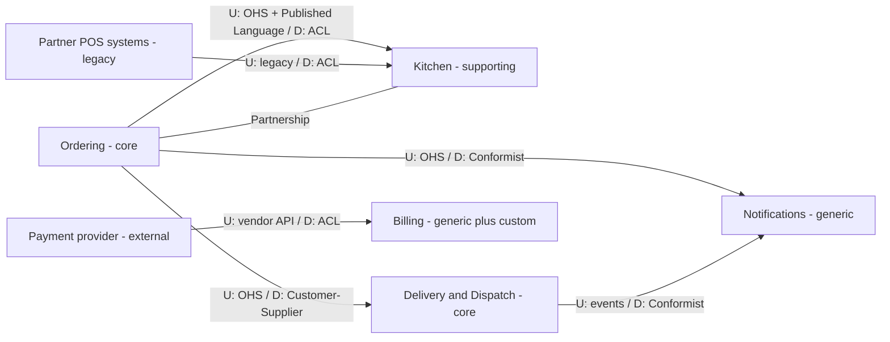
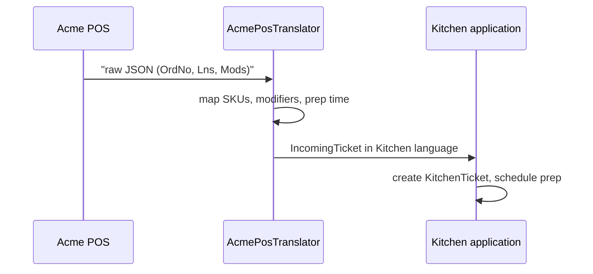

# Bounded Contexts and Context Mapping

## Introduction

As a domain grows, one big model stops working. Martin Fowler describes an electricity utility where the word "meter" meant three different things to three departments: the connection between the grid and a location, the connection between the grid and a customer, and the physical device on the wall ([Bounded Context](https://martinfowler.com/bliki/BoundedContext.html)). People cope with that in conversation. Software can't: a `Meter` class that tries to serve all three ends up with dozens of optional fields and rules that contradict each other.

A **bounded context** is an explicit boundary inside which one model, and one [ubiquitous language](./1-arch-ubiquitous-language.mdx), is consistent. Inside the boundary every term has exactly one meaning. Outside it, the same word may mean something else, and that's fine, as long as the translation between contexts is explicit.

A **context map** is the picture of all your bounded contexts and the relationships between them: who depends on whom, who translates, and who just accepts what they're given.

An analogy: countries. Inside a country, laws, currency and language are consistent. At the border you change money and show a passport. Nobody tries to make one global currency for every country just because "money" is the same word everywhere. Bounded contexts are the countries, and context mapping describes the border crossings.

## One Word, Several Models

At QuickBite, "order" appears everywhere. But look at what each part of the business actually needs:

| Context | What they call it | What they care about | What they ignore |
| --- | --- | --- | --- |
| Ordering | Order | Lines, prices, fees, discounts, customer, cancellation rules | Cooking steps, courier route |
| Kitchen | Ticket | Items to cook, modifiers, prep time, ready-for-pickup | Prices, customer payment |
| Delivery | Delivery job | Pickup and drop-off addresses, time windows, courier | Menu items, prices |
| Billing | Charge | Amount, payment method, refunds, restaurant payout | What food was in it |

One shared `Order` class with all of these fields is a classic [Big Ball of Mud](../5-arch-modern-patterns/7-arch-anti-patterns.mdx) in the making. Instead, each context has its own small model:

```python
# contexts.py - each bounded context owns a small model of "the order"
from dataclasses import dataclass, field
from datetime import datetime, timedelta


# --- Ordering context ---------------------------------------------------
@dataclass
class Order:
    order_id: str
    customer_id: str
    restaurant_id: str
    lines: list[tuple[str, int, int]]  # (menu_item_id, qty, unit_price_cents)
    delivery_address: str

    def amount_due_cents(self) -> int:
        return sum(qty * price for _, qty, price in self.lines)


# --- Kitchen context ------------------------------------------------------
@dataclass
class KitchenTicket:
    ticket_id: str           # Kitchen's own identity
    order_ref: str           # reference back to Ordering, by id only
    items: list[str]
    prep_minutes: int
    ready: bool = False

    def mark_ready(self) -> None:
        self.ready = True


# --- Delivery context -----------------------------------------------------
@dataclass
class DeliveryJob:
    job_id: str
    order_ref: str
    pickup_address: str
    dropoff_address: str
    ready_at: datetime
    courier_id: str | None = None
    notes: list[str] = field(default_factory=list)


order = Order("o-42", "c-1", "r-9",
              [("pad-thai", 2, 1150), ("spring-rolls", 1, 600)],
              "12 Elm St")
ticket = KitchenTicket("t-901", order.order_id, ["2x pad-thai", "1x spring-rolls"], prep_minutes=15)
job = DeliveryJob("d-77", order.order_id, "Thai Garden, 5 Main St", order.delivery_address,
                  ready_at=datetime(2026, 10, 11, 18, 0) + timedelta(minutes=ticket.prep_minutes))

print("Ordering:", order.amount_due_cents(), "cents")
print("Kitchen:", ticket.items, f"{ticket.prep_minutes} min")
print("Delivery:", job.pickup_address, "->", job.dropoff_address, "ready", job.ready_at.time())
```

Output:

```text
Ordering: 2900 cents
Kitchen: ['2x pad-thai', '1x spring-rolls'] 15 min
Delivery: Thai Garden, 5 Main St -> 12 Elm St ready 18:15:00
```

The three models share only an **identifier** (`order_ref`). Each can change independently: the Kitchen team can add allergen flags without touching Billing.

In a real codebase each context would be a separate package, module or service, with its own tests and its own owner. In Python that might be `quickbite/ordering/`, `quickbite/kitchen/` and `quickbite/delivery/`, with a rule that none imports another's internals. See [Structuring a Codebase](../7-arch-clean-architecture/6-arch-structuring-a-codebase.mdx).

## Subdomains vs Bounded Contexts

These two terms get mixed up constantly.

- A **subdomain** is part of the **problem space**: an area of the business, such as dispatch, payments or menu management. It exists whether or not you write software.
- A **bounded context** is part of the **solution space**: a boundary you draw around a model in your software.

Ideally they line up one to one, but they don't have to. A legacy system may cover three subdomains in one context. A large core subdomain might be split into two contexts. The [Introduction](./0-arch-ddd-introduction.mdx) covers core, supporting and generic subdomains.

## Finding the Boundaries

There is no algorithm, but these heuristics work well in practice:

1. **The language changes.** When the same word starts meaning something different, or a different group of experts takes over, you are probably crossing a boundary.
2. **Different rules for the same thing.** If Kitchen thinks an order is "done" when it's ready and Ordering thinks it's done when it's delivered, those are different models.
3. **Different rates of change.** Pricing rules change weekly; the delivery address format changes once a year.
4. **Business capabilities.** Ask "what does the business do?" Accept orders, cook food, deliver, collect money, pay restaurants.
5. **Team ownership.** A bounded context should be owned by one team. One team can own several contexts, but a context shared by three teams has no real owner. This connects to [Conway's Law and Team Topologies](../0-arch-fundamentals/9-arch-conways-law.mdx).
6. **Pivotal events.** In an [Event Storming](./7-arch-event-storming.mdx) timeline, events like "Order Placed" or "Food Ready for Pickup" often mark handoffs between contexts.

:::tip Start bigger, split later
Boundaries that are too fine create chatty integration and distributed transactions. It is usually cheaper to start with a few larger contexts and split one when the language inside it clearly diverges than to merge contexts that were cut too small.
:::

## Context Mapping

Once you have contexts, map how they relate. Relationships are as much about **teams** as about code. The terms below come from Evans' book and are summarized in the DDD Crew's [Context Mapping](https://github.com/ddd-crew/context-mapping) resource.

**Upstream** contexts influence **downstream** ones: if Ordering changes its event format, Kitchen is affected, but not the other way round.

| Pattern | What it means | QuickBite example |
| --- | --- | --- |
| **Partnership** | Two teams succeed or fail together and plan jointly | Ordering and Kitchen coordinate releases of a new "scheduled orders" feature |
| **Shared Kernel** | Two contexts share a small, explicitly agreed piece of model or code | A tiny shared `Money` and `Currency` package |
| **Customer/Supplier** | Upstream supplier plans with the downstream customer's needs in mind | Ordering (supplier) adds fields Delivery (customer) asks for |
| **Conformist** | Downstream adopts the upstream model as-is, without translation | Notifications simply uses Ordering's event fields |
| **Anticorruption Layer (ACL)** | Downstream translates the upstream model into its own, to stay clean | Kitchen translates partner POS payloads into `KitchenTicket` |
| **Open Host Service (OHS)** | Upstream offers a well-defined protocol for many consumers | Ordering publishes a documented order-events API |
| **Published Language** | A documented, shared exchange format | Versioned JSON Schema for `OrderPlaced` |
| **Separate Ways** | No integration; each context solves its own problem | Marketing keeps its own customer list from the CRM |
| **Big Ball of Mud** | A messy area with no clear model; contain it | The legacy restaurant admin system |

Here is the QuickBite context map. Labels show the pattern on each side: `U` for upstream, `D` for downstream.



Reading the map tells you a lot: Ordering is a key upstream, so its published events need careful versioning. Kitchen protects itself from partner POS systems with an ACL. Notifications conforms to everyone because it is generic and simple.

## The Anticorruption Layer in Code

QuickBite integrates with restaurant point-of-sale (POS) systems from several vendors. One vendor sends payloads like this:

```json
{
  "OrdNo": "88123",
  "Lns": [
    {"Sku": "PT-01", "Q": "2", "Mods": "NO_PNUT|XTRA_SPICY"},
    {"Sku": "SR-02", "Q": "1", "Mods": ""}
  ],
  "PrepTm": "00:15:00"
}
```

If Kitchen code reads `Lns`, `Q` and `Mods` directly, the vendor's model leaks everywhere. An anticorruption layer translates at the boundary, so the rest of Kitchen only sees its own model.

```python
# kitchen_acl.py - anticorruption layer for one POS vendor
from __future__ import annotations

import json
from dataclasses import dataclass
from typing import Protocol


# Kitchen's own model (the thing we protect)
@dataclass(frozen=True)
class TicketItem:
    name: str
    quantity: int
    allergies: tuple[str, ...]
    notes: tuple[str, ...]


@dataclass(frozen=True)
class IncomingTicket:
    external_ref: str
    items: tuple[TicketItem, ...]
    prep_minutes: int


class PosTranslator(Protocol):
    def to_ticket(self, raw: str) -> IncomingTicket: ...


# Vendor-specific translation lives here and nowhere else
class AcmePosTranslator:
    SKU_NAMES = {"PT-01": "Pad Thai", "SR-02": "Spring Rolls"}
    ALLERGY_CODES = {"NO_PNUT": "peanut"}
    NOTE_CODES = {"XTRA_SPICY": "extra spicy"}

    def to_ticket(self, raw: str) -> IncomingTicket:
        data = json.loads(raw)
        items = tuple(self._item(line) for line in data["Lns"])
        hours, minutes, _ = (int(p) for p in data["PrepTm"].split(":"))
        return IncomingTicket(
            external_ref=f"acme-{data['OrdNo']}",
            items=items,
            prep_minutes=hours * 60 + minutes,
        )

    def _item(self, line: dict) -> TicketItem:
        mods = [m for m in line["Mods"].split("|") if m]
        unknown = [m for m in mods if m not in self.ALLERGY_CODES and m not in self.NOTE_CODES]
        if unknown:
            raise ValueError(f"Unknown modifier codes from Acme POS: {unknown}")
        return TicketItem(
            name=self.SKU_NAMES.get(line["Sku"], f"Unknown item {line['Sku']}"),
            quantity=int(line["Q"]),
            allergies=tuple(self.ALLERGY_CODES[m] for m in mods if m in self.ALLERGY_CODES),
            notes=tuple(self.NOTE_CODES[m] for m in mods if m in self.NOTE_CODES),
        )


def receive_from_pos(translator: PosTranslator, raw: str) -> IncomingTicket:
    """Kitchen application code only depends on the protocol and its own model."""
    return translator.to_ticket(raw)


payload = """{"OrdNo": "88123",
  "Lns": [{"Sku": "PT-01", "Q": "2", "Mods": "NO_PNUT|XTRA_SPICY"},
          {"Sku": "SR-02", "Q": "1", "Mods": ""}],
  "PrepTm": "00:15:00"}"""

ticket = receive_from_pos(AcmePosTranslator(), payload)
print(ticket.external_ref, ticket.prep_minutes, "min")
for item in ticket.items:
    print(f"  {item.quantity}x {item.name} allergies={list(item.allergies)} notes={list(item.notes)}")
```

Output:

```text
acme-88123 15 min
  2x Pad Thai allergies=['peanut'] notes=['extra spicy']
  1x Spring Rolls allergies=[] notes=[]
```

The ACL is an [Adapter](../3-arch-structural-patterns/0-arch-adapter.mdx) (and often a [Facade](../3-arch-structural-patterns/4-arch-facade.mdx)) applied at the context level. Notice that it **fails loudly** on unknown modifier codes: silently dropping a "no peanuts" code would be dangerous.



## Open Host Service and Published Language

On the upstream side, Ordering serves many consumers. Rather than letting each one query its database, Ordering offers an **Open Host Service** with a **Published Language**: a documented, versioned event format.

```json
{
  "$schema": "https://json-schema.org/draft/2020-12/schema",
  "title": "OrderPlaced v1",
  "type": "object",
  "required": ["event_id", "order_id", "restaurant_id", "placed_at", "items"],
  "properties": {
    "event_id": {"type": "string"},
    "order_id": {"type": "string"},
    "restaurant_id": {"type": "string"},
    "placed_at": {"type": "string", "format": "date-time"},
    "items": {
      "type": "array",
      "items": {
        "type": "object",
        "required": ["menu_item_id", "quantity"],
        "properties": {
          "menu_item_id": {"type": "string"},
          "quantity": {"type": "integer", "minimum": 1}
        }
      }
    }
  }
}
```

Note what the published language **leaves out**: prices, discounts and the customer's payment details. Downstream contexts get what they need, not Ordering's internal model. Ways to evolve these contracts are covered in [API Versioning and Evolution](../10-arch-integration-and-apis/6-arch-api-versioning.mdx) and [Schema Evolution](../11-arch-data-architecture/7-arch-data-migrations.mdx).

## Bounded Contexts, Modules and Microservices

A bounded context is a **model boundary**, not a deployment unit.

| Implementation | Good when | Watch out for |
| --- | --- | --- |
| Package or module in a [modular monolith](../6-arch-architectural-styles/3-arch-modular-monolith.mdx) | Most teams; contexts still evolving; one deploy pipeline | Enforce module boundaries with tooling, or they erode |
| Separate service ([microservices](../6-arch-architectural-styles/4-arch-microservices.mdx)) | Contexts need independent scaling, deployment or tech | Network failures, distributed data, [sagas](../9-arch-distributed-systems/5-arch-saga.mdx) |
| Separate system or vendor product | Generic subdomains like payments | Vendor model leaks in without an ACL |

One service can contain several small contexts, and one large context should rarely be split across several services, since that splits a consistent model across a network.

## Real-World Scenario

QuickBite is adding **grocery delivery**. The product team's first idea is to add `is_grocery`, `weight_kg`, `substitution_allowed` and `age_restricted` to the existing `Order`, `MenuItem` and `DeliveryJob` classes.

**What you do:**

1. **Listen to the language.** Grocery experts talk about "substitutions", "picking", "shoppers", "out-of-stock" and "ID checks". Restaurant experts talk about "prep time" and "kitchen tickets". The overlap is smaller than it looks.
2. **Draw a new bounded context, Grocery Fulfillment**, with its own model: `PickList`, `Substitution`, `Shopper`. It replaces Kitchen for grocery orders.
3. **Keep Ordering shared** for checkout, since the customer experience and fee rules are the same. Ordering publishes `OrderPlaced` with a `fulfillment_type`.
4. **Grocery Fulfillment consumes `OrderPlaced` through its own ACL**, and the grocery store inventory APIs through another ACL.
5. **Delivery stays the same context** but becomes a Customer/Supplier relationship with Grocery Fulfillment, adding an "ID check required" capability on request.
6. **Update the context map** and review it with all team leads.

**Why this approach:** the grocery rules (substitutions, weights, age checks) would pollute the restaurant models with conditionals. A separate context lets the grocery team move fast without breaking restaurant flows.

**When to use it / when not to:** split a context when the language and rules clearly diverge, or when a separate team will own it. Don't split when the "new" concept is really a variation with one or two extra rules; a flag or a [Strategy](../4-arch-behavioral-patterns/0-arch-strategy.mdx) inside the existing context is simpler.

**Alternatives and trade-offs:**

| Approach | Pros | Cons | Best for |
| --- | --- | --- | --- |
| New bounded context with ACLs | Clean models; independent team; clear ownership | More integration code; data duplication by design | Clearly different language and rules |
| Extend existing models with flags | Fastest to start | Conditionals everywhere; every team touches the same code | Small variations |
| Shared Kernel for common concepts | Avoids duplicating truly shared pieces | Requires coordination for every change; tends to grow | A few stable concepts like `Money` |
| Conformist to an upstream model | No translation work | Your model is dictated by someone else | Generic or low-value downstream contexts |

## Common Mistakes

- **One context per entity.** "Customer service", "Order service" and "Product service" are usually entity-shaped, not context-shaped, and lead to chatty, tightly coupled pieces. Draw boundaries around business capabilities and language.
- **Sharing a database across contexts.** If Kitchen reads Ordering's tables directly, the boundary exists only on the diagram. See [Database per Service vs Shared Database](../11-arch-data-architecture/0-arch-database-per-service.mdx).
- **A growing Shared Kernel.** Shared kernels should be tiny. If it keeps growing, the contexts may really be one, or you need a published language instead.
- **Skipping the ACL for convenience.** Conforming to a vendor or legacy model feels fast, but its quirks spread through your core code. Protect core contexts.
- **Treating the context map as a one-time diagram.** Teams and relationships change. Revisit the map when teams reorganize or new integrations appear.
- **Ignoring the team dimension.** A context owned by nobody, or by three teams at once, will degrade. Align contexts with teams.

## Summary

- A **bounded context** is a boundary inside which one model and one language are consistent. The same word can mean different things in different contexts.
- **Subdomains** describe the business problem; **bounded contexts** describe your software's model boundaries.
- Find boundaries through language shifts, differing rules, rates of change, business capabilities and team ownership.
- A **context map** shows relationships: Partnership, Shared Kernel, Customer/Supplier, Conformist, Anticorruption Layer, Open Host Service, Published Language, Separate Ways.
- Use an **ACL** to protect important models from upstream or legacy models, and an **OHS with a Published Language** when you serve many consumers.
- Bounded contexts can be modules in a monolith or separate services. The model boundary comes first; the deployment decision comes later.

## Further Learning

**Exercises:**

1. Take a hotel booking domain. Identify at least four bounded contexts and the different meanings of "booking" or "guest" in each.
2. Draw a context map for your current project, marking upstream and downstream for each relationship and naming the pattern. Where would an ACL help?
3. Write a second POS translator, `BetaPosTranslator`, for a vendor that sends XML or a different JSON shape. Confirm `receive_from_pos` works with both without changes.
4. Fill in a [Bounded Context Canvas](https://github.com/ddd-crew/bounded-context-canvas) for QuickBite's Kitchen context.

**Related pages:**

- Previous: [Ubiquitous Language](./1-arch-ubiquitous-language.mdx)
- Next: [Entities and Value Objects](./3-arch-entities-and-value-objects.mdx)
- [Strategic vs Tactical DDD](./8-arch-strategic-vs-tactical-ddd.mdx) for how context mapping fits strategic design
- [Strangler Fig Migration](../9-arch-distributed-systems/11-arch-strangler-fig.mdx), which often uses an ACL to migrate away from a legacy context

**Sources:** Martin Fowler, [Bounded Context](https://martinfowler.com/bliki/BoundedContext.html); DDD Crew, [Context Mapping](https://github.com/ddd-crew/context-mapping) and [Bounded Context Canvas](https://github.com/ddd-crew/bounded-context-canvas); Chris Richardson, [Decompose by subdomain](https://microservices.io/patterns/decomposition/decompose-by-subdomain.html).
