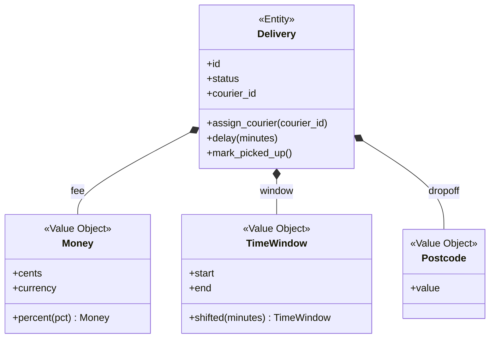

# Entities and Value Objects

## Introduction

Hand a friend a $10 bill and ask for it back. If they return a different $10 bill, you don't care: it's the same **value**. Now lend your car to a friend. If they return a different car of the same make, model and color, you care a lot: you wanted **your** car, the one with that VIN and that dent in the bumper.

That is the whole distinction behind two of DDD's most used building blocks:

- An **entity** is defined by its **identity**. It has a lifecycle, and it stays the same thing even when its attributes change. A courier who changes their phone number is still the same courier.
- A **value object** is defined only by its **attributes**. It has no identity, it is **immutable**, and two value objects with the same attributes are interchangeable. `Money(1250, "USD")` is the same as any other `Money(1250, "USD")`.

Getting this right has practical effects. Value objects remove whole categories of bugs (negative prices, mixed currencies, invalid time ranges, aliasing). Entities give you a clear place for lifecycle rules. And when most of your model is value objects, the code is easier to test and reason about.

This page uses the QuickBite food delivery example from the [DDD Introduction](./0-arch-ddd-introduction.mdx).

## The Problem: Primitive Obsession

Before value objects, domain concepts are usually raw strings, ints and dicts. This is known as **primitive obsession**.

```python
# before.py - primitives everywhere
from dataclasses import dataclass


@dataclass
class Delivery:
    id: str
    fee: int                 # cents? dollars? which currency?
    window: list[int]        # [start_minute, end_minute] since midnight
    dropoff_postcode: str


def schedule(delivery: Delivery, standard_window: list[int]) -> None:
    delivery.window = standard_window          # shares the same list object!


standard = [18 * 60, 18 * 60 + 30]
a = Delivery("d-1", 399, [], "94107")
b = Delivery("d-2", 399, [], "94107")
schedule(a, standard)
schedule(b, standard)

# Delay only delivery a by 15 minutes
a.window[0] += 15
a.window[1] += 15
print("a:", a.window, "b:", b.window)

bad = Delivery("d-3", -50, [1200, 900], "not-a-postcode")
print("Accepted without complaint:", bad)
```

Output:

```text
a: [1095, 1125] b: [1095, 1125]
Accepted without complaint: Delivery(id='d-3', fee=-50, window=[1200, 900], dropoff_postcode='not-a-postcode')
```

Two bugs in a dozen lines:

1. **Aliasing**: delaying delivery `a` also delayed `b`, because both point to the same mutable list. Fowler describes the same problem with shared dates in [Value Object](https://martinfowler.com/bliki/ValueObject.html).
2. **No validation**: a negative fee and a window that ends before it starts are accepted silently.

## Value Objects

A good value object has these properties:

| Property | Meaning |
| --- | --- |
| **Immutable** | Never changes after creation. "Changing" it means creating a new one. |
| **Equality by value** | Two instances with the same attributes are equal. |
| **Self-validating** | It is impossible to create an invalid one. |
| **Side-effect-free behavior** | Methods return new values instead of mutating. |
| **Conceptual whole** | Groups attributes that belong together (amount and currency). |

Python's frozen dataclasses give you immutability and value equality for free:

```python
# values.py - value objects for QuickBite
from __future__ import annotations

import re
from dataclasses import dataclass
from datetime import time, timedelta, datetime, date


@dataclass(frozen=True, slots=True)
class Money:
    cents: int
    currency: str

    def __post_init__(self) -> None:
        if self.cents < 0:
            raise ValueError(f"Money cannot be negative: {self.cents}")
        if not re.fullmatch(r"[A-Z]{3}", self.currency):
            raise ValueError(f"Invalid currency code: {self.currency}")

    def __add__(self, other: Money) -> Money:
        self._same_currency(other)
        return Money(self.cents + other.cents, self.currency)

    def percent(self, pct: int) -> Money:
        return Money(self.cents * pct // 100, self.currency)

    def _same_currency(self, other: Money) -> None:
        if other.currency != self.currency:
            raise ValueError(f"Cannot combine {self.currency} and {other.currency}")

    def __str__(self) -> str:
        return f"{self.cents / 100:.2f} {self.currency}"


@dataclass(frozen=True, slots=True)
class TimeWindow:
    start: time
    end: time

    def __post_init__(self) -> None:
        if self.end <= self.start:
            raise ValueError(f"Window must end after it starts: {self.start}-{self.end}")

    def shifted(self, minutes: int) -> TimeWindow:
        """Return a new window; the original never changes."""
        day = date(2000, 1, 1)
        delta = timedelta(minutes=minutes)
        return TimeWindow(
            (datetime.combine(day, self.start) + delta).time(),
            (datetime.combine(day, self.end) + delta).time(),
        )

    def __str__(self) -> str:
        return f"{self.start:%H:%M}-{self.end:%H:%M}"


@dataclass(frozen=True, slots=True)
class Postcode:
    value: str

    def __post_init__(self) -> None:
        if not re.fullmatch(r"\d{5}", self.value):
            raise ValueError(f"Invalid US ZIP code: {self.value}")


if __name__ == "__main__":
    fee = Money(399, "USD")
    print("Equal by value:", fee == Money(399, "USD"))
    print("Fee plus tip:", fee + fee.percent(50))

    standard = TimeWindow(time(18, 0), time(18, 30))
    delayed = standard.shifted(15)
    print("standard:", standard, "delayed:", delayed)

    for attempt in (lambda: Money(-50, "USD"),
                    lambda: TimeWindow(time(20, 0), time(15, 0)),
                    lambda: Money(100, "USD") + Money(100, "EUR")):
        try:
            attempt()
        except ValueError as err:
            print("Rejected:", err)
```

Output:

```text
Equal by value: True
Fee plus tip: 5.98 USD
standard: 18:00-18:30 delayed: 18:15-18:45
Rejected: Money cannot be negative: -50
Rejected: Window must end after it starts: 20:00:00-15:00:00
Rejected: Cannot combine USD and EUR
```

The aliasing bug is now impossible: `shifted` returns a new window, and `standard` is untouched. Invalid values can't even be constructed, so the rest of the code never needs to re-check them.

:::tip Use integer minor units for money
Store money as integer cents (or Python's `decimal.Decimal` with explicit rounding rules), never as `float`. Floating-point arithmetic cannot represent many decimal amounts exactly.
:::

### Typed identifiers are value objects too

A plain `str` for every ID lets you pass a courier ID where an order ID is expected. A tiny value object, or `typing.NewType` for a zero-cost hint, fixes that:

```python
# ids.py - typed identifiers
from dataclasses import dataclass
from typing import NewType
import uuid

CourierId = NewType("CourierId", str)   # type-checker only, no runtime cost


@dataclass(frozen=True, slots=True)
class OrderId:                           # runtime-checked value object
    value: str

    @staticmethod
    def new() -> "OrderId":
        return OrderId(f"ord_{uuid.uuid4().hex[:12]}")

    def __post_init__(self) -> None:
        if not self.value.startswith("ord_"):
            raise ValueError(f"Not an order id: {self.value}")


def assign(order_id: OrderId, courier_id: CourierId) -> str:
    return f"{courier_id} assigned to {order_id.value}"


print(assign(OrderId("ord_abc123"), CourierId("cour_77")))
try:
    OrderId("cour_77")
except ValueError as err:
    print("Rejected:", err)
```

Output:

```text
cour_77 assigned to ord_abc123
Rejected: Not an order id: cour_77
```

`NewType` is checked only by tools like mypy or pyright; at runtime `CourierId("x")` is just a string. The `OrderId` dataclass is checked at runtime too. Pick based on how costly a mix-up would be.

## Entities

An entity has an identity that stays stable while its attributes change. Equality must be based on that identity, not on attributes.

Python dataclasses compare **all fields** by default, which is wrong for entities. Use `eq=False` and define equality on the ID:

```python
# entities.py - an entity with identity-based equality
from __future__ import annotations

from dataclasses import dataclass, field
from enum import Enum

from values import Money, TimeWindow, Postcode


class DeliveryStatus(Enum):
    SCHEDULED = "scheduled"
    PICKED_UP = "picked_up"
    DELIVERED = "delivered"


@dataclass(eq=False)
class Delivery:
    id: str
    fee: Money
    window: TimeWindow
    dropoff: Postcode
    status: DeliveryStatus = DeliveryStatus.SCHEDULED
    courier_id: str | None = None
    log: list[str] = field(default_factory=list)

    def __eq__(self, other: object) -> bool:
        return isinstance(other, Delivery) and other.id == self.id

    def __hash__(self) -> int:
        return hash(self.id)

    # Behavior: lifecycle rules live on the entity
    def assign_courier(self, courier_id: str) -> None:
        if self.status is not DeliveryStatus.SCHEDULED:
            raise ValueError(f"Cannot reassign a {self.status.value} delivery")
        self.courier_id = courier_id
        self.log.append(f"assigned {courier_id}")

    def delay(self, minutes: int) -> None:
        if self.status is DeliveryStatus.DELIVERED:
            raise ValueError("Cannot delay a delivered order")
        self.window = self.window.shifted(minutes)   # replace the value, don't mutate it
        self.log.append(f"delayed {minutes} min")

    def mark_picked_up(self) -> None:
        if self.courier_id is None:
            raise ValueError("No courier assigned")
        self.status = DeliveryStatus.PICKED_UP


if __name__ == "__main__":
    from datetime import time

    standard = TimeWindow(time(18, 0), time(18, 30))
    a = Delivery("d-1", Money(399, "USD"), standard, Postcode("94107"))
    b = Delivery("d-2", Money(399, "USD"), standard, Postcode("94107"))

    a.delay(15)
    print("a:", a.window, "b:", b.window)

    a.assign_courier("cour_77")
    a.mark_picked_up()
    print("a status:", a.status.value, a.log)

    same_identity = Delivery("d-1", Money(0, "USD"), standard, Postcode("10001"))
    print("Same entity despite different attributes:", a == same_identity)
```

Output:

```text
a: 18:15-18:45 b: 18:00-18:30
a status: picked_up ['delayed 15 min', 'assigned cour_77']
Same entity despite different attributes: True
```

Two things to notice:

- `delay` **replaces** the window value object with a new one. Entities change by swapping value objects, never by mutating them.
- Status changes go through methods that check the lifecycle. There is no public "set status" path.



## The Same Ideas in Java

Java records (standard since Java 16) are a natural fit for value objects: they are final, their fields are final, and `equals` and `hashCode` compare components. Validation goes in a compact constructor.

```java
// Money.java - a value object as a Java record
public record Money(long cents, String currency) {
    public Money {
        if (cents < 0) throw new IllegalArgumentException("Money cannot be negative");
        if (!currency.matches("[A-Z]{3}")) throw new IllegalArgumentException("Bad currency");
    }

    public Money plus(Money other) {
        if (!other.currency.equals(currency)) throw new IllegalArgumentException("Currency mismatch");
        return new Money(cents + other.cents, currency);
    }

    public static void main(String[] args) {
        Money fee = new Money(399, "USD");
        System.out.println(fee.equals(new Money(399, "USD")));
        System.out.println(fee.plus(new Money(100, "USD")));
    }
}
```

Output:

```text
true
Money[cents=499, currency=USD]
```

Entities in Java are ordinary classes whose `equals` and `hashCode` use only the ID. Records are usually a poor fit for entities, because entities change state and records compare all fields.

## Entity or Value Object? It Depends on the Context

The same real-world thing can be either, depending on the [bounded context](./2-arch-bounded-contexts.mdx):

| Concept | In this context | It is a | Because |
| --- | --- | --- | --- |
| Address | Ordering (dropoff for one order) | Value object | Only the values matter; a new address replaces the old |
| Address | Customer Profile (saved "Home" and "Work") | Entity | The customer edits "Home" over time and it keeps its identity |
| Menu item price | Ordering (price at time of order) | Value object | A snapshot that must never change |
| Menu item | Menu Management | Entity | It has a lifecycle: created, repriced, hidden, retired |
| Courier location | Dispatch | Value object | A new reading replaces the old one |

Ask: **"If two of these have the same attributes, are they the same thing?"** If yes, it's a value object. If you need to track *this particular one* over time, it's an entity.

:::note Prefer value objects
Evans and most practitioners recommend making as much of the model as possible out of value objects. They are easy to test, safe to share, and cannot get into invalid states. Make something an entity only when you truly need to track its identity over time.
:::

## Persisting Value Objects

Value objects don't usually get their own table with an ID column. Common options:

- **Embedded columns**: `fee_cents`, `fee_currency` on the `deliveries` table. JPA calls these `@Embeddable`; SQLAlchemy has composite column types.
- **A JSON column** for small structures that are not queried often.
- **A child table without its own identity**, deleted and re-inserted when the owner changes, for collections of values.

Keep mapping code in the persistence layer so the domain classes stay free of ORM concerns, as described in [Hexagonal Architecture](../7-arch-clean-architecture/0-arch-hexagonal.mdx) and the [Repository Pattern](../5-arch-modern-patterns/1-arch-repository-pattern.mdx).

## Real-World Scenario

QuickBite expands into Canada. Within a week, support finds orders where Canadian delivery fees were added to US-dollar food totals, and promo discounts that pushed totals below zero. Fees are `int` columns and prices are `float` in a few places.

**What you do:**

1. **Introduce `Money` as a value object** with currency, non-negative validation and integer minor units. Arithmetic across currencies raises an error.
2. **Introduce `Postcode` and `Address` value objects** with per-country validation, so a Canadian postal code like "M5V 2T6" is valid in Canada and rejected as a US ZIP.
3. **Refactor entities** (`Order`, `Delivery`) to hold value objects instead of primitives, starting at the edges: parse raw input into value objects in the API layer, and let the domain only see valid values.
4. **Persist as embedded columns** (`fee_cents`, `fee_currency`) with a migration that backfills the currency from the market.
5. **Add property-style tests** for `Money`: adding and subtracting never produces negative values or mixes currencies.

**Why this approach:** the bugs come from values that are valid as primitives but invalid in the domain. Value objects move that validation into one place and make invalid states unrepresentable.

**When to use it / when not to:** value objects are worth it for any concept with rules: money, quantities, time ranges, addresses, identifiers, email addresses. For a throwaway script or a field with no rules (a free-text note), a primitive is fine.

**Alternatives and trade-offs:**

| Approach | Pros | Cons | Best for |
| --- | --- | --- | --- |
| Value objects (frozen dataclasses, records) | Validation in one place; no aliasing; expressive | More types; mapping code for persistence and JSON | Concepts with rules |
| Primitives plus validation functions | Little code; easy serialization | Easy to forget to call; validation duplicated | Simple apps, prototypes |
| `NewType` or type aliases | Zero runtime cost; catches mix-ups in type checks | No runtime validation | IDs and units in typed codebases |
| Validation library models (for example Pydantic) at the edges | Great for parsing external input | Mixing I/O validation and domain rules can blur layers | API boundaries |

## Common Mistakes

- **Mutable value objects.** A value object with setters brings back aliasing bugs. Use `frozen=True`, records, or `readonly` properties.
- **Entities with attribute-based equality.** A default `@dataclass` compares all fields, so two snapshots of the same order look different, and two different orders with the same data look equal. Set `eq=False` and compare by ID.
- **Giving every value object an ID "for the database".** That turns values into entities and loses their simplicity. Use embedded columns.
- **Anemic value objects.** If `Money` only holds fields while addition and currency checks live in services, you lose most of the benefit. Put the behavior on the value.
- **Floats for money.** Use integer minor units or `Decimal`.
- **Over-wrapping.** Not every string needs a class. Wrap concepts that have rules or are easy to confuse.

## Summary

- **Entities** have identity and a lifecycle; compare them by ID and change them only through behavior methods.
- **Value objects** are immutable, compared by value, self-validating and side-effect-free; most of a good model is value objects.
- Value objects cure **primitive obsession** and aliasing bugs, and make invalid states unrepresentable.
- In Python, use `@dataclass(frozen=True, slots=True)` for values and `@dataclass(eq=False)` plus ID-based `__eq__` and `__hash__` for entities. In Java, records suit value objects.
- Whether something is an entity or a value object depends on the **bounded context**.

## Further Learning

**Exercises:**

1. Write an `EmailAddress` value object that normalizes case and rejects strings without an `@`. Show that `EmailAddress("A@x.com") == EmailAddress("a@x.com")`.
2. Add `Money.__sub__` that raises a domain-specific `InsufficientFunds` error instead of producing a negative amount.
3. Write a `Quantity` value object for grocery items that supports both units ("3 apples") and weight ("0.5 kg"), and refuses to add units to weights.
4. Find an entity in a codebase you know that uses attribute-based equality. What bugs could that cause in a set or dictionary?

**Related pages:**

- Previous: [Bounded Contexts and Context Mapping](./2-arch-bounded-contexts.mdx)
- Next: [Aggregates and Consistency Boundaries](./4-arch-aggregates.mdx), which groups entities and values into consistent units
- [Null Object and Optional](../5-arch-modern-patterns/4-arch-null-object.mdx) and [Functional Patterns](../5-arch-modern-patterns/5-arch-functional-patterns.mdx) for more on immutability

**Sources:** Martin Fowler, [Value Object](https://martinfowler.com/bliki/ValueObject.html); Eric Evans, [DDD Reference](https://www.domainlanguage.com/ddd/reference/); Python docs, [dataclasses](https://docs.python.org/3/library/dataclasses.html); Java Language Specification, [Record Classes](https://docs.oracle.com/javase/specs/jls/se21/html/jls-8.html#jls-8.10).
