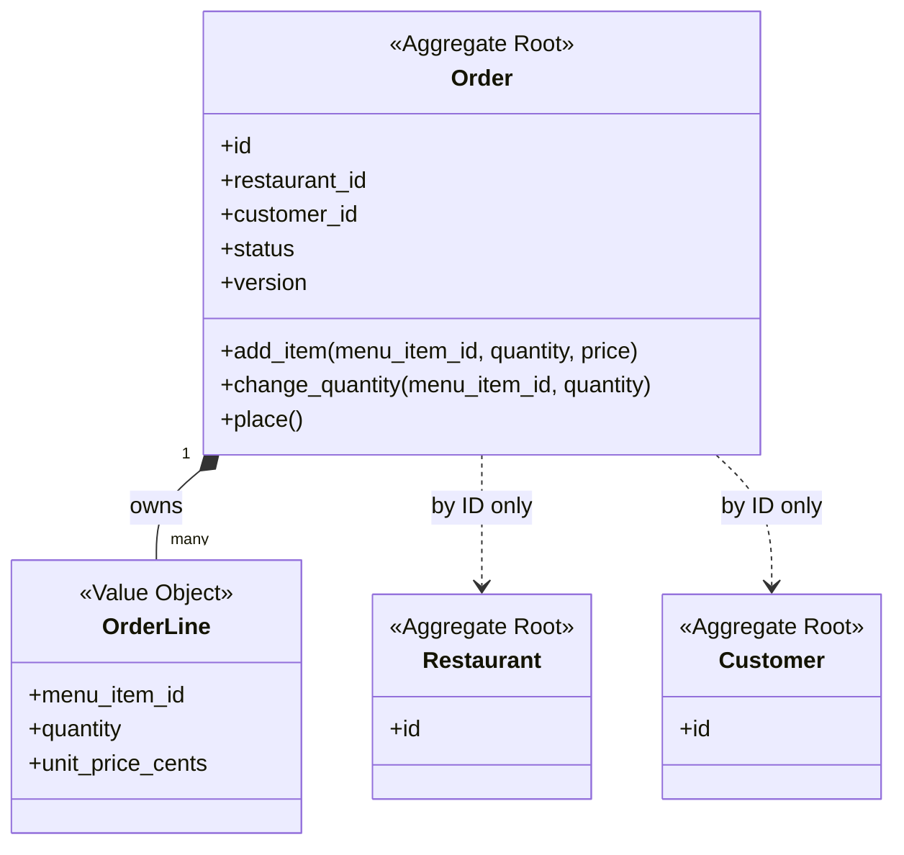
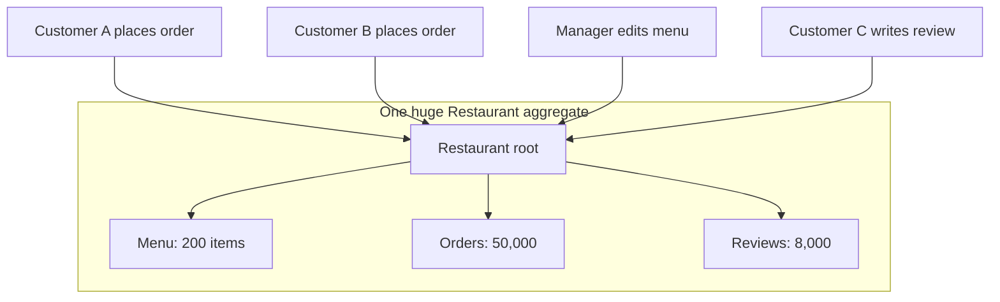
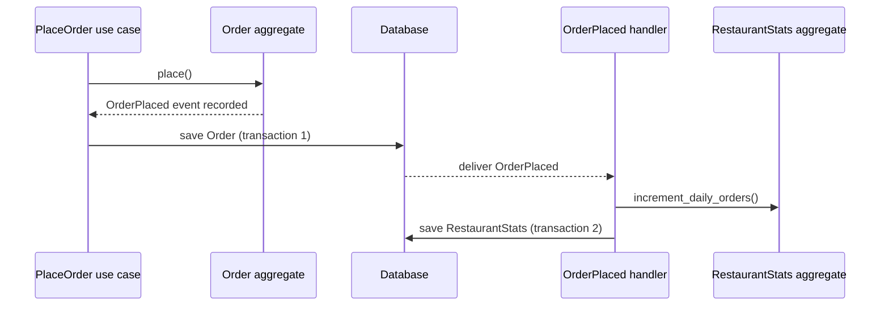

# Aggregates and Consistency Boundaries

## Introduction

Some business rules must **always** be true, no matter how many people are clicking at once:

- An order can't exceed 50 items.
- A placed order can't have its lines changed.
- A courier can't carry more than two active deliveries.

These are **invariants**. The question is: what is the smallest group of objects you must load, check and save together so that an invariant can never be broken?

That group is an **aggregate**. Martin Fowler defines it as a cluster of domain objects that can be treated as a single unit, such as an order and its line items ([DDD Aggregate](https://martinfowler.com/bliki/DDD_Aggregate.html)). One entity in the cluster is the **aggregate root**. Outside code may only hold references to the root and must go through it to make changes. The root checks the invariants on every change.

An analogy: a bank vault with one door and one guard. You can't climb in through the ventilation and rearrange the safety deposit boxes. Everything goes through the guard, who checks the rules. Aggregates are vaults, roots are guards, and the walls are your **consistency boundary**.

The rules of thumb that fall out of this:

- **One aggregate is loaded and saved as a unit**, usually through one [repository](../5-arch-modern-patterns/1-arch-repository-pattern.mdx).
- **One transaction should change one aggregate.** Rules that span aggregates are made consistent eventually, often with [domain events](./5-arch-domain-events.mdx).

## The Problem: Invariants Without a Guard

Here is QuickBite's ordering code before aggregates. Line items are their own objects, saved by anyone who wants to:

```python
# before.py - nothing guards the order's invariants
from dataclasses import dataclass, field

MAX_ITEMS = 50


@dataclass
class OrderLine:
    order_id: str
    menu_item_id: str
    quantity: int


@dataclass
class Order:
    id: str
    status: str = "draft"
    lines: list[OrderLine] = field(default_factory=list)


order = Order("o-1")
order.lines.append(OrderLine("o-1", "pizza", 30))
order.status = "placed"

# A "bulk edit" admin script, written months later, edits a line directly
line = order.lines[0]
line.quantity = 80                                  # exceeds MAX_ITEMS
order.lines.append(OrderLine("o-1", "soda", -3))    # negative quantity, after placing

print(order.status, [(l.menu_item_id, l.quantity) for l in order.lines])
```

Output:

```text
placed [('pizza', 80), ('soda', -3)]
```

The max-items rule and "no changes after placing" rule exist somewhere, maybe in the checkout API handler. But any code that reaches the lines directly can bypass them.

## The Order Aggregate

Now `Order` is the aggregate root. Lines are internal; the root exposes behavior, and every method re-checks the invariants.

```python
# order_aggregate.py - Order as an aggregate root
from __future__ import annotations

from dataclasses import dataclass, field
from enum import Enum

MAX_ITEMS = 50


class OrderStatus(Enum):
    DRAFT = "draft"
    PLACED = "placed"


class OrderInvariantViolated(Exception):
    pass


@dataclass(frozen=True)
class OrderLine:              # value object inside the aggregate
    menu_item_id: str
    quantity: int
    unit_price_cents: int

    def __post_init__(self) -> None:
        if self.quantity < 1:
            raise OrderInvariantViolated("Quantity must be at least 1")


@dataclass(eq=False)
class Order:
    id: str
    restaurant_id: str                  # another aggregate, referenced by ID only
    customer_id: str                    # another aggregate, referenced by ID only
    _lines: dict[str, OrderLine] = field(default_factory=dict)
    status: OrderStatus = OrderStatus.DRAFT
    version: int = 0                    # for optimistic concurrency

    # --- queries -------------------------------------------------------------
    @property
    def lines(self) -> tuple[OrderLine, ...]:
        return tuple(self._lines.values())          # read-only view

    def item_count(self) -> int:
        return sum(l.quantity for l in self._lines.values())

    def total_cents(self) -> int:
        return sum(l.quantity * l.unit_price_cents for l in self._lines.values())

    # --- commands: every change goes through the root -------------------------
    def add_item(self, menu_item_id: str, quantity: int, unit_price_cents: int) -> None:
        self._require_draft()
        existing = self._lines.get(menu_item_id)
        new_qty = quantity + (existing.quantity if existing else 0)
        self._check_max_items(self.item_count() - (existing.quantity if existing else 0) + new_qty)
        self._lines[menu_item_id] = OrderLine(menu_item_id, new_qty, unit_price_cents)

    def change_quantity(self, menu_item_id: str, quantity: int) -> None:
        self._require_draft()
        line = self._lines[menu_item_id]
        self._check_max_items(self.item_count() - line.quantity + quantity)
        self._lines[menu_item_id] = OrderLine(menu_item_id, quantity, line.unit_price_cents)

    def place(self) -> None:
        self._require_draft()
        if not self._lines:
            raise OrderInvariantViolated("Cannot place an empty order")
        self.status = OrderStatus.PLACED

    # --- invariant checks ----------------------------------------------------
    def _require_draft(self) -> None:
        if self.status is not OrderStatus.DRAFT:
            raise OrderInvariantViolated(f"Order {self.id} is {self.status.value}")

    def _check_max_items(self, count: int) -> None:
        if count > MAX_ITEMS:
            raise OrderInvariantViolated(f"Max {MAX_ITEMS} items per order, got {count}")


if __name__ == "__main__":
    order = Order("o-1", restaurant_id="r-9", customer_id="c-1")
    order.add_item("pizza", 30, 1400)
    order.add_item("soda", 2, 250)
    print("items:", order.item_count(), "total:", order.total_cents())

    for attempt in (lambda: order.change_quantity("pizza", 80),
                    lambda: order.add_item("soda", -3, 250)):
        try:
            attempt()
        except OrderInvariantViolated as err:
            print("Rejected:", err)

    order.place()
    try:
        order.add_item("cake", 1, 600)
    except OrderInvariantViolated as err:
        print("Rejected:", err)
```

Output:

```text
items: 32 total: 42500
Rejected: Max 50 items per order, got 82
Rejected: Quantity must be at least 1
Rejected: Order o-1 is placed
```

Notice:

- `lines` returns a **tuple**, a read-only snapshot. Callers can't append to the real collection.
- `OrderLine` is a value object, so callers can't mutate a line they got from `lines` either.
- `restaurant_id` and `customer_id` are **plain IDs**, not object references. The `Order` aggregate does not load or change restaurants.

Python can't truly enforce privacy (the leading underscore is a convention), so code review and linters matter. In Java or TypeScript, `private` fields and unmodifiable collections give stronger guarantees.



## Four Rules for Designing Aggregates

Vaughn Vernon's essay series [Effective Aggregate Design](https://www.dddcommunity.org/library/vernon_2011/) and his book *Implementing Domain-Driven Design* distill aggregate design into four widely used rules:

| Rule | What it means | Why |
| --- | --- | --- |
| **1. Model true invariants in consistency boundaries** | Put objects in one aggregate only if a business rule requires them to be consistent at the end of every transaction | Boundaries come from rules, not from how objects relate in the real world |
| **2. Design small aggregates** | Prefer a root plus a few value objects; avoid huge object graphs | Large aggregates are slow to load and cause concurrency conflicts |
| **3. Reference other aggregates by identity** | Hold `restaurant_id`, not a `Restaurant` object | Keeps boundaries clear and loading cheap; prevents accidental multi-aggregate changes |
| **4. Use eventual consistency outside the boundary** | Rules spanning aggregates are satisfied later, via events or processes | Keeps transactions small; scales better |

The key move in rule 1 is to ask domain experts: **"Does this really have to be consistent immediately, or is a few seconds later OK?"** The answer is "later is fine" far more often than developers expect.

### Why big aggregates hurt

Imagine modeling `Restaurant` as an aggregate that contains its menu, all its orders and its reviews, "because they belong to the restaurant".



Every order placement, menu edit and review would load and lock the same aggregate. With optimistic concurrency, most of those saves conflict and retry. With pessimistic locks, they queue. Splitting into `Restaurant`, `Menu`, `Order` and `Review` aggregates, linked by IDs, removes the contention because no invariant actually ties a review to an order.

## Saving Aggregates Safely: Optimistic Concurrency

Invariants are only safe if two concurrent changes can't both succeed against stale data. The common approach is a **version number** on the aggregate: the save succeeds only if the version in storage is still the one you loaded. The book *Architecture Patterns with Python* ([cosmicpython.com](https://www.cosmicpython.com/book/chapter_07_aggregate.html)) uses this approach for its `Product` aggregate.

```python
# repository.py - one repository per aggregate, with optimistic concurrency
from __future__ import annotations

import copy

from order_aggregate import Order, OrderInvariantViolated


class ConcurrencyConflict(Exception):
    pass


class InMemoryOrderRepository:
    def __init__(self) -> None:
        self._rows: dict[str, Order] = {}

    def get(self, order_id: str) -> Order:
        return copy.deepcopy(self._rows[order_id])     # each caller gets its own copy

    def add(self, order: Order) -> None:
        self._rows[order.id] = copy.deepcopy(order)

    def save(self, order: Order) -> None:
        stored = self._rows[order.id]
        if stored.version != order.version:
            raise ConcurrencyConflict(
                f"Order {order.id}: expected v{order.version}, found v{stored.version}")
        order.version += 1
        self._rows[order.id] = copy.deepcopy(order)


repo = InMemoryOrderRepository()
repo.add(Order("o-1", restaurant_id="r-9", customer_id="c-1"))

# Two browser tabs load the same draft order
tab_a = repo.get("o-1")
tab_b = repo.get("o-1")

tab_a.add_item("pizza", 40, 1400)
repo.save(tab_a)
print("Tab A saved, version", repo.get("o-1").version)

tab_b.add_item("wings", 20, 900)          # valid on its own stale copy...
try:
    repo.save(tab_b)                       # ...but together they'd be 60 items
except ConcurrencyConflict as err:
    print("Tab B rejected:", err)

# Retry: reload, re-run the command, and the invariant catches it
fresh = repo.get("o-1")
try:
    fresh.add_item("wings", 20, 900)
except OrderInvariantViolated as err:
    print("Retry rejected:", err)
```

Output:

```text
Tab A saved, version 1
Tab B rejected: Order o-1: expected v0, found v1
Retry rejected: Max 50 items per order, got 60
```

Without the version check, both tabs would have saved, leaving a 60-item order that breaks the invariant. In a relational database the check is usually an `UPDATE ... WHERE id = ? AND version = ?` that must affect exactly one row; many ORMs support this directly (for example JPA's `@Version` or SQLAlchemy's `version_id_col`).

## Rules That Span Aggregates

What about "a customer may have at most three unpaid orders" or "when an order is placed, the restaurant's daily counter goes up"? These involve more than one aggregate. Options, roughly in order of preference:

1. **Ask whether it must be immediate.** Often a check a few seconds later plus a compensating action ("we've put your order on hold") is acceptable to the business.
2. **Use domain events and eventual consistency.** `Order` raises `OrderPlaced`; a handler updates the restaurant's counter in a separate transaction. See [Domain Events](./5-arch-domain-events.mdx).
3. **Redraw the boundary.** If the rule truly must hold at every instant and is central to the business, the objects may belong in one aggregate after all.
4. **Use a domain service that reads other aggregates and changes one.** For example, check the customer's unpaid order count (a read) before placing (a write to one aggregate). Accept that a race is possible, or back it with a database constraint. See [Domain Services](./6-arch-domain-services.mdx).



## Real-World Scenario

QuickBite's dispatch rules say a courier can carry **at most two active deliveries**, and both must be from restaurants within 1 km of each other. During a Friday rush, a bug lets the dispatcher assign three deliveries to one courier, because two dispatcher instances each saw "1 active delivery" and both assigned one.

**What you do:**

1. **Name the invariant** with the Dispatch experts: "a courier's active load never exceeds two deliveries". This must hold at every moment; a courier can't physically carry a third bag.
2. **Pick the boundary.** The invariant is about the courier's load, not about the deliveries themselves. Make **`CourierShift`** an aggregate that holds the IDs of its active deliveries and enforces the limit in `assign(delivery_id, pickup_location)`.
3. **Keep `Delivery` a separate aggregate**, referenced by ID. It has its own lifecycle (picked up, delivered) and its own rules.
4. **Add a version number** to `CourierShift`. If two dispatchers assign at the same time, one save fails, reloads, and the invariant rejects the third assignment.
5. **Update `Delivery` eventually.** `CourierShift` raises `DeliveryAssignedToCourier`; a handler sets `courier_id` on the `Delivery` aggregate in a separate transaction.

**Why this approach:** the invariant lives in one small aggregate, so it can be checked atomically without locking whole tables. Contention is limited to one courier's shift, which rarely sees concurrent writes outside of the dispatcher.

**When to use it / when not to:** use aggregates where business invariants must hold under concurrency. For read-only reporting, simple CRUD screens, or data with no rules, aggregates add ceremony without benefit.

**Alternatives and trade-offs:**

| Approach | Pros | Cons | Best for |
| --- | --- | --- | --- |
| Small aggregate with optimistic concurrency | Precise, scalable, invariant always holds | Requires retry logic; more modeling effort | True invariants with moderate contention |
| One large aggregate | Many rules checked in one place | Slow loads; frequent conflicts; lock contention | Rarely; only small, rarely-edited clusters |
| Database constraints (unique, check, triggers) | Enforced by the database, hard to bypass | Hard to express complex rules; logic hidden from domain code | Simple invariants such as uniqueness |
| Pessimistic locking (`SELECT ... FOR UPDATE`) | No retries needed | Waiting and deadlock risk; holds locks longer | High contention on few records |
| Eventual consistency with compensation | Small transactions; scales well | Temporary inconsistency; compensation logic needed | Rules the business accepts as "eventually true" |

## Common Mistakes

- **Designing aggregates from the data model.** "Orders have lines, restaurants have orders, so restaurants contain orders" produces giant aggregates. Start from invariants.
- **Object references across aggregates.** If `Order` holds a `Restaurant` object, it's tempting to change both in one transaction. Hold IDs instead.
- **Changing several aggregates in one transaction by habit.** Sometimes it's pragmatic (for example within one database and a low-contention path), but make it a deliberate, documented exception.
- **Exposing mutable internals.** Returning the real `list` of lines lets callers bypass the root. Return copies, tuples or read-only views.
- **Skipping concurrency control.** An invariant checked in memory but saved without a version check can still be broken by concurrent requests.
- **Repositories for internal entities.** An `OrderLineRepository` lets code load and save lines without the root. Have one repository per aggregate root.
- **Using aggregates for queries.** Loading 1,000 aggregates to build a report is slow. Use a separate read model or plain SQL for queries; see [CQRS](../9-arch-distributed-systems/3-arch-cqrs.mdx).

## Summary

- An **aggregate** is a cluster of objects treated as one unit for changes, with a single **aggregate root** that enforces invariants.
- Outside code holds references only to the root; the root exposes behavior, not mutable internals.
- Follow Vernon's four rules: model **true invariants**, keep aggregates **small**, **reference by ID**, and use **eventual consistency** across aggregates.
- Load and save an aggregate as a whole through one repository, with **optimistic concurrency** (a version number) to protect invariants under concurrent writes.
- Cross-aggregate rules use domain events, domain services, or a redrawn boundary, depending on how immediate the rule must be.

## Further Learning

**Exercises:**

1. Add a `remove_item` method to the `Order` aggregate, and a rule that an order's total must be at least $5.00 to be placed. Show both invariants rejecting bad changes.
2. Implement the `CourierShift` aggregate from the scenario, with `assign` and `complete` methods and a two-delivery limit. Simulate two dispatchers with the version-checked repository.
3. A library app has `Member`, `Book` and `Loan`. The rule is "a member can have at most five active loans". Sketch two different aggregate designs and argue which is better.
4. Rewrite `InMemoryOrderRepository.save` as SQL: write the `UPDATE` statement with the version check and explain what the application should do when zero rows are updated.

**Related pages:**

- Previous: [Entities and Value Objects](./3-arch-entities-and-value-objects.mdx)
- Next: [Domain Events](./5-arch-domain-events.mdx), the usual way aggregates communicate
- [Unit of Work Pattern](../5-arch-modern-patterns/2-arch-unit-of-work.mdx) and [Repository Pattern](../5-arch-modern-patterns/1-arch-repository-pattern.mdx) for persistence
- [Consistency Models](../9-arch-distributed-systems/2-arch-consistency-models.mdx) for what "eventually consistent" really promises

**Sources:** Martin Fowler, [DDD Aggregate](https://martinfowler.com/bliki/DDD_Aggregate.html); Vaughn Vernon, [Effective Aggregate Design](https://www.dddcommunity.org/library/vernon_2011/); Harry Percival and Bob Gregory, *Architecture Patterns with Python*, [chapter 7: Aggregates and Consistency Boundaries](https://www.cosmicpython.com/book/chapter_07_aggregate.html).
