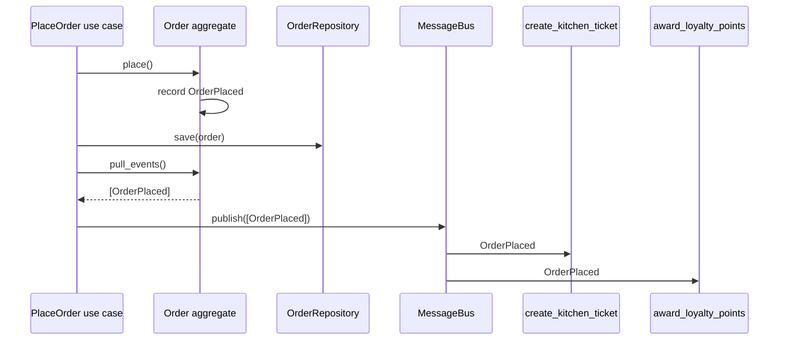

# Domain Events

## Introduction

Listen to domain experts describe their work and you'll hear a lot of past-tense sentences: "when an order **is placed**, the kitchen gets a ticket", "once the food **is ready**, we look for a courier", "if a delivery **was late**, the customer gets a credit". Those are **domain events**: facts about something that happened in the domain that the business cares about.

In DDD, a domain event is an explicit object in the model, such as `OrderPlaced` or `DeliveryCompleted`. Aggregates record events when their state changes, and **handlers** react to them: updating other aggregates, sending notifications, or publishing messages to other bounded contexts.

Think of a newspaper. The reporter writes the story once ("Council approves new bridge") and doesn't need to know who reads it: commuters, construction firms or historians. Each reader decides what to do with the news. Domain events let an aggregate announce what happened without knowing who reacts.

Domain events give you three things:

1. **Explicit side effects.** "When X happens, do Y" becomes a named event and handler, not a line buried in a method.
2. **Loose coupling between aggregates and contexts.** The `Order` aggregate doesn't import the loyalty program.
3. **A natural tool for eventual consistency** between aggregates, as described in [Aggregates](./4-arch-aggregates.mdx).

## The Problem: A Use Case That Knows Everything

Here's QuickBite's order placement before domain events:

```python
# before.py - placing an order calls every interested party directly
class EmailSender:
    def send(self, to: str, msg: str) -> None:
        print(f"email to {to}: {msg}")


class Loyalty:
    def add_points(self, customer_id: str, points: int) -> None:
        print(f"loyalty: +{points} for {customer_id}")


class KitchenClient:
    def create_ticket(self, order_id: str) -> None:
        print(f"kitchen: ticket for {order_id}")


class Analytics:
    def track(self, name: str, props: dict) -> None:
        print(f"analytics: {name} {props}")


def place_order(order_id: str, customer_id: str, total_cents: int,
                email: EmailSender, loyalty: Loyalty, kitchen: KitchenClient,
                analytics: Analytics) -> None:
    # ... validate and save the order ...
    kitchen.create_ticket(order_id)
    email.send(customer_id, f"Order {order_id} confirmed")
    loyalty.add_points(customer_id, total_cents // 100)
    analytics.track("order_placed", {"order_id": order_id})


place_order("o-1", "c-1", 2450, EmailSender(), Loyalty(), KitchenClient(), Analytics())
```

Output:

```text
kitchen: ticket for o-1
email to c-1: Order o-1 confirmed
loyalty: +24 for c-1
analytics: order_placed {'order_id': 'o-1'}
```

Every new reaction ("also notify the restaurant tablet", "also update fraud scores") means editing `place_order`, growing its parameter list and its test setup. If the email server is down, does the order fail? Nobody decided; it just happens to.

## Defining Domain Events

A domain event is a small, **immutable** record named in the **past tense** using the [ubiquitous language](./1-arch-ubiquitous-language.mdx). It carries enough data for handlers to act, plus metadata like an ID and timestamp.

```python
# events.py - domain events as immutable dataclasses
from __future__ import annotations

import uuid
from dataclasses import dataclass, field
from datetime import datetime, timezone


def _now() -> datetime:
    return datetime.now(timezone.utc)


def _new_id() -> str:
    return uuid.uuid4().hex


@dataclass(frozen=True, kw_only=True)
class DomainEvent:
    event_id: str = field(default_factory=_new_id)
    occurred_at: datetime = field(default_factory=_now)


@dataclass(frozen=True, kw_only=True)
class OrderPlaced(DomainEvent):
    order_id: str
    customer_id: str
    restaurant_id: str
    total_cents: int


@dataclass(frozen=True, kw_only=True)
class OrderCancelledByCustomer(DomainEvent):
    order_id: str
    customer_id: str
    reason: str
```

Naming tips:

| Good | Bad | Why |
| --- | --- | --- |
| `OrderPlaced` | `PlaceOrder` | Imperative names are **commands** (requests), not events (facts) |
| `OrderCancelledByCustomer` | `OrderUpdated` | Generic names hide what actually happened |
| `CourierAssigned` | `CourierAssignedEventDTO` | Technical suffixes add noise |
| `PaymentAuthorized` | `PaymentStatusChangedTo2` | Use the business term, not the data change |

## Aggregates Record Events

The aggregate decides when an event happened, because it knows when its state actually changed. A common approach, described by Jimmy Bogard and used in Microsoft's eShop reference app, is to **collect** events on the aggregate and **dispatch them later**, around the time the transaction commits ([Microsoft Learn: Domain events design and implementation](https://learn.microsoft.com/en-us/dotnet/architecture/microservices/microservice-ddd-cqrs-patterns/domain-events-design-implementation)).

```python
# order.py - the aggregate records events instead of calling handlers
from __future__ import annotations

from dataclasses import dataclass, field
from enum import Enum

from events import DomainEvent, OrderPlaced, OrderCancelledByCustomer


class OrderStatus(Enum):
    DRAFT = "draft"
    PLACED = "placed"
    CANCELLED = "cancelled"


@dataclass(eq=False)
class Order:
    id: str
    customer_id: str
    restaurant_id: str
    total_cents: int = 0
    status: OrderStatus = OrderStatus.DRAFT
    _events: list[DomainEvent] = field(default_factory=list)

    def place(self) -> None:
        if self.status is not OrderStatus.DRAFT:
            raise ValueError("Only draft orders can be placed")
        self.status = OrderStatus.PLACED
        self._events.append(OrderPlaced(order_id=self.id, customer_id=self.customer_id,
                                        restaurant_id=self.restaurant_id,
                                        total_cents=self.total_cents))

    def cancel(self, reason: str) -> None:
        if self.status is not OrderStatus.PLACED:
            raise ValueError("Only placed orders can be cancelled")
        self.status = OrderStatus.CANCELLED
        self._events.append(OrderCancelledByCustomer(order_id=self.id,
                                                     customer_id=self.customer_id,
                                                     reason=reason))

    def pull_events(self) -> list[DomainEvent]:
        events, self._events = self._events, []
        return events
```

The aggregate has no idea who listens. It doesn't import email, loyalty or kitchen code, so its tests stay fast and focused.

## Dispatching Events to Handlers

A small in-process **message bus** maps event types to handler functions. This is the [Observer](../4-arch-behavioral-patterns/1-arch-observer.mdx) pattern with events as messages, similar to the bus built in *Architecture Patterns with Python* ([chapter 8](https://www.cosmicpython.com/book/chapter_08_events_and_message_bus.html)).

```python
# bus.py - a minimal in-process domain event dispatcher
from __future__ import annotations

from collections import defaultdict
from collections.abc import Callable

from events import DomainEvent, OrderPlaced, OrderCancelledByCustomer
from order import Order

Handler = Callable[[DomainEvent], None]


class MessageBus:
    def __init__(self) -> None:
        self._handlers: dict[type[DomainEvent], list[Handler]] = defaultdict(list)

    def subscribe(self, event_type: type[DomainEvent], handler: Handler) -> None:
        self._handlers[event_type].append(handler)

    def publish(self, events: list[DomainEvent]) -> None:
        for event in events:
            for handler in self._handlers[type(event)]:
                try:
                    handler(event)
                except Exception as exc:          # one failing handler must not stop others
                    print(f"handler {handler.__name__} failed: {exc}")


# --- Handlers: each one is a separate, small reaction -------------------------
def create_kitchen_ticket(e: OrderPlaced) -> None:
    print(f"kitchen: ticket for {e.order_id} at {e.restaurant_id}")


def award_loyalty_points(e: OrderPlaced) -> None:
    print(f"loyalty: +{e.total_cents // 100} points for {e.customer_id}")


def send_confirmation_email(e: OrderPlaced) -> None:
    raise ConnectionError("SMTP server unavailable")


def release_kitchen_slot(e: OrderCancelledByCustomer) -> None:
    print(f"kitchen: slot released for {e.order_id} ({e.reason})")


bus = MessageBus()
bus.subscribe(OrderPlaced, create_kitchen_ticket)
bus.subscribe(OrderPlaced, award_loyalty_points)
bus.subscribe(OrderPlaced, send_confirmation_email)
bus.subscribe(OrderCancelledByCustomer, release_kitchen_slot)

# --- Application service: do the work, save, then publish ----------------------
order = Order(id="o-1", customer_id="c-1", restaurant_id="r-9", total_cents=2450)
order.place()
# repository.save(order) would go here, in the same unit of work
bus.publish(order.pull_events())

order.cancel(reason="changed my mind")
bus.publish(order.pull_events())
```

Output:

```text
kitchen: ticket for o-1 at r-9
loyalty: +24 points for c-1
handler send_confirmation_email failed: SMTP server unavailable
kitchen: slot released for o-1 (changed my mind)
```

Adding "notify the restaurant tablet" is now one new handler and one `subscribe` call. `Order` and the existing handlers don't change.



:::caution In-process handlers can lose events
In this simple bus, if the process crashes after saving the order but before handlers run, the events are lost. That may be acceptable for analytics, but not for "create the kitchen ticket". The [Transactional Outbox](../9-arch-distributed-systems/6-arch-outbox.mdx) pattern fixes this by saving events in the same database transaction as the aggregate and delivering them afterwards.
:::

## Before or After Commit?

When you dispatch events matters. Microsoft's guidance describes both options and their trade-offs:

| Dispatch timing | What happens | Pros | Cons |
| --- | --- | --- | --- |
| **Before commit, same transaction** | Handlers change other aggregates inside the original transaction | All-or-nothing; simple | Bigger transactions, more locking; breaks "one aggregate per transaction" |
| **After commit, separate transactions** | Each handler runs in its own transaction later | Small transactions; handlers can be async or remote | Eventual consistency; must handle handler failures and retries |
| **After commit, via outbox** | Events stored with the aggregate, relayed reliably | No lost events; works across services | More infrastructure; consumers must be [idempotent](../9-arch-distributed-systems/7-arch-idempotency.mdx) |

A useful default: in-process, same-context side effects that must succeed together may run before commit; anything slow, external or in another bounded context runs after commit via an outbox.

## Domain Events vs Integration Events

Both are "something happened" messages, but they have different audiences and contracts.

| Aspect | Domain event | Integration event |
| --- | --- | --- |
| Audience | Same bounded context | Other bounded contexts or external systems |
| Delivery | Usually in-process | Message broker such as [RabbitMQ](/docs/middleware/rabbitmq) or Kafka |
| Timing | Before or after commit | Only after successful commit |
| Payload | Can use rich domain types | Plain, versioned, documented schema (a [published language](./2-arch-bounded-contexts.mdx)) |
| Change freedom | Refactor freely | Changes must be backward compatible |

A common flow is a domain event handler that **translates** a domain event into an integration event:

```python
# integration.py - translate a domain event into a public integration event
import json
from dataclasses import dataclass
from datetime import datetime, timezone

from events import OrderPlaced


@dataclass(frozen=True)
class OrderPlacedV1:
    """Public contract published to other contexts. Change only compatibly."""
    event_id: str
    order_id: str
    restaurant_id: str
    placed_at: str

    def to_json(self) -> str:
        return json.dumps({"type": "ordering.order_placed.v1", **self.__dict__})


def to_integration_event(e: OrderPlaced) -> OrderPlacedV1:
    # Deliberately leave out total_cents and customer_id: other contexts don't need them
    return OrderPlacedV1(event_id=e.event_id, order_id=e.order_id,
                         restaurant_id=e.restaurant_id,
                         placed_at=e.occurred_at.isoformat(timespec="seconds"))


domain_event = OrderPlaced(event_id="evt-1", occurred_at=datetime(2026, 10, 11, 18, 5, tzinfo=timezone.utc),
                           order_id="o-1", customer_id="c-1", restaurant_id="r-9", total_cents=2450)
print(to_integration_event(domain_event).to_json())
```

Output:

```text
{"type": "ordering.order_placed.v1", "event_id": "evt-1", "order_id": "o-1", "restaurant_id": "r-9", "placed_at": "2026-10-11T18:05:00+00:00"}
```

Keeping the two separate lets you refactor domain events freely while integration events stay stable for other teams.

## Designing Good Events

- **Thin or fat payloads?** A thin event (`OrderPlaced` with just `order_id`) forces consumers to call back for details, coupling them to your API. A fat event carries what consumers need but grows your contract. Most teams include the data that describes *what happened* and leave out unrelated internal state.
- **Include identity and time.** `event_id` lets consumers deduplicate; `occurred_at` helps with ordering and debugging.
- **One event per business fact**, not per field change. `DeliveryRescheduled` is better than `DeliveryWindowStartChanged` plus `DeliveryWindowEndChanged`.
- **Events are facts, so they can't be rejected.** A handler can't "refuse" `OrderPlaced`. If a reaction fails, it needs its own compensation, such as a [saga](../9-arch-distributed-systems/5-arch-saga.mdx).

:::note Domain events are not event sourcing
Using domain events does not mean you must store aggregates as event streams. [Event Sourcing](../9-arch-distributed-systems/4-arch-event-sourcing.mdx) is a separate persistence choice. Most systems that use domain events still store current state in ordinary tables.
:::

## Real-World Scenario

QuickBite wants three new reactions when an order is delivered: award a "fast delivery" bonus to the courier if it arrived early, ask the customer for a rating 30 minutes later, and pay the restaurant at the end of the day. Today the `complete_delivery` endpoint already calls five services directly, and two outages last month were caused by a slow notification service blocking deliveries from completing.

**What you do:**

1. **Introduce `DeliveryCompleted`** as a domain event recorded by the `Delivery` aggregate, carrying `delivery_id`, `order_id`, `courier_id`, `promised_by` and `delivered_at`.
2. **Move existing side effects into handlers**, one per reaction, and register them on the bus.
3. **Store events in an outbox table** in the same transaction as the delivery update, so no event is lost on a crash.
4. **Publish `ordering.delivery_completed.v1`** as an integration event for Billing (restaurant payouts) and Notifications (rating request), each consuming it asynchronously.
5. **Make handlers idempotent** using `event_id`, because the outbox relay delivers at least once.

**Why this approach:** the slow notification service no longer blocks deliveries, and each new reaction is a small addition instead of a change to a critical endpoint.

**When to use it / when not to:** domain events shine when one business fact triggers several independent reactions, or when you need eventual consistency between aggregates or contexts. Skip them when there is exactly one reaction that must happen synchronously and atomically, such as decrementing a counter on the same aggregate. A direct method call is clearer there.

**Alternatives and trade-offs:**

| Approach | Pros | Cons | Best for |
| --- | --- | --- | --- |
| Direct calls in the use case | Simple; easy to follow in a debugger | Use case grows; failures couple together | One or two tightly related steps |
| In-process domain events | Decoupled; explicit side effects; easy to add reactions | Harder to trace flow; lost on crash if not stored | Side effects inside one context |
| Domain events plus outbox plus broker | Reliable; works across services | More infrastructure; eventual consistency; idempotency needed | Cross-context integration |
| Database triggers | Can't be bypassed by app code | Hidden logic; hard to test; tied to the database | Audit logs, legacy systems |

## Common Mistakes

- **Using events as commands.** `SendWelcomeEmail` is a command to one specific handler. Events describe what happened; let handlers decide what to do.
- **Generic "Updated" events.** `OrderUpdated` with the entire order forces every consumer to diff state to find out what happened.
- **Publishing before the transaction commits** to a broker. If the commit then fails, other services act on something that never happened. Use an outbox.
- **Assuming exactly-once delivery.** Brokers and outboxes usually deliver at least once. Handlers must tolerate duplicates.
- **Leaking domain events as public contracts.** Once other teams depend on your internal event, you can't refactor it. Translate to versioned integration events.
- **Too many tiny events.** Not every field change is a domain event. Ask whether a domain expert would care that it happened.

## Summary

- A **domain event** is an immutable, past-tense record of something the business cares about, named in the ubiquitous language.
- Aggregates **record** events when their state changes; an application service **dispatches** them after saving.
- Handlers implement side effects and cross-aggregate rules, keeping aggregates decoupled.
- Choose dispatch timing deliberately: same transaction for tightly related in-process changes, after commit (ideally with an outbox) for everything else.
- Separate internal **domain events** from public, versioned **integration events**.

## Further Learning

**Exercises:**

1. Add a `DeliveryCompleted` event to a `Delivery` aggregate and two handlers: one awards a courier bonus if `delivered_at` is before `promised_by`, the other schedules a rating request.
2. Change `MessageBus.publish` so handlers that raise are retried up to three times, then the event is written to a "dead letter" list.
3. Write a test that proves `Order.place()` records exactly one `OrderPlaced` event with the right fields, without any bus involved.
4. Design the JSON for `ordering.order_cancelled.v1`. Which fields from the domain event would you leave out and why?

**Related pages:**

- Previous: [Aggregates and Consistency Boundaries](./4-arch-aggregates.mdx)
- Next: [Domain Services and Application Services](./6-arch-domain-services.mdx), which dispatch events
- [Event Storming](./7-arch-event-storming.mdx) for discovering events with domain experts
- [Event-Driven Architecture](../6-arch-architectural-styles/5-arch-event-driven.mdx) and [Messaging Patterns](../10-arch-integration-and-apis/5-arch-messaging-patterns.mdx) for events between services

**Sources:** Microsoft Learn, [Domain events: design and implementation](https://learn.microsoft.com/en-us/dotnet/architecture/microservices/microservice-ddd-cqrs-patterns/domain-events-design-implementation); Martin Fowler, [What do you mean by "Event-Driven"?](https://martinfowler.com/articles/201701-event-driven.html); *Architecture Patterns with Python*, [chapter 8: Events and the Message Bus](https://www.cosmicpython.com/book/chapter_08_events_and_message_bus.html); Chris Richardson, [Domain event](https://microservices.io/patterns/data/domain-event.html).
